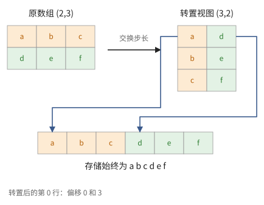
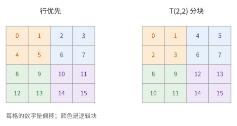
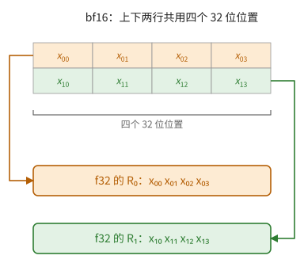
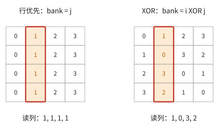
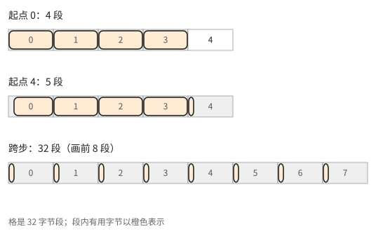
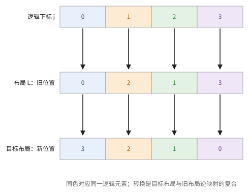

# 第 8 章　布局

数学上，一个数组是从下标集合到数值的函数，$A[i, j]$ 就是"第 $i$ 行第 $j$ 列的那个数"。到了机器上，数组总得放在某个地方：一段线性的存储，或者若干个存储体，或者若干寄存器的若干通道。"下标为 $(i, j)$ 的元素放在哪里"的规则，就叫**布局**。

布局看上去只是记账的方式，却决定了很多性能上的事：一次访问是否连续（第 3 章的突发），会不会撞上存储体冲突（命题 3.11），元素装进寄存器后落在哪个通道（第 4 章的 SIMD），矩阵单元能不能直接使用这个操作数。kernel 语言里许多看似随意的限制，比如"块的最后两维必须是 8 和 128 的倍数"，背后都是布局。这一章先看几种最常见的布局，再看它们怎样影响访存，最后用 $\mathbb{F}_2$ 上的线性代数把它们统一起来（用到的单射、核、维数与陪集见间章 M3）。

## 8.1 布局即函数

先看一个最小的例子。$2 \times 3$ 的数组 $\begin{pmatrix}a&b&c\\d&e&f\end{pmatrix}$ 按行存放，存储里依次是 $a, b, c, d, e, f$。元素 $(i, j)$ 的偏移是 $3i + j$：行号每加 1，偏移加 3；列号每加 1，偏移加 1。这条规则就是一个布局。

> **定义 8.1（布局）** 设数组的形状为 $(n_0, \dots, n_{d-1})$，下标集合 $\mathcal{I} = [n_0] \times \dots \times [n_{d-1}]$。一个**布局**是单射 $L: \mathcal{I} \to \mathcal{P}$，其中 $\mathcal{P}$ 是物理位置的集合：可以是线性存储中的偏移量（以元素计），也可以是（存储体，地址）或（寄存器，子通道，通道）这样的组合。

要求单射，是因为两个不同的元素不能放在同一个位置。$\mathcal{P}$ 可以是各种东西，这一章会陆续遇到。上面的例子属于最常见的一类：

> **定义 8.2（步长布局）** 步长布局是 $L(i) = \sum_r i_r \sigma_r$，$\sigma = (\sigma_0, \dots, \sigma_{d-1})$ 称为**步长**。二维数组 $(n_0, n_1)$ 的**行优先**布局是 $\sigma = (n_1, 1)$，**列优先**布局是 $\sigma = (1, n_0)$。

一组同时访问的下标，若它们的像是一个区间，就称这组访问是**连续的**。行优先布局中一行是连续的，一列不是：读一列时，地址每次跳过一整行。

转置一个步长布局的数组，数学上只需交换步长：$(n_0, n_1)$ 行优先数组的转置，就是同一段存储在步长 $(1, n_1)$ 下读成的 $(n_1, n_0)$ 数组。框架把这种只换映射、不搬数据的数组叫做**视图**。视图很省事，但访问模式跟着变了：原来连续的行，现在成了步长为 $n_1$ 的列。如果后面的计算需要连续访问，就得真的把数据搬一遍（8.8 节）。

> **例 8.3（同一段存储，两种读法）** 沿用开头的 $2 \times 3$ 数组，行优先存储为 $a, b, c, d, e, f$，步长 $(3, 1)$。转置视图的形状是 $(3, 2)$，步长 $(1, 3)$：第 0 行读偏移 0、3，得到 $a, d$；第 1 行读偏移 1、4，得到 $b, e$。六个元素一个都没有动，但"同时读一行"的地址从连续变成了跨步。
>
> 所以看到程序里的转置，要分开问三件事：数学结果是什么；数据有没有真的搬动；下一个运算怎样读它。只看函数名，回答不了后两件。

**图 8.1**　转置视图改变逻辑坐标到偏移的映射；右边按转置后的行连线，底部的六个存储位置保持不变。

## 8.2 分块布局

硬件总以固定形状的块为单位搬运和计算：一个向量寄存器装一个块，矩阵单元一次吃一个固定形状的操作数。可是在行优先布局里，一个二维的小块并不连续：$4 \times 4$ 数组左上角的 $2 \times 2$ 块，偏移是 0、1、4、5，中间隔着两个别人的元素。分块布局的想法是：先把数组切成块，让每块的元素挨在一起存放，块与块再依次排开。

> **定义 8.4（分块布局）** 二维数组 $(R, C)$ 以块 $(t_r, t_c)$ 分块（设 $t_r \mid R$，$t_c \mid C$）：块按行优先排列，块内元素也按行优先排列，
>
> $$
> L(i, j) = \left(\left\lfloor \tfrac{i}{t_r} \right\rfloor \tfrac{C}{t_c} + \left\lfloor \tfrac{j}{t_c} \right\rfloor\right) t_r t_c + (i \bmod t_r)\, t_c + (j \bmod t_c).
> $$
>
> 本书把它记作 $(R, C)$ 上的 $\mathrm{T}(t_r, t_c)$ 布局。

公式看着长，读法很简单：括号里是"这个元素在第几块"，乘上块的大小 $t_r t_c$ 就是前面所有整块占的位置；后两项是"在块内排第几"。

> **命题 8.5** 在 $\mathrm{T}(t_r, t_c)$ 布局中，每个对齐的 $t_r \times t_c$ 子块占据一段连续的存储；在行优先布局中，对齐的 $t_r \times t_c$ 子块连续，当且仅当 $t_r = 1$ 或 $t_c = C$。

*证明* 前者由定义 8.4：块内偏移取遍 $[t_r t_c]$。后者：行优先下子块的第一行末与第二行首相差 $C - t_c + 1$，连续当且仅当 $C = t_c$。∎

分块布局的块形状，通常就取硬件的基本单位：寄存器的形状、一次 DMA 最划算的大小、矩阵单元操作数的形状。这样一个硬件单位的数据在存储里恰好连续，一次就能读出。

**填充。** 若 $R$ 不是 $t_r$ 的倍数，要补到 $\lceil R / t_r \rceil t_r$ 行。填充既占存储，也让计算单元在补的零上空转（命题 5.12）。

**多级分块。** 块内还可以再分块，例如先把数组分成 $(8, 128)$ 的块，每个块内再把相邻两行的元素交织存放（8.4 节）。多级分块就是几个单级分块布局的复合。

> **例 8.6（用十六个数看懂分块）** $4 \times 4$ 数组按 $\mathrm{T}(2, 2)$ 存放。第一个块的元素是 $(0,0), (0,1), (1,0), (1,1)$，偏移为 0、1、2、3；第二个块是 $(0,2), (0,3), (1,2), (1,3)$，偏移 4、5、6、7。元素 $(2, 1)$ 在第 $1 \cdot 2 + 0 = 2$ 块，块内偏移 $0 \cdot 2 + 1 = 1$，总偏移 $2 \cdot 4 + 1 = 9$；行优先下它的偏移碰巧也是 9。元素 $(1, 0)$ 的偏移则从行优先的 4 变成了 2。
>
> 布局改变的是谁挨着谁，不改变数组的值。另外，支持二维步长的 DMA（例 4.17）也能从行优先数组里搬出一个不连续的块；分块布局省掉的是"分成很多小段"的开销，并不是说不分块就搬不了。

**图 8.2**　格内是物理偏移。四种颜色对应四个 2×2 块：行优先下同色元素分散，分块布局下同色元素连续。

## 8.3 寄存器中的布局

数组装进寄存器之后，每个元素落在哪个位置，同样是一个布局，而且它决定了哪些运算便宜、哪些昂贵。

设向量寄存器的形状是 $S \times W$：$S$ 个**子通道**（sublane），每个子通道 $W$ 个**通道**（lane）。可以把这样的寄存器想成一张 $S$ 行 $W$ 列的小表格，一维 SIMD 是 $S = 1$ 的特例。一个 $S \times W$ 的块装入一个寄存器时，自然的映射是 $(i, j) \mapsto$（子通道 $i$，通道 $j$）。

不同的运算对布局的要求不同：

- **逐元素运算**在每个（子通道，通道）位置上独立进行，任何布局都可以，只要所有操作数的布局相同。
- **沿某个轴的归约**：如果这个轴落在不同的寄存器之间（例如把很多个块按位置相加），归约就只是寄存器之间的逐元素运算，很便宜；如果这个轴落在通道上，就需要跨通道交换数据（命题 4.14），又慢又贵。
- **广播**：把一行复制到所有子通道，或把一列复制到所有通道，也都要用跨子通道或跨通道的通路。

> **命题 8.7** 两个布局不同的操作数做逐元素运算，必须先把其中一个变换到另一个的布局。这个变换是一个置换，要经过跨通道单元或存储完成。

所以选择布局的原则是：让归约沿寄存器之间进行，让通道之间的数据交换尽量少，让相邻的运算使用相同的布局。编译器的"布局分配"做的就是这件事；手写 kernel 时，这就是程序员的事。

> **例 8.8（归约轴在哪里）** 两个 $2 \times 4$ 的寄存器 $R_0, R_1$ 存一个 $4 \times 4$ 数组。若每个寄存器存两行，求列和只需先算 $R_0 + R_1$（寄存器之间逐元素相加），再合并两个子通道；求行和却要把四个通道合并起来。若改为每个寄存器存两列，两个方向的难易就互换了。
>
> 可见贵不贵和"行""列"这两个名字无关，只看归约的方向是否横跨硬件的通道。判断之前，先写出映射 $(i, j) \mapsto (\text{寄存器}, \text{子通道}, \text{通道})$。

## 8.4 打包

寄存器的每个位置通常是 32 位。放 16 位、8 位、4 位的元素时，一个位置要塞进 2、4、8 个元素。塞哪几个、按什么次序，就是打包要规定的事。

> **定义 8.9（打包）** **打包**规定哪些逻辑元素共用一个 32 位位置，以及它们在 32 位中的次序。对二维的块，常见两种：
>
> - **沿行打包**：$(2i, j)$ 与 $(2i + 1, j)$ 共用一个位置。于是一个 $S \times W$ 的 32 位寄存器装下 $2S \times W$ 个 bf16。
> - **沿列打包**：$(i, 2j)$ 与 $(i, 2j + 1)$ 共用一个位置，寄存器装下 $S \times 2W$ 个 bf16。

打包的方式影响三件事：

1. **块的形状随类型改变。** 沿行打包时，f32 的块是 $S \times W$，bf16 的块是 $2S \times W$，int8 的块是 $4S \times W$。类型一换，一个寄存器对应的逻辑块也跟着换。
2. **类型转换要拆包或打包。** bf16 转 f32 时，一个打包的寄存器拆成两个 f32 寄存器。拆出来的两个寄存器各含哪些行，取决于打包方式（习题 8.3）；若与下游期望的布局不一致，还要再做一次置换。
3. **矩阵单元有自己期望的打包方式。** 操作数不符合时要先变换。

> **例 8.10（一个位置里装的是哪两个数）** 在沿行打包的 $2 \times 4$ bf16 块中，第 $j$ 个 32 位位置的低半部存 $x_{0j}$、高半部存 $x_{1j}$。转成 f32 后，低半部拆成寄存器 $R_0 = (x_{00}, \dots, x_{03})$，高半部拆成 $R_1 = (x_{10}, \dots, x_{13})$。若下游要的是"相邻两列组成的向量"，拆包之后还得再换一次布局。
>
> 所以把 bf16 转成 f32 时要问两个问题：每个数怎样变宽，变宽之后它落在哪个寄存器。只核对数据类型，第二个问题就漏掉了。

**图 8.3**　以四个 32 位位置为例，沿行打包的 bf16 拆成两个 f32 寄存器；箭头只表示元素归属，不表示具体指令。

## 8.5 存储体冲突与交错

回到命题 3.11：$k$ 个存储体交错存储时，步长为 $s$ 的访问冲突度为 $\gcd(s, k)$。典型的麻烦是：$32 \times 32$ 的 f32 矩阵按行优先存放在 32 个 4 字节宽的存储体中，同时读一列，步长 32，冲突度 32，32 个读请求全挤在一个存储体上排队。有两种解决办法。

第一种是**填充**：每行补一个元素，步长变成 33（习题 3.3）。代价是浪费存储，而且行的起点不再对齐。

第二种是**交错**（swizzle）：不改变行长，而是让每一行的元素"错开"摆放。第 $i$ 行整体做一个依赖于 $i$ 的重排，使同一列的元素在不同的行里落进不同的存储体。最方便的重排是按位异或：

> **命题 8.11（XOR 交错）** 把 $32 \times 32$ 矩阵的元素 $(i, j)$ 存放在第 $i$ 行的第 $j \oplus i$ 个位置（$\oplus$ 为按位异或，$i, j \in [32]$），则同时读一行或同时读一列都没有冲突。

*证明* 位置 $(i, j)$ 的地址是 $32 i + (j \oplus i)$，所在存储体是 $j \oplus i$。读第 $i$ 行：$j \mapsto j \oplus i$ 是 $[32]$ 上的双射，32 个访问落在 32 个不同的存储体。读第 $j$ 列：$i \mapsto j \oplus i$ 也是双射。∎

XOR 交错不浪费存储，也保持了每行的对齐，是共享存储中最常用的布局技巧。交错的单位也可以更大：例如每行 128 字节分成 8 个 16 字节的小段，第 $i$ 行的第 $c$ 段存放在位置 $c \oplus (i \bmod 8)$。

> **例 8.12（四个存储体的 XOR 表）** 把命题 8.11 缩小到 $4 \times 4$ 数组和 4 个存储体。行优先时，存储体号每行都是 $0, 1, 2, 3$；XOR 交错后，四行分别是 $0123$、$1032$、$2301$、$3210$。读第 1 列时，行优先全部落在存储体 1，交错后依次落在 1、0、3、2。
>
> 表中每一行、每一列都是 0–3 的一个排列，这正是两个双射。这里交错的单位是一个 4 字节元素；搬运引擎按 16 字节或 128 字节为单位交错时，要按那个单位重新写映射，不能照搬这张表。

**图 8.4**　格内是存储体号。框出的列在左图挤到同一存储体，在右图分散到四个存储体。

下面的互动图可以改变同时访问的行或列，比较行优先与 XOR 交错的存储体号。每个存储体每轮只服务一个请求，冲突度就是同一存储体上的最大请求数。

## 8.6 $\mathbb{F}_2$ 上的线性布局

前几节的布局各有各的写法：步长、分块公式、异或。当各维长度都是 2 的幂时，它们其实是同一类东西：比特向量之间的线性映射。这个观点的好处是，冲突分析会变成求核的维数（间章 M3 的 M3.4、M3.5 节）。

以 $4 \times 4$ 数组为例，行号 $r = 2r_1 + r_0$，列号 $c = 2c_1 + c_0$。行优先的偏移是 $4r + c$，它的四个比特恰好是 $(r_1, r_0, c_1, c_0)$：只是把下标的比特拼在一起。一般地，把下标 $i \in [2^n]$ 看成比特向量 $\vec{i} \in \mathbb{F}_2^n$，则

- 行优先布局把 $(\vec{i}, \vec{j})$ 映射为地址的比特 $(\vec{i}, \vec{j})$，即拼接；列优先是另一种拼接次序；
- 分块布局是比特的一个置换：块号的比特放在高位，块内偏移的比特放在低位；
- XOR 交错是在某些比特上加上另一些比特（在 $\mathbb{F}_2$ 中加法就是异或）。

它们都是 $\mathbb{F}_2$ 上的线性映射。

> **定义 8.13（线性布局）** 一个**线性布局**是 $\mathbb{F}_2$ 上的线性映射 $L: \mathbb{F}_2^n \to \mathbb{F}_2^m$，即一个 $m \times n$ 的 0/1 矩阵，把逻辑下标的比特映射为物理位置的比特。物理位置的比特可以分组解释：哪些比特是地址，哪些是存储体号，哪些是寄存器号、子通道号、通道号。

线性的第一个好处是，冲突度可以直接从核算出：

> **命题 8.14** 设 $L$ 是线性布局，$\beta = P_{\text{bank}} \circ L$ 是"下标 $\mapsto$ 存储体号"的映射（$P_{\text{bank}}$ 取出存储体号的那几个比特）。一组同时进行的访问，若其下标构成一个陪集 $\vec{a} + U$（$U$ 是 $\mathbb{F}_2^n$ 的子空间），则冲突度为 $2^{\dim(U \cap \ker \beta)}$。特别地，访问无冲突当且仅当 $\beta|_U$ 是单射。

*证明* $\beta$ 在 $\vec{a} + U$ 上的每个像恰有 $\lvert U \cap \ker \beta \rvert = 2^{\dim(U \cap \ker \beta)}$ 个原像（命题 M3.14：线性映射的纤维是核的陪集）。∎

"读一行""读一列"这类访问的下标正好构成陪集：固定一部分比特，让其余比特自由变化。于是判断有没有冲突，就是看存储体映射在这个子空间上有没有非零的核。

> **例 8.15** $32 \times 32$ 的 f32 矩阵，行号的比特 $\vec{r} \in \mathbb{F}_2^5$，列号的比特 $\vec{c} \in \mathbb{F}_2^5$。行优先时存储体号是 $\vec{c}$，即 $\beta(\vec{r}, \vec{c}) = \vec{c}$。读一列时 $U = \{(\vec{r}, 0)\}$，$U \subset \ker \beta$，冲突度 $2^5 = 32$。XOR 交错时 $\beta(\vec{r}, \vec{c}) = \vec{c} + \vec{r}$，在 $U$ 上是单射，冲突度 1；读一行时 $U = \{(0, \vec{c})\}$，也是单射。

线性布局的另一个好处是：布局的复合是矩阵乘法，从布局 $L_1$ 变换到 $L_2$ 所需的数据移动是 $L_2 \circ L_1^{-1}$（$L_1$ 可逆时）。编译器因此可以用同一套线性代数处理各种布局之间的变换。

> **现状（2026-10）**：Triton 编译器从 2025 年起用这种 $\mathbb{F}_2$ 上的"线性布局"统一表示寄存器、共享存储和 MMA 操作数的布局（Zhou 等，ASPLOS 2026）。NVIDIA 的 CuTe 用另一套代数（形状与步长的复合、整除与补）描述同样的对象，GPU 路线会用到。

> **例 8.16（把冲突化成一个两行矩阵）** 回到例 8.12 的四个存储体（例 M3.8、M3.15 用的也是它）。行号写成 $(r_1, r_0)$、列号写成 $(c_1, c_0)$，交错后的存储体比特为 $(r_1 + c_1, r_0 + c_0)$，矩阵是
>
> $$
> \beta = \begin{pmatrix}1&0&1&0\\0&1&0&1\end{pmatrix}.
> $$
>
> 读一列时固定 $c$，可变的子空间由前两个坐标张成；$\beta$ 限制在上面是单位矩阵，核维数 0，冲突度 $2^0 = 1$。行优先时 $\beta = (0 \mid I_2)$，限制在这个子空间上是零矩阵，核维数 2，冲突度 $2^2 = 4$。这正好复现了例 8.12 的表。

## 8.7 访存合并与对齐

DRAM 以突发为单位传输（3.4 节），片上存储的访问也常以若干字节的段为单位。所以一组同时发出的访问花多少代价，不看它要多少字节，而看它碰到多少个不同的段。

> **定义 8.17（合并）** 设访问的最小单位是对齐的 $g$ 字节段。一组同时发出的访问触及的不同段的个数称为它的**段数**；有用的字节数与 $g \times \text{段数}$ 之比称为**效率**。段数取到最小值时，称这组访问是**合并的**。

> **命题 8.18** $W$ 个通道各读一个 $s$ 字节的元素，设 $s \mid g$、各元素地址按 $s$ 对齐（故单个元素不跨段）：
>
> 1. 若元素连续，且起始地址按 $g$ 对齐，段数为 $\lceil Ws / g \rceil$，效率最高；起始地址不对齐时最多多一个段。
> 2. 若元素间步长为 $\sigma$ 个元素，且 $\sigma s \ge g$，每个通道各占一个段，段数为 $W$，效率为 $s / g$。

*证明* (1) $Ws$ 个连续字节至少覆盖 $\lceil Ws/g \rceil$ 个段，对齐时恰好如此。(2) 相邻两个元素相距不少于一个段长，各落在不同的段中。∎

DMA 也一样：拷贝一个子块时，子块的每一行是一段连续字节，行数越多、每行越短，效率越低。所以无论在哪种机器上，"让同时访问的元素在存储中连续"都是第一条布局原则。

> **例 8.19（连续仍要检查起点）** 32 个通道各读一个 f32，段长 $g = 32$ 字节。起点为 0 时，字节区间是 $[0, 128)$，触及段 0–3，效率 100%；起点为 4 时是 $[4, 132)$，触及段 0–4，效率 $128/160 = 80\%$。若每个通道改读第 $32i$ 个元素，相邻地址相距 128 字节，触及 32 个段，效率 $128/1024 = 12.5\%$。
>
> 对齐的损失至多多一个段，跨步的损失却可能让每个通道各占一个段，两者要分开看。这里算的是请求的段数；有缓存时，真正走到 HBM 的流量还要另算。

**图 8.5**　三种访问触及的 32 字节段。橙色是有用字节，空白是随请求带回却未使用的字节。

## 8.8 布局转换的代价

布局不合适时可以转换，但转换不是免费的。需要实际移动元素的转置、重排，在物理上是数据的一个置换。若通过存储完成，至少要把数据读写一遍；在 SIMD 机器上还要经过跨通道的单元，或者借助存储完成（例如按行写入一块 XOR 交错的存储，再按列读出）。

所以布局设计的一条原则是让生产者直接按消费者需要的布局写出：例如把权重事先按矩阵单元需要的方向存好，或者利用矩阵单元读入操作数时顺便转置的能力，而不是在计算过程中显式地转置。

> **例 8.20（什么时候值得搬一次）** 设有 $S$ 字节数据，显式的布局转换要读写各一次，带宽为 $B$，至少要 $2S/B$。原布局使后续每次处理平均搬 $4S$ 字节，转换后每次只搬 $S$；重复 $q$ 次，总时间分别是 $4qS/B$ 和 $(2 + q)S/B$。只计带宽的话，$q \ge 1$ 时转换就可能划算。
>
> 但若后续只有一次很小的运算，转换本身的启动开销可能让它不划算。若生产者能直接按目标布局写出，额外的 $2S/B$ 就整个省掉了。这和命题 6.9 的融合是同一个思想：中间结果不落地，布局转换也不落地。

**图 8.6**　颜色追踪同一逻辑元素；布局转换把旧物理位置换成目标位置。

## 本章小结

1. 布局是从逻辑下标到物理位置的单射；步长布局 $L(i) = \sum_r i_r \sigma_r$，转置只改步长（视图），但改变了访问的连续性。（定义 8.1、8.2）
2. 分块布局 $\mathrm{T}(t_r, t_c)$ 让每个对齐的块连续，块形状通常等于硬件的基本单位；不整除时要填充。（定义 8.4、命题 8.5）
3. 寄存器中，逐元素运算对布局无要求但操作数布局须一致；沿通道的归约与广播需要跨通道通路；布局不同的操作数要先置换。（8.3 节、命题 8.7）
4. 打包让一个 32 位位置放多个窄元素；打包方式决定块形状如何随类型变化，以及类型转换后元素落在哪里。（定义 8.9）
5. XOR 交错使行和列的访问都无存储体冲突，且不浪费存储。（命题 8.11）
6. 2 的幂形状的布局是 $\mathbb{F}_2$ 上的线性映射；冲突度为 $2^{\dim(U \cap \ker \beta)}$；布局变换是 $L_2 \circ L_1^{-1}$。（定义 8.13、命题 8.14）
7. 同时访问的元素应连续且对齐；步长不小于段长时，效率降为 $s/g$。（命题 8.18）
8. 布局转换是置换，至少读写一遍数据；应让生产者直接按消费者的布局写出。（8.8 节）

## 习题

**习题 8.1** ★ 一个 $(64, 512)$ 的 f32 数组采用 $\mathrm{T}(8, 128)$ 布局。求元素 $(13, 300)$ 的偏移量。它与哪些元素位于同一个块中？

答案

按定义 8.4，每行有 $C / t_c = 512/128 = 4$ 个块，每块 $8 \times 128 = 1024$ 个元素。

块号 $\lfloor 13/8 \rfloor \cdot 4 + \lfloor 300/128 \rfloor = 4 + 2 = 6$；块内偏移 $(13 \bmod 8) \cdot 128 + (300 \bmod 128) = 640 + 44 = 684$。偏移量 $6 \times 1024 + 684 = 6828$。

同一块是行 8–15、列 256–383 的元素。

**习题 8.2** ★ 一个 $(100, 300)$ 的 f32 数组采用 $\mathrm{T}(8, 128)$ 布局，需要填充到多大？存储（以及逐元素运算的工作量）多出百分之几？若改成 $(104, 384)$ 的数组呢？

答案

两维分别向上取整：行数 100 取到 8 的倍数 104，列数 300 取到 128 的倍数 384，填充到 $(104, 384)$。$104 \times 384 = 39936$，$39936 / 30000 \approx 1.33$，多出约 33%。

$(104, 384)$ 本身两维都已整除，不用填充。在这类硬件上，让张量的最后两维是块形状的倍数，就能免去这部分浪费。

**习题 8.3** ★ 一个 $8 \times 128$ 的 32 位寄存器存放 $16 \times 128$ 的 bf16 块，沿行打包。把它转换成 f32，得到两个 $8 \times 128$ 的寄存器 $R_{\text{lo}}$、$R_{\text{hi}}$（分别取每个 32 位位置的低 16 位和高 16 位）。(a) 若 $(2i, j)$ 在低位、$(2i+1, j)$ 在高位，$R_{\text{lo}}$ 含哪些行？(b) 若改为 $(i, j)$ 与 $(i + 8, j)$ 共用一个位置呢？(c) 下游希望得到"第 0–7 行"和"第 8–15 行"两个寄存器，哪种打包方式不需要额外的置换？

答案

(a) $R_{\text{lo}}$ 的子通道 $s$ 是第 $2s$ 行，即第 $0, 2, \dots, 14$ 行；$R_{\text{hi}}$ 是奇数行。(b) $R_{\text{lo}}$ 是第 0–7 行，$R_{\text{hi}}$ 是第 8–15 行。(c) (b) 的打包方式。(a) 的方式要再做一次跨子通道的置换，把偶数行和奇数行重新排列。这说明为什么要清楚硬件的打包方式：同样的"bf16 转 f32"，指令数可以差很多。

**习题 8.4** ★ 共享存储每行 128 字节，以 16 字节为单位分成 8 个块；存储体的组织使得同一时刻读取 8 个不同"块位置"的 16 字节没有冲突。一个 $8 \times 8$ 的块矩阵（每个元素 16 字节）按行存放，要同时读取一列的 8 个块。设计一个交错，使行与列的读取都没有冲突，并证明。

答案

把块 $(r, c)$ 存放在第 $r$ 行的位置 $c \oplus r$（$r, c \in [8]$）。读一行：$c \mapsto c \oplus r$ 是 $[8]$ 上的双射；读一列：$r \mapsto c \oplus r$ 也是双射。GPU 的共享存储按 128 字节交错时，用的就是这个办法。

**习题 8.5** ★ 32 个通道各读一个 f32，段长 $g = 32$ 字节，起始地址按 32 字节对齐。分别对步长 1、2、32（以元素计）求段数与效率。

答案

通道 $i$ 读的字节地址是 $4si$（$s$ 为步长），所在的段号是 $\lfloor 4si / 32 \rfloor$。数不同的段号即可。

步长 1：地址跨 128 字节，4 段，取回 128 字节、用 128 字节，效率 100%。步长 2：跨 256 字节，8 段，效率 50%。步长 32：相邻元素相距 128 字节，各在一段，32 段共 1024 字节只用 128 字节，效率 12.5%。

**习题 8.6** ★（审查题）一个 kernel 把 $64 \times 64$ 的 f32 矩阵按行优先写入共享存储（32 个 4 字节宽的存储体），随后 32 个通道各读一列中的一个元素（即同时读第 $j$ 列的 32 个元素）来做转置。指出性能问题，给出两种修改，并比较它们的代价。

答案

步长 64，冲突度 $\gcd(64, 32) = 32$，每次读一列要 32 个周期。修改一：每行填充 1 个元素，步长 65，冲突度 1，多用 $64 \times 4$ 字节。修改二：XOR 交错，元素 $(i, j)$ 存于第 $i$ 行的位置 $j \oplus (i \bmod 32)$（只交错低 5 位），读一列的 32 个元素落在 32 个不同的存储体，不浪费存储、保持行对齐，但读写时要计算交错后的地址。

**习题 8.7** ★（审查题）一个矩阵由生产者写出一次，之后被同一个消费者读四次。按原布局存放时，消费者每次要读 4 MiB（其中很多字节用不上）；按消费者需要的目标布局存放时，每次只读 1 MiB。把原布局显式转换成目标布局，要读写共 2 MiB。只计带宽，比较三种做法的流量：(a) 保持原布局；(b) 先转换，再读四次；(c) 让生产者直接按目标布局写出。

答案

生产者写出的那一次三种做法都有，不计入。

(a) $4 \times 4 = 16$ MiB。(b) $2 + 4 \times 1 = 6$ MiB。(c) $4 \times 1 = 4$ MiB。

所以布局最好在写出时就按消费者的需要定好，省去事后的转换。这里只比较了流量；如果按目标布局写出会让生产者变慢，时间还要另算。

