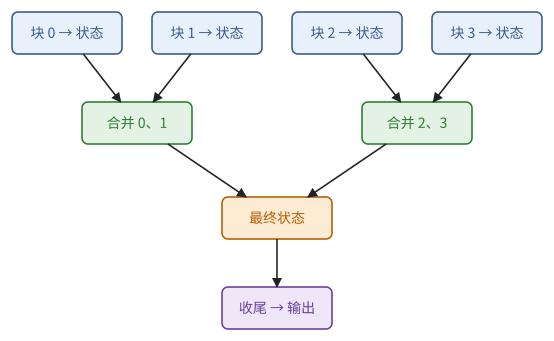
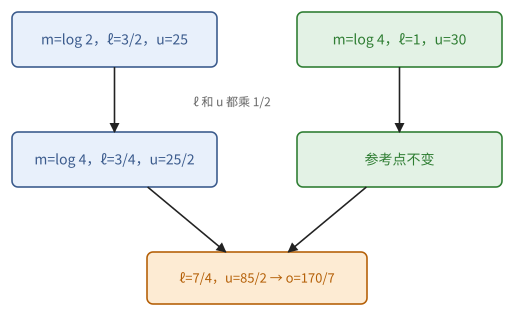
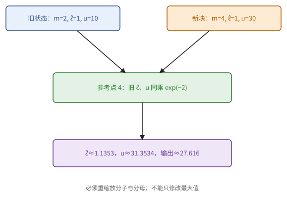
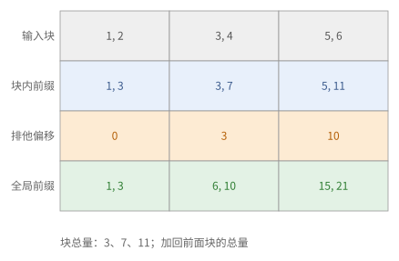

# 第 10 章　归约、扫描与在线算法

第 1 章证明了：只要运算满足结合律，归约和前缀就能用对数深度的树并行计算，也能切成块分头计算再合并。到了真实的 kernel 里，要归约的往往不是简单的求和：softmax、方差、top-k、线性递推，它们的"结合运算"是什么？找到了它，一个看似要扫好几遍数据的计算，就能变成扫一遍、可以任意分块的计算。注意力 kernel 的核心（在线 softmax）就是这样得来的，这也是面试里最常被要求当场推导的东西之一。

本章用到第 1 章的归约与前缀、第 2 章的浮点误差与全序。最后一节讨论浮点数下的可复现性。

## 10.1 归约的一般形式

kernel 中的归约几乎都可以写成三步：先把每个输入变成一个"状态"，再把状态两两合并，最后从合并好的状态里算出结果。合并的运算要满足两条：可以随意加括号，并且有一个"什么都不做"的元素。这样的运算在代数里有个名字。

> **定义 10.1（幺半群）** 集合 $S$ 上满足结合律、且有单位元 $e$ 的二元运算 $\otimes$ 称为**幺半群**。

单位元的用处是表示"空的一块"：一块数据什么也没有时，它的状态就是 $e$，和谁合并都不改变对方。三步写成公式是

$$
f(x_1, \dots, x_n) = \psi\big(\varphi(x_1) \otimes \varphi(x_2) \otimes \dots \otimes \varphi(x_n)\big),
$$

其中 $\varphi: X \to S$ 把每个输入映射为一个**状态**，$\otimes$ 合并状态，$\psi: S \to Y$ 从最终状态得到结果。我们称之为**映射—归约—收尾**。

> **命题 10.2（分块）** 若 $f$ 具有上述形式，则对任意划分 $x = (x^{(1)}, \dots, x^{(b)})$（每块是连续的一段），
>
> $$
> f(x) = \psi\big(R(x^{(1)}) \otimes \dots \otimes R(x^{(b)})\big), \qquad R(y) = \textstyle\bigotimes_i \varphi(y_i).
> $$

*证明* 结合律允许任意加括号。∎

命题 10.2 是一切分块归约的依据：一行数据分在若干个寄存器、若干个块、若干个核心、若干颗芯片上，各自归约成一个状态，再合并状态。所以设计归约 kernel 的关键问题是：找到一个小的状态空间 $S$ 和它上面的结合运算。

最简单的例子：求和（$S = \mathbb{R}$）、最大值（$S = \mathbb{R} \cup \{-\infty\}$）、均值（状态是（和，个数），收尾时相除）、arg max（状态是（值，下标），值相等时取较小的下标）。均值的例子已经说明了一件事：状态不一定就是我们想要的结果。

> **例 10.3（不能直接平均局部平均值）** 一块数据为 $(1, 3)$，另一块为 $(10)$。局部均值分别为 2 和 10，直接平均得 6，真实均值却是 $14/3$。正确的状态是（和，个数）：$(4, 2) \otimes (10, 1) = (14, 3)$，最后相除。
>
> 这给出寻找状态的一个实用办法：如果当前的输出不能正确合并，就把算它时丢掉的信息找回来，放进状态里。均值丢掉了个数；后面会看到，方差还丢掉了均值，注意力丢掉了未归一化的分母。

**图 10.1**　各数据块先变成小状态，树只合并状态，最后一次收尾得到输出。元素总数增加，状态尺寸保持固定。

## 10.2 在线 softmax

softmax 是神经网络中最常见的归一化，也是注意力机制的核心。它的定义是

$$
\operatorname{softmax}(x)_i = \frac{e^{x_i - m}}{\sum_j e^{x_j - m}}, \qquad m = \max_j x_j .
$$

减去 $m$ 是为了防止溢出：在 f32 中 $e^{x}$ 在 $x > 88.7$ 时溢出（bf16 的范围与 f32 相同）。照定义计算要扫三遍数据：求最大值，求 $\sum_j e^{x_j - m}$，再逐个归一化。前两遍能不能合成一遍？难处在于：还没看完整行，不知道最终的最大值 $m$ 是多少。办法是先用"到目前为止的最大值"做参考，等看到更大的值时，再把已经累加的和按比例修正。

> **命题 10.4（在线 softmax）** 非空状态取 $m\in\mathbb{R},\ell>0$，另加唯一空状态 $e=(-\infty,0)$。空状态按 $e\otimes s=s\otimes e=s$ 合并；两个非空状态定义
>
> $$
> (m_1, \ell_1) \otimes (m_2, \ell_2) = \big(m,\ \ell_1 e^{m_1 - m} + \ell_2 e^{m_2 - m}\big), \qquad m = \max(m_1, m_2),
> $$
>
> $\varphi(x) = (x, 1)$。则 $\otimes$ 满足结合律与交换律，且 $\bigotimes_j \varphi(x_j) = (\max_j x_j,\ \sum_j e^{x_j - \max_j x_j})$。

证明的想法是：状态 $(m, \ell)$ 实际上代表一个数 $\ell e^m$，合并就是把这两个数相加，而加法当然满足结合律。

*证明* 令 $\rho(m, \ell) = (m, \ell e^{m})$，它把状态映射到 $(\mathbb{R} \cup \{-\infty\}) \times \mathbb{R}_{\ge 0}$ 上逐分量（最大值，加法）的幺半群中。直接验证 $\rho(s_1 \otimes s_2) = \rho(s_1) \cdot \rho(s_2)$：第二分量为 $(\ell_1 e^{m_1 - m} + \ell_2 e^{m_2 - m}) e^m = \ell_1 e^{m_1} + \ell_2 e^{m_2}$。$\rho$ 是单射（由 $m$ 和 $\ell e^m$ 可以唯一恢复 $\ell$），所以 $\rho((s_1 \otimes s_2) \otimes s_3) = \rho(s_1)\rho(s_2)\rho(s_3) = \rho(s_1 \otimes (s_2 \otimes s_3))$ 推出结合律，交换律同理。归约结果的像是 $(\max_j x_j, \sum_j e^{x_j})$，反解即得。∎

$\rho$ 说明，状态 $(m, \ell)$ 表示的是 $\sum_j e^{x_j} = \ell e^m$，$m$ 只是一个防止溢出的参考点。于是参考点并不唯一：

> **注 10.5** $(m, \ell)$ 与 $(m', \ell e^{m - m'})$ 表示同一个和。只要所有 $e^{x_j - m}$ 不溢出，$m$ 可以取任何不小于 $\max_j x_j - \tau$ 的值（$\tau$ 由格式的范围决定）。因此合并时若新的最大值只比旧的参考点大一点，可以不更换参考点、不做重新缩放，以节省运算。

**加权和。** 注意力机制要算的不是 softmax 本身，而是以它为权重的加权和 $o = \sum_j \operatorname{softmax}(x)_j\, v_j$，$v_j \in \mathbb{R}^d$。同样的办法，在状态里多带一个向量即可。

> **命题 10.6** 非空状态取 $(m,\ell,u)$，其中 $m\in\mathbb{R},\ell>0,u\in\mathbb{R}^d$；另加单位元 $e=(-\infty,0,0)$，与空状态合并直接返回另一方。两个非空状态定义
>
> $$
> (m_1, \ell_1, u_1) \otimes (m_2, \ell_2, u_2) = \big(m,\ \ell_1 e^{m_1 - m} + \ell_2 e^{m_2 - m},\ u_1 e^{m_1 - m} + u_2 e^{m_2 - m}\big),
> $$
>
> $\varphi(x_j, v_j) = (x_j, 1, v_j)$，$\psi(m, \ell, u) = u / \ell$。则 $\otimes$ 满足结合律，且 $\psi(\bigotimes_j \varphi(x_j, v_j)) = o$。

*证明* 同命题 10.4，用 $\rho(m, \ell, u) = (m, \ell e^m, u e^m)$，第三分量映到 $(\mathbb{R}^d, +)$。$\psi$ 的结果为 $\frac{\sum_j e^{x_j} v_j}{\sum_j e^{x_j}} = o$。∎

命题 10.6 是 FlashAttention 的数学核心：对每个查询，按块处理键和值，只保留状态 $(m, \ell, u)$，不必把整行的权重存下来；不同的块（甚至不同的核心、不同的芯片）分别算出各自的状态，最后合并。代价是每次参考点改变时，要把 $u$ 乘以 $e^{m_{\text{old}} - m_{\text{new}}}$，每块多 $d$ 次乘法。

> **例 10.7（参考点变化时为什么要缩放）** 两块分数为 $(0, \log 2)$ 与 $(\log 4)$，对应的标量值为 $(10, 20)$ 与 $(30)$。第一块的状态是 $(\log 2, 3/2, 25)$（以 $\log 2$ 为参考点，两个权重是 $1/2$ 和 $1$）；第二块是 $(\log 4, 1, 30)$。统一到参考点 $\log 4$ 后，第一块的权重整体乘 $1/2$，合并得
>
> $$
> (m, \ell, u) = (\log 4,\ 7/4,\ 85/2), \qquad o = u/\ell = 170/7.
> $$
>
> 直接计算也是 $(10 + 2 \cdot 20 + 4 \cdot 30)/(1 + 2 + 4) = 170/7$。若只缩放 $\ell$ 而忘了 $u$，结果就错了；若每块先输出各自归一化好的结果，又丢掉了合并所需的信息。

**图 10.2**　两个块的状态统一到较大的参考点。分母与加权和必须乘同一个缩放系数，再相加。

> **注 10.8（空块与全屏蔽块）** 单位元 $e=(-\infty,0)$ 必须按规则 $e\otimes s=s$、$s\otimes e=s$ 单独处理；不能把两个空状态代入指数公式计算 $e^{-\infty-(-\infty)}$。有加权和时取 $e=(-\infty,0,0)$。收尾只对 $\ell>0$ 有定义；整行都被屏蔽时输出什么，要另在规格中约定，例如为零。

**图 10.3**　参考点升高时，分子与分母同时重缩放；下面可逐块检查这一不变量。

## 10.3 方差：Welford 与 Chan 的合并

LayerNorm 要求均值和方差。教科书公式 $\operatorname{Var}(x) = \frac{1}{n}\sum x_i^2 - \bar{x}^2$ 只需一遍，但两个大数相减会发生灾难性的抵消（习题 10.7）。统计出身的读者对下面的公式不会陌生，它就是"总离差平方和 = 组内平方和 + 组间平方和"。

> **命题 10.9（Chan 的合并）** 状态取 $(n, \mu, M_2)$，表示 $n$ 个数的个数、均值、离差平方和 $\sum (x_i - \mu)^2$。定义
>
> $$
> \begin{aligned}
> n &= n_a + n_b, \qquad \delta = \mu_b - \mu_a, \\
> \mu &= \mu_a + \delta \frac{n_b}{n}, \\
> M_2 &= M_{2,a} + M_{2,b} + \delta^2 \frac{n_a n_b}{n},
> \end{aligned}
> $$
>
> $\varphi(x) = (1, x, 0)$，$\psi = M_2 / n$。则在精确算术下这是一个结合运算，归约结果的 $\mu$ 与 $M_2/n$ 分别是均值与方差。
>
> 另外允许唯一空状态 $(0,0,0)$，与它合并直接返回另一方，不代入含 $1/n$ 的公式；收尾只在 $n>0$ 时定义。

*证明* 令 $\rho(n, \mu, M_2) = (n,\ n\mu,\ M_2 + n\mu^2)$，即（个数，和，平方和）。直接计算可验证 $\rho$ 把上述合并变成逐分量加法（例如第三分量：$M_{2,a} + n_a\mu_a^2 + M_{2,b} + n_b \mu_b^2 = M_2 + n\mu^2$），且 $\rho$ 在 $n > 0$ 时是单射。∎

在精确算术下，Chan 的合并与"个数、和、平方和"三元组完全等价；区别在浮点误差：它始终处理离差 $x - \mu$ 而不是 $x$ 本身，在均值远大于标准差时稳定得多。逐个加入一个元素的特例称为 Welford 算法。RMSNorm 只需要 $\sum x_i^2$，是普通的求和（累加器用 f32）。

> **例 10.10（两组均值差留下了什么）** 把 $(1, 3, 5, 7)$ 分成 $(1, 3)$ 和 $(5, 7)$。状态分别是 $(2, 2, 2)$ 和 $(2, 6, 2)$；$\delta = 4$，合并后的均值是 $2 + 4 \cdot 2/4 = 4$，离差平方和
>
> $$
> M_2 = 2 + 2 + 4^2 \cdot (2 \cdot 2)/4 = 20.
> $$
>
> 方差为 5。多出来的 16 来自两组均值不同（组间平方和）；只把两块的 $M_2$ 相加会得到 4，漏掉了组间的差异。若给所有数都加上 $10^6$，真实方差仍是 5，Chan 的公式仍然只处理"差 4"这样的小数，而平方和相减的公式要处理 $10^{12}$ 量级的数。

## 10.4 Top-k

前几节的状态是几个数，top-k 的状态是一个短列表。top-k 在模型里到处都是：混合专家模型给每个词元从上百个专家里挑出几个（第 11 章），生成文本时从词表里挑出概率最大的几个候选，有些稀疏化方法只保留最重要的激活。

先规定"谁大"。浮点数要用 2.11 节的全序（定义 2.36），值相同时下标小的排在前面。这样任意两个元素都分得出先后，把这个次序记作 $\succ$（$x_i \succ x_j$ 读作"$x_i$ 排在 $x_j$ 前面"）。

> **命题 10.11（top-k 的合并）** 状态取按 $\succ$ 排好序、长度至多为 $k$ 的列表（附带下标），$\otimes$ 为"合并两个列表，保留前 $k$ 个"。则 $\otimes$ 满足结合律与交换律，归约结果是全体元素的前 $k$ 个。

*证明* $\succ$ 是全序，所以 $\operatorname{top}_k(A \cup B) = \operatorname{top}_k(\operatorname{top}_k(A) \cup \operatorname{top}_k(B))$：$A \cup B$ 的前 $k$ 个元素，若属于 $A$，则必在 $A$ 的前 $k$ 个之中。于是 $\otimes$ 对应"集合并之后取前 $k$ 个"，继承了并集的结合律与交换律。∎

如果不规定值相等时的先后，返回的值仍然正确，但返回的下标会依赖于归约树的形状（习题 10.5）。

> **例 10.12（截断之后为什么不会丢掉冠军）** 取 $k = 2$，三块为 $A = (9_0, 7_1, 1_2)$、$B = (8_3, 7_4)$、$C = (10_5, 2_6)$，下标写在右下角。先合并 $A$、$B$ 得 $(9_0, 8_3)$，再并 $C$ 得 $(10_5, 9_0)$；先合并 $B$、$C$ 得 $(10_5, 8_3)$，再并 $A$，仍得 $(10_5, 9_0)$。
>
> 一个元素一旦在自己的块里排到第 $k + 1$ 名，它前面已经至少有 $k$ 个元素，再加入别的块也不可能让它进入全局前 $k$。两个 7 若争夺最后一个位置，按原始下标排序使结果确定（这里假定各块的原始下标互不重复）。

命题 10.11 告诉我们怎样合并两个已经算好的列表。一行 $n$ 个数的 top-k 本身怎样算？常见的有三种做法，它们的工作量和深度差别很大。

**逐轮取最大。** 重复 $k$ 轮：用一次 arg max 归约找出当前最大的元素，记下它，再把它从候选中去掉。每轮是一次 $n$ 元归约，工作量 $n - 1$、深度 $\lceil \log n \rceil$；但第 $j + 1$ 轮要等第 $j$ 轮选出结果，才知道该去掉谁，$k$ 轮串成一条依赖链。所以总工作量约 $kn$，深度约 $k \lceil \log n \rceil$。在归约延迟很长的硬件上（归约要穿过跨通道的单元，4.4 节），时间约等于 $k$ 乘以一次归约的延迟。

"去掉"怎么实现？最省事的写法是把选中的位置改成 $-\infty$。这在输入本身含有 $-\infty$ 时就出错了。

> **注 10.13（"已选"标记的冲突）** 若用某个值 $v$ 表示"已经选过"，而输入也可能取到 $v$，这个标记就与真实的输入分不开。对 f32 来说找不到安全的 $v$：按全序比 $-\infty$ 更小的只有负 NaN，而它们本身也可能是输入；每个 32 位比特串都可能出现在输入里，没有多余的值可用（鸽巢原理）。可靠的做法是把"是否已选"放进单独的状态：一个掩码，或者一个与值分开存放的下标数组。

> **例 10.14（重复的下标）** 一行 128 个数，只有位置 0、127、1 上是有限值 3、2、1，其余都是 $-\infty$；取 $k = 8$，arg max 在平局时返回最大的下标。前三轮选出位置 0、127、1，并把它们改成 $-\infty$。第四轮整行都是 $-\infty$，平局，选出 127；把它"改成 $-\infty$"什么也没改变，以后每一轮都再选 127。返回的下标是 $(0, 127, 1, 127, 127, 127, 127, 127)$：下标重复，而且位置 127 的真实值是 2，与后面五次返回的 $-\infty$ 对不上。
>
> 这正是 Zhong（2026，附录 E）在 JAX 的 Pallas TPU 实现中发现的错误（注 2.39）。源码注释承认会返回重复的下标，说保留它是为了避免"昂贵的防御性屏蔽"。论文测得，修好它在最基本的形状上只多花 4.7% 的时间。

**名次计数。** 换一个角度：元素 $x_i$ 在输出里排第几，就等于有多少个元素排在它前面。

> **命题 10.15（名次计数）** 对全序 $\succ$，令 $r_i = \#\{j : x_j \succ x_i\}$。则 $(r_0, \dots, r_{n-1})$ 是 $[n]$ 的一个排列，$\{i : r_i < k\}$ 恰是 top-k，且 $r_i$ 就是 $x_i$ 在输出中的位置。计算全部 $r_i$ 要 $n(n-1)$ 次比较，这些比较互不依赖，深度为一次比较加一次 $n$ 元求和，与 $k$ 无关。

*证明* $\succ$ 是全序，排在 $x_i$ 前面的元素恰有 $r_i$ 个，所以 $x_i$ 是第 $r_i$ 名（从 0 计）；不同元素名次不同，取遍 $[n]$。top-k 就是名次小于 $k$ 的那些元素。每个 $r_i$ 是 $n - 1$ 个 0/1 比较结果之和，求和的深度是 $\lceil \log n \rceil$。∎

在 SIMD 硬件上，名次计数可以只用"循环移位再比较"实现：把整行循环移位 $d$ 个通道，与原行逐元素比较，就同时比完了所有相距 $d$ 的元素对；对 $d = 1, \dots, n - 1$ 各做一次，这 $n - 1$ 次移位互不依赖，可以一个接一个地发出（4.4 节）。它的工作量比逐轮取最大多，却没有长度为 $k$ 的依赖链，$k$ 大时占优。

**先分组排序，再合并。** 第三种做法利用命题 10.11：把一行分成 $m$ 组，每组先排好序（只需保留前 $k$ 个），再从 $m$ 个有序列表中依次取出最大的。朴素地取，每输出一个元素都要在 $m$ 个队首之间比较 $m - 1$ 次。但每输出一个元素，只有一个列表的队首变了，其余队首之间的比较结果可以留着下次再用。把这些比较结果存起来的数据结构叫**败者树**（loser tree）。

> **命题 10.16（败者树）** 设 $m = 2^q$ 个有序列表的队首两两比赛，胜者再两两比赛……共 $q$ 层、$m - 1$ 场，每个内部节点记下本场的败者，另记下总冠军。输出冠军之后，它所在的列表换上新的队首；新队首只需沿它的叶子到根的路径，依次与路径上 $q$ 个节点记下的败者比赛，就恢复了整棵树。所以建树要 $m - 1$ 次比较，之后每输出一个元素只要 $q = \log m$ 次比较。

证明的想法：冠军一路赢上来，所以路径上每个节点记下的败者，正好是"路径旁边那棵子树的冠军"。

*证明* 设冠军从叶子 $v_0$ 一路赢到根，路径为 $v_0, v_1, \dots, v_q$。对路径上的内部节点 $v_t$，冠军从它的一个孩子上来，在 $v_t$ 击败了另一个孩子那棵子树的胜者，所以 $v_t$ 记下的败者就是那棵旁边子树的胜者。换上新队首之后，路径以外的子树都没有变，它们的胜者和各节点记下的败者仍然有效。于是只要在 $v_1, \dots, v_q$ 上依次重赛：在 $v_t$，让从下面上来的胜者与 $v_t$ 记下的败者（旁边子树的胜者）比赛，胜者继续往上，败者记在 $v_t$。$q$ 场之后，每个节点记下的又都是本场的真正败者，根上得到新的冠军。∎

三种做法该怎么选？先在纸面上算一笔账。

> **例 10.17（三种做法的账）** 取 $n = 128$。逐轮取最大：$k = 8$ 时约 $8 \times 127 \approx 1000$ 次比较，依赖链是 8 轮归约，深度约 $8 \times 7 = 56$；$k = 128$ 时工作量约 $1.6 \times 10^4$，深度约 900。名次计数：无论 $k$ 多大，都是 $128 \times 127 \approx 1.6 \times 10^4$ 次比较，深度约 $1 + 7 = 8$。分成 16 组、每组 8 个：组内排序之后，败者树建树 15 次比较，以后每输出一个元素 4 次比较；但 $k$ 个输出仍然一个接一个，依赖链长度为 $k$，只是每一环从一次 128 元归约缩短成 4 次比较。

纸面上的账只是开始。哪种做法真正更快，取决于硬件上"一次有依赖的归约"和"许多次独立的比较"各要多少时间：

> **注 10.18（实测：TPU v4 上的 top-k）** Zhong（2026）在 TPU v4 的一个核心上，测量了每行 128 个 f32、共 8 行的 top-k。逐轮取最大每轮都要等一次约 79 个周期的跨通道归约：$k = 8$ 约 685 个周期，$k = 128$ 涨到 10525 个周期，几乎与 $k$ 成正比。名次计数要做 127 次跨通道循环移位，时间基本不随 $k$ 变化，$k = 128$ 只要 1278 个周期，快 8 倍；但 $k = 8$ 时它比逐轮取最大慢，因为 8 轮的依赖链本来就不长。可见同一个问题，最优的算法随形状变化；论文最后按形状在几种做法之间自动选择，在 25 个测试形状中的 24 个上快于原来的实现。

## 10.5 扫描与线性递推

前缀和（扫描）在第 1 章已有一般理论。在硬件上，最常用的是分块的形式。

> **命题 10.19（分块扫描）** 把长度 $n$ 的序列分成 $n/c$ 块，每块长度 $c$。(1) 各块独立求块内前缀；(2) 对 $n/c$ 个块的总和求排他前缀（本块之前所有块的总量）；(3) 把第 (2) 步的偏移加到对应块的每个元素上。总工作量约 $2n + n/c$，深度约为 $c$ 加上第 (2) 步的深度。

块的大小通常与硬件对齐：块内的扫描用寄存器内的移位—相加（Kogge–Stone，$\log c$ 步），块之间顺序传递一个累计值。

> **例 10.20（加回的是前一块的总量）** 序列 $(1, 2, 3, 4, 5, 6)$ 分成三块。块内前缀为 $(1, 3)$、$(3, 7)$、$(5, 11)$；块总量为 $(3, 7, 11)$。各块需要的偏移是排他前缀 $(0, 3, 10)$，加回后为 $(1, 3, 6, 10, 15, 21)$。若误把包含本块的前缀 $(3, 10, 21)$ 加回，就把本块重复计了一次。
>
> 对于不满足交换律的结合运算，"加回"应理解为把前面所有块的状态放在左边，再与本块的前缀结合；元素的次序始终保持不变。

**图 10.4**　块内前缀、块总量的排他前缀、把偏移合并回各块，是三项不同的工作。

**线性递推。** 递推 $h_t = a_t h_{t-1} + b_t$ 看起来只能一步一步算，因为每一步都要用上一步的结果。但每一步是一个仿射映射 $f_t(h) = a_t h + b_t$，递推的结果是这些映射的复合，而复合满足结合律。

> **命题 10.21（仿射映射的扫描）** 把 $f_t$ 记作 $(a_t, b_t)$，复合 $f_2 \circ f_1$ 对应
>
> $$
> (a_1, b_1) \otimes (a_2, b_2) = (a_2 a_1,\ a_2 b_1 + b_2).
> $$
>
> 它满足结合律，于是 $h_t = (f_t \circ \dots \circ f_1)(h_0)$ 可以用扫描在 $O(\log n)$ 深度内对所有 $t$ 求出。

*证明* $f_2(f_1(h)) = a_2(a_1 h + b_1) + b_2$。函数复合满足结合律。∎

这与第 1 章的进位函数是同一个思路：不知道输入的时候，先把"每一步怎样变换"组合起来。若 $h_t$ 是向量、$a_t$ 是对角矩阵（逐元素的衰减），复合仍然便宜；若 $a_t$ 是一般的 $d \times d$ 矩阵，每次复合要 $d^3$ 次运算，代价太大。线性 RNN 与状态空间模型选择对角或结构化的 $a_t$，正是为了能这样并行训练。

> **例 10.22（复合的方向不能颠倒）** $h_0 = 1$，先做 $f_1(h) = 2h + 1$，再做 $f_2(h) = 3h + 4$。状态合并为 $(2, 1) \otimes (3, 4) = (6, 7)$，所以 $h_2 = 6 \cdot 1 + 7 = 13$。若把复合的次序弄反，得到 $(6, 9)$，结果是 15。
>
> 函数复合有结合律，却通常没有交换律。扫描允许改变括号，不允许打乱时间顺序；系数是矩阵时，乘法的次序同样必须保留。

**用矩阵单元做扫描。** 矩阵单元比向量单元快几十倍（例 6.2）。一块长度为 $c$ 的前缀和可以写成矩阵乘法：$y = L x$，$L$ 是 $c \times c$ 的下三角全一矩阵。这用 $c^2$ 次乘加代替 $c$ 次加法；只要 $c$ 不超过两种单元算力之比的量级，用矩阵单元反而更快。对线性递推，块内的 $L$ 换成 $L[t, s] = \prod_{r = s+1}^{t} a_r$（$s \le t$），块与块之间传递状态。这种"块内用矩阵乘法、块间顺序传递"的写法，是在加速器上实现扫描类计算的常用方法。

## 10.6 可复现的归约

浮点加法不满足结合律（2.5 节），所以命题 10.2 在浮点数下只是近似成立：不同的分块、不同的归约树给出末位不同的结果。这里要区分两种要求。

> **定义 10.23（可复现）** 一个程序是**确定的**，若同样的输入在同样的配置下总给出逐位相同的输出；是**可复现的**，若在不同的并行配置（核心数、芯片数、块大小）下也给出逐位相同的输出。

> **命题 10.24** 若归约树的形状只依赖于 $n$（以及固定的块大小），而不依赖于参与的单元数或运行时的先后，则程序是确定的。用原子加法累加的程序一般不是确定的。

要做到跨配置可复现，归约树必须与配置无关，例如总是按固定的块大小分块、按固定的次序合并；或者使用精确的累加：把输入按一个公共的指数网格舍入后用宽整数相加（整数加法满足结合律），只在最后转回浮点数。这些做法都有代价，所以框架通常只保证确定性，不保证跨配置可复现。

> **例 10.25（树固定与精确不是一回事）** 在 f32 中取 $(2^{24}, 1, -2^{24})$。左结合时先把 $2^{24} + 1$ 舍入为 $2^{24}$，最后得 0；右结合时 $1 - 2^{24}$ 可以精确表示，最后得 1。固定其中一棵树，每次的结果都一样，却并没有让所有树的结果都一样。
>
> 在线 softmax 和 Chan 合并的结合律，也都是精确算术下的性质。分块后的浮点程序仍要给出误差的容许范围：代数上能合并，保证的是方法正确；舍入后差多少，是另一个数值问题。

## 本章小结

1. kernel 中的归约是"映射—归约—收尾"$\psi(\bigotimes_i \varphi(x_i))$；任意分块归约后再合并，结果相同。设计归约的关键是找到小的状态空间和结合运算；找不到时，把被丢掉的信息放回状态。（定义 10.1、命题 10.2、例 10.3）
2. 在线 softmax：状态 $(m, \ell)$，合并时按 $e^{m_i - m}$ 重新缩放；加权和再加一个向量分量 $u$，收尾 $u/\ell$。参考点 $m$ 不唯一，可以延迟重新缩放；空块用单位元单独处理。（命题 10.4、10.6，注 10.5、10.8）
3. 方差：状态 $(n, \mu, M_2)$，用 Chan 的公式合并，比"平方和减平方"稳定。（命题 10.9）
4. top-k：在全序（值相同按下标）下，状态是长度为 $k$ 的有序列表，合并后截断。一行的 top-k 可以逐轮取最大（工作量 $kn$，依赖链长 $k$）、名次计数（工作量 $n^2$，深度与 $k$ 无关）或分组排序后用败者树合并（每个输出 $\log m$ 次比较）；用值标记"已选"会与输入冲突，要把有效性放进单独的状态。（命题 10.11、注 10.13、命题 10.15、10.16）
5. 分块扫描：块内前缀、块总和的排他前缀、加回偏移。线性递推是仿射映射的复合，可以并行扫描；块内可以写成下三角矩阵乘法交给矩阵单元。（命题 10.19、10.21）
6. 固定归约树得到确定性；跨配置可复现需要与配置无关的树或精确累加；原子累加一般不确定。（定义 10.23、命题 10.24）

## 习题

**习题 10.1** ★ 不借助 $\rho$，直接验证命题 10.4 的 $\otimes$ 满足结合律。

提示 1

先只考虑三个非空状态；空状态由单位元规则单独处理。

提示 2

令 $m = \max(m_1, m_2, m_3)$，把 $(s_1 \otimes s_2) \otimes s_3$ 和 $s_1 \otimes (s_2 \otimes s_3)$ 的第二分量都化成只含 $e^{m_i - m}$ 的形式。

答案

记 $m_{12} = \max(m_1, m_2)$。$(s_1 \otimes s_2) \otimes s_3$ 的第二分量为 $(\ell_1 e^{m_1 - m_{12}} + \ell_2 e^{m_2 - m_{12}}) e^{m_{12} - m} + \ell_3 e^{m_3 - m} = \ell_1 e^{m_1 - m} + \ell_2 e^{m_2 - m} + \ell_3 e^{m_3 - m}$，第一分量为 $m$。另一种括号方式化简后得到同样的表达式。

**习题 10.2** ★ 对 $x = (1, 3, 2)$，分成 $(1, 3)$ 和 $(2)$ 两块，分别求在线 softmax 的状态，再合并。验证结果给出正确的 softmax。

提示 1

每个块分别保留参考点和相对于它的指数和；合并时统一参考点。

提示 2

第一块：$m = 3$，$\ell = e^{1-3} + e^{0}$。

答案

第一块 $(3,\ 1 + e^{-2})$，第二块 $(2,\ 1)$。合并：$m = 3$，$\ell = 1 + e^{-2} + e^{-1} \approx 1.503$。softmax 为 $(e^{-2}, 1, e^{-1}) / \ell \approx (0.090, 0.665, 0.245)$，与直接计算一致。

**习题 10.3** ★ 在 flash attention 中，一个查询的当前状态是 $(m, \ell, u)$，新来一块 $b$ 个键的分数 $s_1, \dots, s_b$ 和对应的值 $v_1, \dots, v_b$。写出更新后的状态，并数一数这次更新的运算量（$d$ 是值的维数）。

提示 1

列出新块的最大值、指数和、加权和，再与旧状态合并，不要先归一化新块。

提示 2

先把新块归约成一个状态，再与旧状态合并（命题 10.6）。

答案

$m' = \max(m, \max_i s_i)$；$\ell' = \ell e^{m - m'} + \sum_i e^{s_i - m'}$；$u' = u\, e^{m - m'} + \sum_i e^{s_i - m'} v_i$。运算量：$b$ 次指数、$bd$ 次乘加（$\sum_i p_i v_i$，在实际 kernel 中是一次矩阵乘法），加上缩放旧的 $u$ 的 $d$ 次乘法。缩放的代价只是 $d$，与块中的 $bd$ 相比很小；注 10.5 的延迟缩放可以省掉它的大部分。

**习题 10.4** ★ 用命题 10.9 合并 $x_a = (1, 2, 3)$ 与 $x_b = (10, 12)$ 的状态，验证得到的均值与方差。

提示 1

先计算每组的个数、均值与离差平方和；组间均值差是必须保留的信息。

提示 2

$x_a$：$(3, 2, 2)$；$x_b$：$(2, 11, 2)$。

答案

$n = 5$，$\delta = 9$，$\mu = 2 + 9 \cdot \frac{2}{5} = 5.6$，$M_2 = 2 + 2 + 81 \cdot \frac{6}{5} = 101.2$，方差 $20.24$。直接计算：均值 $28/5 = 5.6$，$\sum x^2 = 1 + 4 + 9 + 100 + 144 = 258$，$258/5 - 5.6^2 = 51.6 - 31.36 = 20.24$。

**习题 10.5** ★ 对 $x = (5, 7, 7, 2)$ 求 top-1（值与下标）。若规定相等时任取其一，构造两种归约树，使返回的下标不同。规定相等时取较小下标后，结果是什么？

提示 1

设合并规则在值相等时取左边的操作数。只改变括号、不改变元素次序的树，结果都一样（为什么？）。要让结果不同，需要改变元素的次序。

提示 2

SIMD 硬件上常见的"折半"归约先合并相距 $n/2$ 的元素：$(x_0 \otimes x_2) \otimes (x_1 \otimes x_3)$。

答案

"相等取左边"时，保持次序的树总是返回第一次出现的最大值，所以只改括号不会改变结果。树 A（顺序合并）：$((x_0 \otimes x_1) \otimes x_2) \otimes x_3 = (7, 1)$。树 B（折半）：$x_0 \otimes x_2 = (7, 2)$，$x_1 \otimes x_3 = (7, 1)$，再合并 $(7, 2) \otimes (7, 1)$，相等取左边得 $(7, 2)$。原因是"相等取左边"不满足交换律，而折半归约交换了元素的次序。规定"相等时取较小下标"后，运算满足交换律，两棵树都返回 $(7, 1)$。

**习题 10.6** ★ 用命题 10.21 计算 $h_t = 0.5\, h_{t-1} + 1$，$h_0 = 0$，求 $h_1, h_2, h_3$，并用两两复合（先复合 $f_1, f_2$，再与 $f_3$ 复合）验证 $h_3$。

提示 1

把每步写成同一个仿射映射，复合允许改括号却不能改时间顺序。

提示 2

$(a_1, b_1) \otimes (a_2, b_2) = (a_2 a_1, a_2 b_1 + b_2)$。

答案

顺序计算：$h_1 = 1$，$h_2 = 1.5$，$h_3 = 1.75$。复合：$f_2 \circ f_1 = (0.25, 1.5)$，再与 $f_3$ 复合得 $(0.125, 0.5 \cdot 1.5 + 1) = (0.125, 1.75)$，作用在 $h_0 = 0$ 上得 $1.75$。

**习题 10.7** ☆ 在 f32 中用公式 $\frac{1}{n}\sum x_i^2 - \bar{x}^2$（实现为 $(\sum x_i^2 - (\sum x_i)^2/n)/n$）计算 $(10001, 10002, 10003)$ 的方差。真实值是 $2/3$。

提示 1

$10^8$ 附近 f32 的间距是 8，$3 \times 10^8$ 附近是 32，$9 \times 10^8$ 附近是 64。

提示 2

逐步舍入：$x_i^2$ 分别舍入为 100020000、100040000、100060008；它们的和、$(\sum x_i)^2 = 900360036$ 以及它除以 3 也都要舍入。

答案

$\sum x_i^2$：$100020000 + 100040000 = 200060000$（精确），再加 $100060008$ 得 $300120008$，舍入为 $300120000$。$(\sum x_i)^2 = 900360036$ 舍入为 $900360064$，除以 3 得 $300120021.3$，舍入为 $300120032$。相减得 $-32$，方差 $\approx -10.7$：负的方差。用 Chan/Welford 合并则得到 $0.6667$。

**习题 10.8** ★（审查题）AI 写的 softmax kernel 对每一行先算 `e = exp(x)`，再算 `s = sum(e)`，最后输出 `e / s`，全部用 bf16。指出所有问题并给出修改。

提示 1

分别检查指数范围、累加精度和是否将中间数组写回远存储。

提示 2

想一想 $x$ 中有一个元素是 100 时会怎样；再想一想 bf16 的累加（例 2.18）。

答案

一，没有减去最大值：$x > 88.7$ 时 $e^x$ 溢出为无穷大，结果出现 $\infty / \infty = \text{NaN}$。二，求和在 bf16 中累加，长行会停滞或误差很大。三，需要三遍（或至少两遍）读这一行。修改：用在线 softmax 一遍求出 $(m, \ell)$，累加在 f32 中进行，第二遍输出 $e^{x_i - m} / \ell$；若这个 softmax 后面紧跟与值的加权和（注意力），则用命题 10.6 一遍完成。

**习题 10.9** ★（综合审查题）在线注意力的一块完全被屏蔽，另一块状态为 $(\log2,3,9)$。写出空块状态、两块合并后的状态与输出。若两块都为空，该怎样处理？

提示 1

先使用显式单位元规则，不要对两个负无穷作减法。

提示 2

非空状态与单位元合并保持不变；收尾只对正分母有定义。

答案

空块为 $(-\infty,0,0)$；合并得 $(\log2,3,9)$，输出 3。两块都空时状态仍是单位元，$u/\ell$ 无定义，须按规格返回零或其他明确约定，不能让 $0/0$ 或 $-\infty-(-\infty)$ 进入数值计算。

**习题 10.10** ★（审查题）AI 写了一个 top-k：重复 $k$ 次，每次 `i = argmax(x)`，把 `(x[i], i)` 记入结果，再执行 `x[i] = -inf`。(a) 输入一行只有 2 个有限值、$k = 4$ 时，会发生什么？(b) 不改变"逐轮取最大"的结构，怎样修好它？(c) 修好之后，每轮多了哪些运算？它们在依赖链上吗？

提示 1

(a) 照例 10.14 走一遍：第 3 轮时整行是什么？

提示 2

(b) 把"已选"记在一个单独的布尔掩码 `taken` 里，每轮只在 `~taken` 的位置上求最大。全是 $-\infty$ 时也要能选出一个尚未选过的位置。

答案

(a) 前两轮正确。第 3 轮起整行都是 $-\infty$，arg max 返回某个固定位置（例如平局取第一个或最后一个），若它恰是前两轮选过的位置，就会重复选它；返回的值也可能与该下标处的真实值不符（注 10.13）。

(b) 维护掩码 `taken`，每轮在 `~taken` 的位置上用命题 2.37 的整数键求最大值，平局取最小下标，选出后置 `taken[i] = True`；值从原始输入 `x[i]` 取，不从被改写过的数组取。整数键把 $-\infty$、NaN 都当作普通值，即使全行都是 $-\infty$，也会选出一个尚未选过的位置。

(c) 每轮多一次按掩码选择（逐元素运算）和一次掩码更新。选择在归约之前，属于这一轮的计算，所以在依赖链上；但它们是逐元素运算，比一次跨通道归约便宜得多。Zhong 的论文用更巧妙的办法把修复的大部分工作移出依赖链（第四部分的案例研究会讲），在 TPU v4 上只多花约 2% 到 5%。

**习题 10.11** ★ 对 $x = (5, 7, 7, 2)$，按"值大的在前，值相同时下标小的在前"计算命题 10.15 的名次 $r_i$，写出 top-2。名次计数只做"严格大于"的比较时，怎样把"值相同时下标小的在前"编进比较里？

提示

$x_j \succ x_i$ 当且仅当 $x_j > x_i$，或 $x_j = x_i$ 且 $j < i$。用整数键时，"$x_j \ge x_i$ 且 $j < i$"可以写成 $\operatorname{key}(x_j) > \operatorname{key}(x_i) - 1$。

答案

$r_0 = 2$（两个 7 在它前面），$r_1 = 0$，$r_2 = 1$（下标 1 的 7 在它前面），$r_3 = 3$。top-2 是下标 1、2，值 7、7。名次两两不同，正好是 $0, 1, 2, 3$ 的排列。

对整数键 $a_j = \operatorname{key}(x_j)$：$j < i$ 时比较 $a_j > a_i - 1$（即 $a_j \ge a_i$），$j > i$ 时比较 $a_j > a_i$。唯一的麻烦是 $a_i$ 等于最小的整数时 $a_i - 1$ 会溢出绕回；Zhong 的实现对这种位置单独把名次的初值设为它前面元素的个数。

**习题 10.12** ☆ 四个有序列表 $A = (9, 4)$、$B = (8, 7)$、$C = (6, 5)$、$D = (10, 1)$。建一棵败者树（$A$ 对 $B$、$C$ 对 $D$，胜者再比），写出每个节点记下的败者。输出冠军后，重赛了哪几场？依次输出前三名，共做了几次比较？

提示

建树 3 场。冠军 10 来自 $D$，换上 $D$ 的下一个元素 1，沿 $D$ 到根的路径重赛 2 场。

答案

建树：$A$ 对 $B$，9 胜、记败者 8；$C$ 对 $D$，10 胜、记败者 6；根上 9 对 10，10 胜、记败者 9。冠军 10。$D$ 换上 1：在 $C$/$D$ 节点 1 对记下的 6，6 胜、记 1；在根 6 对记下的 9，9 胜、记 6。第二名 9（来自 $A$）。$A$ 换上 4：在 $A$/$B$ 节点 4 对 8，8 胜、记 4；在根 8 对 6，8 胜、记 6。第三名 8。共 $3 + 2 + 2 = 7$ 次比较；朴素做法每输出一个都要 3 次比较。

