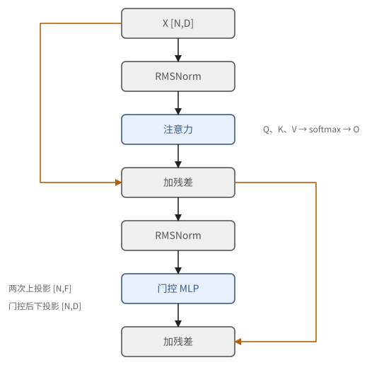
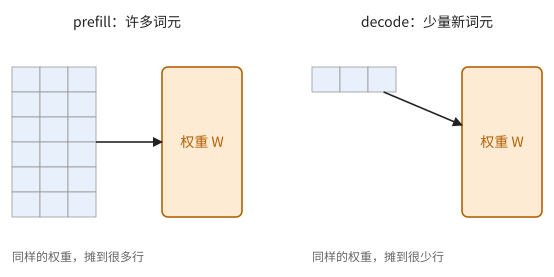
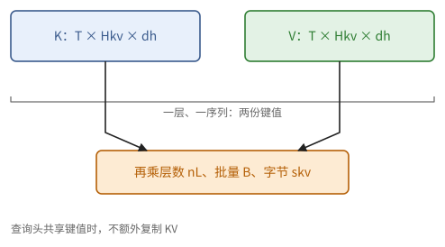
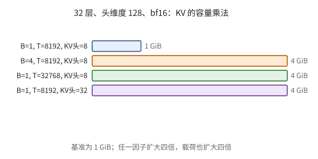
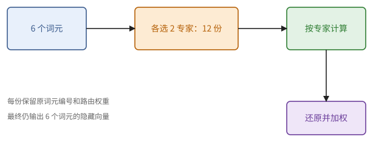

# 第 11 章　Transformer 的算术

前十章讲的是机器和一般的计算结构。这一章讲加速器上最主要的工作负载：Transformer 语言模型。读这一章不需要任何机器学习的背景：我们先说清一个语言模型从外面看在算什么，再把它的内部写成一串矩阵乘法、归约和逐元素运算；然后讲"训练"到底在做什么（损失、梯度、优化器），因为训练的每一步都会变成具体的运算量和显存；最后讲推理。我们不讨论模型为什么有效，只关心它算什么、要算多少、要存多少，再用第 6 章的屋顶线判断每一部分受什么限制。后面的并行策略和 kernel，都是为了对付这一章算出的数字。

这一章的计算在面试中出现得极多："一个 70B 的模型训练要多少卡、多少天""decode 为什么慢""KV cache 占多少显存"，都只需要本章的几个公式。最后两节讲推理服务里另外两个常被问到的话题：投机解码怎样在不改变输出分布的前提下一次生成好几个词元，以及为什么温度为 0 时，同一个问题问两遍也会得到不同的回答。用到的前置知识是第 2 章的数值格式、第 6 章的屋顶线（特别是命题 6.21）和第 10 章的在线 softmax 与批不变性；数学上只用到矩阵乘法、求导和基本的概率，分别见间章 M3、M5、M4。

## 11.1 语言模型在算什么

先不看内部，看它从外面是什么样子。把一句话的开头"今天天气很"交给一个语言模型，它给出的是下一个词元的一张概率表：比如"好"0.41，"热"0.22，"冷"0.15，……词表里每个词元都有一个概率，加起来等于 1。从这张表里抽一个词元接在后面，再拿加长了的开头去问，如此反复，就生成了一段文字。

> **定义 11.1（语言模型）** 设词表有 $V$ 个词元。一个**语言模型**（language model）是一个带参数 $\theta$ 的函数：对任意前缀 $x_{<t} = (x_0, \dots, x_{t-1})$，它给出下一个词元的分布 $p_\theta(\cdot \mid x_{<t})$。约定 $x_0$ 是一个固定的起始词元；由概率的乘法规则（命题 M4.5），一整段文字的概率是
>
> $$
> p_\theta(x_1, \dots, x_T \mid x_0) = \prod_{t=1}^{T} p_\theta(x_t \mid x_{<t}).
> $$

参数 $\theta$ 就是模型里所有矩阵的全部元素。"一个 80 亿参数的模型"，说的就是 $\theta$ 有 80 亿个分量。模型的结构（下一节）规定这些数怎样参与计算；这些数取什么值，由训练决定（11.4 节）。

**Transformer 怎样给出这张表。** 每个词元先变成一个 $D$ 维向量；接着 $n_L$ 层依次修改每个位置上的向量，修改时一个位置可以从它前面的位置收集信息；最后，位置 $t$ 上的向量乘以一个 $D \times V$ 的矩阵，得到 $V$ 个实数 $\ell = (\ell_0, \dots, \ell_{V-1})$，称为 **logits**（未归一化的对数概率），再做 softmax（10.2 节）：

$$
p_\theta(i \mid x_{\le t}) = \frac{e^{\ell_i}}{\sum_{j} e^{\ell_j}} .
$$

例如 $V = 3$、$\ell = (2, 1, 0)$ 时，三个词元的概率约为 $(0.665, 0.245, 0.090)$。logits 只有差才有意义：给所有 $\ell_i$ 加同一个常数，概率不变。

注意，位置 $t$ 的输出给出的是**下一个**词元 $x_{t+1}$ 的分布。一段 $T$ 个词元的文字送进去，每个位置都输出一张表，一次计算就得到 $T$ 个预测。这些预测互不偷看后文：

> **命题 11.2（每个位置只看前面）** 在下一节的 Transformer 中，若注意力使用因果掩码，则位置 $t$ 的输出只依赖于 $x_0, \dots, x_t$。

*证明* 对层数归纳。词嵌入是逐位置的。设某一层的输入在位置 $u$ 上只依赖于 $x_0, \dots, x_u$；这一层里除注意力外的运算都是逐位置的，注意力在位置 $t$ 只用到位置 $u \le t$ 的键和值，所以输出在位置 $t$ 上只依赖于 $x_0, \dots, x_t$。∎

这个命题有两个用处，后面都会用到：训练时，一次前向就能同时检查模型在每个位置上的预测（11.4 节）；推理时，前面位置算过的中间结果不会因为后面来了新词元而改变，可以存起来反复使用（11.8 节的 KV cache）。

## 11.2 记号与模型

现在打开模型的内部。一个仅解码器的 Transformer 由 $n_L$ 个结构相同的**层**组成。文本先被切成**词元**（token，大致是一个词或词的一部分），每个词元表示成一个 $D$ 维向量。输入是 $B$ 个序列、每个长 $T$ 个词元，共 $N = BT$ 个词元，堆成矩阵 $X \in \mathbb{R}^{N \times D}$。每层做两件事，每件都以"残差"的方式加回原来的 $X$：

$$
X \leftarrow X + \operatorname{Attn}(\operatorname{Norm}(X)), \qquad X \leftarrow X + \operatorname{MLP}(\operatorname{Norm}(X)).
$$

"残差"的意思是：每个分支算出的不是一个新的 $X$，而是一个修正量，加回到原来的 $X$ 上。即使某一层的分支几乎什么也没做（输出接近 0），信号也能原样传到下一层，所以几十层叠起来仍然好训练。

**归一化**（RMSNorm）：对每行 $x$，$x \mapsto x / \sqrt{\operatorname{mean}(x^2) + \varepsilon} \odot g$，$g \in \mathbb{R}^D$ 是参数。它先把每个向量缩放到均方根为 1，再逐分量乘上可学习的 $g$。各分支的输入因此大小相近，低精度格式（2.6 节）也不容易溢出。

**注意力**：让每个词元从它前面的词元那里"收集信息"。有 $H$ 个**头**，每头维数 $d_h$（通常 $H d_h = D$）；键和值有 $H_{kv}$ 个头（$H_{kv} = H$ 为标准的多头注意力 MHA，$H_{kv} < H$ 为分组查询注意力 GQA，$H_{kv} = 1$ 为 MQA）。

$$
Q = X W_Q,\quad K = X W_K,\quad V = X W_V, \qquad W_Q \in \mathbb{R}^{D \times H d_h},\ W_K, W_V \in \mathbb{R}^{D \times H_{kv} d_h}.
$$

对每个头 $h$（它使用的键值头是 $\lfloor h H_{kv} / H \rfloor$），对每个序列：

$$
S_h = \frac{Q_h K_h^{\mathsf T}}{\sqrt{d_h}} + \text{mask}, \qquad P_h = \operatorname{softmax}(S_h)\ \text{（按行）}, \qquad O_h = P_h V_h,
$$

其中 mask 在位置 $t' > t$ 处为 $-\infty$（因果掩码：每个词元只看它之前的词元）。用统计的语言说，$P_h$ 的每一行是一组权重，$O_h$ 的每一行是值向量的加权平均。各头的 $O_h$ 拼接后乘以 $W_O \in \mathbb{R}^{H d_h \times D}$。

> **例 11.3（三个词元的注意力，带数字）** 一个头，$d_h = 2$，一个序列有 3 个词元，查询、键、值分别是
>
> $$
> Q = \begin{pmatrix} 1 & 0 \\ 1 & 1 \\ 0 & 2 \end{pmatrix}, \qquad K = \begin{pmatrix} 1 & 0 \\ 0 & 1 \\ 1 & 1 \end{pmatrix}, \qquad V = \begin{pmatrix} 1 & 0 \\ 0 & 1 \\ 1 & 1 \end{pmatrix}.
> $$
>
> 分数 $S = QK^{\mathsf T}/\sqrt{2}$ 加上因果掩码（$\sqrt{2} \approx 1.414$），再按行做 softmax：
>
> $$
> S \approx \begin{pmatrix} 0.707 & -\infty & -\infty \\ 0.707 & 0.707 & -\infty \\ 0 & 1.414 & 1.414 \end{pmatrix}, \qquad P = \operatorname{softmax}(S) \approx \begin{pmatrix} 1 & 0 & 0 \\ 0.5 & 0.5 & 0 \\ 0.108 & 0.446 & 0.446 \end{pmatrix}.
> $$
>
> 例如第 2 行：$e^{0} = 1$，$e^{1.414} \approx 4.11$，和约 9.23，三个权重是 $1/9.23$、$4.11/9.23$、$4.11/9.23$。被掩码的位置 $e^{-\infty} = 0$，权重为零。输出是值的加权平均：
>
> $$
> O = PV \approx \begin{pmatrix} 1 & 0 \\ 0.5 & 0.5 \\ 0.554 & 0.892 \end{pmatrix}.
> $$
>
> 第 0 个词元只能看自己，输出就是 $v_0$。第 2 个词元的查询 $(0, 2)$ 只在第二个坐标上有分量，它"找"的是第二个坐标大的键：$k_1$、$k_2$ 在这个坐标上都是 1，得到同样大的权重；$k_0$ 在这个坐标上是 0，权重只有 0.108。查询与哪个键的点积大，就从哪个位置多取一些值。

**MLP**（带门控的形式）：

$$
\operatorname{MLP}(X) = \big(\sigma(X W_1) \odot (X W_3)\big) W_2, \qquad W_1, W_3 \in \mathbb{R}^{D \times F},\ W_2 \in \mathbb{R}^{F \times D},
$$

$\odot$ 是逐元素乘法，$\sigma$ 是一个逐元素作用的弯曲函数，称为**激活函数**（activation function）。常用的是 SiLU：$\sigma(z) = z / (1 + e^{-z})$，$\sigma(-2) \approx -0.24$，$\sigma(0) = 0$，$\sigma(2) \approx 1.76$：负的一侧被压扁，正的一侧几乎原样通过。

> **注 11.4（为什么要有激活函数）** 若没有 $\sigma$，一个不带门控的 MLP 就是 $X W_1 W_2$，等于乘以一个矩阵 $W_1 W_2$；线性映射复合起来仍是线性映射，叠多少层都一样，中间维 $F$ 再大也增加不了表达能力。逐元素的弯曲函数打破了线性，模型才能表示复杂的函数。对加速器来说，$\sigma$ 是逐元素运算，代价在访存而不在算术（下一节会算到）。

最前面的**词嵌入**是一个 $V \times D$ 的矩阵，第 $i$ 行是第 $i$ 个词元的向量；最后的**输出层**是一个 $D \times V$ 的矩阵，把每个位置的向量变成 $V$ 个 logits（11.1 节）。$V$ 是词表大小。数一数参数：

> **命题 11.5（参数量）** 每层的参数量约为
>
> $$
> \underbrace{2D \cdot H d_h + 2 D \cdot H_{kv} d_h}_{\text{注意力}} + \underbrace{3 D F}_{\text{MLP}},
> $$
>
> 全模型的参数量 $\Phi \approx n_L(\cdots) + 2VD$（不计归一化的少量参数）。MHA 且 $F = 4D$、不带门控（MLP 只有两个矩阵）时，每层约 $12D^2$。

这些公式里形状很多，最好的消化办法是拿一个小例子走一遍。

> **例 11.6（跟着一个小模型走一层）** 取 $B = 2, T = 3, D = 8, H = 2, H_{kv} = 1, d_h = 4, F = 12$。输入展平为 $X[6, 8]$；$Q[6, 8]$ 按（序列，头，位置，维数）可以看成 $[2, 2, 3, 4]$，$K, V[6, 4]$ 各看成 $[2, 1, 3, 4]$。每个查询头的分数矩阵是 $3 \times 3$，同一序列的两个查询头共用一个键值头。
>
> 门控 MLP 的两次上投影各得到 $[6, 12]$，逐元素相乘仍为 $[6, 12]$，下投影回 $[6, 8]$，才能与残差相加。检查 AI 写的程序时，先核对这些形状，就能排除"头轴和序列轴混在一起"这一大类错误。

**图 11.1**　一层的两个残差分支。箭头旁的形状说明数据尺寸；门控 MLP 的两个上投影在同一位置相乘。

## 11.3 运算量与数据量

有了参数量，就可以数出一次前向传播的运算量与数据量。结论先说在前面：矩阵乘法约为每词元 $2\Phi$ FLOP；注意力的运算量要在很长的序列上才与之相当，但它的中间结果必须留在片上；其余运算都是访存受限的。

**矩阵乘法。** 一次处理 $N$ 个词元，乘以一个 $D_{\text{in}} \times D_{\text{out}}$ 的权重：运算量 $2N D_{\text{in}} D_{\text{out}}$，数据量 $s(D_{\text{in}} D_{\text{out}} + N D_{\text{in}} + N D_{\text{out}})$。由命题 6.21，$N \ll D$ 时强度约 $2N/s$，$N$ 很大时强度很高。

> **命题 11.7（前向的运算量）** 前向传播中矩阵乘法的运算量约为每词元 $2\Phi$ FLOP。

*证明* 每个被每词元使用的稠密权重矩阵元素参与一次乘加。这里 $\Phi$ 应取这些稠密投影的参数量；词嵌入查表、未被选中的专家和共享权重不能按存储参数总数重复计入。∎

"每词元 $2\Phi$"是最值得背下来的数：一个 70 亿参数的模型，每处理一个词元约做 $1.4 \times 10^{10}$ 次浮点运算。

**注意力的分数与加权和。** 每个头、每对（查询，键）要算一个长 $d_h$ 的点积（$2d_h$ FLOP），加权和又是 $2 d_h$。在因果掩码下约一半的对有效，所以一个长 $T$ 的序列每层约为

$$
2 \cdot 2 d_h \cdot H \cdot \frac{T^2}{2} = 2 D T^2 \ \text{FLOP}.
$$

与矩阵乘法的 $2T \cdot (\text{每层参数量})$ 相比，在每层 $12D^2$ 参数时比值为 $\frac{2DT^2}{24 T D^2} = \frac{T}{12D}$：序列长度达到 $D$ 的十几倍时，注意力本身的运算量才与矩阵乘法相当。注意力的麻烦在别处：若把 $S_h$、$P_h$ 写到 HBM，数据量是 $s H T^2$ 量级，远大于其他部分。所以注意力必须用在线 softmax（命题 10.6）一块一块地算，中间结果不离开片上存储。

**归一化、激活、残差加法。** 这些运算的运算量和数据量都是 $O(ND)$，强度是常数，属于访存受限，应当与相邻的矩阵乘法融合（命题 6.9）。

> **例 11.8（小模型的账不是一个总 FLOP 数）** 例 11.6 的注意力投影参数为 $2 \cdot 8 \cdot 8 + 2 \cdot 8 \cdot 4 = 192$，MLP 参数为 $3 \cdot 8 \cdot 12 = 288$，共 480。六个词元的稠密投影用 $2 \cdot 6 \cdot 480 = 5760$ FLOP。
>
> 因果注意力每头有 $3 \cdot 4/2 = 6$ 个有效的（查询，键）对，两个序列、两个查询头，每对 $4 d_h = 16$ FLOP，共 384 FLOP。归一化和激活还没有计入；它们用的是向量单元，搬的是另一些字节，不能把所有 FLOP 加在一起除以矩阵单元的峰值。

**图 11.2**　同一权重矩阵在 prefill 时服务许多词元，在 decode 时只服务少量新词元。权重读取的摊销不同，瓶颈因此变化。

## 11.4 训练：损失与梯度下降

训练要回答的问题是：$\theta$ 的几十亿、几百亿个数应该取什么值？办法是拿大量真实的文字去"考"模型。设训练文字里有一句"今天天气很好"，模型在"今天天气很"之后给"好"的概率是 0.41。我们希望模型给真实出现的下一个词元尽量大的概率；对每个位置都这样要求，再把各个位置合起来。

> **定义 11.9（交叉熵损失）** 对一段训练文字 $x_0, x_1, \dots, x_T$，模型的**损失**（loss）是
>
> $$
> \mathcal{L}(\theta) = -\frac{1}{T} \sum_{t=1}^{T} \log p_\theta(x_t \mid x_{<t}),
> $$
>
> 即每个位置上"真实的下一个词元"所得概率的负对数，再取平均。它称为**交叉熵损失**（cross-entropy loss）。训练就是在大量文字上把 $\mathcal{L}$ 尽量压低。

学过统计的读者会认出这就是最大似然：$-T\mathcal{L}$ 是训练文字在模型下的对数似然（定义 11.1 的乘法规则）。由 M4.4 节，它的期望是真实分布对模型分布的交叉熵，等于真实分布的熵加上两者的 KL 散度，所以压低交叉熵就是让模型的分布接近数据的分布。由命题 11.2，一次前向就得到全部 $T$ 个位置的概率，所以一段文字的损失只需一次前向。

> **例 11.10（损失的数值意味着什么）** 三个位置上，真实词元得到的概率是 0.5、0.25、0.9。损失为
>
> $$
> -\tfrac{1}{3}(\ln 0.5 + \ln 0.25 + \ln 0.9) = \tfrac{1}{3}(0.693 + 1.386 + 0.105) \approx 0.728 .
> $$
>
> $e^{0.728} \approx 2.07$ 称为**困惑度**（perplexity）：模型的表现，相当于每一步都在约 2 个词元中均匀地猜。一个什么都没学到、对所有词元一视同仁的模型，损失是 $\ln V$；$V = 128256$ 时约为 11.76，困惑度就是 $V$ 本身。

损失变小，靠的是知道每个参数往哪边动能让它变小，也就是损失对参数的导数。先看离损失最近的一层：logits。

> **命题 11.11（损失对 logits 的导数）** 在一个位置上，设 logits 为 $\ell$，$p = \operatorname{softmax}(\ell)$，真实的下一个词元为 $y$。则
>
> $$
> \frac{\partial (-\log p_y)}{\partial \ell_i} = p_i - [i = y],
> $$
>
> 其中 $[i = y]$ 在 $i = y$ 时为 1，否则为 0。

*证明* $-\log p_y = -\ell_y + \log \sum_j e^{\ell_j}$。对 $\ell_i$ 求导（$(\ln x)' = 1/x$ 与链式法则，M5.1、M5.3 节），第一项给出 $-[i = y]$，第二项给出 $e^{\ell_i} / \sum_j e^{\ell_j} = p_i$。∎

意思很直观。沿负导数的方向改 logits（下面的定义 11.12），真实词元的 logit 被往上推 $1 - p_y$，其余每个词元被往下压 $p_i$；模型越有把握（$p_y$ 越接近 1），这个位置要求的修正越小。例如 $\ell = (2, 1, 0)$、$y = 1$ 时，导数是 $(0.665, -0.755, 0.090)$。

对加速器来说，这个导数要用到整个 $V$ 维的 $p$。一颗芯片一步处理 16384 个词元时，logits 是一个 $16384 \times 128256$ 的 f32 矩阵，约 8.4 GB。所以实际的实现把输出层的矩阵乘法、softmax、取负对数和求导融合在一起，按块算完，不把整个矩阵写到 HBM 里（6.3 节的融合，10.2 节的在线 softmax）。

**沿梯度往下走。** 知道了导数，最朴素的办法是沿着损失下降最快的方向走一小步。

> **定义 11.12（小批量梯度下降）** 训练的每一**步**取一批训练文字（共 $N$ 个词元，称为一个**小批量**（minibatch）），算出这一批上的平均损失对全部参数的梯度 $g = \nabla_\theta \mathcal{L}_{\text{batch}}(\theta)$（梯度见 M5.2 节），然后更新
>
> $$
> \theta \leftarrow \theta - \eta\, g .
> $$
>
> 正数 $\eta$ 称为**学习率**（learning rate）。

真正想压低的是全部训练文字（几万亿个词元）上的平均损失，它的梯度没法每一步都算。一批文字上的平均梯度是它的无偏估计，批越大，估计的方差越小，这就是样本均值的方差随样本量减小（命题 M4.8）。一步就是：一批文字，一次前向，一次求梯度，一次更新。

学习率不能随便取。

> **例 11.13（学习率太大会发散）** 只有一个参数时取 $\mathcal{L}(w) = \frac{a}{2} w^2$（$a > 0$），最小值在 $w = 0$。梯度是 $aw$，一步之后 $w \leftarrow (1 - \eta a) w$。只有 $\lvert 1 - \eta a \rvert < 1$，即 $0 < \eta < 2/a$ 时，$w$ 才趋于 0。取 $a = 4$：$\eta = 0.1$ 时每步乘以 0.6，很快收敛；$\eta = 0.6$ 时每步乘以 $-1.4$，在 0 的两边来回跳，越跳越远。
>
> 参数很多时，各个方向弯曲的程度（这里的 $a$）各不相同。学习率要服从最弯的方向，平缓的方向就走得很慢（习题 11.4）。11.6 节的 Adam 部分地解决了这个问题。

> **现状（2026-10）**：实际训练中学习率随步数变化：开头若干步从 0 线性升高（预热），中间保持，最后逐渐减小。DeepSeek-V4.1-Flash 的预训练每步取约 1.006 亿个词元，前 2000 步预热，学习率 $2.6 \times 10^{-4}$ 一直保持到第 28 万亿个词元，之后在 12 万亿个词元内按余弦曲线降到 $2.6 \times 10^{-5}$，共训练 45 万亿个词元，约 45 万步。

**反向传播。** 剩下的问题是梯度 $g$ 怎样算。模型是一长串运算的复合，可以用链式法则从后往前一层一层地求：每往回一步，就乘以这一步的雅可比矩阵的转置（M5.3、M5.4 节）。

> **定义 11.14（前向与反向传播）** 设模型是逐层的复合 $h_k = f_k(h_{k-1}; \theta_k)$（$k = 1, \dots, n$），损失 $\mathcal{L}$ 是 $h_n$ 的函数。**前向传播**依次算出 $h_1, \dots, h_n$，并保存反向时要用的中间结果；**反向传播**（M5.4 节）从 $\partial \mathcal{L} / \partial h_n$ 出发，对 $k = n, \dots, 1$，由 $\partial \mathcal{L} / \partial h_k$ 算出本层参数的梯度 $\partial \mathcal{L} / \partial \theta_k$，以及要传给前一层的 $\partial \mathcal{L} / \partial h_{k-1}$。

每一层只要会做一件事：给定"损失对我的输出的导数"，算出"损失对我的参数的导数"和"损失对我的输入的导数"。最后一层的起点就是命题 11.11。最常见的一层是矩阵乘法：

> **命题 11.15（矩阵乘法的反向）** 设 $Y = XW$，$X \in \mathbb{R}^{N \times D_{\text{in}}}$，$W \in \mathbb{R}^{D_{\text{in}} \times D_{\text{out}}}$，记 $G = \partial \mathcal{L} / \partial Y$（与 $Y$ 同形）。则
>
> $$
> \frac{\partial \mathcal{L}}{\partial X} = G\, W^{\mathsf T}, \qquad \frac{\partial \mathcal{L}}{\partial W} = X^{\mathsf T} G .
> $$

*证明* $Y_{ij} = \sum_k X_{ik} W_{kj}$。由链式法则，$\partial \mathcal{L} / \partial X_{ik} = \sum_j G_{ij}\, \partial Y_{ij} / \partial X_{ik} = \sum_j G_{ij} W_{kj}$，即 $G W^{\mathsf T}$ 的 $(i, k)$ 元；$\partial \mathcal{L} / \partial W_{kj} = \sum_i G_{ij} X_{ik}$，即 $X^{\mathsf T} G$ 的 $(k, j)$ 元。∎

从这个命题能读出三件后面反复用到的事。第一，反向是两个矩阵乘法，各与前向的那个一样大。第二，算 $\partial \mathcal{L} / \partial W$ 要用到前向的输入 $X$，所以前向时必须把它存下来；这些为反向而保存的中间结果称为**激活**。第三，$X^{\mathsf T} G$ 把 $N$ 个词元的贡献加在一起，参数的梯度是全批词元的总和，第 12 章的数据并行要为此做一次 all-reduce。核对形状是检查反向代码最快的办法：$N = 6$、$D_{\text{in}} = 8$、$D_{\text{out}} = 12$ 时，$G W^{\mathsf T}$ 是 $[6, 12] \times [12, 8] = [6, 8]$，与 $X$ 同形；$X^{\mathsf T} G$ 是 $[8, 6] \times [6, 12] = [8, 12]$，与 $W$ 同形。

逐元素的运算（激活函数、归一化）也各有自己的求导公式，同样要用到前向的输入。把这一整套机械的过程交给程序自动完成，是第 13 章自动微分的内容；这里只需要知道它要算什么、要存什么。

## 11.5 训练一步的运算量

现在可以数一步训练的账了：一次前向、一次反向，再把参数更新一次。

> **命题 11.16（训练的运算量）** 训练一步的矩阵乘法运算量约为每词元 $6\Phi$ FLOP：前向 $2\Phi$，反向 $4\Phi$。

*证明* 前向由命题 11.7。反向中每个矩阵乘法变成两个同样大小的矩阵乘法（命题 11.15），共 $4\Phi$。参数的更新是逐元素的，每步约 $\Phi$ 次运算，不随词元数增长，可以忽略。∎

衡量训练跑得好不好，最常用的指标是**模型 FLOP 利用率**（model FLOPs utilization，MFU），由 PaLM 的作者提出：

$$
\text{MFU} = \frac{(\text{模型每词元的 FLOP}) \times (\text{每秒处理的词元数})}{(\text{芯片数}) \times P},
$$

其中"模型每词元的 FLOP"按命题 11.16 取 $6\Phi$（长序列时再加上注意力的部分）。它只计"模型本身必须做的"运算：如果为了省显存做了重计算（11.6 节），多做的那次前向不计入 MFU（把它计入的叫硬件 FLOP 利用率，HFU）。有了 MFU，训练时间就是一个除法：

$$
\text{训练时间} \approx \frac{6 \Phi \cdot (\text{训练的总词元数})}{(\text{芯片数}) \cdot P \cdot \text{MFU}} .
$$

> **现状（2026-10）**：大规模训练的 MFU 通常在 40% 到 55% 之间。公开报告中：PaLM（5400 亿参数）在 6144 颗 TPU v4 上 MFU 为 46.2%（HFU 57.8%）；字节跳动的 MegaScale 在 12288 块 GPU 上训练 1750 亿参数的模型，MFU 为 55.2%，是 Megatron-LM 的 1.34 倍；Meta 的 Llama 3（4050 亿参数）在 8192 块 H100 上 MFU 为 43%，扩到 16384 块时为 41%，长上下文阶段为 38%。规模越大，通信和同步越难完全藏住，MFU 越难保持（第 12 章）。

## 11.6 优化器与训练状态

定义 11.12 的更新规则最简单，实际很少原样使用。对它的改进称为**优化器**（optimizer），常见的有两步。

第一步是**动量**：不用这一步的梯度 $g$，而用最近若干步梯度的指数加权平均 $m \leftarrow \beta m + (1 - \beta) g$，再按 $\theta \leftarrow \theta - \eta m$ 更新，梯度里的随机波动被平均掉一部分。第二步是让每个参数各用各的步长，这就是 Adam。

> **定义 11.17（Adam）** 对每个参数分别维护两个数：梯度的指数加权平均 $m$，以及梯度平方的指数加权平均 $v$（称为一阶矩和二阶矩）。第 $t$ 步（$t = 1, 2, \dots$，$m, v$ 从 0 开始）：
>
> $$
> m \leftarrow \beta_1 m + (1 - \beta_1) g, \qquad v \leftarrow \beta_2 v + (1 - \beta_2) g^2, \qquad \theta \leftarrow \theta - \eta \, \frac{m / (1 - \beta_1^t)}{\sqrt{v / (1 - \beta_2^t)} + \epsilon} .
> $$
>
> 常取 $\beta_1 = 0.9$，$\beta_2 = 0.95$ 或 $0.999$，$\epsilon$ 很小。AdamW 还另外做一步 $\theta \leftarrow \theta - \eta\lambda\theta$，称为权重衰减。

$m / \sqrt{v}$ 大致是"梯度的均值除以梯度的均方根"，所以每个参数每步走的距离都在 $\eta$ 左右，与它的梯度本身有多大无关。分母里的 $1 - \beta^t$ 是开头几步的修正：$m, v$ 从 0 开始，前几步的平均值偏小，除以 $1 - \beta^t$ 正好补回来。

> **例 11.18（Adam 让各个参数步调一致）** 两个参数的梯度一直分别是 100 和 0.01。梯度下降每步分别走 $100\eta$ 和 $0.01\eta$，相差一万倍，学习率只能照顾前者（例 11.13）。Adam 中 $m$ 趋于 $g$，$v$ 趋于 $g^2$，两个参数每步都走约 $\eta$。

Adam 的代价是每个参数多存 $m, v$ 两个数，通常用 f32，即每个参数 8 字节。更新本身是逐元素的运算，访存受限（命题 6.9）。

**为什么还要一份 f32 的参数。** 矩阵乘法用 bf16 的参数就够了，可更新时不行。

> **例 11.19（更新被舍入吃掉）** 某个参数 $w = 1$，每步的更新量约为 $10^{-4}$。bf16 只有 8 个二进制有效位（2.6 节的表），1 附近相邻两个 bf16 数相差 $2^{-7} \approx 0.0078$。$1 + 10^{-4}$ 离 1 比离下一个 bf16 数近得多，舍入后还是 1（定义 2.9）。每一步都如此，一千步之后 $w$ 仍是 1，而它本应变成约 1.1。f32 在 1 附近的间距约 $1.2 \times 10^{-7}$，这些小更新都能记下来。

一般地，用相对精度为 $u$ 的格式（命题 2.10），小于约 $u\lvert w \rvert$ 的更新会被整个舍掉。所以训练程序在一份 f32 的**主参数**上做更新，每步再把它舍入成 bf16，供下一步的矩阵乘法使用。2.10 节的随机舍入是另一种办法：它让舍入结果的期望等于 $w + \delta$，小的更新在平均意义上保留了下来。

**显存。** 现在可以说清训练时片外存储里要放什么了：

- **参数、梯度与优化器状态**。常见的混合精度 Adam：bf16 参数（2 字节）、梯度（2 或 4 字节）、f32 主参数（4 字节）、Adam 的 $m$ 与 $v$（各 4 字节），每个参数约 16 字节。
- **激活**。反向要用到前向的中间结果（命题 11.15 之后的说明），每层每词元要保存若干个 $D$ 维（以及 $F$ 维）的向量，总量与 $n_L N D$ 成正比。可以只保存一部分，反向时重新计算其余部分（**重计算**），以多做约一次前向（运算量 $+2\Phi$/词元）换取显存。

例如 $\Phi = 7 \times 10^{10}$ 的模型，仅参数和优化器状态就要约 1.1 TB，远超一颗芯片的 HBM。所以训练必须把这些状态分到许多芯片上（第 12 章）。

> **例 11.20（参数能放下，训练状态仍放不下）** 假设有 $10^9$ 个可训练参数：bf16 权重 2 GB，bf16 梯度 2 GB，f32 主权重 4 GB，Adam 的两个 f32 矩 8 GB，共 16 GB，还没有算激活和临时缓冲。若梯度保留 f32，则是 18 GB。一个能容纳 2 GB 权重的设备，并不因此就能训练这个模型。
>
> 这里 GB 是 $10^9$ 字节；容量表若用 GiB，要先换单位。重计算只减少激活，不能让必须保存的优化器状态消失。

> **现状（2026-10）**：Adam（AdamW）仍是最常用的优化器，但大模型越来越多地对矩阵参数改用 Muon：它只保留一个动量，并把每个矩阵的更新量近似地正交化（让更新矩阵的各个奇异值相等），优化器状态从每参数 8 字节降到 4 字节。DeepSeek-V4.1-Flash 对线性层的矩阵用 Muon（查询和键的矩阵按头分别处理），对归一化的权重、偏置等用 AdamW（$\beta_1 = 0.9$，$\beta_2 = 0.95$），对词嵌入、输出层和 Engram 表用一种同样只需要动量的"Sinkhorn 平衡"更新。

## 11.7 预训练、微调与强化学习

一个能对话的模型通常要经过几个阶段的训练。各阶段用的是同一套机器（前向、反向、优化器），区别只在损失怎样定、数据从哪里来。

**预训练**（pretraining）：在海量的文字（网页、书籍、代码、图文）上用定义 11.9 的损失训练。DeepSeek-V4.1-Flash 用了 45 万亿个词元。得到的"基座模型"很会接着写，但不一定会按指令回答问题。

**监督微调**（supervised fine-tuning，SFT）：损失不变，数据换成按对话模板排好的示范对话，并且只在"回答"的那些位置上计损失：

$$
\mathcal{L}_{\text{SFT}} = -\frac{1}{\lvert A \rvert} \sum_{t \in A} \log p_\theta(x_t \mid x_{<t}),
$$

$A$ 是回答部分的位置。提示部分照样参与前向和反向（回答的每个位置都要看提示），只是不要求模型预测提示本身，所以运算量并不因此减少。

**强化学习**（reinforcement learning，RL）：有些目标写不成"下一个词元应该是什么"，比如数学题答得对不对、代码能不能通过测试。这时让模型自己生成回答，按结果打分，再调整参数，让高分的回答更可能出现。设对问题 $x$，回答 $y$ 的得分为 $R(x, y)$，要最大化的是期望得分 $J(\theta) = \mathbb{E}_{y \sim p_\theta(\cdot \mid x)}[R(x, y)]$。抽样这一步不能直接求导，但有一个恒等式：

> **命题 11.21（策略梯度）** 对任意与 $y$ 无关的常数 $b$（称为**基线**），
>
> $$
> \nabla_\theta J(\theta) = \mathbb{E}_{y \sim p_\theta(\cdot \mid x)}\Big[\big(R(x, y) - b\big)\, \nabla_\theta \log p_\theta(y \mid x)\Big].
> $$

*证明* $J = \sum_y p_\theta(y) R(y)$，所以 $\nabla J = \sum_y R(y) \nabla p_\theta(y) = \sum_y R(y)\, p_\theta(y) \nabla \log p_\theta(y) = \mathbb{E}[R \nabla \log p_\theta]$，中间一步用了 $\nabla \log p = \nabla p / p$（链式法则）。又 $\mathbb{E}[\nabla \log p_\theta] = \sum_y \nabla p_\theta(y) = \nabla \sum_y p_\theta(y) = \nabla 1 = 0$，所以减去 $b$ 不改变期望。∎

右边可以用抽样来估计：用当前的模型对同一个问题生成若干个回答，各自打分，以"得分减去这组的平均分"为权重，对每个回答做一次"增大它的对数概率"的梯度步。比平均好的回答被加强，比平均差的被削弱；减去平均分不改变期望，却能大大减小估计的方差（习题 11.7）。$\log p_\theta(y \mid x) = \sum_t \log p_\theta(y_t \mid x, y_{<t})$，它的梯度就是前面交叉熵的那套反向传播，只是每个回答带上一个权重。

这对系统有一个直接的后果。强化学习的每一步都包括两件很不一样的工作：生成回答，这是推理（11.8 节起的内容），常常占去大部分时间；在这些回答上做前向和反向，这是训练。命题 11.21 要求回答从当前的 $\theta$ 抽出（称为**同策略**，on-policy）；若负责生成的推理程序与负责训练的程序算出的概率有细微差别，严格说就不再是同策略了，要用重要性权重 $p_{\text{train}} / p_{\text{sample}}$ 来修正。11.12 节还会回到这一点。

**蒸馏**（distillation）是另一种常见的做法：让一个模型去模仿另一个（通常更大的）模型，损失取 $-\sum_i p_{\text{teacher}}(i) \log p_\theta(i)$，相当于把定义 11.9 中"真实词元的概率为 1"换成老师给出的整张概率表。

> **现状（2026-10）**：DeepSeek-V4.1-Flash 的后训练依次是监督微调、强化学习和同策略蒸馏（学生自己生成回答，老师为每个位置给出概率）。技术报告说算法上没有新东西，变化都在数据和环境上；它的草稿模块（投机解码用，11.11 节）也用来加速强化学习和蒸馏中的生成。

## 11.8 推理：prefill 与 decode

推理没有反向传播，但要一个一个地生成词元。生成一段回答分两个阶段：先读入用户的提示，再逐个生成新词元。两个阶段的瓶颈截然不同。

**Prefill**：一次处理提示中的全部 $T$ 个词元，等价于一次前向传播。$N = BT$ 很大，矩阵乘法计算受限。

**Decode**：之后每一步为每个序列生成一个新词元。每一步只处理 $N = B$ 个词元，却要用到之前所有词元的键和值。为了不重复计算，把每层的 $K$、$V$ 保存下来，称为 **KV cache**。

> **命题 11.22（KV cache 的大小）** 每个词元每层要保存 $2 H_{kv} d_h$ 个数，整个序列的 KV cache 为
>
> $$
> 2\, n_L H_{kv} d_h\, s_{kv}\, T \ \text{字节}.
> $$

> **命题 11.23（decode 一步的时间）** 对于稠密模型的全注意力 decode，假定本步所用权重与 KV 不驻留在片上缓存且不由跨步融合复用，一步至少要从 HBM 读一遍本步使用的权重和全部 KV cache：
>
> $$
> T_{\text{step}} \ge \frac{s \Phi + B \cdot (\text{每序列的 KV 字节数})}{B_{\text{HBM}}}, \qquad \text{吞吐} = \frac{B}{T_{\text{step}}}\ \text{词元/秒}.
> $$
>
> 当 $B$ 不超过约 $s I^* / 2$ 时（命题 6.21），矩阵乘法访存受限，这个下界就是实际时间的主要部分。

*证明* 每个权重都要参与这一步每个序列的计算，每个序列的注意力要读它的全部 KV cache。$B$ 小时运算时间可以忽略。∎

命题 11.23 揭示了推理服务的核心权衡：批量 $B$ 越大，读权重的代价被越多的序列分摊，吞吐越高；但 KV cache 随 $BT$ 增长，既占显存又占带宽，而且每一步的时间（也就是每个用户看到的出字速度）也随之变慢。

decode 中注意力的强度：每个新词元对每个头做 $4 d_h T$ FLOP，读 $2 H_{kv} d_h T s$ 字节的 KV cache，强度约 $\frac{2H}{H_{kv} s}$。MHA、bf16 时只有 1 FLOP/字节；GQA 把 $H / H_{kv}$ 提高到 4 或 8，强度随之提高，KV cache 也随之缩小。

> **现状（2026-10）**：除 GQA 外，多头潜在注意力（MLA，DeepSeek-V2 引入）把每个词元的键值压缩成一个共享的 $d_c$ 维潜向量（外加一小段位置编码分量），KV cache 降到每层每词元约 $d_c$ 个数；解码时可以把还原键值的矩阵并入查询和输出的投影，直接在潜向量上计算注意力。DeepSeek 在 ISCA 2025 的论文里给了一组对比（bf16，每词元）：DeepSeek-V3（61 层，每层存 512 维潜向量加 64 维位置分量）约 70 KB，用 GQA 的 Qwen-2.5 72B 约 328 KB，LLaMA-3.1 405B 约 516 KB，分别是前者的 4.7 倍和 7.3 倍。2026 年的 DeepSeek-V4 更进一步，把每 4 个词元的键值压缩成一项再做稀疏选择，并穿插每 128 个词元压成一项的层，1M 上下文时 KV cache 只有 V3.2 的约 10%。

> **例 11.24（先算一个真实形状的 KV 预算）** 设 $n_L = 32, H = 32, H_{kv} = 8, d_h = 128, T = 8192, s_{kv} = 2$。由命题 11.22，每个序列的 KV 为
>
> $$
> 2 \cdot 32 \cdot 8 \cdot 128 \cdot 8192 \cdot 2 = 2^{30}\ \text{字节} = 1\ \text{GiB}.
> $$
>
> 批量 16 时，仅 KV 就占 16 GiB。若稠密模型有 $7 \times 10^9$ 个参数，bf16 权重约 14 GB。假定每步都从 HBM 读取、有效带宽 1 TB/s，每步至少读 $14 + 17.18 \approx 31.18$ GB，用时至少 31.18 ms，吞吐上限约 $16/0.03118 \approx 513$ 词元/秒。
>
> 这个估算没有计启动、同步、量化转换和其他算子，是上限而不是能达到的服务速度。若用 MHA（$H_{kv} = 32$），KV 的字节数变成四倍；GQA 的好处首先体现在存储和读取的账上。

**图 11.3**　每层每词元保存 K、V 两份。批量、层数、长度与键值头数分别乘进总容量，查询头数只通过与键值头的共享关系影响它。

**图 11.4**　KV 容量按层、序列数、长度、KV 头数、头维度和格式相乘；图只计有效载荷。

prefill 与 decode 的差别，在真实系统里有多大？Google 的一篇论文给出了一组很好的数字。

> **现状（2026-10）**：Pope 等（MLSys 2023）在 TPU v4 上为 PaLM 540B 设计推理时的分片方案。在小批量的逐词元生成中，用 int8 权重做到每个词元约 29 ms；在大批量处理输入（prefill）时，MFU 达到 76%。同一个模型，前者的瓶颈是每一步都要把权重读一遍（所以量化权重直接缩短时间），后者是矩阵单元本身。这正是命题 11.23 与命题 6.21 预言的两种情形。

## 11.9 混合专家模型

前面的分析假定每个词元都经过全部参数，混合专家模型打破了这一点。

**混合专家**（mixture of experts，MoE）层有 $E$ 个 MLP（**专家**），一个小的**路由器**为每个词元选出 $k$ 个专家（这就是第 10 章的 top-k），词元的输出是这 $k$ 个专家输出的加权和。

- 参数量随 $E$ 增长：每层约 $E \cdot 3DF$；
- 每词元的运算量只随 $k$ 增长：每词元约 $2 \cdot k \cdot 3DF$。

例如 DeepSeek-V3 共有 6710 亿个参数，每个词元只激活其中约 370 亿个：存储按 6710 亿算，运算按 370 亿算。

> **命题 11.25** 一次处理 $N$ 个词元时，平均每个专家分到 $Nk/E$ 个词元，每个专家的矩阵乘法强度约为 $\frac{2Nk}{sE}$。

*证明* 命题 6.21，以 $Nk/E$ 代替 $N$。∎

所以 MoE 用参数量换取了运算量的节省，但代价是每个专家的矩阵乘法更小、更难计算受限，在 decode 中尤其如此。实现上要先按专家把词元**分组**（一次 gather 或排序），对每个专家做一次行数不同的矩阵乘法（**分组矩阵乘法**），再把结果**按原顺序放回**并加权。词元在专家间分配不均时，有的专家很忙、有的很闲。专家分布在不同芯片上时，分组与放回就变成第 7 章的全交换。

> **例 11.26（总参数与实际用到的权重）** 取 $N = 256, E = 64, k = 2$。一层共有 512 次"词元分给专家"，均匀时每个专家 8 行；bf16 下每个专家的矩阵乘法强度只有约 8 FLOP/字节。若把全部专家的参数加起来套 $2N\Phi$，就把只选两个专家的计算算成了用全部 64 个专家。
>
> 还要看分配的尾部：若一个专家分到 64 行，其他专家大多只有几行，忙的专家和闲的专家不能互相替代。分组 kernel 的目的，除了减少启动次数，还包括把各组的小块均匀地分给执行单元。

**图 11.5**　六个词元各选两个专家，先形成专家组，再计算，再按原始词元编号和路由权重合并。重复分派是算法需要，不能在还原时丢掉。

## 11.10 量化

最后，量化减少每个数的字节数。按量化的对象分三种情形，它们的收益来自不同的地方。

**只量化权重**（权重为 int8、int4 或 fp4，激活为 bf16）：在 decode 这种访存受限的情形下，时间与权重的字节数成正比（命题 6.21），所以读权重的时间可以按比例减少；总时间还取决于缩放元数据、反量化的代价和其他流量。矩阵单元不支持该存储格式时，kernel 内可以把权重转回 bf16 再乘。

**权重与激活都量化**（例如 W8A8、fp8、带块缩放的 fp4）：使用低精度的矩阵单元，在计算受限的情形（训练、prefill）下吞吐翻倍（注 2.23）。精度取决于缩放的粒度（命题 2.29）。

**量化 KV cache**：减少命题 11.23 中 KV 部分的字节数，对长上下文的 decode 尤其有效。

> **例 11.27（位宽减半不等于时间减半）** 在例 11.24 中，只把权重从 bf16 改成 int8，权重读取从 14 GB 减为约 7 GB，KV 仍为 17.18 GB。忽略缩放元数据，带宽模型给出的加速上限只有 $31.18/24.18 \approx 1.29$ 倍，到不了 2 倍；反量化若占用向量单元，还会更小。
>
> 若长上下文下 KV 占主导，应先算量化 KV 能省多少；若大批量 prefill 已经计算受限，要检查矩阵指令是否直接支持低精度、缩放在哪里乘上去。量化什么、用什么格式存、用什么格式算，是规格里三件独立的事。

低精度训练也走到了 4 位。

> **现状（2026-10）**：DeepSeek-V3（2024）用 fp8（E4M3）完成了全部矩阵乘法的训练，激活按每 $1 \times 128$、权重按每 $128 \times 128$ 一块做缩放；他们发现 H800 的 Tensor Core 在 fp8 累加时只保留约 14 位精度（$K = 4096$ 时最大相对误差接近 2%），于是每累加 128 个元素就把部分和搬到 f32 寄存器里继续累加（定义 2.24 的原则在硬件不完全遵守时的补救）。NVIDIA（2025）用 NVFP4 训练了一个 120 亿参数的模型、共 10 万亿个词元，结果与 fp8 基线相当；做法是对权重梯度矩阵乘法的输入做随机 Hadamard 变换以打散离群值、权重按 $16 \times 16$ 的二维块缩放、只对梯度用随机舍入（2.10 节），并让少数几层保持 bf16。同样条件下 MXFP4（块长 32、缩放因子是 2 的幂）要多用约 36% 的词元才能达到 NVFP4 的损失。

## 11.11 投机解码

命题 11.23 说明了 decode 慢在哪里：每生成一个词元，都要把权重和 KV cache 从 HBM 读一遍，矩阵单元大部分时间闲着。读一遍权重的时间里，本来可以算好几个词元。可是生成是串行的，第 $t + 1$ 个词元要以第 $t$ 个为条件，没法直接并行。

投机解码（speculative decoding）的办法是先猜、后验。用一个便宜得多的**草稿模型**（draft model）一口气猜出后面 $\gamma$ 个词元，再让原来的大模型（称为目标模型）做一次前向传播，同时算出这 $\gamma$ 个位置以及再往后一个位置的分布。一次检查 $\gamma + 1$ 个位置，相当于把命题 11.23 中的 $N$ 从 $B$ 变成 $B(\gamma + 1)$；只要仍在访存受限的范围内，用时和生成一个词元差不多。猜对的部分直接收下，从第一个猜错的位置起丢掉重来。

贪心解码（每步取概率最大的词元）时，"猜对"就是草稿词元恰好等于目标模型的 arg max，收下的词元和不用投机解码时一模一样。按概率采样时要小心一些：草稿是按草稿模型自己的分布 $q$ 抽的，我们要的却是服从目标分布 $p$ 的词元。下面的接受规则正好做到这一点，学过统计的读者会认出它是拒绝采样的一个变形。记两个分布的总变差距离为 $\operatorname{TV}(p, q) = \frac{1}{2}\sum_x \lvert p(x) - q(x) \rvert$（定义 M4.15），并记 $(a)_+ = \max(a, 0)$。

> **定理 11.28（投机采样不改变分布）** 在某个位置上，目标模型的分布为 $p$，草稿模型的分布为 $q$。按下面的规则产生一个词元：从 $q$ 抽出 $x$；以概率 $\min\big(1, p(x)/q(x)\big)$ 接受 $x$；若拒绝，就从分布
>
> $$
> r(y) = \frac{\big(p(y) - q(y)\big)_+}{\sum_z \big(p(z) - q(z)\big)_+}
> $$
>
> 中重新抽一个。则产生的词元恰好服从 $p$。接受的概率是 $\beta = \sum_x \min\big(p(x), q(x)\big) = 1 - \operatorname{TV}(p, q)$。

证明的想法是把输出 $y$ 的概率拆成两条路：抽到 $y$ 就被接受，或者先被拒绝、再从 $r$ 里抽到 $y$。

*证明* 第一条路的概率是 $q(y) \min\big(1, p(y)/q(y)\big) = \min\big(p(y), q(y)\big)$，对 $y$ 求和得接受概率 $\beta$。若 $\beta = 1$，则 $p = q$，结论显然成立。否则拒绝的概率为 $1 - \beta$，而
$$
\sum_z \big(p(z) - q(z)\big)_+ = \sum_z \Big(p(z) - \min\big(p(z), q(z)\big)\Big) = 1 - \beta,
$$
所以第二条路的概率是 $(1 - \beta) \cdot \big(p(y) - q(y)\big)_+ / (1 - \beta) = \big(p(y) - q(y)\big)_+$。两条路相加，$\min(p, q) + (p - q)_+ = p$。又 $\sum_z (p - q)_+ = \operatorname{TV}(p, q)$，得 $\beta = 1 - \operatorname{TV}(p, q)$。∎

定理 11.28 的意思是：草稿模型无论多差，都不会改变输出的分布，只会影响有多少词元被收下。草稿与目标越接近（总变差越小），接受得越多。

一轮里有 $\gamma$ 个草稿，依次按定理 11.28 检查：第一个被拒绝的位置用 $r$ 重新抽一个词元，后面的草稿全部丢掉；若 $\gamma$ 个都被接受，目标模型在第 $\gamma + 1$ 个位置的分布已经顺带算好了，再从中抽一个。所以每一轮至少产出一个词元，不会比普通的 decode 差。

> **命题 11.29（每轮产出的词元数）** 设每个草稿词元被接受的概率都是 $\alpha$，且相互独立。每一轮（草稿模型猜 $\gamma$ 个，目标模型验证一次）产出的词元数的期望为
>
> $$
> 1 + \alpha + \alpha^2 + \dots + \alpha^\gamma = \frac{1 - \alpha^{\gamma + 1}}{1 - \alpha}.
> $$

*证明* 设本轮前 $A$ 个草稿被接受，$A \le \gamma$，则 $P(A \ge j) = \alpha^j$。本轮产出 $A + 1$ 个词元（被拒的位置补抽一个，或全部接受时多抽一个），由尾和公式（命题 M4.9），$\mathbb{E}[A + 1] = 1 + \sum_{j = 1}^{\gamma} P(A \ge j)$。∎

$\alpha$ 是草稿与目标的平均接近程度，期望值不会超过 $1/(1 - \alpha)$：$\alpha = 0.8$ 时每轮至多约 5 个词元。草稿要猜几个，要和代价一起算。设草稿模型走一步的时间是目标模型的 $c$ 倍，验证一轮的时间与目标模型走一步相同，则加速比约为
$$
\frac{1 - \alpha^{\gamma + 1}}{(1 - \alpha)(1 + c\gamma)}.
$$

> **例 11.30（猜几个最划算）** 取 $\alpha = 0.8$、$c = 0.05$。$\gamma = 2$：期望 $2.44$ 个词元，一轮用时 $1.1$，加速约 2.2 倍；$\gamma = 4$：$3.36$ 个，用时 $1.2$，约 2.8 倍；$\gamma = 8$：$4.33$ 个，用时 $1.4$，约 3.1 倍；$\gamma = 16$：$4.89$ 个，用时 $1.8$，约 2.7 倍。猜得太多，后面的草稿几乎都会被丢掉，草稿模型的时间却照付。若 $\alpha = 0.6$，$\gamma = 4$ 时约 1.9 倍，$\gamma = 8$ 时反而降到约 1.8 倍：草稿越不准，最好的 $\gamma$ 越小。
>
> 这笔账有一个前提：验证 $\gamma + 1$ 个位置和生成一个词元一样快。它只在 decode 访存受限、矩阵单元有空闲时成立。批量 $B$ 已经很大时，验证让 $N$ 变成 $B(\gamma + 1)$，一旦超过拐点（命题 6.21），验证就不再免费。所以投机解码在小批量、看重延迟的场合收益最大，在大批量追求吞吐的场合收益变小（习题 11.16）。

实现上还有两点。验证时目标模型写进 KV cache 的是全部 $\gamma + 1$ 个位置的键值，被拒绝的位置要从缓存里退掉，只要把序列长度改回去即可。验证本身是一次很短的 prefill：$\gamma + 1$ 个查询对整个缓存做注意力，彼此之间仍用因果掩码。

> **现状（2026-10）**：Leviathan 等（ICML 2023）与 Chen 等（2023）同时提出这种做法，在 T5-XXL 和 Chinchilla 70B 上分别得到 2–3 倍和 2–2.5 倍的 decode 加速，输出分布不变。后来的做法大多不再用一个独立的小模型，而是在目标模型上加几层专门做草稿：DeepSeek-V3 的多词元预测（MTP）模块多预测一个词元，它的接受率在 85%–90% 之间，生成速度提高约 1.8 倍；DeepSeek-V4.1 的草稿模块每次猜 5 个位置，并按实测的吞吐曲线挑选验证的长度。

## 11.12 推理服务：连续批处理与批不变

一台推理服务器同时为许多用户服务。请求随时到来，回答有长有短，所以服务器不会等凑满一批再一起算到底，而是每一步重新组一次批：刚到的请求做 prefill，已经开始的请求各 decode 一个词元，答完的请求离开。这叫**连续批处理**（continuous batching）。长提示的 prefill 若一次做完，会让同批的 decode 等很久，所以常把它切成若干段，每一步只做一段（chunked prefill）。

序列长短不一、又在不断增长，给每个序列预留一块连续的最大长度的 KV cache 太浪费。常用的办法和操作系统的虚拟内存一样：把 KV cache 切成固定大小的**页**（例如 16 到 256 个词元），每个序列用一张**页表**（block table）记下它的各页在一个大页池中的位置。这样存放的缓存称为**分页 KV cache**（paged KV cache），由 vLLM 的 PagedAttention（SOSP 2023）推广开来。kernel 读键值时按页表取页：页内连续，页与页之间不连续。页越大，每次搬运越高效，序列最后一页浪费的空间（至多一页少一个词元）也越大。

> **现状（2026-10）**：prefill 受计算限制，decode 受访存限制（11.8 节），把两者放在同一批里会互相拖累：一段长 prefill 让同批所有用户的下一个词元都晚出来。所以大规模服务常把两者分到不同的芯片上（prefill–decode 分离），prefill 算完后把 KV cache 传给负责 decode 的芯片，两边还可以各选各的并行方式。DistServe（OSDI 2024）给了一个直观的例子：13B 模型、输入 512 个词元、输出 64 个，混在一块 A100 上每秒只能服务约 1.6 个请求；两块卡专做 prefill、一块专做 decode，三块卡共服务 10 个请求，每卡 3.3 个，是原来的 2 倍多。Kimi 的 Mooncake（FAST 2025）还把 KV cache 放进集群里闲置的 CPU 内存和 SSD，让共享前缀的请求复用，在真实负载下多服务了约 75% 的请求。

连续批处理带来一个乍看奇怪的现象。把温度设为 0（每步取概率最大的词元），同一个问题连问 1000 遍，按理应当得到 1000 个相同的回答。Thinking Machines 在 2025 年用 Qwen3-235B 和 vLLM 做了这个实验：1000 个回答里有 80 种不同的版本，前 102 个词元全部相同，从第 103 个词元开始分叉，992 个回答说费曼生于"Queens, New York"，8 个说"New York City"。

常见的解释是"GPU 并行、浮点加法不满足结合律，所以每次加的次序不同"。这只对了一半。他们把同一对 bf16 矩阵连乘 1000 次，结果逐位相同；推理的前向传播里几乎不用原子加法，每个 kernel 都是确定的（定义 10.23）。真正的原因是定义 10.26 的批不变性：你的请求这一步和多少别人的请求同批，取决于服务器当时的负载，而 kernel 会按批的大小换归约的做法。对用户来说，同批的其他请求就像一个看不见的随机输入。

语言模型里要归约的运算只有三类：RMSNorm 沿 $D$ 求和，矩阵乘法沿 $K$ 求和，注意力沿键的方向合并状态。逐个用命题 10.27 检查：

- **RMSNorm**：批量大时一行一个核心；批量小时把一行切给几个核心。修正办法与习题 10.12 相同。
- **矩阵乘法**：批量小、输出块太少时用 split-K（6.8 节）或按负载切分 $K$；批量很小时还可能换用更小的矩阵指令，甚至不用矩阵单元。每一种切换都改变了一行的归约树。修正办法是对所有形状只用一种分块配置，不切 $K$。语言模型的 $N$ 维（模型宽度）通常很大，输出块本来就够多，所以这样做损失不大。
- **注意力**：除了批量，还要防另一种变化：同一个序列，这一步一次处理了它的几个词元。prefill 时一次处理整段提示，decode 时一次处理一个，分段 prefill 时一次处理一段；投机解码的验证一次处理 $\gamma + 1$ 个。位置 $t$ 的查询，无论属于哪种情况，都必须用同一棵树归约键 $0, 1, \dots, t$。

> **命题 11.31（注意力的批不变条件）** 设注意力 kernel 对位置 $t$ 的查询，总是把键 $0, 1, \dots, t$ 从位置 0 起按固定的块长 $b$ 分块（分界点在 $b$ 的倍数上），块内按固定次序归约，块与块之间按位置次序合并（命题 10.6）。则这个查询的输出与批量、同批的其他序列、本步处理了本序列的几个词元、缓存中已有几个词元都无关。

*证明* 归约树只由 $t$ 和常数 $b$ 决定，由命题 10.27 即得。∎

条件看起来理所当然，实际的 kernel 却常常违反它，下面是两种典型情形。

> **例 11.32（缓存里的键和新来的键分开处理）** 块长 32，缓存里已有 80 个词元，这一步新来 48 个。有的 kernel 先处理缓存部分，分成 $[0, 32), [32, 64), [64, 80)$ 三块，再处理新来的部分，分成 $[80, 112), [112, 128)$ 两块，共 5 块。同样 128 个词元若一次 prefill，分成 $[0, 32), \dots, [96, 128)$ 4 块。位置 127 的查询在两种情况下的归约树不同，结果的末位可以不同。修正：先把新来的键值写进缓存（更新页表），再对整个缓存按绝对位置分块计算。
>
> 第二种情形是 decode 时的沿键值方向切分。为了在批量小时用满核心，kernel 把一个序列的键值切成若干段，各段算出部分状态再合并。若"段数"按当时的空闲核心数来定，段长就随负载变化，违反了命题 11.31；按例 10.28，应当固定段长，让段数随序列长度变化。

> **现状（2026-10）**：Thinking Machines 把上面的修正做进 vLLM（开源为 batch_invariant_ops）之后，1000 个回答完全相同。代价：用 Qwen3-8B 处理 1000 个请求，原来用时 26 秒，批不变的版本 55 秒，改进注意力 kernel 后 42 秒；单看矩阵乘法，比 cuBLAS 慢约 20%。他们认为这些 kernel 还远没有优化到头。DeepSeek-V4（2026）把批不变和确定性做进了整个训练与推理系统：decode 注意力不再沿键值方向切分，改用两个 kernel，整波的序列每个由一个 SM 算完，最后不满一波的序列由几个 SM 合作，并让两者的累加次序完全一致；矩阵乘法全部换成自研的 DeepGEMM，大多数情况下不再用 split-K；反向传播里的原子加法也都换成了按固定次序的归约。他们说额外的开销很小。

这件事为什么值得花这些代价？最直接的用处是强化学习。在"同策略"（on-policy）强化学习里，推理引擎按当前模型生成回答（采样），训练程序再用同一个模型计算这些回答的概率并更新参数。两边算出的概率本应相同；若数值上不同，训练其实就悄悄变成了"异策略"的，要么加重要性权重去修正，要么训练会不稳定。Thinking Machines 的实验中，不加修正的训练在约 300 步后奖励崩溃；加修正后，采样与训练两边的 KL 散度约为 0.001；用批不变的 kernel 让两边逐位一致后，KL 散度恰好是 0。另一个用处是调试：结果能逐位重现，才能把一次损失突增追到具体的数值原因。

> **注 11.33（逐位一致与数值精度是两件事）** 批不变保证的是"同一个输入，每次算出同样的比特"，不保证这些比特离精确值近。采样与训练若用了不同的实现（例如训练用一套 kernel、推理用另一套），即使各自都批不变，结果也会不同，这时差距的大小就由数值格式决定。Qi 等（2025）发现，在强化学习的微调中，这种差距主要来自 bf16 只有 7 位尾数的舍入误差，把训练和推理都改用 fp16（10 位尾数，动态范围小一些，需要配合损失缩放）后，整段回答的对数概率差距缩小到原来的约 1/24，训练也更稳定。微调时数值的范围早已在预训练中定型，bf16 多出的动态范围用不上，少掉的 3 位尾数却处处有代价。两种思路分别对应定义 10.26 和第 2 章的误差分析。

## 本章小结

1. 语言模型给出下一个词元的分布 $p_\theta(\cdot \mid x_{<t})$，整段文字的概率是各位置条件概率之积；Transformer 在每个位置输出 $V$ 个 logits，经 softmax 成为概率。因果掩码使位置 $t$ 的输出只依赖 $x_0, \dots, x_t$，所以一次前向给出所有位置的预测，前面的中间结果也可以缓存。（定义 11.1、命题 11.2）
2. Transformer 每层：RMSNorm、注意力（$Q, K, V$ 投影、按头的 $\operatorname{softmax}(QK^{\mathsf T}/\sqrt{d_h}) V$、输出投影）、门控 MLP，加残差；激活函数打破线性。参数量见命题 11.5。（11.2 节、注 11.4）
3. 前向的矩阵乘法约每词元 $2\Phi$ FLOP；注意力约每层每序列 $2DT^2$，在 $T \gtrsim 12D$ 时才与矩阵乘法相当；注意力的中间矩阵不能写回 HBM。逐元素与归一化运算访存受限，应当融合。（命题 11.7、11.3 节）
4. 训练压低交叉熵损失（即最大似然）。损失对 logits 的导数是 $p - [\cdot = y]$；小批量梯度下降按 $\theta \leftarrow \theta - \eta g$ 更新，学习率过大会发散；反向传播逐层用链式法则，矩阵乘法 $Y = XW$ 的反向是 $GW^{\mathsf T}$ 与 $X^{\mathsf T}G$，要用到保存的激活 $X$。（定义 11.9、11.12、11.14，命题 11.11、11.15，例 11.13）
5. 训练约每词元 $6\Phi$ FLOP；MFU 是有用运算占峰值的比例，大规模训练通常 40%–55%。（命题 11.16、11.5 节）
6. Adam 为每个参数保存一阶矩与二阶矩，使每步的步长与梯度的大小无关；bf16 会把小于约 $u\lvert w\rvert$ 的更新整个舍掉，所以要在 f32 的主参数上更新。混合精度 Adam 每参数约 16 字节；激活可以用重计算换显存。（定义 11.17、例 11.19、例 11.20）
7. 预训练与监督微调都用交叉熵损失；强化学习用策略梯度 $E[(R - b)\nabla \log p_\theta]$，减去基线不改变期望而减小方差；它的生成部分就是推理，同策略要求采样与训练算出同样的概率。蒸馏用老师的整张分布代替真实词元。（命题 11.21、11.7 节）
8. prefill 计算受限；decode 每步要读全部权重和 KV cache，批量小于约 $sI^*/2$ 时访存受限。KV cache 为 $2 n_L H_{kv} d_h s T$ 字节每序列。（命题 11.22、11.23）
9. MoE 的每个专家只分到 $Nk/E$ 个词元，强度更低；实现上是分组、分组矩阵乘法、放回。（命题 11.25）
10. 只量化权重加速访存受限的 decode；量化权重与激活加速计算受限的情形；量化 KV cache 加速长上下文。（11.10 节）
11. 投机解码：草稿模型猜 $\gamma$ 个词元，目标模型一次验证；按 $\min(1, p/q)$ 接受、拒绝时从 $(p - q)_+$ 重抽，输出分布恰为 $p$，接受概率为 $1 - \operatorname{TV}(p, q)$。每轮期望产出 $(1 - \alpha^{\gamma+1})/(1 - \alpha)$ 个词元；验证只在访存受限时近乎免费，所以批量越大收益越小。（定理 11.28、命题 11.29、例 11.30）
12. 推理服务用连续批处理和分页 KV cache；批的组成随负载变化，kernel 若按批量切换归约方式，温度为 0 的输出也会变。注意力要做到批不变，须按绝对位置、固定块长分块，先把新键值写入缓存再统一计算；切分键值时固定段长。逐位一致使同策略强化学习的采样与训练真正一致。（11.12 节、命题 11.31、例 11.32）

## 习题

下面几题用同一个模型：$D = 4096$，$n_L = 32$，$H = 32$，$H_{kv} = 8$，$d_h = 128$，门控 MLP 的 $F = 14336$，$V = 128256$，词嵌入与输出层不共享参数。这是一个常见的 80 亿参数规模的公开模型的结构。

**习题 11.1** ★ 求这个模型的参数量 $\Phi$。

答案

按命题 11.5 逐项算。注意力：查询与输出投影各 $D \times D$，键与值投影各 $D \times H_{kv} d_h = 4096 \times 1024$，每层 $2 \cdot 4096^2 + 2 \cdot 4096 \cdot 1024 \approx 33.6 \times 10^6 + 8.4 \times 10^6 = 41.9 \times 10^6$。门控 MLP 有三个 $D \times F$ 的矩阵，每层 $3 \cdot 4096 \cdot 14336 \approx 176.2 \times 10^6$。

每层合计 $218.1 \times 10^6$，32 层 $6.98 \times 10^9$。词嵌入与输出层各 $V \times D$，共 $2 \times 128256 \times 4096 \approx 1.05 \times 10^9$。$\Phi \approx 8.0 \times 10^9$。

**习题 11.2** ★ 一段训练文字有 4 个要预测的位置，模型给真实词元的概率分别是 0.8、0.1、0.5、0.4。(a) 求交叉熵损失和困惑度。(b) 哪个位置贡献最大？若把它的概率提高到 0.5，损失和困惑度变成多少？

答案

(a) $-\ln$ 依次为 0.223、2.303、0.693、0.916，和 4.135，损失约 1.034，困惑度约 2.81。(b) 概率 0.1 的位置贡献了 2.303，超过总和的一半：负对数对小概率非常敏感。改成 0.5 后，和为 2.526，损失约 0.631，困惑度约 1.88。

**习题 11.3** ★ 一个位置的 logits 为 $(1, 1, 0, -1)$，真实词元是第 2 个（从 0 数起）。(a) 用命题 11.11 求导数。(b) 说明各分量之和为什么总是 0。(c) 沿负导数走一步（学习率 1），真实词元的概率从多少变成多少？

答案

(a) 分母 $2 \times 2.718 + 1 + 0.368 \approx 6.805$，$p \approx (0.400, 0.400, 0.147, 0.054)$，导数 $\approx (0.400, 0.400, -0.853, 0.054)$。(b) $\sum_i (p_i - [i = y]) = 1 - 1 = 0$。这与"给所有 logits 加同一个常数，概率不变"是一回事：沿全 1 方向，损失不变，导数在这个方向上的分量为 0。(c) 新的 logits $\approx (0.600, 0.600, 0.853, -1.054)$，真实词元的概率从 0.147 升到约 0.370。

**习题 11.4** ★ 两个参数，损失 $\mathcal{L} = \frac{1}{2}(100 w_1^2 + w_2^2)$。(a) 梯度下降的学习率最大能取多少而不发散？(b) 取 $\eta = 0.019$，要多少步才能把 $w_2$ 缩小到原来的 1/100？这时 $w_1$ 怎样了？(c) 用这个例子解释例 11.18。

答案

(a) 每步 $w_1 \leftarrow (1 - 100\eta) w_1$，$w_2 \leftarrow (1 - \eta) w_2$。要两个都收敛，须 $\eta < 2/100 = 0.02$。(b) $w_2$ 每步乘以 0.981，需要 $\ln 100 / (-\ln 0.981) \approx 240$ 步；$w_1$ 每步乘以 $-0.9$，240 步后约为原来的 $10^{-11}$，早就到了。弯得厉害的方向决定了学习率的上限，平缓的方向因此走得极慢。(c) Adam 按每个参数的梯度大小归一化，两个坐标每步都走约 $\eta$，平缓的方向不再被拖累。

**习题 11.5** ★ 门控 MLP 的第一个上投影 $Y = XW_1$，$X$ 为 $[N, D] = [8192, 4096]$，$W_1$ 为 $[4096, 14336]$。(a) 前向和反向各要多少 FLOP？(b) 反向需要前向保存哪个数组？bf16 下它多大？(c)（审查）一段反向代码分别对 $W_1$ 和 $W_3$ 两条分支算出 $\partial \mathcal{L}/\partial X$，最后只把 $W_1$ 那条的结果传给前一层。错在哪里？

答案

(a) 前向 $2 \times 8192 \times 4096 \times 14336 \approx 9.6 \times 10^{11}$；反向是 $GW_1^{\mathsf T}$ 和 $X^{\mathsf T}G$ 两个同样大小的矩阵乘法，共约 $1.9 \times 10^{12}$，是前向的两倍（命题 11.16 的来源）。(b) 算 $\partial \mathcal{L}/\partial W_1 = X^{\mathsf T}G$ 要用 $X$；$8192 \times 4096 \times 2$ 字节 $= 64$ MiB，这还只是一层里的一个。(c) $X$ 同时是 $W_1$ 和 $W_3$ 两个上投影的输入；按链式法则，一个变量经多条路径影响损失时，各路径的导数要相加：$\partial \mathcal{L}/\partial X = G_1 W_1^{\mathsf T} + G_3 W_3^{\mathsf T}$。只传一条，梯度就错了，程序不会报错，训练只是悄悄地变差。

**习题 11.6** ★ 每步的更新量为 $10^{-4}$。(a) 在 bf16 中，绝对值多大的参数会把这次更新整个舍掉？（bf16 在 $[2^e, 2^{e+1})$ 中的间距是 $2^{e-7}$；比半个间距小的增量被舍掉。）(b) 在 f32 中呢？（f32 的间距是 $2^{e-23}$。）(c) 由此说明主参数为什么用 f32 就够了。

答案

(a) $2^{e-8} > 10^{-4}$ 即 $2^e > 0.0256$，$e \ge -5$。所以 $\lvert w \rvert \ge 1/32 \approx 0.031$ 时，这次更新整个丢失。$\lvert w \rvert$ 在 $[1/64, 1/32)$ 时没有丢，但被舍入成间距 $2^{-13} \approx 1.22 \times 10^{-4}$ 的整数倍，误差约 22%。(b) $2^{e-24} > 10^{-4}$ 即 $2^e > 1677.7$，要 $\lvert w \rvert \ge 2048$ 才会丢失。(c) 神经网络的参数通常远小于 1，离 2048 差得很远；f32 给更新留下了足够的有效位，而 bf16 连 0.03 量级的参数都记不住 $10^{-4}$ 的更新。

**习题 11.7** ★ 只有两个可能的回答 A、B，模型以概率 $s = 1/(1 + e^{-\theta})$ 回答 A。A 得 1 分，B 得 0 分。(a) 直接求 $\nabla_\theta J$，再用命题 11.21（$b = 0$）验证。(b) 取 $\theta = 0$，比较 $b = 0$ 与 $b = 0.5$ 时单个样本的梯度估计 $(R - b)\nabla_\theta \log p_\theta(y)$ 的方差。

提示

$ds/d\theta = s(1 - s)$，所以 $\nabla_\theta \log p(A) = \nabla_\theta \log s = 1 - s$，$\nabla_\theta \log p(B) = \nabla_\theta \log(1 - s) = -s$。

答案

(a) $J = s$，$\nabla J = s(1 - s)$。命题 11.21：$s \cdot 1 \cdot (1 - s) + (1 - s) \cdot 0 \cdot (-s) = s(1 - s)$，一致；取 $b = 0.5$ 时为 $s \cdot 0.5(1 - s) + (1 - s)(-0.5)(-s) = s(1 - s)$，也一致。(b) $s = 0.5$。$b = 0$：抽到 A 时估计值为 $1 \times 0.5 = 0.5$，抽到 B 时为 0，均值 0.25，方差 0.0625。$b = 0.5$：抽到 A 时为 $0.5 \times 0.5 = 0.25$，抽到 B 时为 $(-0.5)(-0.5) = 0.25$，方差为 0。基线取成平均分时，好坏回答的信号都被利用起来，估计稳定得多。

**习题 11.8** ★ 用 $1.5 \times 10^{13}$ 个词元训练这个模型，在 1024 颗参考芯片 X（$P = 2.6 \times 10^{14}$）上、MFU 为 40%，需要多少天？

答案

由命题 11.16，训练每词元约 $6\Phi$ FLOP，总量 $6 \times 8 \times 10^9 \times 1.5 \times 10^{13} = 7.2 \times 10^{23}$ FLOP。

整机每秒的有用运算 $1024 \times 2.6 \times 10^{14} \times 0.4 \approx 1.07 \times 10^{17}$ FLOP。所需时间 $7.2 \times 10^{23} / 1.07 \times 10^{17} \approx 6.8 \times 10^6$ 秒，除以每天 86400 秒，约 78 天。

**习题 11.9** ★ bf16 存储时，这个模型每个词元的 KV cache 有多大？一个 32768 词元的序列呢？若改为 MHA（$H_{kv} = 32$）呢？

答案

由命题 11.22，每词元每层存键、值各 $H_{kv} d_h$ 个数。每词元共 $2 \times n_L \times H_{kv} \times d_h \times 2\ \text{字节} = 2 \times 32 \times 8 \times 128 \times 2 = 131072$ 字节 $= 128$ KiB。

32768 词元为 $32768 \times 128\ \text{KiB} = 4$ GiB。MHA 时 $H_{kv}$ 从 8 变成 32，是 4 倍：每词元 512 KiB，每序列 16 GiB。

**习题 11.10** ★ 在参考芯片 X（HBM 64 GB、1 TB/s）上用 bf16 做 decode，$B = 32$ 个序列，每个上下文 4096 词元。(a) 权重与 KV cache 共占多少显存？(b) 每步至少多少时间？吞吐是多少词元/秒？(c) 把权重量化为 int8，(b) 变成多少？

答案

(a) 权重约 16 GB；KV cache $32 \times 4096 \times 128\ \text{KiB} = 16$ GiB（约 17.2 GB）；合计约 33 GB，放得下。(b) 约 $33 \times 10^9 / 10^{12} = 33$ ms，吞吐 $32 / 0.033 \approx 970$ 词元/秒。(c) 权重 8 GB，每步约 25 ms，吞吐约 1280 词元/秒。只提高约 1.3 倍而不是 2 倍，因为 KV cache 没有量化。

**习题 11.11** ★ 对这个模型，一个长 $T = 8192$ 的序列，注意力（分数与加权和）的运算量占前向总运算量的多少？

答案

注意力每层 $2 \times 4096 \times 8192^2 \approx 5.5 \times 10^{11}$；矩阵乘法每层 $2 \times 8192 \times 2.18 \times 10^8 \approx 3.6 \times 10^{12}$。注意力约占 13%。（这个模型的每层参数约 $13D^2$，与 $12D^2$ 接近。）

**习题 11.12** ★ 一个 MoE 层有 $E = 64$ 个专家，每词元选 $k = 2$ 个。decode 一步有 $N = 256$ 个词元。(a) 平均每个专家分到几个词元？矩阵乘法的强度是多少（bf16）？(b) 这一步大约要读多少个专家的权重？

答案

(a) 共 $256 \times 2 = 512$ 次分派，平均每个专家 $512 / 64 = 8$ 个词元。由命题 11.25，强度约 $2 \times 8 / 2 = 8$ FLOP/字节，严重访存受限。

(b) 每个词元选中某个专家的概率是 $k/E = 1/32$，256 个词元都没选它的概率约 $(1 - 1/32)^{256} \approx e^{-8} \approx 3 \times 10^{-4}$。所以几乎每个专家都至少分到一个词元，要读全部 64 个专家的权重。MoE 在 decode 中省下的是运算量，省不下读权重的时间。

**习题 11.13** ★（审查题）有人提议："把这个模型的权重和激活都量化成 fp8，用 fp8 矩阵乘法做 decode。fp8 的算力是 bf16 的两倍，所以 decode 吞吐会翻倍。"评价这个说法。

答案

decode 访存受限，fp8 算力翻倍本身不带来加速。加速来自权重字节减半（与只量化权重的效果相同）；激活很小，影响不大；KV cache 若仍是 bf16 则不变。按习题 11.10 的设定，吞吐约提高 1.3 倍。若要接近两倍，还需量化 KV cache。fp8 算力翻倍只在计算受限的 prefill 和训练中有用。

**习题 11.14** ☆ 用混合精度 Adam 训练 $\Phi = 7 \times 10^{10}$ 的模型。参数、梯度和优化器状态共需多少显存？至少要多少颗 HBM 为 64 GB 的芯片才能放下（不计激活）？

答案

混合精度 Adam 每参数约 16 字节（11.6 节：bf16 参数 2、梯度 2、f32 主参数 4、$m$ 与 $v$ 各 4）。共 $7 \times 10^{10} \times 16 = 1.12 \times 10^{12}$ 字节，约 1.1 TB。

$1.12 \times 10^{12} / (64 \times 10^9) = 17.5$，至少 18 颗芯片，前提是这些状态被均匀地分开存放，而不是每颗芯片存一份。这就是第 12 章 FSDP 的出发点。

**习题 11.15** ★ 词表只有三个词元，目标分布 $p = (0.5, 0.3, 0.2)$，草稿分布 $q = (0.2, 0.5, 0.3)$。按定理 11.28 求接受概率 $\beta$、重抽分布 $r$，并直接验证输出服从 $p$。$\operatorname{TV}(p, q)$ 是多少？

答案

$\min(p, q) = (0.2, 0.3, 0.2)$，$\beta = 0.7$。$(p - q)_+ = (0.3, 0, 0)$，所以 $r = (1, 0, 0)$。输出分布为 $(0.2, 0.3, 0.2) + 0.3 \cdot (1, 0, 0) = (0.5, 0.3, 0.2) = p$。$\operatorname{TV}(p, q) = \frac{1}{2}(0.3 + 0.2 + 0.1) = 0.3 = 1 - \beta$。草稿模型偏爱第二个词元，多出来的概率被拒绝掉，再全部补给目标模型更偏爱的第一个词元。

**习题 11.16** ★ 在参考芯片 X（$P = 2.6 \times 10^{14}$ FLOP/s，HBM 带宽 $10^{12}$ 字节/秒）上用 bf16 权重做 decode，投机解码取 $\gamma = 4$。(a) 按命题 11.23 的条件，批量 $B$ 不超过多少时，验证一轮的时间仍约等于普通 decode 一步？(b) $B = 128$ 时，验证的矩阵乘法受什么限制？用时大约是普通 decode 一步的几倍？

答案

(a) $I^* = 260$，$sI^*/2 = 260$。验证时 $N = 5B \le 260$，即 $B \le 52$。(b) $N = 640$，强度约 $640$ FLOP/字节，高于拐点，计算受限；普通 decode 的 $N = 128$ 仍访存受限。只看矩阵乘法，验证用时约为 $640 / 260 \approx 2.5$ 倍于普通一步（读权重的时间对应 $N = 260$）。若每轮期望产出 3.36 个词元（$\alpha = 0.8$），加速只剩约 $3.36 / 2.5 \approx 1.3$ 倍，还没扣除草稿模型的时间。

**习题 11.17** ★（审查题）有人说："我们用贪心解码。由定理 11.28，开投机解码与不开时输出的分布相同；贪心时分布是确定的，所以输出逐字相同。"在浮点数下，这个说法有什么漏洞？怎样才能真的逐字相同？

答案

定理 11.28 是关于精确概率的命题。实际上，验证时目标模型一次处理 $\gamma + 1$ 个位置，矩阵乘法的 $N$ 和注意力"本步处理了本序列几个词元"都与普通 decode 不同；若 kernel 据此换了分块或切分方式，同一位置的 logits 末位可以不同。最大的两个 logits 非常接近时，arg max 就可能翻转，此后整个回答都不同了。要逐字相同，矩阵乘法、RMSNorm 和注意力都必须批不变（命题 10.27、11.16）：分块配置不随 $N$ 变化，注意力按绝对位置、固定块长归约。

**习题 11.18** ☆ 块长 64，缓存里已有 100 个词元，这一步新来 28 个。(a) 若 kernel 先处理缓存、再处理新词元，位置 127 的查询的键被分成哪几块？(b) 一次 prefill 全部 128 个词元呢？(c) 分段 prefill，第一段 96 个、第二段 32 个，且 kernel 按命题 11.31 的方式计算，第二段里位置 127 的查询的键怎样分块？

答案

(a) $[0, 64), [64, 100), [100, 128)$，三块，分界点 100 不是 64 的倍数。(b) $[0, 64), [64, 128)$ 两块。(c) 先把第二段的 32 个键值写入缓存，再按绝对位置分块：$[0, 64), [64, 128)$，与 (b) 相同，所以结果逐位一致；(a) 的做法则不一致。

