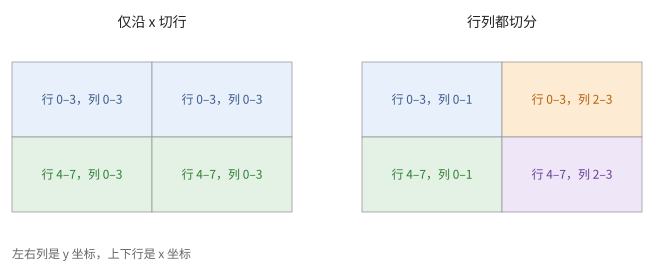
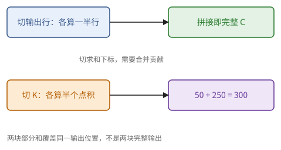
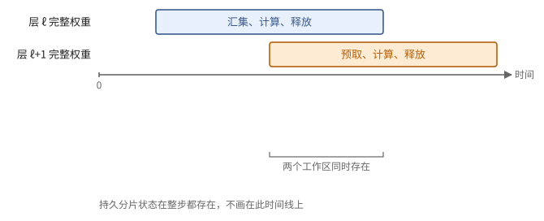
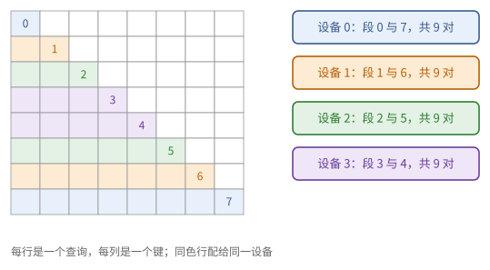
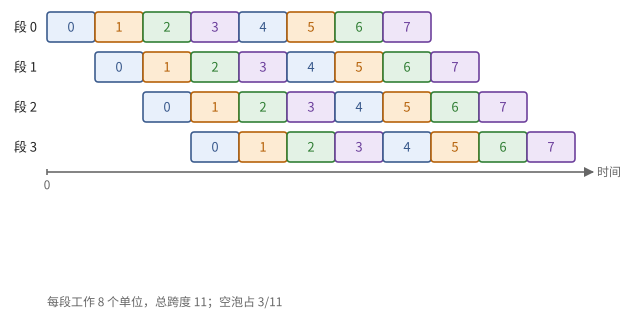
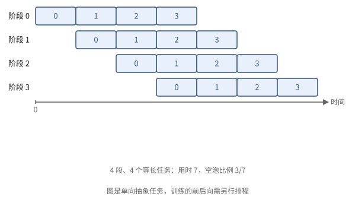

# 第 12 章　并行策略

第 11 章算出：大模型的参数和优化器状态放不进一颗芯片，训练所需的运算量要上千颗芯片算上几个月。怎样把一个 Transformer 的计算和存储分到许多芯片上？每种分法需要什么通信，通信能不能藏在计算后面？这一章先建立一套描述"数组怎样切开"的记号，把分布式矩阵乘法归结为四条规则，再用第 7 章的代价模型逐个分析数据并行、FSDP、张量并行、上下文并行、流水线并行和专家并行，最后把它们组合起来估算一步训练。

这一章是分布式训练面试的主干。各种并行的名字听起来五花八门，其实都是同一个问题的不同答案：切哪个下标，为此要付出什么通信。

## 12.1 网格与分片

先给芯片排个座位。

> **定义 12.1（设备网格）** $p$ 颗芯片排成一个多维数组，每一维有一个名字，称为**网格**（mesh）。例如 $\{x: 4, y: 8\}$ 是 32 颗芯片排成 $4 \times 8$，坐标 $(r_x, r_y)$。网格的维称为**网格轴**。

网格是逻辑上的排列，但应当与物理拓扑对应：例如在环面上让每个网格轴对应环面的一维，同一网格轴上的芯片就组成一个物理的环。

> **定义 12.2（分片）** 对数组 $A$ 的每一维，指定零个或若干个网格轴。数组的某一维**沿轴 $x$ 分片**，是指把这一维切成 $\lvert x \rvert$ 段连续的块，第 $r$ 块存放在 $x$ 坐标为 $r$ 的那些芯片上；没有用到的网格轴上，数据是**复制**的。记号：$A[I_x, J]$ 表示第一维沿 $x$ 分片、第二维不分片；$A[I_{xy}, J]$ 表示第一维同时沿 $x$ 和 $y$ 分片，切成 $\lvert x \rvert \lvert y \rvert$ 段。一个网格轴至多用于数组的一维。

于是每颗芯片上存放的数据量是 $\lvert A \rvert / \prod (\text{用到的轴的大小})$。

> **例 12.3（切了哪个轴，就复制在哪个轴）** 网格 $\{x: 2, y: 2\}$，数组 $A[8, 4]$ 只沿第一维的 $x$ 分片。设备 $(0,0), (0,1)$ 都存第 0–3 行，$(1,0), (1,1)$ 都存第 4–7 行。每台设备存 16 个数，全系统共有 64 个数，而原数组只有 32 个：沿 $y$ 的复制让物理总量翻了一倍。
>
> 若再把第二维沿 $y$ 切分，每台设备只存 $4 \times 2$ 个数，复制就消失了。网格只是一个坐标系；沿某个轴通信快不快，还要看它对应的物理链路。

**图 12.1**　2×2 网格上的行分片与二维分片。格内标明设备持有的逻辑区域，重复区域就是复制。

## 12.2 分片矩阵乘法

分布式程序的主体是矩阵乘法。给定两个操作数各自怎样切开，结果怎样切开、需要什么通信？只有四种情形。

考虑 $C[I, J] = \sum_K A[I, K] B[K, J]$。称 $K$ 为**收缩维**（被求和消掉的那一维），$I$、$J$ 为**非收缩维**。

> **命题 12.4（分片矩阵乘法的规则）**
>
> 1. **非收缩维分片，无需通信**：$A[I_x, K] \cdot B[K, J] \to C[I_x, J]$。每颗芯片用自己的行算出自己的行。
> 2. **收缩维在两侧沿同一组轴分片，得到部分和**：$A[I, K_x] \cdot B[K_x, J]$ 在每颗芯片上算出的是部分和 $C^{(r)}$，要沿 $x$ 归约：all-reduce 得到 $C[I, J]$，或 reduce-scatter 得到 $C[I_x, J]$（或 $C[I, J_x]$）。
> 3. **收缩维两侧的分片不一致，先使之一致**：例如 $A[I, K_x] \cdot B[K, J]$。对复制的 $B$，取出本地需要的一段 $B[K_x, J]$ 不需要通信，化为情形 2；或者对 $A$ 做 all-gather 得到 $A[I, K]$，化为情形 1。
> 4. **同一个轴不能同时分片两个非收缩维**：$A[I_x, K] \cdot B[K, J_x]$ 的结果 $C[I_x, J_x]$ 不合法（定义 12.2 要求一个轴至多用于一维）。须先对其中一个操作数做 all-gather。

*证明* 情形 1：$C[i, :] = A[i, :] B$，只用到本地的 $A$ 行与完整的 $B$。情形 2：$C = \sum_r A_{:, K_r} B_{K_r, :}$，第 $r$ 项在坐标 $r$ 的芯片上算出。情形 3：给复制的数组加上分片只需局部切片；去掉分片需要 all-gather。情形 4：芯片 $(r_x)$ 只有 $A$ 的第 $r_x$ 段行和 $B$ 的第 $r_x$ 段列，只能算出 $C$ 的对角块。∎

通信的代价由第 7 章给出：沿 $q$ 颗芯片对一个总大小为 $S$ 字节的数组做 all-gather（每颗芯片开始时持有 $S/q$，结束时持有 $S$）或 reduce-scatter（反过来），带宽项为 $\frac{q-1}{q}\frac{S}{\beta} \approx \frac{S}{\beta}$（命题 7.13）；all-reduce 是它的两倍。下面计算时只保留带宽项，并记 $\beta$ 为每颗芯片在所用网格轴上的注入带宽。

> **例 12.5（部分和不是一个更小的完整结果）** 令 $A = (1, 2, 3, 4)$，$B = (10, 20, 30, 40)^{\mathsf T}$，沿 $K$ 切给两台设备。设备 0 得 $1 \cdot 10 + 2 \cdot 20 = 50$，设备 1 得 $3 \cdot 30 + 4 \cdot 40 = 250$。两者必须相加才得到 300。
>
> 如果切的是 $A$ 的不同行，每台设备算出的就是自己那些行的完整结果。所以判断要不要通信，第一步是问：切开的是求和的下标，还是输出的下标？这比记"行并行""列并行"这些名字可靠。

**图 12.2**　切输出维得到可直接拼接的结果；切收缩维得到覆盖同一输出位置的部分和，需要归约。

## 12.3 数据并行与 FSDP

最简单的并行方式是让每颗芯片处理不同的数据。设一步训练处理 $N$ 个词元。

**数据并行**（DP）：参数在所有芯片上复制，词元沿轴 $d$ 分片，$X[N_d, D]$。前向时每一层都是情形 1，没有通信。反向时权重的梯度 $\nabla W = X^{\mathsf T} \nabla Y$ 的收缩维是 $N$，沿 $d$ 分片，是情形 2：每颗芯片得到部分和，要做一次 all-reduce。

- 每步通信：对全部梯度做一次 all-reduce，约 $2 s\Phi / \beta$。
- 每颗芯片的显存：完整的参数、梯度、优化器状态，约 $16\Phi$ 字节（11.3 节）。这是数据并行的致命问题。

**FSDP**（fully sharded data parallel，也称 ZeRO-3）的想法是：既然每颗芯片都存一份完整的参数太浪费，那就把参数、梯度、优化器状态也都沿 $d$ 切开，例如 $W[D_d, F]$，要用的时候再临时拼起来。

- 前向用到一层的 $W$ 时，先 all-gather 得到完整的 $W[D, F]$，用完即丢弃；
- 反向时再 all-gather 一次，算出部分和形式的梯度后做 reduce-scatter，每颗芯片只留下自己那一段梯度；
- 优化器只更新本地的一段参数。

每步通信约为 all-gather 两次、reduce-scatter 一次，共约 $3 s\Phi / \beta$，比 DP 多一半；每颗芯片的显存降为约 $16\Phi / p$。多出的通信能不能藏住？

> **命题 12.6（FSDP 的通信可以被掩盖的条件）** 若每层的 all-gather 与 reduce-scatter 能与相邻层的计算重叠，则带宽模型中计算量足以覆盖通信量的必要比较条件为
>
> $$
> \frac{N}{p} \ge \frac{s}{2} \cdot \frac{P}{\beta}
> $$
>
> 实现完全掩盖还要求每次通信在使用前及时完成、首尾开销可忽略且资源不争用。$N/p$ 是每颗芯片每步处理的词元数。

*证明* 一层参数量为 $\Phi_\ell$。每颗芯片每步对这一层的计算量为 $6 (N/p) \Phi_\ell$ FLOP，时间 $6 (N/p) \Phi_\ell / P$；通信约 $3 s \Phi_\ell / \beta$。前者不小于后者当且仅当 $N/p \ge s P / (2\beta)$。∎

$P / \beta$ 是芯片间链路的"屋顶线拐点"：每从链路收到一个字节，要做多少次运算才不吃亏。参考芯片 X 若每颗芯片的链路注入带宽为 $10^{11}$ 字节/秒，$P/\beta = 2600$，bf16 下要求每颗芯片每步至少处理约 2600 个词元。全局批量是有上限的（太大的批量对训练不利），所以芯片越多，越难满足这个条件，这时要引入别的并行方式。

> **例 12.7（持久状态和临时工作区分开算）** 8 台设备训练 $10^9$ 个参数，按每参数 16 字节计，FSDP 的持久状态每台为 2 GB。若当前层有 $10^8$ 个参数，bf16 的 all-gather 之后，完整权重还要另占 0.2 GB；提前拼好下一层、保留反向要用的激活，峰值还会更高。
>
> 所以"$16\Phi/p$ 放得下"只是显存预算的一部分。真实的峰值是持久状态，加上同时活着的完整层权重、通信缓冲、激活和临时空间。提前 all-gather 换来了重叠，也延长了完整权重活着的时间。

**图 12.3**　一层权重从分片状态临时汇集，参与前向或反向，用完释放。下一层提前汇集时，两个完整工作区可能重叠。

## 12.4 张量并行

命题 12.6 要求每颗芯片处理足够多的词元，芯片越多越难满足。另一种思路是不切数据，而切每一层的权重，让几颗芯片合作完成同一层的计算。这叫**张量并行**（TP），沿网格轴 $t$ 进行。

**MLP**：$W_1, W_3$ 沿 $F$（列）分片，$W_2$ 沿 $F$（行）分片：

$$
X[N, D] \cdot W_1[D, F_t] \to H[N, F_t] \quad \text{（情形 1，无通信）},
$$

逐元素的激活与门控在本地完成，然后

$$
H[N, F_t] \cdot W_2[F_t, D] \to \text{部分和} \xrightarrow{\text{all-reduce}} Y[N, D] \quad \text{（情形 2）}.
$$

这样安排的妙处在于：中间的 $H$ 本来就按 $F$ 切开，激活函数是逐元素的，所以第一个乘法和激活都不用通信，只在最后做一次 all-reduce。

**注意力**：按头分片，$W_Q, W_K, W_V$ 沿头的维度分片，每颗芯片算自己那几个头的注意力，$W_O$ 沿输入维分片，最后一次 all-reduce。

所以每层前向有两次 all-reduce，每次的数据量是 $N D$ 个激活。

> **命题 12.8（张量并行的规模上限）** 设每层参数约 $12 D^2$，激活为 $s$ 字节。张量并行的通信能被计算掩盖，需要
>
> $$
> t \le \frac{6 D}{s} \cdot \frac{\beta}{P}.
> $$

*证明* 每颗芯片每层的前向计算量为 $2N \cdot 12 D^2 / t$，时间 $24 N D^2 / (tP)$；两次 all-reduce 的通信约 $2 \times 2 N D s / \beta$。前者不小于后者当且仅当 $t \le 6 D \beta / (s P)$。∎

$D = 8192$、bf16、$P / \beta = 2600$ 时，$t \le 9.5$。与 FSDP 不同，这个上限与批量无关：张量并行只能在带宽最高的一小组芯片内使用，典型的 $t$ 是 4 到 8。

**序列并行**：张量并行中，两次 all-reduce 之间的归一化与残差加法在每颗芯片上重复计算，激活也在每颗芯片上完整保存。把 all-reduce 拆成 reduce-scatter 与 all-gather（命题 7.9），在二者之间让激活沿 $N$ 分片：$X[N_t, D]$。通信量不变，激活的显存和这部分计算都降为 $1/t$。

> **例 12.9（两台设备完成一个门控 MLP）** 取 $D = 4, F = 8, t = 2$。$W_1, W_3$ 各按列切成两个 $4 \times 4$，每台设备得到自己的 $H_r[N, 4]$；激活和门控在本地进行。$W_2$ 按行切成两个 $4 \times 4$，各设备算出 $Y_r[N, 4]$，最后 $Y = Y_0 + Y_1$。
>
> 若把门控的两次上投影切成不同的列集合，逐元素乘法就对不上号了；若下投影误按列切，设备就缺了另一半的隐藏维。三个权重的切法要作为一套规格一起核对。

## 12.5 上下文并行

序列很长时（比如几十万个词元），一个序列的激活和注意力计算都太大，一颗芯片放不下。**上下文并行**（CP）把序列维 $T$ 沿轴 $c$ 分片：每颗芯片持有一段连续的查询 $Q[T_c]$ 与对应的 $K[T_c]$、$V[T_c]$。

难处在于注意力需要每个查询看到所有的键。**环形注意力**的办法是：把 $c$ 颗芯片排成环，每颗芯片保留自己的查询，键值块沿环传递 $c - 1$ 次（每次是一次置换）。每收到一块键值，就用在线 softmax（命题 10.6）把它并入每个查询的状态 $(m, \ell, u)$。由命题 7.18，若每步的计算不少于传递一块键值的时间，通信就被掩盖：

$$
\frac{4 T_c^2 D}{P} \ge \frac{2 T_c H_{kv} d_h s}{\beta} \iff T_c \ge \frac{s}{2} \cdot \frac{H_{kv} d_h}{D} \cdot \frac{P}{\beta}.
$$

在因果掩码下，后面的查询要看的键更多：若按连续的段分配，持有最后一段的芯片工作量最大。常用的办法是把序列切成 $2c$ 段，第 $i$ 颗芯片取第 $i$ 段与第 $2c - 1 - i$ 段，一轻一重搭配，使各芯片的工作量相等。

> **例 12.10（前后配对如何均衡因果计算）** 把长度 8 的序列按每个词元一段分给 4 台设备。第 $j$ 段的查询有 $j + 1$ 个可见的键。若每台设备拿连续的两段，四台的有效对数是 3、7、11、15；若把第 $i$ 段与第 $7 - i$ 段配给同一台设备，每台都是 9。
>
> 这个精确的平衡依赖于等长的段、相同的头数和相同的每对代价。若各序列长度不同或掩码不规则，要按非空块的实际工作量重新分配。

**图 12.4**　因果三角中的八段查询按首尾配对。每设备同时承担少量与大量可见键的查询，平衡总工作量。

## 12.6 流水线并行

前几种方式都让每颗芯片参与每一层的计算。流水线并行反过来，按层切分：前几层放在第一组芯片上，接下来几层放在第二组上，依此类推。

**流水线并行**（PP）把 $n_L$ 层分成 $p_p$ 段，每段放在一组芯片上；一个批量切成 $m$ 个**微批量**，依次流过各段。芯片之间只需传递段边界上的激活（点对点），通信量很小。代价是开头和结尾总有一些段在空等：

> **命题 12.11（流水线的空泡）** 前向与反向各算一遍的简单调度中，每段处理一个微批量的前向与反向共用时 $t$，则一步用时约 $(m + p_p - 1) t$，其中空闲（**空泡**）所占的比例为
>
> $$
> \frac{p_p - 1}{m + p_p - 1}.
> $$

*证明* 由命题 9.9，$s = p_p$ 个各用时 $t$ 的阶段处理 $m$ 块，用时 $(m - 1)t + p_p t$；有效工作 $mt$。∎

所以微批量要远多于段数。交错前向与反向的调度（常称 1F1B）可以减少同时在途的激活，把每颗芯片放多个不相邻的段可以减小空泡，但都不能消除它。

> **例 12.12（四段和八个微批量）** 四个流水线段，每段处理一个任务用时 1，8 个任务总时间 $8 + 4 - 1 = 11$，每段工作 8、空闲 3，空泡比例 $3/11$。增加到 32 个任务时为 $3/35$。
>
> 训练时把前向和反向当作这样的阶段，还要约定调度方式和各段的代价；真实的 1F1B 时间要从前向、反向的依赖图算出来。空泡比例也推不出激活的峰值，峰值由同时在途的微批量个数决定。

**图 12.5**　四段处理八个单向微批量的理想时间线。该图证明空泡公式的阶段模型，训练时须另画前向与反向依赖。

**图 12.6**　等长单向任务的流水线；微批量增加会摊薄首尾空泡。

> **现状（2026-10）**：DeepSeek-V3（2024）的 DualPipe 调度把每个微批量的前向和反向各切成几块（注意力、专家分发的全交换、MLP、专家回收的全交换；反向再分成对输入的梯度和对权重的梯度两部分），让一个微批量的计算与另一个微批量的通信成对重叠，同时从流水线的两端送入微批量，进一步减小空泡。代价是每段要保存两份参数。这个设计的出发点，正是 12.7 节专家并行的全交换太贵。

## 12.7 专家并行

MoE 层（11.5 节）提供了另一个可以切分的维度：专家。

**专家并行**（EP）把 MoE 层的 $E$ 个专家沿轴 $e$ 分到各芯片上，每颗芯片放 $E/e$ 个专家。路由之后，每颗芯片把每个词元发往持有其所选专家的芯片（一次全交换），专家计算之后再发回（又一次全交换）。

每个 MoE 层每颗芯片发送和接收约 $2 \times (N/p) k D s$ 字节。全交换受二分带宽限制（命题 7.5），所以专家并行对拓扑很敏感。词元在专家间分配不均时，最忙的芯片决定这一层的时间；常见的对策是限制每个专家接收的词元数（容量因子），超出的词元丢弃或改派，或者在路由时限制每个词元能去的节点数，减少跨节点的流量。

> **例 12.13（通信量看分派，时间看最忙的设备）** 4 台设备各放一个专家，8 个词元各选 2 个专家，隐藏维 $D = 4$、bf16。共发送 16 份隐藏向量，每份 8 字节，分发的有效载荷 128 字节；返回还有同样多。若 16 份里有 8 份落在同一个专家上，其余专家再空闲，也缩短不了这个专家的矩阵乘法。
>
> 落在本地的专家可以不走外部链路；一个词元选中的几个专家若在同一个远端节点上，还可以只传一份、到了再复制。算链路的账要从具体的路由表出发，分清有效载荷、实际跨链路的字节和最忙的目标的工作量。

"只传一份、到了再复制"在 DeepSeek-V3 的训练里是一条硬性的设计。他们的 H800 节点内 NVLink 实际约 160 GB/s，节点间每块 GPU 的 InfiniBand 网卡实际约 40 GB/s，相差约 4 倍。256 个路由专家按节点分成 8 组，每组 32 个；路由时规定每个词元最多去 4 个节点。一个词元若选中同一节点上的几个专家，只经网卡发一份到那个节点，再由节点内的 NVLink 转给各个专家。于是跨节点的流量由"选了几个专家"变成"去了几个节点"，较慢的链路上至多 4 份。

## 12.8 组合与估算

最后把各种方式组合起来。实际的系统同时使用几种并行，每种对应网格的一个轴，例如 $\{\text{fsdp}: 64, \text{tp}: 8\}$。分配网格轴的原则：

- 每单位计算所需通信越多的并行方式，越应放在带宽越高的链路上：张量并行与专家并行在最内层，FSDP 与数据并行在外层，流水线并行可以跨越最慢的网络；
- 对每个轴检查通信能否被掩盖（命题 12.6、12.8 等），对每颗芯片检查显存（11.3 节）。

**估算一步训练**：计算时间 $6\Phi N / (pP \cdot \text{MFU}_{\text{kernel}})$；逐轴算出通信时间；能重叠时取最大值，不能重叠时相加；再加上流水线的空泡。

> **现状（2026-10）**：Llama 3 的 4050 亿参数模型在最多 16384 块 H100 上训练，同时用了四种并行：张量并行（8，放在一台机器内）、上下文并行、流水线并行和 FSDP（数据并行的一种），MFU 为 38%–43%（11.3 节）。论文还报告，在 54 天的预训练快照里作业被打断了 466 次，其中 419 次是意外中断，GPU 本身的故障占意外中断的一半以上。上万颗芯片的训练，容错和快速恢复（检查点、替换故障机器）与并行策略同样重要。

**推理中的张量并行。** decode 时每步只有 $N = B$ 个词元，张量并行的 all-reduce 消息只有 $B D s$ 字节，几乎全是 $\alpha$ 项（命题 7.13）。每层两次，$n_L$ 层就是 $2 n_L$ 次固定开销，每次几微秒到十几微秒，直接加到每个词元的延迟上（习题 12.7）。所以 decode 需要步数少、固定开销低的集合通信。

> **现状（2026-10）**：Google TPU 8i 加入了专门加速集合通信、降低其延迟的单元（Collectives Acceleration Engine），NVIDIA 的 NVLink 交换系统把 72 颗 GPU 放进一个全带宽的交换域，二者都是在回应本节所说的 decode 延迟与专家并行的全交换问题。

> **例 12.14（组合方案必须同时过三关）** 参考芯片 X，$P/\beta = 2600$，取 $D = 8192, s = 2$。命题 12.8 的带宽条件给 $t \le 9.45$，所以 $t = 8$ 还在范围内。再加 FSDP 轴 $d = 16$，共 128 台设备；若全局一步 32768 个词元，每个 FSDP 分片处理 2048 个词元，低于命题 12.6 要求的 2600，FSDP 的通信可能露出来。
>
> 张量并行减少了每台设备的计算，也改变了每台设备的权重量和通信量，组合之后的条件要按实际的本地形状重新算。这里用两个单轴的条件筛掉明显不合适的选择；两个都满足，也不能保证整机就能跑到预期的速度。容量、带宽、依赖次序都通过之后，方案才有成立的可能。

**推理中的专家并行。** 大的 MoE 模型在 decode 时通常把专家分到许多芯片上，每个 MoE 层两次全交换，每生成一个词元就要经过 $n_L$ 层。每台设备每步只处理几十个词元，计算很少，这两次全交换往往就决定了每个用户看到的出字速度。DeepSeek 在 ISCA 2025 的论文里算过一笔账。

> **例 12.15（专家并行给 decode 速度定的上限）** 取 DeepSeek-V3 的形状：61 层，隐藏维约 7000，每个词元送往 8 个路由专家和 1 个共享专家，共 9 份。每台设备放一个专家，每步处理 32 个词元；分发用 fp8（每个数 1 字节），回收用 bf16（2 字节）。每台设备每层收发
>
> $$
> 32 \times 9 \times 7000 \times (1 + 2) \approx 6.05 \times 10^6\ \text{字节}.
> $$
>
> 经一块 400 Gb/s（50 GB/s）的网卡，用时约 121 µs。把每步的词元分成两个微批量交替进行：一个在计算时，另一个在通信。计算若足够快，链路就一直忙着，每层用时约为两个微批量的通信时间之和，242 µs；61 层合计约 14.8 ms，即每个用户每秒约 67 个词元。若换成 72 颗 GPU 同在一个 NVLink 交换域、每颗 900 GB/s 的系统，每个微批量约 6.7 µs，每词元约 0.82 ms，每秒约 1200 个词元。
>
> 这个上限没有计入网络延迟、计算时间和带宽的利用率，真实的数字会低不少。但它说明了一件事：对大 MoE 模型的 decode，单个用户能有多快，主要取决于全交换走的是哪一层链路。这也是上面的现状框里各家都在扩大高带宽交换域的原因。

带宽要多少才够？DeepSeek-V4（2026）的报告从另一个方向给了一个干净的条件。

> **命题 12.16（专家计算藏住全交换的条件）** 设隐藏维为 $D$，专家的中间维为 $F_e$（门控、上投影、下投影三个矩阵）。一个词元送到一个专家，前向要做 $6 D F_e$ FLOP，分发（fp8）与回收（bf16）共传 $3D$ 字节。若每颗芯片的算力为 $P$，可用于全交换的带宽为 $\beta$，则专家计算的时间不少于通信时间，当且仅当
>
> $$
> \frac{P}{\beta} \le 2 F_e .
> $$

*证明* 每个（词元，专家）对的计算时间为 $6DF_e/P$，通信时间为 $3D/\beta$，前者不小于后者当且仅当 $P/\beta \le 2F_e$。∎

条件与 $D$ 和词元数都无关，只看专家的中间维。DeepSeek-V4-Pro 的 $F_e = 3072$，界是 6144 FLOP/字节：每 1 GB/s 的全交换带宽，能藏住约 6.1 TFLOP/s 的专家计算。这是一个平衡点：带宽低于它，通信露在外面；高于它，多出来的带宽也换不来速度。DeepSeek 据此建议硬件厂商按这个比例配置带宽，而不是无条件地堆带宽。用 H800 的数字检查：fp8 稠密算力约 $2 \times 10^{15}$ FLOP/s，网卡 50 GB/s，比值约 40000，远超 6144，所以 DeepSeek-V3 要限制每个词元去的节点数，并尽量把流量留在 NVLink 上。

## 本章小结

1. 网格是带名字的设备数组；数组的每一维可以沿若干网格轴分片，其余轴上复制；记号 $A[I_x, J]$。（定义 12.1、12.2）
2. 分片矩阵乘法：非收缩维分片无需通信；收缩维两侧同轴分片得部分和，需 all-reduce 或 reduce-scatter；两侧不一致时先切片或 all-gather；一个轴不能同时分片两个非收缩维。（命题 12.4）
3. DP：梯度 all-reduce，显存 $16\Phi$；FSDP：两次 all-gather 一次 reduce-scatter，显存 $16\Phi/p$，每芯片每步词元数 $\ge \frac{s}{2} P/\beta$ 时通信可掩盖。（命题 12.6）
4. TP：MLP 列切再行切、注意力按头切，每层两次激活的 all-reduce；可掩盖需 $t \le \frac{6D}{s}\frac{\beta}{P}$，只适合最高带宽的小组；序列并行把 all-reduce 拆成 reduce-scatter 与 all-gather 以节省激活。（命题 12.8）
5. CP：键值沿环传递，用在线 softmax 合并；因果掩码下用对称的分段平衡负载。（12.5 节）
6. PP：空泡比例 $(p_p - 1)/(m + p_p - 1)$。（命题 12.11）
7. EP：每个 MoE 层两次全交换，受二分带宽和负载不均限制。（12.7 节）
8. 通信越密集的并行越靠内层链路；decode 的张量并行受集合通信的固定开销限制；万卡规模下容错同样关键。（12.8 节）
9. MoE 的 decode 中，每层两次全交换常常决定出字速度：以每设备处理的词元数、9 份分发、fp8 分发加 bf16 回收算出每层字节，再除以所走链路的带宽。专家计算能藏住全交换，当且仅当 $P/\beta \le 2F_e$，与隐藏维无关。跨节点时限制每个词元去的节点数，节点内再转发。（12.7 节、例 12.15、命题 12.16）

## 习题

**习题 12.1** ★ 对下列分片矩阵乘法，说明需要什么通信，以及结果的分片：(a) $A[I_x, K] \cdot B[K, J_y]$；(b) $A[I, K_x] \cdot B[K_x, J_y]$；(c) $A[I_y, K_x] \cdot B[K, J]$；(d) $A[I_x, K] \cdot B[K_x, J]$。

提示 1

逐个检查哪个下标被切分：收缩维产生部分和，输出维产生完整局部结果。

提示 2

逐个对照命题 12.4 的四种情形。

答案

(a) 无需通信，$C[I_x, J_y]$（两个非收缩维用不同的轴，合法）。(b) 本地得到部分和，沿 $x$ 做 all-reduce 得 $C[I, J_y]$，或 reduce-scatter 得 $C[I_x, J_y]$。(c) 对复制的 $B$ 局部切片成 $B[K_x, J]$，本地得部分和，沿 $x$ 归约，结果 $C[I_y, J]$ 或 $C[I_y, J_x]$。(d) $B$ 的收缩维沿 $x$ 分片，而 $A$ 的 $x$ 已用于 $I$：要么对 $B$ 沿 $x$ 做 all-gather 得 $B[K, J]$，结果 $C[I_x, J]$；要么对 $A$ 做 all-to-all 把 $x$ 从 $I$ 移到 $K$，得 $A[I, K_x]$，化为情形 2。

**习题 12.2** ★ $\Phi = 7 \times 10^{10}$，bf16 参数与梯度，64 颗芯片，每颗的注入带宽 $\beta = 10^{11}$ 字节/秒。分别求 DP 与 FSDP 每步的通信时间（只计带宽项）和每颗芯片存放参数、梯度、优化器状态所需的显存。

提示 1

分别列两方案每步的 collective 种类与持久状态；通信总量按单设备注入计。

提示 2

DP 约 $2s\Phi/\beta$，FSDP 约 $3s\Phi/\beta$；显存 $16\Phi$ 与 $16\Phi/p$。

答案

DP：$2 \times 2 \times 7 \times 10^{10} / 10^{11} = 2.8$ s，显存 1.12 TB（放不下）。FSDP：4.2 s，显存 17.5 GB。FSDP 多花一半通信，换来能放得下；4.2 s 能否被掩盖取决于每步的计算量（习题 12.3）。

**习题 12.3** ★ 接习题 12.2，参考芯片 X（$P = 2.6 \times 10^{14}$），每步全局处理 $N = 4 \times 10^6$ 个词元。(a) 每步的计算时间（MFU 按 100% 计）是多少？(b) FSDP 的通信能否被掩盖？(c) 若芯片数增加到 2048，而全局批量不变呢？

提示 1

增加设备数不会增加全局词元数，因此每设备工作下降而层权重的通信未同比下降。

提示 2

命题 12.6：需要 $N/p \ge P/\beta = 2600$（$s = 2$）。

答案

(a) $6 \times 7 \times 10^{10} \times 4 \times 10^6 / (64 \times 2.6 \times 10^{14}) \approx 101$ s。(b) $N/p = 62500 \gg 2600$，可以掩盖（4.2 s 远小于 101 s）。(c) $N/p \approx 1950 < 2600$，计算约 3.2 s，通信仍约 4.2 s，不能掩盖。此时应引入张量并行：每 $t$ 颗芯片共享一份 FSDP 分片，FSDP 的轴变小，每颗芯片上的通信与计算之比改变。

**习题 12.4** ★ 用命题 12.8 估计：$D = 8192$，bf16，(a) $P/\beta = 2600$；(b) 在一个高带宽交换域内，$P/\beta = 500$。张量并行的规模上限各是多少？

提示 1

把比较式整理为 t 的上界；注意使用的是该网格轴的有效单向带宽。

提示 2

$t \le 6D\beta/(sP) = 3D / (P/\beta)$。

答案

(a) $3 \times 8192 / 2600 \approx 9.5$，取 8。(b) $3 \times 8192 / 500 \approx 49$，可以到 32 左右。张量并行的规模由最快的那一级互联决定。

**习题 12.5** ★ 8 段流水线，32 个微批量，空泡比例是多少？要让空泡低于 5%，至少需要多少个微批量？

提示 1

先求填充排空的空闲段数，再解关于微批量数的不等式。

提示 2

命题 12.11。

答案

$7/39 \approx 18\%$。需要 $7/(m + 7) < 0.05$，即 $m > 133$，至少 134 个。

**习题 12.6** ★ 上下文并行，环形注意力：$D = 8192$，$H_{kv} d_h = 1024$，bf16，$P/\beta = 2600$。每颗芯片的序列段 $T_c$ 至少多长，通信才能被掩盖？

提示 1

每阶段保留本地 Q，传入一块 K/V；比较这一块的计算和传输。

提示 2

12.5 节的不等式。

答案

$T_c \ge 1 \times \frac{1024}{8192} \times 2600 = 325$。这个条件很容易满足；上下文并行的瓶颈通常在因果掩码下的负载不均，而不在通信。

**习题 12.7** ★ decode 时用 $t = 8$ 的张量并行，模型 $n_L = 80$ 层，每层两次 all-reduce，每次消息很小，集合通信的 $\alpha = 5$ µs。(a) 用环形 all-reduce，每个词元因此多出多少延迟？(b) 用递归倍增算法呢？

提示 1

只计启动项时，先求一次 collective 的步数，再乘每层次数和层数。

提示 2

环形 all-reduce 的 $\alpha$ 项为 $2(t-1)\alpha$，递归算法为 $2\alpha \log t$（命题 7.13、7.14）。

答案

(a) 每次 $14 \times 5 = 70$ µs，$160$ 次共 11.2 ms。(b) 每次 $6 \times 5 = 30$ µs，共 4.8 ms。若每个词元的计算本身只要 10–20 ms，这部分开销举足轻重。这就是低延迟集合通信对 decode 的意义。

**习题 12.8** ★（审查题）AI 为 MLP 写的张量并行方案是：$W_1[D, F_t]$，$W_2[F, D_t]$（$W_2$ 沿输出维分片）。按命题 12.4 分析第二个矩阵乘法 $H[N, F_t] \cdot W_2[F, D_t]$ 需要什么通信，与 12.4 节的方案比较。

提示 1

检查隐藏维 F 的两侧分片是否一致；沿同轴切输出维不能代替缺失的隐藏维数据。

提示 2

收缩维 $F$ 在 $H$ 中沿 $t$ 分片，在 $W_2$ 中复制；但 $W_2$ 的 $t$ 已被 $D$ 占用。

答案

$W_2$ 的轴 $t$ 已用于 $D$，不能再对 $F$ 局部切片。只能对 $H$ 做 all-gather 得 $H[N, F]$，再做情形 1 得 $Y[N, D_t]$，之后下一层还需要 all-gather 得 $Y[N, D]$。$H$ 的大小是 $N F$，约为 $Y$ 的 $F/D$ 倍（通常 3.5–4 倍），通信量远大于 12.4 节方案中对 $ND$ 规模的激活做一次 all-reduce。修改：$W_2$ 沿 $F$（行）分片，$W_2[F_t, D]$。

**习题 12.9** ★（综合审查题）两设备分别持有 $A[4,4]$ 的上、下两行与 $B[4,4]$ 的左、右两列，且沿同一个设备轴。各自计算能覆盖 C 的哪些区域？给出一种无需改变设备数的正确方案。

提示 1

某设备只有自己 A 的行和 B 的列；先把能算出的输出坐标画出来。

提示 2

两个设备只能算左上与右下两个 2×2 块，缺另两个块。

答案

设备 0 算 C 的行 0–1、列 0–1，设备 1 算行 2–3、列 2–3，缺两个非对角块。可 all-gather B，使每设备持有完整 B，再用自己的 A 行计算完整本地输出行。也可汇集 A 后按 B 列计算；二者容量与通信需分别计账。

**习题 12.10** ★ 一个 MoE 模型有 48 层，隐藏维 $D = 4096$，每个词元送往 8 个路由专家和 1 个共享专家，专家的中间维 $F_e = 1536$。decode 时每台设备放一个专家、每步处理 64 个词元，分发用 fp8、回收用 bf16，全交换走 100 GB/s 的链路，两个微批量交替。(a) 按例 12.15 的办法，每词元至少多少毫秒？每个用户每秒至多多少个词元？(b) 若每颗芯片的 fp8 算力为 $10^{15}$ FLOP/s，按命题 12.16，全交换的带宽至少要多少，专家计算才能藏住通信？100 GB/s 够吗？

提示 1

每台设备每层收发 $64 \times 9 \times 4096 \times 3$ 字节；两个微批量的通信时间相加是每层的下界。

提示 2

命题 12.16：$\beta \ge P / (2F_e)$。

答案

(a) 每层每台设备约 $7.08 \times 10^6$ 字节，100 GB/s 下约 70.8 µs；两个微批量交替，每层约 142 µs；48 层约 6.8 ms，每秒至多约 147 个词元。(b) $\beta \ge 10^{15} / 3072 \approx 3.3 \times 10^{11}$ 字节/秒，即约 326 GB/s。100 GB/s 不够，通信会露在外面；(a) 中假设"计算足够快、链路一直忙"，正是这种情形下的估算。

**习题 12.11** ★（审查题）有人提议："我们的 MoE 推理受全交换限制，所以把网络带宽再翻一倍，吞吐就能翻倍。"已知专家中间维 $F_e = 2048$，芯片算力 $P = 2 \times 10^{15}$ FLOP/s，现有全交换带宽 $\beta = 800$ GB/s。评价这个提议。

提示

先算现在的 $P/\beta$，与 $2F_e$ 比较，判断现在到底是谁在限制。

答案

$P/\beta = 2 \times 10^{15} / 8 \times 10^{11} = 2500 \le 2F_e = 4096$，按命题 12.16，专家计算已经能藏住通信，瓶颈不在带宽。再加带宽，带宽模型下不会变快。若实测仍然受通信限制，要找别的原因：负载不均使最忙的设备成为瓶颈（12.7 节）、消息太小而受延迟项 $\alpha$ 限制、计算与通信没有真正重叠，或者全交换占用了计算单元。先测清楚是哪一种，再决定花钱的方向。

