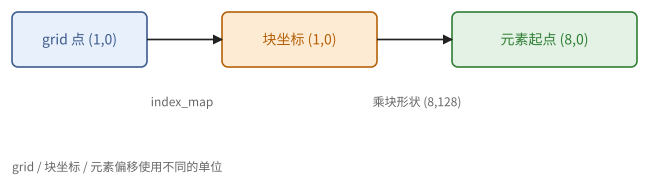
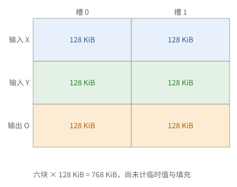
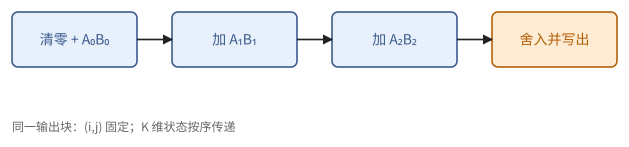
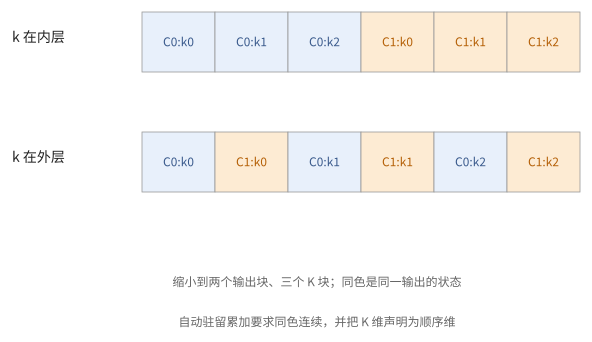
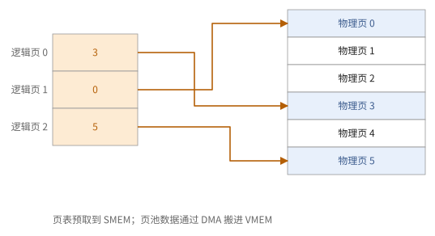
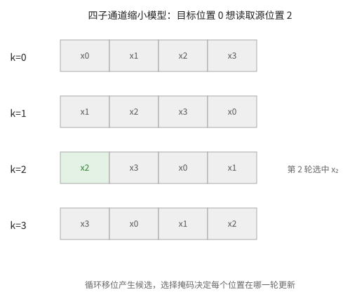
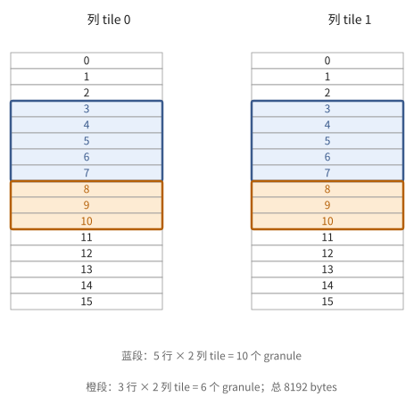
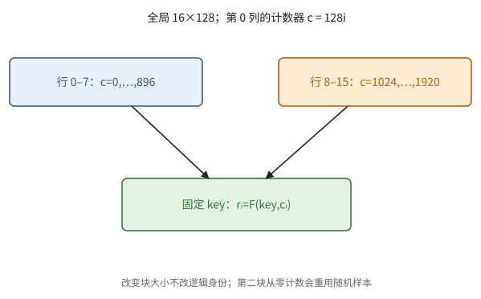

# 第 16 章　Pallas TPU 编程

XLA 会自动完成融合、分块和流水线，大多数程序不必关心这些。但第 11 章里最关键的几个计算（注意力、分组矩阵乘法、量化矩阵乘法、带特殊通信的矩阵乘法），常常需要按第 6–10 章的理论专门安排数据流，而 XLA 的通用策略做不到。**Pallas** 是 JAX 中写这种 kernel 的语言：程序员说明怎样把数组切成块、每一块怎样计算，编译器（Mosaic）生成 DMA、流水线和 TensorCore 的指令。

我们先把一个 Pallas kernel 看成数学对象，推出它正确的条件和它要搬多少数据，后面各节都在这个模型上添东西。书中可执行的 kernel 都在 JAX 0.11.2 的 TPU 解释器上检查过语义。

## 16.1 kernel 的数学描述

一个 Pallas kernel 做的事，其实就是第 6 章的分块矩阵乘法那样的"按块循环"：外面一个多重循环遍历所有的块，每一步取出几个输入块、算出一个输出块。Pallas 把这个循环写成一个整数格子（grid），把"第几步取哪一块"写成一个函数。

> **定义 16.1（Pallas kernel）** 一个 Pallas kernel 由以下几部分组成：
>
> - **grid**：一个整数格 $\mathcal{G} = [g_0] \times \dots \times [g_{r-1}]$，称为迭代空间；
> - 对每个输入和输出 $X_m$：一个**块形状** $b_m$ 和一个**下标映射** $\varphi_m: \mathcal{G} \to$ 块坐标；
> - **kernel 体** $\kappa$：一个以若干块为参数的函数。
>
> 它的语义是：按字典序遍历 $\gamma \in \mathcal{G}$，对每个 $\gamma$，取出每个输入的第 $\varphi_m(\gamma)$ 块，执行 $\kappa$，把结果写入每个输出的第 $\varphi_m(\gamma)$ 块。块坐标是块的编号而不是元素的偏移：形状为 $(b_0, b_1)$ 的块，坐标 $(i, k)$ 对应元素 $[i b_0, (i+1) b_0) \times [k b_1, (k+1) b_1)$。

grid 是分块之后的循环，下标映射说明每一步用到哪些块。有了这个描述，正确性和数据量都能直接算出来。先看正确性：如果两个 grid 点写同一个输出块，会发生什么？

> **命题 16.2（输出的正确性条件）** 设输出 $Y$ 的下标映射为 $\varphi_Y$。
>
> 1. 若 $\varphi_Y$ 不是单射，则映到同一个输出块的那些 grid 点，在遍历次序中必须**连续**，并且对应的 grid 维必须按顺序执行（16.5 节的 `"arbitrary"`）。此时这个输出块在这些步之间留在 VMEM 中，可以被累加；当下标改变时才写回 HBM。
> 2. 若 $\varphi_Y$ 不是满射，未被覆盖的输出块的内容未定义。

*证明* 自动流水线只在输出块的下标改变时写回（16.2 节）。若映到同一块的步不连续，这个块会被写回、之后又以未初始化的缓冲重新开始，先前的结果被覆盖；若这些步被分给不同的核心并行执行，就是对同一块的数据竞争（定义 9.3）。未被映到的块从未被写。∎

再看数据量。流水线有一个简单而重要的行为：相邻两步若要同一个输入块，就不再重新读。

> **命题 16.3（数据量）** 自动流水线只在相邻两步的块下标不同时重新读入一个输入块。所以输入 $X_m$ 的 HBM 读取量为
>
> $$
> (\text{遍历中 } \varphi_m(\gamma) \text{ 改变的次数} + 1) \times (\text{块的字节数}),
> $$
>
> 输出同理。

所以 grid 维的**次序**决定了数据量：把某个输入的下标不依赖的维放在最内层，这个输入就不会被重复读取。第 6 章的分块分析（命题 6.12）在 Pallas 中，就是数一数各个下标映射改变了几次（习题 16.1）。

> **例 16.4（grid 点不是线程编号）** 数组 $X[16, 256]$，块 $[8, 128]$，grid $(2, 2)$，映射 $(i, j) \mapsto (i, j)$。四个点依次选左上、右上、左下、右下块；点 $(1, 0)$ 选的是元素行 8–15、列 0–127。
>
> 若错误地让映射返回 `(8*i, 128*j)`（元素偏移），BlockSpec 仍会把它当作块坐标，再乘一次块尺寸，于是越界。写下四个 grid 点和它们实际对应的元素区间，比翻 API 文档更快发现这类错误。



**图 16.1**　grid 坐标先经过 index_map 得到块坐标，再乘 block_shape 得到元素起点。这两次映射的单位不同。

## 16.2 BlockSpec 与自动流水线

定义 16.1 中的块形状和下标映射，在程序中由 `pl.BlockSpec(block_shape, index_map)` 给出。最简单的例子是逐行分块的加法：

```python
def add_kernel(x_ref, y_ref, o_ref):
    o_ref[...] = x_ref[...] + y_ref[...]

def add(x, y, bm=256):
    M, N = x.shape
    spec = pl.BlockSpec((bm, N), lambda i: (i, 0))       # 第 i 步用第 i 个行块
    return pl.pallas_call(
        add_kernel,
        out_shape=jax.ShapeDtypeStruct(x.shape, x.dtype),
        grid=(M // bm,),
        in_specs=[spec, spec],
        out_specs=spec,
    )(x, y)
```

（在没有 TPU 的机器上检查语义时，给 `pallas_call` 加上 `interpret=pltpu.InterpretParams()`。）

编译器为它生成的正是 9.4 节的软件流水线：每个操作数在 VMEM 中有两个缓冲；第 $t$ 步计算时，第 $t + 1$ 步的输入块已经在读入，第 $t - 1$ 步的输出块正在写回。程序员不写任何 DMA 或同步，正确性由编译器保证。

两个可以调节的参数：

- **缓冲数**：`pl.BlockSpec(..., pipeline_mode=pl.Buffered(3))` 让这个操作数用三个缓冲，即提前两步预取。当每块的计算时间小于读入的延迟时（定理 9.11），需要更深的预取。
- **VMEM 预算**：所有操作数的（缓冲数 × 块字节数）加上 scratch，必须放进 VMEM。编译器参数 `vmem_limit_bytes` 设定上限。块越大，固定开销占比越小（命题 4.19），但 VMEM 越紧。

> **例 16.5（从三个块推回缓冲容量）** 逐元素加法的输入、输出块都是 $[256, 128]$ 的 f32，每块 128 KiB；三个操作数各双缓冲，共 $3 \cdot 2 \cdot 128 = 768$ KiB。若两个输入改为三缓冲、输出仍双缓冲，预算变为 1 MiB。
>
> 这只是显式的块预算，还要给临时值、布局填充和编译器的工作区留余量。缓冲数从 2 增到 3，改变的是同时活着的数据，而不是输出的形状。



**图 16.2**　两个输入和一个输出各有两槽。kernel 体看见当前块，流水线还保存上一块写回与下一块读入所需的存储。

## 16.3 kernel 体：ref 与值

kernel 体的参数是 **ref**：指向 VMEM（或 SMEM、HBM）中一块存储的引用，可读可写。ref 和普通的 JAX 数组（值）不同：值是不可变的（第 13 章），ref 是一块可以反复改写的存储。

- `x_ref[...]` 把整块读成一个**值**（一个 JAX 数组，编译后在向量寄存器中）；`x_ref[pl.ds(start, size), :]` 读动态的一段；`o_ref[...] = v` 写回。
- 值上的运算就是 `jnp` 的运算，编译器把它们映射到 TensorCore 的单元：`jnp.dot` 用 MXU；指数、倒数等用 EUP；逐元素运算用向量 ALU；沿最后一维（通道方向）的归约和转置用 XLU（15.3 节）。
- `pl.program_id(d)` 是当前 grid 点的第 $d$ 个坐标，`pl.num_programs(d)` 是第 $d$ 维的大小。
- `pl.when(cond)` 包装只在条件成立时执行的代码（标量单元上的分支）；kernel 体内的循环用 `jax.lax.fori_loop`。

把这些放在一起，就能写出第 6 章的分块矩阵乘法：

> **例 16.6（分块矩阵乘法）**
>
> ```python
> def mm_kernel(a_ref, b_ref, o_ref, acc_ref):
>     k = pl.program_id(2)
>
>     @pl.when(k == 0)
>     def _():
>         acc_ref[...] = jnp.zeros_like(acc_ref)
>
>     acc_ref[...] += jnp.dot(a_ref[...], b_ref[...], preferred_element_type=jnp.float32)
>
>     @pl.when(k == pl.num_programs(2) - 1)
>     def _():
>         o_ref[...] = acc_ref[...].astype(o_ref.dtype)
>
> def matmul(a, b, bm=128, bn=128, bk=128):
>     M, K = a.shape
>     _, N = b.shape
>     return pl.pallas_call(
>         mm_kernel,
>         out_shape=jax.ShapeDtypeStruct((M, N), a.dtype),
>         grid=(M // bm, N // bn, K // bk),
>         in_specs=[pl.BlockSpec((bm, bk), lambda i, j, k: (i, k)),
>                   pl.BlockSpec((bk, bn), lambda i, j, k: (k, j))],
>         out_specs=pl.BlockSpec((bm, bn), lambda i, j, k: (i, j)),
>         scratch_shapes=[pltpu.VMEM((bm, bn), jnp.float32)],
>         compiler_params=pltpu.CompilerParams(
>             dimension_semantics=("parallel", "parallel", "arbitrary")),
>     )(a, b)
> ```

这段程序只有十几行有用的内容，却包含了本章到此为止的全部要点。用命题 16.2、16.3 检查它：

- **正确性**（命题 16.2）：输出的下标 $(i, j)$ 在 $k$ 维上不变，映到同一块的步是连续的（$k$ 在最内层），且 $k$ 维标为 `"arbitrary"`。累加器是 f32 的 scratch，在 $k = 0$ 时清零，在最后一步写出一次（避免了习题 2.8 与习题 6.9 的两个错误）。
- **数据量**（命题 16.3）：$A$ 的块 $(i, k)$ 每步都变，读 $\frac{M}{b_M}\frac{N}{b_N}\frac{K}{b_K}$ 次，每次 $s b_M b_K$ 字节，共 $s MK \cdot \frac{N}{b_N}$；$B$ 共 $s KN \cdot \frac{M}{b_M}$；$C$ 写 $MN$ 个元素一次。与命题 6.12 相同。

> **例 16.7（沿三个 K 块追踪累加器）** 在例 16.6 中取 $K = 384$、$b_K = 128$。第 0 步先清零再加上 $A_0 B_0$，第 1 步变成 $A_0 B_0 + A_1 B_1$，第 2 步再加 $A_2 B_2$，这时才写出输出。若每一步都清零，最后只剩第三项；若每一步都把累加器转成 bf16，就多了好几次舍入。
>
> 要检查的不变量是："第 $k$ 步结束时，累加器里是第 0 到 $k$ 块的部分和。"累加器是 ref，是会变的状态；从 ref 读出来的值只是读的那一刻的快照，不会跟着 ref 一起更新。



**图 16.3**　同一输出块的 K 维按顺序累加；清零、累加、最后写出各有确定位置。输出块切换时开始一条新的状态链。



**图 16.4**　缩小的 grid 遍历保留三个 K 块；连续驻留是累加状态正确性的条件之一。

<div class="widget" data-widget="blockmap"></div>

## 16.4 内存空间与 scratch

例 16.6 用一块 scratch 作累加器。操作数和 kernel 内部的存储可以放在哪里？每个操作数可以指定**内存空间**：

| 内存空间 | 含义 |
| --- | --- |
| `pltpu.VMEM`（分块操作数的默认值） | 块被自动流水线拷入 VMEM |
| `pltpu.SMEM` | 放入标量存储，用于下标、偏移等标量 |
| `pl.ANY`（或 `pltpu.HBM`） | 留在 HBM，kernel 得到一个指向 HBM 的 ref，必须自己用 DMA 搬运（16.6 节） |

`scratch_shapes` 声明 kernel 内部使用的存储，在整个 kernel 的执行期间（跨所有 grid 步）都存在：

- `pltpu.VMEM(shape, dtype)`：累加器、手动 DMA 的缓冲；
- `pltpu.SMEM(shape, dtype)`：标量的中间结果；
- `pltpu.SemaphoreType.DMA((n,))`：$n$ 个 DMA 信号量（定义 9.7）；`pltpu.SemaphoreType.REGULAR` 用于核心之间、芯片之间的普通信号（第 19 章）。

> **例 16.8（ref 在哪里，决定能做什么）** 指向 HBM 的 ref 表示一块远处的存储，并不意味着数据已经在向量寄存器里。要做向量加法，先把需要的数据 DMA 到 VMEM，再从 VMEM 读成值；SMEM 里的小整数表用来算地址，不能当作大张量运算的工作区。
>
> 形状和类型相同的两个 ref，若在不同的内存空间里，能合法做的操作也不同。所以 kernel 的规格要同时写明数值类型和内存空间。

## 16.5 维度语义与多核

例 16.6 还给每个 grid 维标了语义。`dimension_semantics` 为每个 grid 维声明一种语义：

- `"parallel"`：这一维的各步互相独立，可以以任何次序执行，也可以分给多个 TensorCore（megacore，15.6 节）；
- `"arbitrary"`：这一维必须按顺序执行，因为各步之间有状态传递（累加到输出或 scratch）。

> **命题 16.9** 若某个输出（或 scratch 中的累加器）的块在某一维上保持不变并被累加，这一维必须是 `"arbitrary"`。把它标为 `"parallel"`，在有多个 TensorCore 时就是数据竞争。

在只有一个 TensorCore 的芯片上，错误的标注可能恰好不出错，换到 megacore 的芯片上才出错。这是审查时要逐维检查的一点（习题 16.3）。

> **例 16.10（拆输出和拆状态是两回事）** 固定 $K$ 循环，两个输出块 $(i, j) = (0, 0)$ 和 $(1, 0)$ 的输出互不重叠，累加状态也各是各的，可以分给两个 TensorCore。反过来，固定一个输出块而让两个 $K$ 步并行，它们就会同时修改同一个累加器。
>
> 若确实要把 $K$ 拆开并行，就要给每个 $K$ 分片一份独立的部分和，最后再加一次归约（6.8 节的 split-K）。把维度标成 `"parallel"` 只是一个声明，代替不了这一步算法上的改写。

## 16.6 手动 DMA 与信号量

自动流水线覆盖了"每步取固定的块"的情形。以下情形需要自己写 DMA：访问模式依赖于数据、各阶段的节奏不同、需要跨越 grid 步的特殊重叠，以及跨核心、跨芯片的拷贝（第 19 章）。

做法是把输入留在 HBM（`memory_space=pl.ANY`），在 scratch 中声明 VMEM 缓冲和 DMA 信号量，用 `pltpu.make_async_copy(src, dst, sem)` 建立拷贝，`.start()` 发起，`.wait()` 等待。下面的 kernel 用双缓冲按行块求列和：

```python
def colsum_kernel(x_hbm, o_ref, buf, sem):
    bm = buf.shape[1]
    nblk = x_hbm.shape[0] // bm

    def copy(t, slot):
        return pltpu.make_async_copy(x_hbm.at[pl.ds(t * bm, bm)], buf.at[slot], sem.at[slot])

    copy(0, 0).start()                                   # 序幕
    o_ref[...] = jnp.zeros_like(o_ref)

    def body(t, carry):
        slot = t % 2
        @pl.when(t + 1 < nblk)
        def _():
            copy(t + 1, 1 - slot).start()                # buf[1-slot] 已在第 t-1 步用完
        copy(t, slot).wait()                             # 命题 9.4：读之前等待
        o_ref[...] += buf[slot].sum(axis=0, keepdims=True)
        return carry

    jax.lax.fori_loop(0, nblk, body, 0)

def colsum(x, bm=128):
    M, N = x.shape
    return pl.pallas_call(
        colsum_kernel,
        out_shape=jax.ShapeDtypeStruct((1, N), x.dtype),
        in_specs=[pl.BlockSpec(memory_space=pl.ANY)],
        out_specs=pl.BlockSpec(memory_space=pltpu.VMEM),
        scratch_shapes=[pltpu.VMEM((2, bm, N), x.dtype), pltpu.SemaphoreType.DMA((2,))],
    )(x)
```

逐条对照第 9 章：读 `buf[slot]` 之前等待了它的拷贝（命题 9.4）；向 `buf[1-slot]` 发起拷贝时，它的上一个读者是第 $t - 1$ 步的计算，按程序次序已经结束（命题 9.5）；两个缓冲各用一个信号量（注 9.8）。注意这里沿行块的求和是寄存器之间的逐元素加法，不需要跨通道的归约（习题 15.4）。

**嵌套流水线**：`pltpu.emit_pipeline(body, grid=..., in_specs=..., out_specs=...)` 在一个 kernel 的内部，对留在 HBM 中的 ref 再生成一个自动流水线。它适合"外层按数据决定处理哪一段、内层规则地分块"的情形，例如对每个专家的那一段词元做分块矩阵乘法（第 17 章）。

> **例 16.11（手动搬运也要算清单位）** 输入 $X[384, 128]$，每块 128 行，缓冲是 `buf[2, 128, 128]`。第 $t$ 块在 HBM 中从第 $128t$ 行开始，放进第 $t \bmod 2$ 个槽。第 1 步预取第 2 块时，槽 0 里的第 0 块已经算完，所以可以覆盖。
>
> 若同一个槽还要作为异步写回的源，"算完"就不够了，必须等写回把它读完。把第 9 章说的所有读者都列出来，才知道什么时候能把这个槽让给下一块。

## 16.7 标量预取与数据依赖的下标

有时要读哪一块取决于数据：按下标表取出行块（gather）、MoE 中每个专家的词元区间、分页 KV cache 的页表。自动流水线要在执行第 $t$ 步之前就发起第 $t + 1$ 步的拷贝，所以必须在执行之前就知道下标。**标量预取**把若干个小的整数数组在 grid 开始之前拷入 SMEM，并把它们作为额外参数传给所有的下标映射：

```python
def copy_kernel(idx_ref, x_ref, o_ref):                  # 预取的参数排在最前
    o_ref[...] = x_ref[...]

def gather_blocks(x, idx, bm=8):
    M, N = x.shape
    grid_spec = pltpu.PrefetchScalarGridSpec(
        num_scalar_prefetch=1,                           # 第一个参数 idx 被预取到 SMEM
        grid=(idx.shape[0],),
        in_specs=[pl.BlockSpec((bm, N), lambda i, idx_ref: (idx_ref[i], 0))],
        out_specs=pl.BlockSpec((bm, N), lambda i, idx_ref: (i, 0)),
    )
    return pl.pallas_call(
        copy_kernel,
        out_shape=jax.ShapeDtypeStruct((idx.shape[0] * bm, N), x.dtype),
        grid_spec=grid_spec,
    )(idx, x)
```

第 $i$ 步读入第 `idx[i]` 个行块。下标映射在标量单元上执行，应当保持简单（几次加法、比较、查表）。由命题 16.3，若相邻两步的 `idx` 相同，这一块不会被重复读入。

> **例 16.12（页表是小小的控制数据）** 逻辑页大小为 16 行，页表为 $(3, 0, 5)$。逻辑上的第 0、1、2 页分别来自页池中的物理行 48–63、0–15、80–95。预取到 SMEM 的只是三个页号，不是三页完整的数据；下标映射查出页号，DMA 再去搬真正的键值块。
>
> 页号可以在运行时改变，但每次搬的块形状仍是固定的。地址动态和形状动态是两个不同的问题：前者可以用预取解决，后者通常仍要靠填充或分档。



**图 16.5**　逻辑页表保存物理页号。DMA 从页池相应块读入，页内连续，逻辑相邻页未必物理相邻。

## 16.8 形状与布局的约束

写 kernel 时最常碰到的约束有这几条：

- **块的最后两维**必须分别是 8 和 128 的倍数，或者等于数组相应维的全长；bf16 时第一个要求变为 16 的倍数，int8 时为 32（15.3 节的布局与打包）。数组的形状不满足时，应当在 kernel 之外补齐（习题 8.2）。
- **不是所有 `jnp` 运算都能编译。** 一般来说，逐元素运算、沿某一维的归约、矩阵乘法、广播、对齐的切片可以；任意的 gather、改变最后两维的 reshape、复杂的索引常常不行，或者要付出重排的代价。编译失败时，先想它对应哪些硬件操作（第 15 章），换一种对硬件友好的写法。
- **解释器不检查这些约束。** `interpret=pltpu.InterpretParams()` 在 CPU 上模拟 DMA 与信号量，可以检查 kernel 的语义，但它会接受真实 TPU 上不合法的块形状（例如行数为 100 的块），也不反映任何性能。解释器中正确，只说明语义正确。
- **查看编译结果**：可以导出 Mosaic 降低后的中间表示，以及最终的 TensorCore 指令包（第 20 章）。

> **现状（2026-10）**：Pallas 的 TPU 后端还提供 `pl.kernel` 等更底层的入口，可以直接以核心为单位编程，并用于 SparseCore；TPU 8t/8i 的 SparseCore 与集合通信加速单元也通过 Pallas 编程。Pallas 的接口仍在演进，本章用到的 `pallas_call`、`BlockSpec`、`PrefetchScalarGridSpec`、`make_async_copy` 是其中最稳定的部分。

> **例 16.13（解释器通过不等于布局合适）** 形状 $[100, 300]$ 的 f32 数组按 $[8, 128]$ 对齐，可以在 kernel 外填充为 $[104, 384]$，元素从 30000 个增加到 39936 个，多出约 33%。输出最后截回原来的区域；归约时填充值取什么由运算决定：求和填 0，求最大值填 $-\infty$。
>
> 解释器能检查下标、状态和同步，却不会因为这种不自然的形状报告布局失败或给出真实的代价。语义对不对、真实后端能不能编译、资源够不够，是三份要分别取得的证据。

## 16.9 从数组原语到数据通路

前面的 kernel 都在搬规整的块。这一节看几种不那么规整的操作：gather、scatter、转置与拼接、扫描、top-k。对每一种，都先问同一个问题：元素要从哪里移动到哪里，这种移动用哪条硬件通路完成？由第 15 章，沿子通道的移动便宜，沿通道的移动要经过 XLU，跨寄存器的重排要经过存储。下面用 $s$ 表示子通道、$l$ 表示通道。

先把两种最常混淆的操作分清楚。

> **定义 16.14（收集与散布）** **收集**（gather）按目的位置指定读者：$y_j = x_{p_j}$，重复的 $p_j$ 允许同一输入被多次读取。**散布**（scatter）按源位置指定写者：$y_{p_j} \gets x_j$。若 $p_j$ 重复，必须另行规定覆盖次序、相加或取最大等冲突语义。

gather 是"每个输出去哪里取"，scatter 是"每个输入放到哪里"。前者天然没有冲突（读多少次都行），后者两个输入可能要放到同一个位置，必须说清楚怎么办。所以只要可能，就把 scatter 改写成 gather：

> **命题 16.15（无冲突的散布改成收集）** 若 $p: [n] \to [n]$ 是一个已知排列，则散布 $y_{p(j)} = x_j$ 等价于收集 $y_d = x_{p^{-1}(d)}$。若 $p$ 不是单射，则不存在这样的逆排列。

*证明* 每个目的 $d$ 恰有一个原像 $j = p^{-1}(d)$，代入散布定义即可。若两个源共享一个目的，逆映射不能同时返回两者。∎

硬件没有直接的通路时，gather 也可以用便宜的操作拼出来，只是要多付几步：

> **例 16.16（用循环移位拼出子通道 gather）** 要计算 $y_{s,l} = x_{i_{s,l}, l}$，其中 $0 \le i_{s,l} < 8$（每个位置从同一通道的某个子通道取数）。第 $k$ 轮把整个寄存器沿子通道循环移位 $k$ 步，得到 $r^{(k)}_{s,l} = x_{(s+k) \bmod 8, l}$，只在 $i_{s,l} = (s+k) \bmod 8$ 的位置选用它，$k = 0, \dots, 7$。每个输出恰好在某一轮选中正确的元素。
>
> 这要七次一步移位和八次选择：说明这个操作能做，不说明它便宜。若能让需要索引的轴落在有直接 gather 能力的方向上，这一组操作通常可以省掉。

**转置、拼接与类型转换**也要按同样的思路检查。交换没有被分块的外层轴，可能只是换一种解释方式；交换寄存器的最后两维，就要经过跨通道的通路。对齐的拼接可以把两块分别写进不重叠的区域；跨越打包边界的拼接还要掩码、移位与合并。数值转换改变值，位型重解释（bitcast）只改变读法，两者不能互换；窄格式拆包之后，还可能要换布局（例 8.10）。

**在大缓冲里追加几行**，数学上是一次状态更新，不必重新生成整个拼接后的数组。例如 $X[32, 128]$ 的 f32 缓冲，只有第 $[5, 8)$ 行被三行新数据覆盖，要搬的只有 $3 \cdot 128 \cdot 4 = 1536$ 字节，其余行保持原值。把缓冲作为可变的 Ref 传入，可以表达这种局部修改；调用前后的状态要在规格里写清楚，没被覆盖的行来自旧状态，不能当作未初始化的输出。第 13 章的不可变数组与这种可变 Ref 是两种不同的对象，可变 Ref 也不允许修改追踪时的 Python 全局变量。写法见附录 B 的 `jax.new_ref`。

> **例 16.17（不对齐的行窗口要分段搬）** 按定义 8.4 的 $\mathrm{T}(8, 128)$ 布局存放一个 256 列的 f32 数组，要搬行 $[3, 11)$ 的全部列。这个窗口跨过两个行块：前五行在第一个行块里，后三行在第二个行块里。每一段都含两个列块，列块内部的行是连续的，列块之间有固定的步长，所以可以用两次带步长的 DMA 描述，分别搬 10 个和 6 个 512 字节的单位。
>
> 总共 $8 \cdot 256 \cdot 4 = 8192$ 字节，即 16 个单位。若目的地也用同样的分块布局，两段分别写进目的块里互补的行区间，所以目的布局也必须写进规格。编译器若只接受一个对齐的窗口，它拒绝的是这一种降低方式，不能据此认为这 8192 字节在硬件上搬不了。

**扫描**要注意循环移位的"绕回"。第 $k$ 级并行前缀把位置 $j - 2^k$ 的值加到 $j$ 上，但只在 $j \ge 2^k$ 时才加；用循环移位实现时，开头的那些位置会收到从末尾绕回来的数据，必须屏蔽掉（第 1 章的前缀递推）。另一种做法是把行向量 $x$ 右乘上三角全一矩阵 $U$（$U_{ij} = 1$ 当且仅当 $i \le j$），则 $(xU)_j = \sum_{i \le j} x_i$，交给 MXU（10.5 节）。两种做法数学上相同，前者付交换和加法，后者付矩阵运算和可能的格式转换；浮点运算的次序也不同。

最后是 top-k。第 10 章（例 10.14）已经看到，用"把选过的值改成 $-\infty$"来标记已选会出错：

> **例 16.18（top-k 的有效性不能用值来代替）** 一行只有两个有效位置，值为 4 和 1，其余是填充值 $-\infty$；要求输出四项。每轮选出最大值后把它改成 $-\infty$，第三轮起就可能重选已经选过的位置。应当另外保留一个"有效且未选"的布尔掩码，没有候选时输出明确的无效标记；如果必须补满四个位置，另行规定补哪些位置、按什么次序。值相等时下标的次序也属于规格（注 2.40）。

这正是 Pallas 官方 top-k 的问题。Zhong（2026）在 TPU v4 上系统地研究了怎样把它修好、又怎样让它更快，本部分最后一章会完整地讲这个例子。

> **现状（2026-10-08）**：Pallas TPU 教程在 v4 上观察到：沿通道的 gather 由三条指令完成（设置置换、执行置换、取出结果，即 `vsetperm`、`vperm`、`vpop`）；沿子通道的 gather 没有直接的指令，要像例 16.16 那样用移位和选择拼出来。`jnp.cumsum`、部分 scatter、无符号整数的最大值、直接操作 MXU 结果队列的接口，以及有效元素少于 $k$ 的 top-k，在那个版本的 Pallas 里要么不能编译，要么结果不对。这些是特定版本的观察（逐项出处见附录 B、E）：某个 API 编译失败，不说明硬件做不到。`pl.multiple_of` 这类对齐提示只是程序员对编译器的承诺，起点实际上不对齐时，它修不好程序。



**图 16.6**　四子通道的缩小模型展示移位与选择合成 gather；实际八子通道需要覆盖八轮。



**图 16.7**　跨两个行块的行窗口分成五行和三行两段；按 512 字节的单位计，两段合起来正好是整个窗口的字节数。

## 16.10 随机数：状态、位置与分布

13.7 节用显式的密钥让随机数保持纯函数的语义。到了 kernel 里，硬件上的随机数生成器是有状态的，问题变得具体：怎样保证同一个元素每次拿到同一个随机数（比如反向传播要重放前向的 dropout），即使分块方式变了？先把两种生成随机数的方式分清楚。下面 $q$ 表示生成器的状态，$k$ 表示密钥，$c$ 表示计数器。

> **定义 16.19（两种随机数接口）** **有状态生成器**（stateful PRNG）是确定映射 $(q', r) = G(q)$，每次生成推进状态。**计数器式生成器**（counter-based PRNG）是确定函数 $r = F(k, c)$，一个逻辑随机样本由密钥与计数器共同确定。伪随机是算法性质；同一输入确定同一输出是这两种接口的共同要求。

有状态生成器像一本按页往下翻的随机数表：第几个数取决于前面已经翻过多少页。计数器式生成器像一本可以直接翻到第 $c$ 页的表。

> **命题 16.20（按位置重放的条件）** 若实现 $F$、密钥 $k$、逻辑位置到计数器的映射 $c(i)$ 都保持不变，则第 $i$ 个随机样本与分块次序、设备分配无关。对有状态接口，仅固定初始状态而改变每个逻辑位置消耗随机数的次序，一般不能保证这个性质。

*证明* 前者每次求的是同一个函数值 $F(k, c(i))$。后者的第 $t$ 次输出是 $G$ 从初始状态推进 $t$ 次的结果；改变位置对应的 $t$ 就可能改变输出。∎

> **例 16.21（局部编号重复与全局形状变化）** 全局数组有 16 行、每行 128 列，按行优先令 $c(i, j) = 128 i + j$。若两个行块各自从局部计数器 0 开始，它们会用到同样的随机数；正确的做法是第二块从 $8 \cdot 128$ 开始。若全局列数改为 256，位置 $(1, 0)$ 的计数器从 128 变成 256，也就不能要求它得到原来的随机数。
>
> 训练步号、用途、层号、样本号和元素位置，应当一起决定一个逻辑随机样本。若注意力的反向要重放 dropout，必须用和前向完全相同的映射；只保存同一个种子、却换了一种块的遍历次序，是不够的。

> **现状（2026-10-08）**：Pallas TPU 教程在 v4 上发现，硬件随机数生成器的状态是 64 个 xorshift128+ 生成器（一种只用异或和移位推进的简单生成器），每个占两个 64 位字；一条 `vrng` 指令让每个生成器各前进八步，得到一个向量寄存器的随机比特。状态属于具体的物理 TensorCore，两个核心装入相同的状态，就得到相同的序列。`prng_seed` 会先把种子混合一下再装入，和直接把硬件状态清零不是一回事；运行时在 kernel 开始前也可能重设状态。Pallas 的有状态接口、Pallas 的 key 与 `sample_block`、普通 JAX 的 key，三者生成的序列各不相同，不能混用。来源和 API 索引见附录 B、E。

有状态生成器还要管好状态本身。全零的 xorshift 状态会永远输出零，直接装入状态之前要排除它；API 接受种子 0，不等于把硬件状态清零。要精确地接着上次的随机流继续生成，就要保存并恢复生成器的状态，或者改成按调用身份重新派生；不能假定两次程序调用之间没有别人动过某个物理核心的状态。

选择哪种生成器，还要算代价。有状态接口把一次种子混合摊到很多个输出上；计数器式接口要对每个位置都做一次混合，但更容易重放。v4 的向量单元没有 32 位整数乘法，加法、异或、移位却有直接的指令，所以哈希算法的"轮数"不能直接换算成指令数；这一点也不能推广到有整数乘法指令的其他芯片。一次展开太多会让中间值溢出寄存器，分块生成时要把计数器的区间一起传下去。

随机比特还不是我们要的分布。设 $b$ 个随机比特给出整数 $K \in \{0, \dots, 2^b - 1\}$。

> **命题 16.22（离散均匀数的端点）** $U = K/2^b$ 落在 $[0, 1)$，可取 0；$V = (K+1)/2^b$ 落在 $(0, 1]$，最小值为 $2^{-b}$。按整数阈值 $K < \lfloor p 2^b \rfloor$ 产生伯努利事件，其概率与 $p$ 的差小于 $2^{-b}$。用 $V$ 产生 $-\log V$ 时，尾部上限为 $b \log 2$。

*证明* 直接列出整数取值。满足阈值的整数个数为 $\lfloor p 2^b \rfloor$；对数单调，最小的 $V$ 给最大的 $-\log V$。∎

所以做指数分布、Gumbel 分布或正态分布的变换之前，要规定区间的哪一端是开的：不能把可能为 0 的 $U$ 直接送进 $\log$。有限精度带来的尾部截断也属于数值规格。正态变换还要额外的多项式和超越函数运算，瓶颈可能从生成比特转到变换上。第 2 章的随机舍入同样要规定输入范围：用"给位型加噪声再截掉低位"实现时，NaN、溢出和次正规数都要另外处理，不能只用普通正数的例子证明它对所有输入都正确。



**图 16.8**　全局计数器与设备分块分开；改变行块大小不应改变逻辑样本身份。

<div class="widget" data-widget="rng"></div>

## 本章小结

1. Pallas kernel = grid + 每个操作数的块形状与下标映射 + kernel 体；语义是按字典序遍历 grid，对映射到的块执行 kernel 体。（定义 16.1）
2. 输出块被多个 grid 点共用时，这些点必须连续、对应的维必须是 `"arbitrary"`；未被覆盖的输出未定义。（命题 16.2、16.9）
3. 输入块只在下标改变时重新读入；grid 维的次序决定 HBM 数据量。（命题 16.3）
4. 自动流水线默认双缓冲，`pl.Buffered(n)` 加深；VMEM 预算 = Σ 缓冲数 × 块大小 + scratch。（16.2 节）
5. kernel 体中 ref 读写块，值上的 `jnp` 运算映射到 MXU、EUP、向量 ALU、XLU；`program_id`、`pl.when`、`fori_loop`。（16.3 节）
6. 内存空间 VMEM、SMEM、ANY/HBM；scratch 包括累加器、缓冲、信号量。（16.4 节）
7. 手动 DMA：`make_async_copy(...).start()/.wait()`，按第 9 章检查；`emit_pipeline` 生成嵌套流水线。（16.6 节）
8. 标量预取让下标映射依赖于数据。（16.7 节）
9. 块的最后两维须是 $(8, 128)$ 的倍数（窄类型更大）；解释器只验证语义。（16.8 节）
10. gather 规定读位置，scatter 还要规定冲突；已知排列可逆转为 gather。非对齐窗口需分段并同时规定目的布局，扫描需屏蔽环绕，top-k 需独立的有效性状态。（定义 16.14、命题 16.15、例 16.16–16.18）
11. 随机数的重放需要固定生成算法、密钥与全局计数器映射；有状态的随机流还受消费次序影响。分布的端点、概率分辨率和尾部截断也是规格。（定义 16.19、命题 16.20、例 16.21、命题 16.22）

## 习题

**习题 16.1** ★ 对例 16.6 的矩阵乘法，$M = N = K = 4096$，bf16，$b_M = b_N = 512$，$b_K = 1024$。(a) 按命题 16.3 计算 $A$、$B$、$C$ 的 HBM 数据量。(b) 若把 grid 改为 $(j, i, k)$ 的次序（下标映射相应调整），数据量变吗？(c) 若改为 $(k, i, j)$ 呢？这样做合法吗？

<details><summary>答案</summary>

(a) 由命题 16.3，$A$ 的块号 $(i, k)$ 在 grid $(i, j, k)$ 的相邻两步之间几乎总在变（$k$ 在最内层），所以 $A$ 被读 $N/b_N$ 遍：$2 \cdot 4096^2 \cdot \frac{4096}{512} = 256$ MiB；$B$ 同理读 $M/b_M$ 遍，也是 256 MiB；$C$ 只写一遍，$2 \cdot 4096^2 = 32$ MiB。

(b) 不变。$k$ 仍在最内层，每步 $A$、$B$ 的块都可能改变，两者被读的遍数不变。

(c) $k$ 在最外层时，同一个输出块 $(i, j)$ 在每一轮 $k$ 中各出现一次，不连续，违反命题 16.2 的第 1 条：每轮结束都会写回，下一轮从未初始化的缓冲重新开始，结果错误。要这样遍历，就必须把输出放在 HBM 中自己读出、累加、写回，$C$ 的数据量变为原来的 $K/b_K$ 倍（习题 6.9）。

</details>

**习题 16.2** ★ 接习题 16.1 (a)，双缓冲时 VMEM 中要放多少字节？能否放进 16 MiB？若 $b_K$ 改为 4096 呢？

<details><summary>答案</summary>

$A$ 块 $512 \times 1024 \times 2 = 1$ MiB，两份 2 MiB；$B$ 块同为 2 MiB；$C$ 块 bf16 $0.5$ MiB，两份 1 MiB；累加器 f32 1 MiB。共 6 MiB，放得下。$b_K = 4096$ 时 $A$、$B$ 各 8 MiB，共 18 MiB，放不下。

</details>

**习题 16.3** ★（审查题）AI 写的矩阵乘法与例 16.6 相同，只是 `dimension_semantics=("parallel", "parallel", "parallel")`。在 v5e 上测试通过，在 v5p 上结果偶尔错误。解释原因。

<details><summary>答案</summary>

$k$ 维上输出块与累加器保持不变并被累加，必须是 `"arbitrary"`。标为 `"parallel"` 后，在两个 TensorCore 的芯片上，编译器可以把 $k$ 维分给两个核心，它们各自有累加器却写同一个输出块（或者执行次序被打乱，$k = 0$ 的清零不再是第一步），结果取决于时序。v5e 只有一个核心，按顺序执行，碰巧正确。

</details>

**习题 16.4** ★（审查题）下面是 16.6 节 kernel 的一个变体。找出错误。

```python
def body(t, carry):
    slot = t % 2
    copy(t, slot).wait()
    @pl.when(t + 1 < nblk)
    def _():
        copy(t + 1, slot).start()
    o_ref[...] += buf[slot].sum(axis=0, keepdims=True)
    return carry
```

<details><summary>答案</summary>

第 $t + 1$ 块被拷进了 `buf[slot]`，而这个缓冲正要被本步的求和读取：违反命题 9.5，读到的可能是第 $t + 1$ 块的部分数据。而且第 $t + 1$ 步等待的是 `sem[(t+1) % 2]`，与发起时用的 `sem[slot]` 不一致（错误 3）。应当拷进 `buf[1 - slot]`、用 `sem[1 - slot]`，并且发起在读之前或之后都可以（因为目标缓冲不同）。

</details>

**习题 16.5** ★ 分页的 KV cache 把每个序列的键值存放在若干个固定大小的"页"中，页表 `pages[s, p]` 给出序列 $s$ 的第 $p$ 页在大数组中的位置。用标量预取写出一个 grid 为 $(s, p)$ 的 kernel 的 KV 输入的 BlockSpec。

<details><summary>答案</summary>

`pl.BlockSpec((page_size, d), lambda s, p, pages_ref: (pages_ref[s, p], 0))`，其中 KV 数组的形状是 $(\text{总页数} \times \text{page\_size}, d)$，`num_scalar_prefetch=1`，页表作为第一个参数。真实的分页注意力还要处理每个序列的页数不同（第 18 章），可以再预取一个"每序列页数"的数组，在 kernel 体中用 `pl.when` 跳过多余的页。

</details>

**习题 16.6** ★ 一个 f32 数组形状为 $(1000, 256)$，有人用 $(100, 256)$ 的块写了 Pallas kernel，在解释器中正确，在 TPU 上编译失败。为什么？给出两种修改。

<details><summary>答案</summary>

块的倒数第二维 100 不是 8 的倍数，也不等于全长 1000，违反了布局约束；解释器不检查这一点。修改一：块取 $(200, 256)$ 或 $(40, 256)$ 等 8 的倍数且整除 1000 的值（如 $(200, 256)$：200 是 8 的倍数，1000/200 = 5）。修改二：在 kernel 外把数组补到 $(1024, 256)$，用 $(128, 256)$ 或 $(256, 256)$ 的块，最后截掉多余的行。

</details>

**习题 16.7** ★ 写出计算 $y = \sum_k X[k, :]$（对 $(K, N)$ 数组按列求和）的 Pallas kernel 的 grid、BlockSpec 和维度语义，块为 $(b_K, b_N)$。

<details><summary>答案</summary>

grid $= (N/b_N, K/b_K)$；输入 `pl.BlockSpec((bK, bN), lambda j, k: (k, j))`；输出 `pl.BlockSpec((1, bN), lambda j, k: (0, j))`；`dimension_semantics=("parallel", "arbitrary")`。kernel 体在 $k = 0$ 时清零输出块，然后 `o_ref[...] += x_ref[...].sum(axis=0, keepdims=True)`。由命题 16.3，每个输入块只读一次；输出块在 $k$ 维上连续，满足命题 16.2。输出数组的形状是 $(1, N)$，块的第一维 1 等于全长，满足 16.8 节的约束。若输入是 bf16，累加应在 f32 中进行（例如用 f32 的 scratch 累加，最后写出）。

</details>

**习题 16.8** ★（审查题）一个 kernel 的输出数组有 3 个行块，但 `grid=(2,)`，输出的下标映射为 `lambda i: (i, 0)`。在解释器里检查，前两个行块都正确。(a) 这个 kernel 可以接受吗？(b) 若把映射改成 `lambda i: (0, 0)`，又有什么问题？

<details><summary>答案</summary>

(a) 不可以。第 2 个行块没有任何一步写它，内容未定义（可能是零，也可能是残留的旧数据），这是命题 16.2 第 2 条的情形。前两块正确，不说明整个输出正确。修改：把 grid 扩到 3 步，或者让输出数组只有 2 个行块。

(b) 两步都写第 0 块，第 1、2 块没人写，同样未定义。第 0 块被写了两次：若本意是累加，这两步必须连续、顺序执行（维度语义为 `"arbitrary"`），并且第一步要先初始化（命题 16.2 第 1 条）；若只是普通的覆盖写，最后留下的只有第二步的结果。

</details>

**习题 16.9** ★ 散布 $y_{p(j)} = x_j$ 中，$p = (2, 0, 3, 1)$，输入 $x = (a, b, c, d)$。写出输出 $y$，以及与它等价的收集（gather）$y_d = x_{q(d)}$ 的下标 $q$。若 $p = (2, 0, 2, 1)$，还能这样改写吗？

<details><summary>答案</summary>

按 $y_{p(j)} = x_j$ 逐个填：$y_2 = a$，$y_0 = b$，$y_3 = c$，$y_1 = d$，所以 $y = (b, d, a, c)$。

反过来看每个目的位置的数从哪里来：$y_0$ 来自 $x_1$，$y_1$ 来自 $x_3$，$y_2$ 来自 $x_0$，$y_3$ 来自 $x_2$。所以 $q = p^{-1} = (1, 3, 0, 2)$（命题 16.15）。

$p = (2, 0, 2, 1)$ 时，$a$ 和 $c$ 都要写到位置 2，位置 3 没有人写。$p$ 不是排列，没有逆，不能改写成收集。这时规格必须先说清：两个数写同一位置时谁覆盖谁（或者相加），没人写的位置填什么。

</details>
