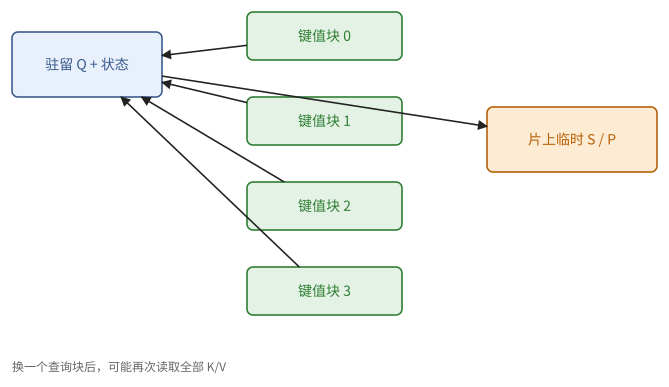
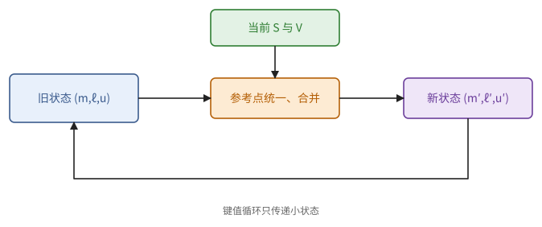
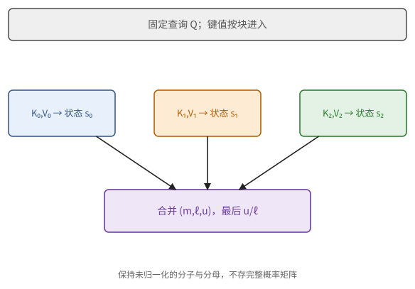
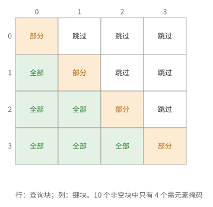
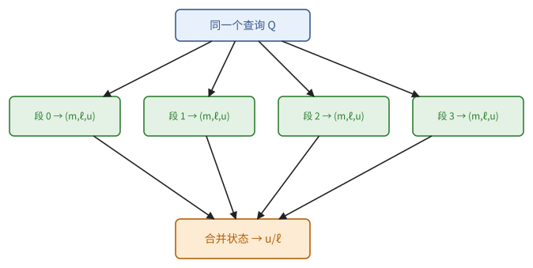

# 第 18 章　TPU kernel：注意力

注意力是 Transformer 中唯一不是"矩阵乘法加逐元素运算"的部分。第 11 章说明了它的麻烦：中间的分数矩阵是 $T \times T$ 的，不能写回 HBM；第 10 章给出了解决办法：在线 softmax 让我们一块一块地处理键和值，只保留每个查询的状态 $(m, \ell, u)$。这一章把它写成 TPU 上的 kernel，也就是常说的 FlashAttention。

注意力 kernel 是面试里最常被问到的 kernel，能把这一章从头到尾讲清楚，就过了一大关。它和矩阵乘法有一点不同：瓶颈不一定在矩阵单元，指数运算和跨通道的归约都可能拖后腿。最后一节看一个每天在大量 TPU 上运行的推理 kernel，看这些技术在真实的服务系统里怎样拼在一起。

## 18.1 注意力的屋顶线

写 kernel 之前先估上限。考虑一个头：$Q, K, V \in \mathbb{R}^{T \times d}$，输出 $O = \operatorname{softmax}(QK^{\mathsf T}/\sqrt{d})\,V$。

- 运算量：$QK^{\mathsf T}$ 与 $PV$ 各 $2T^2 d$，不计掩码共 $4T^2 d$；
- 若把 $S$、$P$ 写回 HBM：数据量约 $2 s T^2$ 的量级，强度约 $d/s$，访存受限；
- 若中间结果不离开 VMEM（FlashAttention）：只读 $Q, K, V$、写 $O$，但键值要被每个查询块读一遍。查询块大小为 $b_q$ 时，$K$、$V$ 被读 $T / b_q$ 次，数据量约 $2 s T d \cdot T / b_q$，强度约 $\frac{4 T^2 d}{2 s T^2 d / b_q} = \frac{2 b_q}{s}$。

> **命题 18.1** flash attention 在 prefill 中的强度约为 $2b_q / s$，与 $T$ 无关；$b_q$ 达到 $sI^*/2$ 时计算受限。decode 时对同一份 KV 的强度约为 $2 \cdot (\text{共享该 KV 的同时处理查询数}) / s$；只有该强度低于相关屋顶线拐点时才访存受限。单查询的普通 decode 通常由读 KV cache 决定。

*证明* 上面的计数；decode 时 $b_q$ 换成同时处理的查询数。∎

这个结果和第 6 章的分块矩阵乘法如出一辙：查询块就是"$C$ 块"，它越大，每次读来的键值被用得越多。所以 prefill 的注意力 kernel 要选足够大的 $b_q$，decode 的注意力 kernel 则要以最高的效率读 KV cache（18.4 节）。

> **例 18.2（中间矩阵和重复读的键值分开算）** 单头 $T = 4096$、$d = 128$、$s = 2$。一张 $T \times T$ 的 bf16 分数矩阵就占 32 MiB，写出再读回是 64 MiB；若概率矩阵也写出来，又是一组往返。查询块 $b_q = 256$ 时，键和值各 1 MiB，共 2 MiB，被 16 个查询块各读一遍，共 32 MiB。
>
> 不写出中间矩阵，不等于 $K$、$V$ 只从 HBM 读一遍。要看查询块之间有没有在片上共享键值，没有的话就按重复读来算。



**图 18.1**　每个查询块保留自己的 Q 和状态，流式经过所有键值块。分数块只在片上存在，K/V 的读取则随查询块数重复。

## 18.2 FlashAttention 的 TPU 形式

现在把命题 10.6 写成 Pallas kernel。grid 取（批量 × 头，查询块，键值块）。对每个查询块，在 VMEM 的 scratch 中保留 f32 的状态：每行的 $m$、$\ell$，以及 $b_q \times d$ 的累加器 $u$。沿键值块的维逐块执行命题 10.6 的合并，这一维必须是 `"arbitrary"`（命题 16.9），最后一块时输出 $u / \ell$。

```python
def flash_kernel(q_ref, k_ref, v_ref, o_ref, m_ref, l_ref, acc_ref, *, causal, bq, bk, scale):
    qi, ki = pl.program_id(1), pl.program_id(2)

    @pl.when(ki == 0)
    def _():
        m_ref[...] = jnp.full_like(m_ref, -jnp.inf)
        l_ref[...] = jnp.zeros_like(l_ref)
        acc_ref[...] = jnp.zeros_like(acc_ref)

    def update():
        q, k = q_ref[0], k_ref[0]                                   # (bq, d), (bk, d)
        s = jax.lax.dot_general(q, k, (((1,), (1,)), ((), ())),     # q k^T，不显式转置 k
                                preferred_element_type=jnp.float32) * scale
        if causal:
            row = qi * bq + jax.lax.broadcasted_iota(jnp.int32, (bq, bk), 0)
            col = ki * bk + jax.lax.broadcasted_iota(jnp.int32, (bq, bk), 1)
            s = jnp.where(col <= row, s, -jnp.inf)
        m_prev = m_ref[...]
        m_new = jnp.maximum(m_prev, s.max(axis=1, keepdims=True))
        alpha = jnp.exp(m_prev - m_new)                             # 旧状态的缩放因子
        p = jnp.exp(s - m_new)
        l_ref[...] = alpha * l_ref[...] + p.sum(axis=1, keepdims=True)
        acc_ref[...] = alpha * acc_ref[...] + jnp.dot(
            p.astype(v_ref.dtype), v_ref[0], preferred_element_type=jnp.float32)
        m_ref[...] = m_new

    if causal:
        pl.when(ki * bk <= qi * bq + bq - 1)(update)                # 跳过完全在对角线以上的块
    else:
        update()

    @pl.when(ki == pl.num_programs(2) - 1)
    def _():
        o_ref[0] = (acc_ref[...] / l_ref[...]).astype(o_ref.dtype)
```

BlockSpec：$Q$ 与输出取 `(1, bq, d)`，下标 `(b, i, 0)`；$K$、$V$ 取 `(1, bk, d)`，下标 `(b, j, 0)`；scratch 为 `VMEM((bq, 1), f32)` 两个、`VMEM((bq, d), f32)` 一个；`dimension_semantics=("parallel", "parallel", "arbitrary")`。这个 kernel 在解释器中与直接计算的结果一致（误差来自把 $P$ 转为 bf16 后再与 $V$ 相乘）。

对照命题 10.6 读这段代码：`m_new` 是新的参考点，`alpha` 是旧状态要乘的缩放因子 $e^{m_{\text{old}} - m_{\text{new}}}$，分母 `l_ref` 和累加器 `acc_ref` 都乘上它，再加上新块的贡献。几点说明：

- **不显式转置 $K$**：`dot_general` 收缩两者的第 1 维，即 $QK^{\mathsf T}$；MXU 在推入权重时可以顺便转置（15.4 节），所以不需要 XLU 做转置。
- **$P$ 转为 bf16 再乘 $V$**：MXU 以 bf16 计算，$P \in [0, 1]$ 转为 bf16 的相对误差约 $2^{-8}$。累加仍在 f32 中。
- **$m$、$\ell$ 的存放**：上面为了清楚，把它们存为 $(b_q, 1)$。在真实的 TPU 上，一列的数组会被补齐到 128 个通道；实用的 kernel 把每行的 $m$、$\ell$ 复制到全部 128 个通道中存放，运算时再按需要截取，以符合 $\mathrm{T}(8, 128)$ 的布局。

**各单元的负载。** 对 $S$ 的每个元素，MXU 要做 $QK^{\mathsf T}$ 与 $PV$ 中的各 $d$ 次乘加，即 $4d$ FLOP；EUP 要做一次指数；XLU 要参与行最大值与行和两次跨通道归约。三个单元同时工作，最慢的那个决定时间。

> **命题 18.3（MXU 与 EUP 的平衡）** 设 MXU 每周期 $P_{\text{mxu}}$ FLOP，EUP 每周期 $E$ 个指数。flash attention 不被 EUP 限制的条件是
>
> $$
> 4d \ge \frac{P_{\text{mxu}}}{E}.
> $$

*证明* 每个分数元素的 MXU 时间为 $4d / P_{\text{mxu}}$，EUP 时间为 $1 / E$。∎

以 v4 的一个 TensorCore 为例，$P_{\text{mxu}} = 2 \times 65536$，EUP 每 2 个周期一个寄存器即 $E = 512$，比值为 256，要求 $d \ge 64$。$d = 128$ 时 MXU 是瓶颈，$d = 64$ 时两者持平，更小的头维度就会被指数运算拖住。这是注意力 kernel 特有的现象：它的瓶颈可能不在矩阵单元。

XLU 的负载更要小心。若每个 $8 \times 128$ 的分数寄存器都做两次跨通道归约，在 v4 上每个寄存器约要 8 个周期（两个 XLU 队列），远慢于 MXU。办法与习题 15.4 相同：先在 $b_k / 128$ 个寄存器之间逐元素求最大值与和，每 8 行只做两次跨通道归约。另一种办法是改变布局：计算 $S^{\mathsf T} = K Q^{\mathsf T}$，让键沿子通道和寄存器排列，行方向的归约就变成寄存器之间的逐元素运算（8.3 节的原则）。

> **例 18.4（一块查询留下哪些状态）** $b_q = 128$、$d = 128$ 时，状态 $u$ 占 $128 \cdot 128 \cdot 4 = 64$ KiB，$m$ 和 $\ell$ 在数学上各只有 512 字节。若在物理上把每行的标量复制到 128 个通道，两者各要 64 KiB，而不是 512 字节。
>
> 临时的分数块 $[128, 256]$ 的 f32 还要再占 128 KiB 左右，键值的预取槽也要加进预算。状态在数学上有多大，不等于按硬件布局存放后占多少空间；估算资源时两者要分开写。



**图 18.2**　一块查询的状态 m、ℓ、u 沿键值循环传递。分数 S 与指数 P 是本步临时值，不是跨全部序列保存的矩阵。



**图 18.3**　对同一查询按键值块合并未归一化状态，最后才除以分母。互动使用标量值缩小模型。

<div class="widget" data-widget="softmax"></div>

## 18.3 掩码与块稀疏

因果掩码让大约一半的块完全不必计算。查询块 $i$ 与键值块 $j$ 的关系只有三种：完全在对角线以下（全部可见），跨越对角线（部分可见），完全在对角线以上（全部屏蔽）。上面的 kernel 用 `pl.when` 跳过第三种，对第二种用 `where` 逐元素屏蔽。

> **命题 18.5** 取 $b_q = b_k = b$，$n = T/b$，因果掩码下需要计算的块数为 $n(n+1)/2$，占全部 $n^2$ 块的 $\frac{1}{2} + \frac{1}{2n}$。

*证明* 第 $i$ 个查询块需要第 $0, \dots, i$ 个键值块。∎

跳过的块仍然占用 grid 的步。若 grid 很大，可以只遍历需要的块。

**块稀疏注意力。** 一般的掩码（滑动窗口、文档边界、前缀可见等）事先在块的粒度上分类：对每个（查询块，键值块），标记为"全部屏蔽""全部可见""部分可见"。用标量预取传入每个查询块需要访问的键值块列表（以及列表长度、每块是否需要逐元素掩码），grid 的键值维只遍历列表中的块，下标映射查表得到实际的键值块号（16.7 节）。

> **命题 18.6** 块稀疏注意力的运算量与非空块的个数成正比；部分可见块额外付出逐元素掩码的代价。

例如窗口为 $w$ 的滑动窗口注意力，每个查询块只需约 $w / b + 1$ 个键值块，运算量从 $O(T^2)$ 降到 $O(Tw)$。

> **例 18.7（先看块坐标，再决定要不要逐元素掩码）** 取 $T = 512$、$b = 128$，共 $4 \times 4$ 块。查询块 2 看键值块 0、1 时全部可见，看键值块 2 时只见块内的下三角，看键值块 3 时全不可见。要计算的块数是 $1 + 2 + 3 + 4 = 10$，比 $16/2 = 8$ 多。
>
> 跳过全屏蔽的块可以省掉 MXU 的工作；但如果只在 kernel 体里用分支跳过，自动流水线可能已经把这些块的 $K$、$V$ 预取进来了。要连搬运一起省，必须让 grid 和下标映射实际遍历的列表也跳过这些块。



**图 18.4**　4×4 因果块矩阵：绿色全可见、橙色需元素掩码、空白全不可见。块级跳过和块内掩码是两项不同操作。

## 18.4 decode 时的注意力

decode 时每个序列只有一个新的查询，要与它的整个 KV cache 计算注意力（11.8 节）。由命题 18.1，这是访存受限的，目标是以接近 HBM 带宽的速度读完 KV cache。

**利用 GQA。** 在分组查询注意力中，$H / H_{kv}$ 个查询头共享一个键值头。把共享同一个键值头的所有查询头放进同一个块一起处理，键值只读一次，强度提高 $H / H_{kv}$ 倍。这时"查询块"的行数就是 $H / H_{kv}$（再乘以投机解码时的草稿词元数）。

**分页与长度不同的批量。** KV cache 通常按页存放（习题 16.5），每个序列的长度不同。用标量预取传入页表和每个序列的长度：下标映射查页表得到每一页的位置；超过序列长度的页用 `pl.when` 跳过，最后一页中多余的位置用掩码屏蔽。

**切分长序列。** 若批量很小而序列很长，按序列分 grid 用不满所有核心，读 KV 的并发也不够（推论 4.8）。这时沿序列长度把 KV cache 切成若干段，各段独立地计算部分状态 $(m, \ell, u)$，最后用命题 10.6 合并（这一做法常称为 split-K 或 flash-decoding）。合并的代价是写出、读入每段的状态，每段只有 $O(d)$ 个数，可以忽略。

> **例 18.8（最后一页的余量和拆分带来的并发）** 上下文长 1000，页大小 128，需要 8 页，最后一页只用了 104 个位置，空着 24 个。页表决定八页在哪里，长度掩码决定最后一页里哪些位置有效；只看页表、把整页都当作有效，就错了。
>
> 若把八页分成四段，每段由一个任务算出自己的 $(m, \ell, u)$，最后再合并。查询相同、页不重叠，合并给出同样的数学结果；新增的代价是四份状态的读写与合并，而不是四份完整的概率矩阵。



**图 18.5**　同一查询对四段 KV 分别计算状态；最终按同一在线合并律归约，既提高并发又不需要物化整行概率。

## 18.5 反向传播

训练还需要注意力的反向传播。难点与前向相同：不能保存 $T \times T$ 的 $P$。先求出反向的公式，再从公式读出 kernel 的结构。

设损失对输出的梯度为 $\bar{O}$。对一个头（省略缩放 $1/\sqrt{d}$，它只是乘到 $S$ 上），由第 13 章：

> **命题 18.9（注意力的反向）**
>
> $$
> \bar{V} = P^{\mathsf T} \bar{O}, \qquad \bar{P} = \bar{O} V^{\mathsf T}, \qquad \bar{S} = P \odot (\bar{P} - D\,\mathbf{1}^{\mathsf T}), \qquad \bar{Q} = \bar{S} K, \qquad \bar{K} = \bar{S}^{\mathsf T} Q,
> $$
>
> 其中 $D_i = \sum_j P_{ij} \bar{P}_{ij} = \sum_c O_{ic} \bar{O}_{ic}$。

*证明* 前两个与后两个是矩阵乘法的 VJP（命题 13.7）。$\bar{S}$ 是逐行 softmax 的 VJP（习题 13.2）：$\bar{s} = p \odot (\bar{p} - \langle p, \bar{p} \rangle)$。最后，$\langle P_{i,:}, \bar{P}_{i,:} \rangle = \sum_j P_{ij} (\bar{O} V^{\mathsf T})_{ij} = \sum_c \bar{O}_{ic} (PV)_{ic} = \langle \bar{O}_{i,:}, O_{i,:} \rangle$。∎

最后那个等式很关键：本来要用整行的 $P$ 和 $\bar{P}$ 才能算出 $D_i$，现在只用输出 $O$ 和它的梯度 $\bar{O}$（都只有 $d$ 维）就够了。由此得到反向 kernel 的结构：

- 前向时为每一行保存 $\operatorname{lse}_i = m_i + \log \ell_i$（每行一个数），反向时用 $P_{ij} = \exp(S_{ij} - \operatorname{lse}_i)$ 重新算出 $P$ 的每一块，而不保存 $T \times T$ 的 $P$；
- 预先算出 $D_i = \langle O_{i,:}, \bar{O}_{i,:} \rangle$（一次逐行的点积）；
- $\bar{Q}$ 的每一块要对所有键值块累加，$\bar{K}$、$\bar{V}$ 的每一块要对所有查询块累加。为了让每个输出块只在一个按顺序执行的 grid 维上累加（命题 16.2），常见的做法是写两个 kernel：一个以查询块为外层、遍历键值块，累加 $\bar{Q}$；另一个以键值块为外层、遍历查询块，累加 $\bar{K}$ 与 $\bar{V}$。

反向的运算量：$QK^{\mathsf T}$ 重算一次，$\bar{V}, \bar{P}, \bar{Q}, \bar{K}$ 各一次矩阵乘法，共 5 次 $2T^2d$，约为前向（2 次）的 2.5 倍。

把前向与反向的 kernel 连接起来，用 `jax.custom_vjp`（13.4 节）：前向函数返回输出与残差（$Q, K, V, O, \operatorname{lse}$），反向函数调用反向的 kernel。

> **例 18.10（用一行的内积代替保存概率）** 一行概率 $p = (1/4, 3/4)$，值为 $(2, 6)$，输出 $o = 5$，输出梯度 $\bar{o} = 2$。于是 $\bar{p} = (4, 12)$，$D = p \cdot \bar{p} = 10 = o \bar{o}$，分数的梯度是 $p \odot (\bar{p} - D) = (-3/2, 3/2)$，两项之和为零。
>
> 和为零是因为 softmax 对整行加同一个常数不变，这也是审查反向 kernel 时一个方便的检查。反向只需要用 lse 重算概率块，再由输出和输出梯度算出 $D$，不必在前向保存整张 $P$。

## 18.6 案例：推理服务里的 ragged paged attention

前几节的 kernel 都假定一批序列的形状相同。最后看一个真实的、每天在大量 TPU 上运行的 kernel：Google 的 ragged paged attention（简称 RPA，Jiang 等，2026）。它从 2025 年初起是 vLLM 的 TPU 后端使用的注意力 kernel，2025 年 10 月起也是 SGLang 在 TPU 上的默认后端；论文说，它让 vLLM 在 TPU 上的词元吞吐提高了 2 到 5 倍。这一节说明它遇到了哪些在 GPU 上不存在的困难，又是怎样用第 15、16 章和本章的工具解决的。

**问题。** 连续批处理（11.12 节）每一步交来的是一个"压平"的批：所有序列这一步的词元首尾相接排成一列，第 $r$ 个序列占其中 $l_q(r)$ 个位置（decode 时为 1，分段 prefill 时为一段），它要看的键值共 $l_{kv}(r)$ 个，散落在分页的缓存里（11.12 节）。这个批是参差的（ragged），各序列的长度不同；又是动态的，长度要到运行时才知道。而 XLA 按静态形状编译，形状一变就要重新编译，服务时承受不起。所以 RPA 在服务启动时固定两个上限：一步最多 $s$ 个词元、最多 $n$ 个序列；输入按上限补齐，真实的长度和页表作为标量预取的小数组传入（16.7 节），kernel 在运行时按它们决定搬什么、算什么，从不重新编译。

**难点一：在任意位置切片。** 一个序列的词元可能从压平的批的第 37 行开始。TPU 的存储按块分块存放（定义 8.4），bf16 还把相邻两行打包进一个 32 位位置（定义 8.9）。若词元轴是数组的倒数第二维，从第 37 行切开，就切到了块的中间，甚至切开了一对打包的行，只能在向量单元上拆包、拼接、再打包（例 16.17）。RPA 的办法是：参差的词元轴永远不放在最后两维。以查询为例，把形状 $(s, h_q, d)$ 改写成 $(s, h_q/2, 2, d)$，多出一个大小为 2 的"打包轴"作为倒数第二维。最后两维是 $(2, d)$，XLA 只能给它选最小的块 $\mathrm{T}(2, 128)$；每个词元的数据自成整块，沿最高维（词元轴）在任意位置切片，都只是挑出若干个整块。这样做还顺带省掉了填充：张量并行之后每台设备上的头往往很少，例如 12 行 bf16 若按 8 行或 16 行一块分块要补到 16 行，按 2 行一块就不必补。

**难点二：K 和 V 存在一起。** RPA 的 KV cache 把每个键值头的 K 和 V 沿头的维交错存放，形状是 $(s_{kv}, 2h_{kv}/2, 2, d)$：一个词元所有头的 K、V 挨在一起。好处有三：张量并行后每台设备常常只剩一个键值头，单独的 K 填不满一对打包的位置，和 V 合起来正好填满；decode 时每个新词元写回缓存只要一次较大的 DMA，而不是 K、V 各一次很小的 DMA，DMA 的固定开销（例 15.8）摊薄了一半；向量读写的次数也减半。代价是计算时要把 K、V 分开：把搬进 VMEM 的块看成 $(b_{kv} \cdot 2h_{kv}, d)$ 的二维数组，按步长 $2h_{kv}$ 隔行读取，就得到某一个头的 K（错开一行得到 V）。步长若是偶数，多次读取会落在同一个存储体上（8.5 节），所以 RPA 给这块缓冲的起点加一个小偏移，让实际的步长成为奇数。

**难点三：自己写流水线。** BlockSpec 的自动流水线（16.2 节）要求每一步的块坐标能由 grid 坐标算出，而这里要搬的是页表里查出来的页、只搬有效长度、还要顺便更新缓存，都不合这个要求。RPA 用手动 DMA 和信号量（16.6 节）写了自己的流水线，同时有四路 DMA 在跑：

1. 查询块：HBM → VMEM，只搬有效的行；
2. 键值块：按页表从页池收集若干页，连同本步新算出的键值，拼成 VMEM 里一块连续的缓冲；
3. 缓存更新：把本步新算出的键值从 VMEM 写进 HBM 里分页的缓存，这本来是注意力之前单独的一个 scatter kernel；
4. 输出块：VMEM → HBM，只写有效的行。

每一路都是双缓冲（定理 9.11）。预取会跨过序列的边界：算第 $r$ 个序列的最后一块时，第 $r + 1$ 个序列的第一块已经在路上了。计算部分就是 18.2 节的在线 softmax，只是每个查询块里叠放了共享同一键值头的所有查询头，矩阵形状为 $(c_q \cdot H/H_{kv},\ d)$，装进 MXU 的 $K$、$V$ 一次服务整组查询头（18.4 节的 GQA 技巧）。

**难点四：按情形分别编译。** DMA 可以只搬有效长度，计算却要求每个展开的计算块占用固定数目的寄存器，长度未知就只能按上限补齐，白算填充的部分。RPA 先把批重新排序：只做 decode 的序列在前，做固定长度 prefill 段的在中，其余混合的在后，再用三个下标标出分界；每一段调用一个单独编译、块大小写死的 kernel。块大小有两组：$b_q$、$b_{kv}$ 决定一次 DMA 搬多少（影响搬运与计算的重叠），$c_q$、$c_{kv}$ 决定一次计算多大（影响寄存器是否够用）。它们按芯片的代、模型的头维、上下文长度离线调好，存成一张表，服务启动时查表编译。

**效果。** 论文在 Ironwood（TPU7x，每颗芯片两个 TensorCore，HBM 带宽 7380 GB/s，bf16 峰值 2307 TFLOP/s，MXU 为 $256 \times 256$）上测量，形状取 Llama 3 8B（32 个查询头、8 个键值头、$d = 128$），页大小 256 个词元。

> **例 18.11（decode 一步读了多少字节）** 128 个序列同时 decode，每个上下文 8192 个词元，bf16。每个词元每个键值头的 K、V 共 $2 \times 128 \times 2 = 512$ 字节，8 个头 4 KiB；读入的缓存连同本步新写回的一个词元，共 $128 \times 8193 \times 4096 \approx 4.30 \times 10^9$ 字节，查询与输出另有约 2 MB。按 7380 GB/s，至少要 0.58 ms。实测（不计 kernel 外的预处理）641 µs，有效带宽约 6.7 TB/s，是峰值的 91%。论文表格里写的是 85%：它把字节数按 $1024^3$ 换算成 GiB，再除以按 $10^9$ 计的峰值。读数字之前先对单位。
>
> 同一组实验里（同样换成十进制单位），上下文 512 时只达到峰值的约 27%，2048 时约 63%，到 8192 以上才稳定在 91% 左右。每一步要搬的数据太少时，流水线的启动、尾巴和每个序列的固定开销占了大头；论文建议把几个短序列的键值合成一次 DMA 来搬。

消融实验把各部分逐一拿掉：上下文 8192 时，完整的 kernel 641 µs，去掉缓存更新 640 µs，只做 DMA 不做计算 629 µs，只做计算不做 DMA 486 µs。可见缓存更新完全藏在了搬运后面，把单独的 scatter kernel 融合进来几乎是白赚的；整体受访存限制，但计算也已经占了约四分之三的时间，并不轻。

prefill（一个序列，不加掩码）在 32768 个词元时达到 853 TFLOP/s，只有芯片峰值的 37%。这里有一个与 $d$ 有关的硬上限：$QK^{\mathsf T}$ 的收缩维是 $d = 128$，只填满 $256 \times 256$ 的 MXU 的一半；$PV$ 的输出维是 $d = 128$，也只用了一半的列（命题 5.12 的补零）。所以 $d = 128$ 时两次矩阵乘法最多用到 MXU 的 50%，853 TFLOP/s 已是这个上限的 74%。头维取 256 时，同一个 kernel 达到 1674 TFLOP/s。论文由此建议，为 TPU 设计模型时就让头维与 MXU 的边长相配。

> **注 18.12（这个例子说明了什么）** RPA 没有用到任何新的数学：在线 softmax（命题 10.6）、分页与标量预取（16.7 节）、手动 DMA 与多缓冲（16.6 节、定理 9.11）、打包与分块布局（定义 8.4、8.9）、存储体冲突（8.5 节），都是前面讲过的。它的工作量在于把这些工具放在 TPU 的约束下拼对：参差的轴不碰最后两维，搬运只搬有效部分，计算按情形静态化，每一路 DMA 都有一个信号量管着它何时可读、何时可覆盖。面试和审查 TPU kernel 时，这正是要问的几件事。

> **现状（2026-10）**：JAXBench（2026，见附录 E）用这类 kernel 测试 AI 自动编写 Pallas 的能力：手工调好的 RPA 比 XLA 直接编译的写法快约 7 倍，而参评的自动方法在给定的样本预算内都没能写出一个正确的 RPA；Google 随后的多智能体系统 MaxKernel 写出了正确的版本，速度约为手工版的三分之一。论文列出的后续工作包括：把短的 prefill 合并成一批以提高强度、让调度器总是交来固定长度的 prefill 段、prefill 与 decode 分离部署，以及把部分工作交给 SparseCore（15.7 节）。

## 本章小结

1. flash attention 的强度约 $2b_q/s$，与序列长度无关；decode 时访存受限，由读 KV cache 决定。（命题 18.1）
2. TPU 上的 flash attention：grid（批量×头，查询块，键值块），键值维 `"arbitrary"`，f32 的 $(m, \ell, u)$ 放在 scratch 中，按命题 10.6 合并；用 `dot_general` 收缩第 1 维避免显式转置。（18.2 节）
3. 每个分数元素需要 $4d$ 次 MXU FLOP、一次指数、两次参与跨通道归约；$4d < P_{\text{mxu}}/E$ 时被 EUP 限制；跨通道归约要先在寄存器之间部分完成，或改变布局。（命题 18.3）
4. 因果掩码跳过约一半的块；一般的掩码按块分类，用标量预取只遍历非空块。（命题 18.5、18.6）
5. decode：把共享键值头的查询头放在一起；用标量预取处理页表与长度；长序列沿长度切分再合并状态。（18.4 节）
6. 反向：保存每行的 lse，重算 $P$；$\bar{S} = P \odot (\bar{P} - D)$，$D_i = \langle O_i, \bar{O}_i \rangle$；分两个 kernel 累加 $\bar{Q}$ 与 $\bar{K}, \bar{V}$；运算量约为前向的 2.5 倍；用 `custom_vjp` 连接。（命题 18.9）
7. 服务用的 ragged paged attention：按上限静态编译、真实长度与页表用标量预取传入；参差的词元轴不放在最后两维，用大小为 2 的打包轴换来最小的块，可在任意位置切片；K、V 交错存放，一次 DMA 写回一个词元，计算时按奇数步长隔行读出；手写四路双缓冲 DMA，把缓存更新融合进注意力；decode、prefill、混合三种情形分别编译。$d = 128$ 时两次矩阵乘法最多用到 $256 \times 256$ MXU 的一半。（18.6 节、例 18.11、注 18.12）

## 习题

**习题 18.1** ★ 一个头 $d = 128$，$T = 8192$，bf16。(a) 不融合（把 $S$ 与 $P$ 写回 HBM）时，注意力的数据量与强度各是多少？(b) flash attention 取 $b_q = 512$ 时呢？(c) 在 v5e 上（拐点约 240）二者各是什么受限？

<details><summary>答案</summary>

(a) $S$、$P$ 各 $T^2 = 6.7 \times 10^7$ 个元素，各写读一次约 $4 \times 2 \times 6.7 \times 10^7 \approx 5.4 \times 10^8$ 字节；运算 $4T^2 d \approx 3.4 \times 10^{10}$；强度约 64。(b) 约 $2 \times 512 / 2 = 512$。(c) 前者访存受限，后者计算受限。

</details>

**习题 18.2** ★ 用命题 18.3，分别对 $d = 64, 128, 256$ 判断 v4 上的 flash attention 是 MXU 还是 EUP 受限。若某代芯片的 MXU 算力翻倍而 EUP 不变呢？

<details><summary>答案</summary>

$4d = 256, 512, 1024$：$d = 64$ 两者持平，$d = 128, 256$ MXU 受限。MXU 翻倍后比值为 512：$d = 64$ 变为 EUP 受限，$d = 128$ 持平。随着矩阵单元越来越快，指数运算越来越可能成为瓶颈；可以用更便宜的指数近似、把部分指数交给其他单元，或减少不必要的重新缩放（注 10.5）。

</details>

**习题 18.3** ★ $T = 8192$，$b = 512$，因果掩码。需要计算多少个块？跨越对角线、需要逐元素掩码的有多少个？

<details><summary>答案</summary>

$16 \times 17 / 2 = 136$ 个块，占 256 个的 53%。跨越对角线的是 $i = j$ 的 16 个块，其余 120 个全部可见，不需要掩码。

</details>

**习题 18.4** ★ 滑动窗口注意力：每个查询只看它之前的 $w = 1024$ 个键（含自己）。$T = 32768$，$b = 512$。每个查询块需要多少个键值块？总共多少块？与完整的因果注意力相比运算量少多少？

<details><summary>答案</summary>

键的区间长 $b + w - 1 = 1535$，至多跨越 $\lceil 1535 / 512 \rceil + 1 = 4$ 个块（对齐时为 3 个块，即块 $i - 2, i - 1, i$）。$n = 64$ 个查询块，约 $64 \times 3 = 192$ 块；完整因果注意力为 $64 \times 65 / 2 = 2080$ 块，约少 91%。

</details>

**习题 18.5** ★ decode 时 $H = 32$、$H_{kv} = 8$、$d = 128$，bf16 的 KV cache。(a) 每个查询头单独处理时，注意力的强度是多少？(b) 把共享同一键值头的 4 个查询头放在一起呢？(c) 再加上 4 个投机解码的草稿词元呢？

<details><summary>答案</summary>

(a) $2 \times 1 / 2 = 1$。(b) 4。(c) 16 个查询共享一次读取，强度 16。都远低于拐点，仍是访存受限，但每读一个字节完成的工作多了 16 倍：在同样的带宽下，每秒能服务的词元数相应增加。

</details>

**习题 18.6** ★ 命题 18.9 的反向中，$D_i = \sum_j P_{ij} \bar{P}_{ij} = \langle O_{i,:}, \bar{O}_{i,:} \rangle$。为什么反向 kernel 要先用后一个表达式算好 $D$，而不是在每个块中用前一个表达式计算？

<details><summary>答案</summary>

$\sum_j P_{ij}\bar{P}_{ij}$ 要遍历第 $i$ 行的所有键值块才能得到，而计算 $\bar{S}$ 的每一块都要用到 $D_i$。若在块中计算，就得先完整地遍历一遍才能开始，等于多做一遍。

$\langle O_{i,:}, \bar{O}_{i,:} \rangle$ 只需要 $O$ 与 $\bar{O}$ 的第 $i$ 行，两者在反向开始时都已经有了。在进入主循环之前用一次逐行点积算好，代价只是读一遍 $O$ 和 $\bar{O}$。

</details>

**习题 18.7** ★（审查题）有人把 18.2 节的 kernel 改为 $b_q = 256$、$b_k = 128$，并把跳过条件写成 `ki <= qi`。在因果掩码下会出现什么问题？若某一行在当前块之前的所有块中都被完全屏蔽，`m_prev` 与 `m_new` 都是 $-\infty$，`alpha = exp(m_prev - m_new)` 会得到什么？

<details><summary>提示</summary>

查询块 $i$ 覆盖第 $[256i,\ 256i + 256)$ 行，键值块 $j$ 覆盖第 $[128j,\ 128j + 128)$ 列。因果掩码下，这一块至少有一个可见元素，当且仅当它最小的列号不超过最大的行号。

</details>
<details><summary>答案</summary>

`ki <= qi` 只在 $b_q = b_k$ 时正确；$b_q = 256$ 时查询块 $i$ 需要键值块 $0, \dots, 2i + 1$，条件应为 `ki * bk <= qi * bq + bq - 1`，原条件会漏掉一半需要的块，结果错误。第二个问题：$-\infty - (-\infty)$ 是 NaN，`alpha` 为 NaN，会污染 $\ell$ 与 $u$。按 18.2 节的条件，处理的第一个块总有可见的元素，不会出现这种情况；但在一般的掩码（例如文档边界）下可能出现。稳妥的写法是在 `m_new` 为 $-\infty$ 时把 `alpha` 与 `p` 置零（例如先把 `m_new` 中的 $-\infty$ 替换为 0 再计算指数）。

</details>

**习题 18.8** ★ 接例 18.11 的设定，把上下文改为 2048。(a) 一步 decode 至少要读多少字节？按 7380 GB/s 至少要多久？(b) 实测为 233 µs，有效带宽是峰值的百分之几？(c) 为什么短上下文时离峰值远？

<details><summary>答案</summary>

(a) $128 \times 2049 \times 4096 \approx 1.074 \times 10^9$，加上约 $2 \times 10^6$，共约 $1.076 \times 10^9$ 字节；至少 $1.076 \times 10^9 / 7.38 \times 10^{12} \approx 146$ µs。(b) $1.076 \times 10^9 / 233 \times 10^{-6} \approx 4.6$ TB/s，约为峰值的 63%。(c) 与 8192 时比较：字节数是那时的四分之一，时间却是 641 µs 的三分之一多。按峰值带宽算，2048 时有约 $233 - 146 = 87$ µs 不在搬数据，8192 时约 $641 - 582 = 59$ µs。这部分时间（启动、流水线的首尾、每个序列的固定开销、搬运与计算没能重叠的部分）大致是几十微秒，在短上下文时占了三分之一以上，在长上下文时不到十分之一。所以论文建议把几个短序列的键值合成一次搬运。

</details>

**习题 18.9** ★ Ironwood 的 MXU 是 $256 \times 256$。(a) 为什么 $d = 128$ 时注意力的两次矩阵乘法最多用到 MXU 的 50%？(b) $d = 64$ 呢？(c) 一个 $d = 128$ 的模型若想在 prefill 中用满 MXU，可以怎样改模型或改 kernel？

<details><summary>答案</summary>

(a) $QK^{\mathsf T}$ 的收缩维是 $d = 128$，只占阵列 256 行中的一半；$PV$ 的输出维是 $d = 128$，只占 256 列中的一半。补零的部分白算，所以上限都是 50%。(b) 两者都只占四分之一，上限 25%。(c) 改模型：头维取 256（论文的建议）。改 kernel：对 $PV$，可以把两个头的 $V$ 并排拼成 256 列，让一次乘法同时算两个头的输出（前提是两个头用同一份 $P$，例如共享键值头的两个查询头之间并不满足，需要按具体结构判断）；对 $QK^{\mathsf T}$，收缩维无法这样拼接。所以最直接的办法是在设计模型时就让头维与 MXU 相配。

</details>

**习题 18.10** ☆（审查题）AI 写的服务用注意力 kernel 直接用 BlockSpec：把压平的查询数组 $(s, h_q \cdot d)$ 按 $(b_q, h_q \cdot d)$ 分块，下标映射用"第 $r$ 个序列的起始行除以 $b_q$"。序列长度依次为 37、1、1、200。指出问题。

<details><summary>答案</summary>

第二个序列从第 37 行开始，不是 $b_q$ 的倍数，"起始行除以 $b_q$"取整后得到的块从第 32 行（若 $b_q = 32$）开始，混进了第一个序列的最后 5 行，第二个序列本身反而可能被截断；bf16 时第 37 行还和第 36 行打包在同一个位置里。要么把每个序列补齐到 $b_q$ 的倍数（decode 的序列只有 1 行，补到 32 行几乎全是浪费），要么像 RPA 那样把词元轴移出最后两维、用手动 DMA 按真实的起点和长度搬运。还要检查：长度为 200 的序列的最后一块越过了数组末尾时怎样处理，以及输出只写有效行。

</details>
