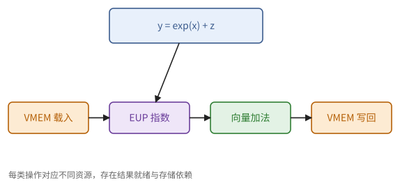
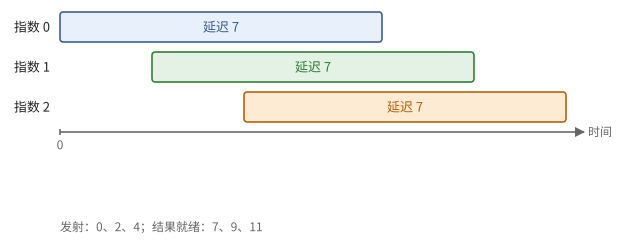
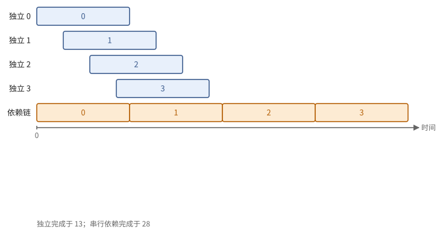
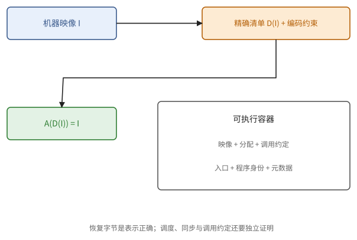
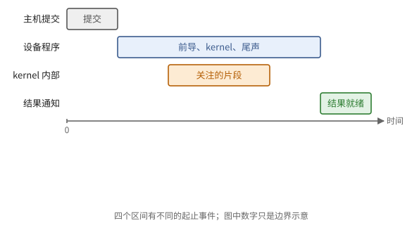

# 第 20 章　TPU 性能的静态分析

第 4 章说过，静态调度的机器有一个特别的好处：程序的执行时间可以从指令本身算出来。TensorCore 正是这样的机器：除了等待 DMA、等待其他设备这类外部事件，一段指令的周期数可以由指令包序列、各单元的延迟和发射间隔推算出来。真机上还可能有并行任务、频率变化和外部资源争用，但在一个固定的发射模型里，答案是唯一的。

这一章讲怎样读编译出来的指令包，怎样用一个简单的发射模型推算周期，常见的指令模式各要多少时间，剖析工具的结果该怎样读，最后讨论两件看似琐碎、其实最容易出错的事：机器编码与可执行文件的关系，以及"一个时间数字到底量的是什么"。

初读可以跳过这一章：前面各章的屋顶线估算已经足以设计 kernel。这一章用于最后一步：估算与实际对不上，或者要从一个已经接近上限的 kernel 里再挤出一点时间时，到指令的层面去找原因。模型与参数来自对 TPU v4 的公开实测（ayaka14732 的 Pallas TPU 教程与 tpuasm，以及 Zhong 的 top-k 论文），其他代际的具体数字不同，但模型的结构相同。下一章的案例研究就是用这一章的方法完成的。

## 20.1 从 kernel 到指令包

要从指令推算时间，先得拿到指令、读懂指令。一个 Pallas kernel 的编译经过以下几个阶段：

1. Pallas 把 kernel 体追踪成 jaxpr（13.2 节）；
2. Mosaic 把它降低为面向 TPU 的中间表示：块变成向量寄存器大小的片，`jnp.dot` 变成 MXU 的推入—乘—取回序列，DMA 与信号量变成相应的操作；
3. 后端编译器做寄存器分配、指令调度，把指令装进指令包，生成机器程序。

可以查看的产物有：Mosaic 的中间表示、编译器的调度结果，以及从可执行文件中反汇编出的指令包序列。最后一种最可靠，因为它就是实际执行的程序：每个指令包列出各个槽（15.2 节）上的指令。读一个循环体时，先数它有多少个指令包，再看各个槽的占用：

- 若某一类槽（例如 `vx`、`vr`，或 `vld`、`vst`）在每个指令包中都被占用，它是可能的发射瓶颈；还要比较依赖、单元服务间隔和外部等待；
- 若大部分指令包只有一两条指令，说明依赖链太长或循环展开得不够，单元在空等；
- 等待指令（等待同步标志）出现在哪里、等多久，说明访存是否与计算重叠。

> **例 20.1（一行张量代码，好几类硬件操作）** 对 f32 块写 `y = exp(x) + z`，降低后至少有 VMEM 读取、EUP 指数、向量加法和 VMEM 写回；若数据来自 HBM，还要加 DMA 和等待。矩阵乘法更多：权重推入、装入、乘法、结果取回，以及 $K$ 方向部分积的向量累加。
>
> 所以"源码只有一行"不能拿来估周期。应当先给每一类操作指定执行单元和存储位置，再数数量和依赖；这样读反汇编时，才分得清哪些行是算法本身要的，哪些是多出来的重排或寄存器溢出。

**图 20.1**　张量表达式逐层落到载入、指数、加法与写回。指令包只负责并排发射符合依赖的操作，硬件单元才负责实际运算。

## 20.2 发射模型

20.1 节的读法只能定性地看出瓶颈。要定量地推算周期，需要知道指令包是怎样被发射的。TensorCore 的发射分两级：标量单元先按顺序把指令包"过一遍"，遇到向量指令就把它放进一个队列，由向量一侧按顺序真正发射。

> **定义 20.2（两级发射）** TensorCore 按以下规则执行指令包序列：
>
> 1. **标量发射**按顺序进行，没有阻塞时每周期一个指令包；标量指令在此时执行。
> 2. 含有向量（或 DMA）指令的指令包在标量发射之后进入**向量发射队列**（VIF）。
> 3. **向量发射**按顺序进行，每周期至多一个指令包，最早在标量发射之后 1 个周期（含 VMEM 读写的指令包为 2 个周期），并且要等记分板放行：源操作数已经就绪、要用的单元已过了发射间隔、要取回的结果已经进入结果队列。
> 4. VIF 的容量有限：一个指令包在向量发射之后若干周期才从 VIF 中释放；未释放的项达到上限时，标量发射停止。
> 5. 在本模型中，`sfence` 本身进入向量侧；其下一包的标量发射须等之前 VIF 项全部释放。它不自动排空尚未等待的外部 DMA 或各单元的结果队列。

规则 3 里的"按顺序"很要紧：一个向量指令包若在等某个结果，它后面的所有向量指令包都跟着等，哪怕后面的指令本来可以先执行。规则 4 意味着标量单元最多只能"跑在"向量单元前面一段距离。这正是 4.6 节"解耦访存与执行"的一种实现：标量一侧可以提前计算地址、发起 DMA，向量一侧在后面按序执行。

> **现状（2026-10-08）**：以下参数来自教程对 TPU v4 的观察，适用于它给出的模型与指令形式；本书未做真机测量。MXU 准备、打包 XLU 等其他形式不能只套用 f32 的发射间隔。

**参数**（取 TPU v4 的参考值，完整来源在附录 A、E）：

| 通路 | 提交 → 结果可取回（周期） | 相邻两次提交的间隔 | 相邻两次取回的间隔 |
| --- | ---: | ---: | ---: |
| 向量 ALU（多数运算） | 1–2 | 1 | — |
| EUP（指数、倒数等） | 7 | 2 | 1 |
| MXU（乘法 → 取回） | 约 83（部分 MXU 约 101） | 8 | 8 |
| XLU 转置（最后一次提交 → 取回） | 6 | 8 | 8 |
| XLU 跨通道归约 | 约 79 | 8 | — |
| XLU 通道置换 | 约 69 | 8 | — |
| CMEM 直接读取 `cld` → `crf` | 53 | 2 | 2 |
| 硬件随机比特 `vrng` | 结果直接写寄存器 | 8 | — |
| 向量 → 标量 | 约 43 | — | — |

VIF 的容量约为 20 项，一项在向量发射后约 10 个周期释放。模型按这些规则逐个指令包推算两种发射的时刻；在实测的几十个片段上，它与真机的周期计数器读数几乎完全一致。Zhong（2026）用另一套方法独立测得了同样的跨通道归约（79）和通道移位（69）延迟，还从编译器自带的延迟表里读到了一致的数字。

> **命题 20.3** 在定义 20.2 的模型下，一段不含外部等待（DMA、跨设备同步）的直线代码的执行时间是确定的，可以由上表的参数逐包递推算出。

*证明* 每条规则都只依赖于之前各指令包的发射时刻与固定的参数；对指令包的序号归纳即得。∎

"确定"有一个可以观察到的推论：同一个不含外部等待的程序，反复运行的周期数应当一模一样。Zhong 的测量正是如此：只含指令的 Pallas kernel 六次读数完全相同，而含有 DMA 的 XLA 程序每次相差 1 到 3 个周期，因为 DMA 什么时候完成取决于当时存储系统的状态。

> **例 20.4（一张可以手算的简化调度表）** 暂时忽略 VIF，只保留"每拍至多发一条"、单元的间隔与依赖。EUP 延迟 7、间隔 2。三个独立的指数 $e_0, e_1, e_2$ 最早在第 0、2、4 拍发射，结果在第 7、9、11 拍就绪；依赖 $e_i$ 的加法若有空闲的 ALU，最早分别在第 7、9、11 拍发射。
>
> 若规定先发完所有指数再发加法，还要满足程序次序；若每个加法又依赖前一个加法，关键路径就更长。这张表是模型内的推算，不是说真实的后端一定这样排。

**图 20.2**　三次独立指数的发射间隔为 2，延迟为 7。后续加法等待各自结果，而不是把每次指数的 7 周期串行相加。

## 20.3 用模型分析常见模式

下面用定义 20.2 的模型和上表的参数，分析几种在 kernel 中反复出现的指令模式。

**依赖链与吞吐。** EUP 的延迟是 7、间隔是 2：单个寄存器的指数要等 7 个周期，连续 16 个寄存器只要约 $15 \times 2 + 7 = 37$ 个周期（命题 4.4）。只有当程序同时提供足够多的独立寄存器时，才能达到吞吐。

**MXU 的交错。** MXU 的乘法每 8 个周期接收一个寄存器，结果约 83 个周期后才能取回，取回也是每 8 个周期一个。连续发出 16 条乘法、再连续取回 16 次，与"发出约 10 条之后开始交替发出乘法与取回"相比，前者要多等：第一次取回要排在最后一条乘法之后，之后每 8 个周期才取一个，积压的结果不能一口气取完。实测前者约 254 个周期，后者约 228 个周期。所以 MXU 的乘法与取回应当交错排列，在途的乘法保持在约 $83 / 8 \approx 10$ 条。

**跨通道归约的代价。** 一次跨通道归约约 79 个周期才能取回，但每 8 个周期可以提交一次。对单个寄存器求行和要等约 80 个周期；对很多个寄存器，吞吐是每 8 个周期一个（两个 XLU 时每 4 个周期）。沿子通道的归约（在向量 ALU 中移位相加）对单个寄存器约十几个周期。这就是习题 15.4 的结论在指令层面的来源。如果跨通道操作一个依赖一个，每一环都要等满 79 个周期；第 10 章 top-k 的"逐轮取最大"在 TPU 上慢，就慢在这里。

**向量结果变成标量。** 把向量的计算结果变成循环次数或分支条件，要约 43 个周期，期间标量发射停止。所以数据依赖的控制流（例如"算出最大值再决定是否继续"）在 TensorCore 上很贵，应当尽量改写为掩码（4.3 节）。

**循环。** 一个计数循环的每次迭代是几个标量指令包加一个分支延迟槽；除此之外分支没有额外开销。所以循环的时间就是循环体的指令包数乘以迭代次数，再加上循环体中的等待。

> **例 20.5（资源的下界和依赖的下界取较大的那个）** 一个循环里有 16 条某类操作，单元的发射间隔为 2、延迟为 7。若它们互相独立，从第一条发出到最后一个结果至少要 $15 \cdot 2 + 7 = 37$ 个周期；若每一条都要用前一条的结果，整条链至少要 $16 \cdot 7 = 112$ 个周期。
>
> 把"条数乘间隔"当作时间，会漏掉依赖；把"条数乘延迟"当作时间，会漏掉流水线的吞吐。最终的估计还要受指令包数、端口、VIF 和寄存器容量的约束。

**图 20.3**　同样四个延迟 7、间隔 2 的操作：独立时可交错，串行依赖时必须逐个等待。图只比较此单元，不含前端和搬运。

## 20.4 剖析工具的读法

静态分析之外，还有实测的剖析工具。TPU 的性能剖析工具叫 XProf。读一条时间线，要先分清哪些是硬件记录的事件，哪些是工具推出来的分析结果：

- **有标记的区间有真实时间戳。** `vtrace` 在边界记录全局时间计数器（GTC，定义 20.13），主机按标记配对出事件区间；这些区间不是编译器插值出来的。但区间内部没有逐条指令的计时，也不能把工具的成本估计当成每条指令的测量。
- **插入标记会改变程序。** 跟踪指令本身要占用指令槽，可能打断原本紧密排列的指令包，测出的时间与不插入标记时不同。

所以剖析工具适合回答粗粒度的问题：哪一个 kernel、哪一个集合通信占了大部分时间，计算与通信是否重叠。细粒度的问题（这个循环体为什么比估计的慢）更适合用本章的静态分析回答：读指令包，按模型推算，与屋顶线的估计比较。

> **例 20.6（工具画出来的条，不等于每条指令的测量）** 某张剖析图显示一个 kernel 用了 100 微秒，其中 MXU 区间标为 60、DMA 等待标为 30。据此可以怀疑搬运没有充分重叠，再用静态分析去确认等待出现在哪里；但不能因为某个小操作画在第 42 微秒，就认为硬件在那一刻逐条记录了这条指令。
>
> 跟踪区间、成本估计和"这条指令来自哪一行源码"，是三种不同的证据，各自的边界随工具和版本变化。

## 20.5 审查清单

把本章的方法汇总起来。读一个 TPU kernel 编译出的指令时，依次检查：

1. **内层循环的指令包数**：与按屋顶线估计的"每次迭代应当用的周期数"比较。
2. **瓶颈的槽**：哪一类槽在每个指令包中都满；它是否就是屋顶线预测的那个单元（MXU、向量 ALU、VMEM 读写、XLU、EUP）。
3. **MXU 的交错**：乘法与取回是否交错，在途的乘法是否足够多。
4. **等待的位置**：等待 DMA 的指令是否出现在循环的稳态中，若是，说明预取不够深（定理 9.10）或带宽不够。
5. **意外的指令**：寄存器溢出到 VMEM 的读写、意外的跨通道操作（布局不合适）、意外的类型转换。

> **例 20.7（先给多出来的操作找来历）** 按算法，每个 $K$ 步应当读两块、做乘法、合并部分积；指令清单里却每步还多一次转置和一组 VMEM 读写。先问转置是不是因为输入布局不合 MXU 的要求，再问多出来的读写是不是寄存器不够用造成的溢出。
>
> 改的顺序按代价排：消掉多余的数据移动，通常比把两条独立的标量指令塞进同一个包收益大得多。每条修改建议都应当指向一本具体的资源账或一条依赖链，而不是笼统地要求"提高利用率"。

## 20.6 机器清单、编码与可执行容器

要按定义 20.2 推算周期，输入必须是真正执行的指令包。编译器打印出来的"调度结果"是机器程序上面一层的表示，可能含有不占槽的伪指令，也不一定显示每条指令的全部字段。要做精确的分析（或者手工改一两条指令做对照实验），就要直接操作机器程序本身。这时有几件事要分清。记 $I$ 为原始的机器字节，$D$ 为反汇编，$A$ 为汇编。

> **定义 20.8（精确往返）** **精确往返**（exact round trip）要求 $A(D(I)) = I$，即逐字节相同；只恢复可见助记符与操作数的清单，则可能选择另一个合法编码。相同助记符不是字节相同的证明，也不单独构成执行等价的证明。

为什么要这么较真？因为同一条看起来一样的指令，可能有几种合法的编码，选哪一种会影响同一个包里别的指令能不能放进去。

> **例 20.9（空槽也不能随便塞指令）** 一个指令包的两个槽可能共享立即数字段、标量操作数的选择或向量读端口。即使槽 1 是空的，它想用的资源也可能已经被槽 0 以不兼容的方式占用了。必须把各槽的编码约束放在一起求解；"每个槽至多一条"只是必要条件。
>
> 精确的清单里用 `.encoding` 记下那些无法从可见操作数唯一恢复的选择。删掉它再重新汇编，可能得到一个"规范"的编码，结果就不再是对原程序只改了一个变量的修改。

> **现状（2026-10-08）**：tpuasm 用 `.target` 选择目标，花括号界定 bundle，`s0:` 等前缀是物理槽。final bundles 仍可能有 `sphi` 等伪指令，且未必展示所有 selector；实际机器解码适合核对 `vdwg` 的权重来源等细节。目标还包括 v4 BCS（控制序列器）与 v6e TEC（SparseCore 向量子核），不都是 TensorCore。对齐、槽数、共享端口与支持的 libtpu 组合见附录 B。

往程序里插入几条指令，还会牵动跳转：

> **命题 20.10（插入之后必须重新定位）** 若在旧 PC $p$ 之前插入 $h$ 个包，对未新增的旧包，位置映射为 $f(q) = q$（$q < p$）或 $q + h$（$q \ge p$）。原从 $q$ 跳到 $r$ 的相对分支，必须改成 $f(r) - f(q)$；同时必须规定跳到插入边界时，是否先执行新增片段。

*证明* PC 按包的次序编号，插入后的前后区间直接给出 $f$；相对位移是目标 PC 减当前 PC。若边界的新旧两种入口含义未规定，原来的一个地址不能唯一确定控制流意图。∎

程序映像也不是完整的可执行对象。可执行文件里还记着内存分配、调用约定、入口、程序身份和编译元数据；修改了字节之后，这些关系必须仍然一致。tpuasm 把"等长替换"和"显式插入"分成两个入口，不能拿两份长度不同的清单去猜怎样重定位。汇编器只检查编码是否合法，不替你排程、不替你补等待；汇编成功也不能证明数值、同步和运行时约束都正确。

**来源映射**把（PC，槽）对应到源码的位置和函数区间，可以用来追问"这次多出来的读写来自哪一行"。它要在版本匹配的编译阶段捕获；信息缺失时应当记作"未知"，不能据此说这条指令与源码无关。来源映射本身也不能当作周期读数。

**图 20.4**　精确往返恢复机器字节；可执行容器还携带分配、身份与调用约定。

## 20.7 时间边界与两个时钟

最后一个问题看起来简单：一个"用了 685 个周期"的数字，量的到底是什么？读计数器之前，哪些事件已经结束了？两级发射（定义 20.2）和异步操作的发起与完成（命题 9.3）让这个问题变得不那么简单。

> **定义 20.11（计时边界）** 一次时间声明应给出起止事件与计数器。主机提交返回、提交到结果就绪、连续调用的稳态间隔、整个设备程序、kernel 区间和内部指令段是不同对象；单位相同不代表边界相同。

> **例 20.12（提交只用了两拍，不等于算完只用了两拍）** 一个长延迟的向量操作后面紧跟着标量读计数器。只要 VIF 还没满，标量一侧就可以在向量结果出来之前把计数器读了。这样量到的差值主要是"提交"，而不是"算完"；发起 DMA 之后直接读计数器，同样量不到传输的时间。
>
> 在教程的 v4 两级模型中，先等待相应的完成对象，再单独执行一条 `sfence`，下一个包才读计数器，就能把之前向量一侧的等待计入边界。`sfence` 会排空 VIF，但不会自动等待所有 DMA 或结果队列；和读计数器放在同一个包里，也约束不了这次读数。

读数本身也有开销，要单独扣除。Zhong（2026）的做法是先测一个空片段：手写的测试载体里两次读数之差是 13 个周期，插进编译器生成的完整程序里（要先保存、再恢复借用的标量寄存器）是 20 个周期，之后每个读数都减去这个固定开销。

> **定义 20.13（局部周期与全局时间）** **局部周期计数器**（local cycle counter，LCC）计数一个局部执行器的周期，差值适合分析该执行器的程序段。**全局时间计数器**（global time counter，GTC）提供跨参与者对齐的时间轴；其分辨率、偏移和同步误差是另一组参数。

不同核心的 LCC 不能直接相减；周期换算成秒，也要用那一次运行的实际频率（Zhong 用主机时钟测得 v4 的 LCC 频率在 1049.99 到 1050.01 MHz 之间，与公开的 1050 MHz 一致，一个周期约 0.95 纳秒）。GTC 的最低几位可能是本地的排序信息，不能按固定比例把每个最低位都当作等长的时间。跨芯片比较事件时，还要把时钟同步误差和网络传播时间放进上下界。

起点和终点两端都要建立需要的完成边界。只在终点同步，起点的读数仍可能早于前面的搬运完成，把本不属于这个片段的等待算了进来；要排空哪些状态，取决于这一次你关心的是哪些事件。

> **现状（2026-10-08）**：教程用 v4 的 LCC、GTC 与 `vtrace` 分别核对局部周期、跨核时钟和 XProf 事件；有 `vtrace` 的区间确实来自 GTC 时间戳。region trace 还会改变包数并限制跨区域调度。因此公平比较要固定 dtype、精度、形状、输出语义和执行边界，并区分含跟踪标记与正式运行的映像。相关指令与工具见附录 B、E。

**图 20.5**　提交、设备程序、内部片段和结果就绪的边界不同；下方用简化单元模型比较依赖与吞吐。

## 本章小结

1. Pallas kernel 经 Mosaic 降低、后端调度后成为指令包序列；读循环体时数指令包、看各槽的占用、看等待的位置。（20.1 节）
2. 两级发射模型：标量按序发射，向量指令经 VIF 按序发射，受操作数就绪、单元间隔、结果队列和 VIF 容量的约束；不含外部等待的代码，周期数由模型唯一确定，反复运行读数相同。（定义 20.2、命题 20.3）
3. v4 的参数：EUP 延迟 7、间隔 2；MXU 延迟约 83、间隔 8；XLU 归约约 79、间隔 8；向量到标量约 43。（20.2 节的表）
4. 由模型得到的规律：要有足够多的独立操作；MXU 的乘法与取回要交错；跨通道归约与向量到标量的转换很贵；循环的时间是指令包数乘迭代次数。（20.3 节）
5. XProf 的跟踪区间有边界时间戳，但不提供区间内每条指令的测量；插入标记会改变程序，细粒度问题应结合实际机器映像与发射模型。（20.4 节）
6. 精确往返是逐字节恒等；组包还受共享编码资源约束。插入需更新 PC、分支和容器元数据；来源映射与计时证据分别使用。（定义 20.8、例 20.9、命题 20.10）
7. 时间声明需要起止事件与时钟，并扣除读数自身的开销；LCC 用于局部周期，GTC 用于对齐时间。标量读数可以早于向量侧完成，栅栏也不能代替相应的完成等待。（定义 20.11、例 20.12、定义 20.13）

## 习题

**习题 20.1** ★ 用 20.2 节的参数估计：对 32 个互相独立的寄存器求指数（EUP），最后一个结果何时可以取回？若这 32 个指数是一条依赖链呢？

提示 1

独立指数按间隔提交，串行依赖按结果延迟推进；两者不能用同一乘法公式。

提示 2

命题 4.4，$L = 7$，$I = 2$。

答案

独立时约 $31 \times 2 + 7 = 69$ 个周期；依赖链时约 $32 \times 7 = 224$ 个周期（再加上每次取回与重新提交的少量周期）。

**习题 20.2** ★ 一个 MXU 要处理 64 个 LHS 寄存器。(a) 若连续发出 64 条乘法、再连续取回 64 次，大约需要多少周期？(b) 若交错排列，大约多少？

提示 1

画提交和取回两个资源道；先提交完会推迟结果队列的排空。

提示 2

(a) 最后一条乘法约在第 $63 \times 8$ 个周期发出，之后的 64 次取回每 8 个周期一次。(b) 稳态时每 8 个周期一条乘法、一次取回。

答案

(a) 约 $63 \times 8 + 1 + 63 \times 8 \approx 1009$ 个周期（第一次取回在最后一条乘法之后，且此时结果早已就绪）。(b) 约 $63 \times 8 + 83 \approx 587$ 个周期：乘法每 8 个周期一条，第一个结果 83 个周期后开始取回，之后取回与乘法同时进行，最后一个结果在最后一条乘法之后 83 个周期取回。交错排列快约 40%。

**习题 20.3** ★ 一个 kernel 的内层循环每次迭代读入一个 bf16 的 $16 \times 128$ 块（一次 VMEM 读）、做 4 次向量运算、写出一个块（一次 VMEM 写）。按 15.2 节的槽数，每次迭代至少要几个指令包？瓶颈在哪一类槽？

提示 1

按每类槽每拍服务数除操作数取上整，最后取最大值；依赖可能再增周期。

提示 2

每个指令包至多一次 VMEM 读、一次 VMEM 写、两次向量 ALU 运算。

答案

VMEM 读写各需 1 个包；向量运算需 2 个包（每包两次）。若循环展开、不同迭代的指令可以交织，每次迭代至少 2 个指令包，瓶颈是向量 ALU 的两个槽。若不展开，依赖链（读 → 运算 → 写）还会加上各自的延迟，实际更多。

**习题 20.4** ★ 一个 kernel 需要先求出一个向量的最大值，再根据这个最大值决定循环要执行几次。按 20.3 节，这个决定要多少周期？给出一种避免它的写法。

提示 1

数值归约与将结果变成控制标量是两段依赖；只改控制方式可避免第二段。

提示 2

向量 → 标量约 43 个周期，期间标量发射停止。

答案

除了求最大值本身（含一次跨通道归约，约 80 个周期），还要约 43 个周期把结果送到标量单元，期间整个 TensorCore 的标量发射停止。避免的办法：让循环执行固定的（最大可能的）次数，用掩码使多余的迭代不产生效果；或者让这个次数在 kernel 之外算好，作为标量预取的参数传入（16.7 节）。

**习题 20.5** ☆ XProf 显示某个 kernel 中一段"逐元素运算"占了 30% 的时间，但按屋顶线它只应占 5%。列出两种可能的解释，并说明怎样用静态分析区分它们。

提示 1

把剖析估计误差与真实额外工作分开，最终指令可验证后者。

提示 2

20.4 节的两点局限；以及布局导致的意外指令（20.5 节第 5 条）。

答案

解释一：时间线是插值的，这段时间实际上属于相邻的操作（例如一次 DMA 等待），剖析的归属不准确。解释二：这段运算确实慢，例如布局不合适导致了跨通道的重排、寄存器溢出或额外的类型转换。区分：读这一段的指令包，数它的包数并找出其中的跨通道操作、额外的 VMEM 读写；若指令包数与屋顶线的估计相符，就是解释一；若出现了意外的指令，就是解释二。

**习题 20.6** ★（综合审查题）简化模型每拍最多发两条向量 ALU、一次载入、一次写回。一个循环迭代有 6 条独立 ALU、2 次载入、1 次写回，纯发射资源下界是多少拍？若六条 ALU 构成延迟 2 的串行链，结果下界如何变化？

提示 1

对各类槽分别算工作量除服务率；依赖链是另一项下界。

提示 2

资源项为 max(ceil(6/2),2,1)；串行链需等每次结果。

答案

纯资源发射跨度至少三拍，但不包括最后操作的完成尾部。串行 ALU 链从第一条发射到最后结果就绪至少 $6\cdot2=12$ 拍；载入就绪和写回可能另延长总时间。三拍只是一项下界，不是完整执行时间。

**习题 20.7** ★ 原包 q=3 有相对分支跳到 r=8。在旧 PC 5 之前插入两个包，原分支的新位移是多少？若在旧 PC 3 之前插入两个包呢？

提示 1

分别映射当前 PC 和目标 PC，不是总给位移加插入长度。

提示 2

命题 20.10 给 f；分支的相对基点是当前包。

答案

在 PC 5 前插入，f(3)=3、f(8)=10，位移 7。若在 PC 3 前插入，旧分支移到 5、旧目标移到 10，位移仍为 5。还必须明确指向插入点的入口是否先执行新增包，并迁移相关元数据，不能只移动代码字节。

**习题 20.8** ★（审查题）一包发起 DMA，下一包只读 LCC，相差两个周期。AI 据此断言 DMA 只需两个周期。为什么证据不足？单独加一个 sfence 是否够？

提示 1

读计数器发生在标量侧；DMA 的发起和完成是两个事件。

提示 2

例 20.12 中，sfence 排空 VIF，但不自动等待尚未等待的 DMA。

答案

两个周期主要表示发起之后标量侧推进到读数，不能推出 DMA 已到达目的。需要先等这次 DMA 的完成对象，再按模型跨单独的 sfence 边界，在下一包读数。只有 sfence 而没有相关等待，仍可能量到发射而非交付；若只需最终算术结果，还须按目标接口等相应结果队列。计时操作会改变程序边界，数值不能直接当成未经插入标记的正式运行时间。

