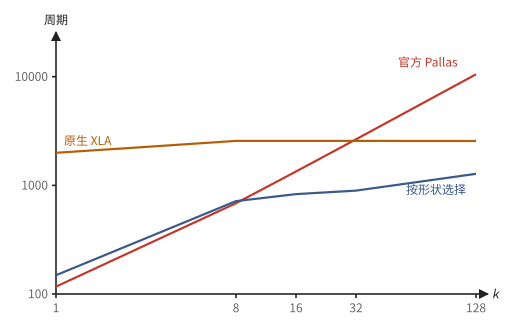

# 第 21 章　案例研究：TPU v4 上又对又快的 top-k

前面几章分别讲了 TensorCore 的结构、Pallas、kernel 的写法和指令级的分析。这一章把它们用在一个真实的研究问题上，从头走到尾。问题来自 Zhong 2026 年的论文《Bitwise-Correct and Faster Top-k on TPU v4》（附录 E）：在 Pallas kernel 里对已经在 VMEM 中的数据逐行求 top-k，能不能既逐位正确，又比现有的实现快？

选这个例子，是因为它几乎用到了本书前面的所有工具：浮点数的全序与整数键（2.11 节）、top-k 的几种算法（10.4 节）、TensorCore 上跨通道单元的代价（15.3 节）、Pallas 的写法（第 16 章）、发射模型与计时边界（第 20 章）。它也示范了一套做性能研究的完整方法：先把"正确"定义清楚，再把测量的边界固定下来，然后按资源分析瓶颈、按形状选算法，最后回头看编译器还缺什么。面试里常被问到"讲一个你优化过的 kernel"，这一章就是一份可以照着讲的样板。

论文的全部数字都是在一颗 TPU v4 芯片的一个 TensorCore 上测得的周期数（v4 的时钟约 1050 MHz，100 个周期约 95 纳秒），数据类型都是 f32。读这一章不需要会写汇编，也不需要记住这些数字；要看懂的是每一步为什么这样推理。

## 21.1 问题与两个基准

top-k 在模型里到处都是（10.4 节）。论文关注其中一类用法：在一个融合的 kernel 里，数据已经在 VMEM 中，对一个块逐行求 top-k，每行几百到几千个元素，每块几行到几百行。例如 Qwen3 的 MoE 层从 128 个专家里给每个词元选 8 个；如果路由的矩阵乘法和 top-k 写在同一个 kernel 里，top-k 的输入就是一个 $[T, 128]$ 的块，$k = 8$。

在 TPU 上用 JAX 求 top-k，现成的办法有两个：

- **原生 XLA**：直接调用 `jax.lax.top_k`，由 XLA 编译。$k > 1$ 时它通常把整行连同下标排序，再取前 $k$ 个，所以周期数几乎不随 $k$ 变化，而随行数和行宽增长。它在所有输入上都是对的。
- **官方 Pallas**：在 Pallas kernel 里调用同一个函数，由 JAX 源码中的 `_top_k_impl` 展开成 $k$ 轮"取最大值、记下下标、把这个位置改成 $-\infty$"（10.4 节的逐轮取最大），再由 Mosaic 编译。它能和 kernel 的其他部分共享 VMEM 中的数据，是写融合 kernel 时唯一现成的办法。

官方实现的源码开头有一段注释，大意是：这个实现假定输入中至少有 $k$ 个不是 $-\infty$ 的值；否则屏蔽之后剩下的元素全是 $-\infty$，可能返回重复的下标；为了避免昂贵的防御性屏蔽，保留这个行为。

这段注释里藏着一个判断：正确与速度不可兼得。论文就是去检验这个判断，分三个问题：

1. "完全正确"到底指什么？官方实现在哪些输入上错？只修不提速，要多花多少周期？
2. 保持正确的前提下，哪些情形能同时快过两个基准，各自受什么限制？
3. 如果加速要用 Pallas 用不到的指令，能不能让编译器自己生成，而不必手写整个程序？

## 21.2 正确性：从比特串出发

先回答第一个问题。2.11 节已经说明，浮点数的比较要从比特串出发，用 IEEE 754 的全序（定义 2.37），同号 NaN 按比特串排序。CPU 上的排序和原生 XLA 都按这个次序返回结果，所以这个定义等于要求与原生 XLA 逐位一致。

> **定义 21.1（逐行 top-k 的正确性）** 对 top-k 轴上的每一行输入，要求：
>
> 1. 每个下标都在范围之内；
> 2. $k$ 个下标互不相同；
> 3. 每个下标处的输入，与对应返回值的比特串相同；
> 4. 返回值的比特串序列，等于按命题 2.38 的整数键稳定排序后的前 $k$ 个。
>
> 比特串相同的元素之间，下标次序不作要求（对应 `is_stable=False`）。

这四条正是注 2.40 的三件事写成了可以检查的形式。用它去检查，官方实现的错误远不止注释里承认的重复下标，有三类：

**已选的位置被再次选中。** 这就是例 10.14：用 $-\infty$ 作"已选"的标记，与输入本身的 $-\infty$ 分不开。后果比注释说的更糟：除了下标重复，返回的值和下标对不上（位置 127 的真实值是 2.0，却又被以 $-\infty$ 返回了五次），按这些下标去取输入，会把同一个分数用上六次。行宽不是 128 的倍数时，全是 $-\infty$ 的一行还会返回寄存器里最后一个通道的下标，它根本不在数组之内：一个全是 $-\infty$ 的 $f32[8, 100]$ 返回下标 127。只要把 $-\infty$ 换成一个很小的有限数（例如 $-10^{30}$），结果就完全正确，问题只出在恰好等于 $-\infty$ 的输入上。

**arg max 的平局与 NaN 规则随数据的摆放而变。** 第二类错误不在 `_top_k_impl` 里，而在它调用的 arg max 里。arg max 按数据摆放的不同走三条硬件路径：一行在一个寄存器里时，是一次跨通道的取最大下标；行宽超过 128 时，先由向量单元合并几个寄存器，再做一次跨通道归约和一次通道置换；沿子通道方向时，是由移位、比较、选择组成的淘汰树。三条路径的规则各不相同：平局时，一个寄存器返回最大的通道号，几个寄存器返回"下标模 128"最大的那个（既不是第一个也不是最后一个），沿子通道时由淘汰树的结构决定，没有简单的规律。NaN 的问题更大：

> **例 21.2（丢掉 NaN 的 arg max）** 合并几个寄存器时，值用 `vmax` 取（遇到 NaN 返回 NaN），下标却由比较指令 `vge` 的结果选（与 NaN 的比较总是假）。这正是例 2.36 的"值和下标分开算"。于是行宽超过 128 时只有最后一个寄存器里的 NaN 能被找到，沿子通道时一个也找不到，$x[\arg\max x] = \max x$ 不再成立。放到 top-k 里后果更大：没被选中的 NaN 不会被标记为已选，于是之后每一轮的最大值都还是 NaN。论文给出的一个输出是：
>
> $$
> \text{返回值} = (\mathrm{NaN}, \mathrm{NaN}, \dots, \mathrm{NaN}), \qquad \text{应为} \ (\mathrm{NaN}, 3, 3, 3, 3, 3, 3, 3).
> $$

**比特串的次序不对。** 官方实现把 NaN 交给跨通道单元，它把一切 NaN 都当作最大值，于是负 NaN 也排在最前面；每轮的值又来自浮点 max，NaN 的 payload 也不保证保留。这些都违反定义 21.1 的第 4 条。

论文用 197592 个输入做了检查，覆盖 31 种形状、轴与 $k$ 的组合（行宽 1 到 8192，行数 1 到 256，沿通道和沿子通道，二维和三维），每种组合都包括普通随机数、随机的 32 位比特串、21 种特殊比特串的随机混合、小整数平局、常数比特串，以及专门构造的"0 到 $k + 1$ 个非负元素"等输入。结果：

| 实现 | 下标越界 | 下标重复 | 值与下标不对应 | 比特串序列不对 |
| --- | ---: | ---: | ---: | ---: |
| 原生 XLA | 0 | 0 | 0 | 0 |
| 官方 Pallas | 1318 | 36844 | 67693 | 65666 |
| 论文的实现 | 0 | 0 | 0 | 0 |

官方实现在 70706 个输入上出错。耐人寻味的是它在哪些输入上完全正确：普通随机数、小整数平局、只含有限值的构造输入，恰好是上游测试覆盖的范围。它的错误全都集中在含 $-\infty$、NaN 或随机比特串的输入上。测试只覆盖"正常"的输入，就永远看不到这类错误；这也是为什么正确性要先写成定义 21.1 这样的规格，再按规格构造输入。

## 21.3 修好它要多少代价

官方保留错误的理由是"修起来贵"。论文先只修、不提速，量出每种修法的代价。下面的周期数都是 $f32[8, 128]$、$k = 8$，官方实现 685 个周期。

**为什么冲突躲不开。** 最直接的想法是换一个标记值，让已选的位置比任何输入都小。但 f32 里比 $-\infty$ 小的只有负 NaN，它们本身也可能是输入（注 10.13 的鸽巢论证）。跨通道单元的 arg max 又只接受 f32，所以只要用一个 f32 值来标记"已选"，冲突就不可避免。出路有两条：让两个冲突的值永远不同时出现；或者在不经过跨通道单元的地方改用整数，整数有多余的值可用。

**抬升。** 设一行有 $m$ 个不等于 $-\infty$ 的元素。在前 $m$ 轮里，总还有一个没被选过、不等于 $-\infty$ 的元素，arg max 不会选中原本的 $-\infty$，这段时间用 $-\infty$ 标记"已选"是安全的。到第 $m$ 轮，真实的有限值都已选完，这时把原本的 $-\infty$ 统一"抬升"为最小的有限 f32：真实的值都没了，不再有冲突，而已选的位置仍是 $-\infty$，排在它们后面。$m$ 只需一次归约，可以和第 0 轮的 arg max 一起发出，不在依赖链上；每个位置在哪一轮被抬升也事先算好，抬升本身藏在那一轮等待跨通道结果的 79 个周期里。结果是 697 个周期，只多 12 个。

**把修复移出依赖链。** 更彻底的做法利用官方实现的一个性质：即使下标开始重复，每一轮返回的值仍然是对的。所以可以只修输出的下标，原来的链一点不动。

> **命题 21.3（后缀名次）** 把原本的 $-\infty$ 按下标递增排在所有其他元素之后。则位置 $i$ 上原本的 $-\infty$ 在完整次序中的名次是
>
> $$
> n - 1 - \#\{j > i : x_j = -\infty\},
> $$
>
> 与前面选过哪些元素无关。记 $u_j = [x_j = -\infty]$，则右边的计数是向量 $u$ 与一个严格下三角的 0/1 矩阵的乘积，可以交给 MXU 精确地算出。

*证明* 排在这个 $-\infty$ 前面的，是全部 $n - m$ 个有限元素，以及下标比 $i$ 小的那些 $-\infty$；总数等于 $n - 1$ 减去下标比 $i$ 大的 $-\infty$ 的个数。$\#\{j > i : u_j = 1\} = \sum_j u_j [j > i]$ 是 $u$ 乘以矩阵 $L_{ji} = [j > i]$。输入和权重都只有 0 和 1，结果是 0 到 127 的整数，在 bf16 输入、f32 累加下都精确（命题 2.25）。∎

装入矩阵、相乘和链上的等待交错进行，结果是 685 个周期，与官方完全相同：修复的代价整个藏进了依赖链的等待里。

**逐位正确。** 前两种修法解决了重选，但还没解决比特串的次序。逐位正确首先需要命题 2.38 的整数键；可跨通道单元只接受 f32，不能直接送整数进去：把整数转成浮点数会舍入，把它的比特串直接当作浮点数读，又会碰上 NaN 和次正规数。论文的办法是按符号把键分成两段，每段 $2^{31}$ 个值，各自编码成正常的有限 f32：每段的前一半映射到负的规格化数，后一半映射到正的规格化数，段内次序严格保持，编码可逆，而且编码出的值里没有 NaN、无穷、零和次正规数。这样 $-\infty$ 就可以专门留给"无效或已选"，不再与任何真实输入冲突。若一行有 $m$ 个非负键，前 $m$ 个输出一定来自非负段，其余来自负段；两段在同一条链上分阶段处理，第 $m$ 个元素选出之后，把负段的编码一次性放进工作数组。这种写法叫 phased，用了 717 个周期，多 4.7%，而且没有依赖数据的分支：每行只有三个有限值、其余全是 $-\infty$ 的输入，周期数也一模一样。

作为对照，最朴素的防御性屏蔽（另用一个布尔掩码记下已选的位置，每轮先在未选位置上求最大值，再在等于它的位置上求最小下标，两次归约都在链上）要 1355 个周期，是官方的两倍。注释所说的"昂贵"，大概指的就是这种修法。

**图 21.1**　$f32[8, 128]$、$k = 8$ 时各种修法的周期数。只有把额外的归约放在依赖链上的朴素屏蔽才贵；逐位正确只多 4.7%，而原生 XLA 在同样的边界内要 2564 个周期。

第一个问题的答案于是很清楚：只修注释承认的重选几乎不花代价；修到与原生 XLA 逐位一致，在最基本的形状上只多 32 个周期。"修起来贵"的前提不成立。贵的不是修复本身，而是把修复放在依赖链上；放在链外的工作，只要不超过链上等待留下的空隙，就是免费的。这和第 1 章的 Brent 定理、第 20 章例 20.5 讲的是同一件事：时间由工作量和依赖链两者中较大的那个决定。

## 21.4 三种代价的分析框架

保持正确之后，怎样提速？论文先建立了一个简单的分析框架。top-k 要比较一行里不同位置的元素，在 TensorCore 上有两种办法，代价相差悬殊（15.3 节）：逐元素运算在两个寄存器的同一位置之间进行，下一周期出结果，每周期两条；跨通道的比较只能交给跨通道单元，推入之后 79 个周期（归约）或 69 个周期（移位）才能弹出，同一队列每 8 个周期接收一次，共两个队列。

> **定义 21.4（三种代价）** 一段 top-k 程序的时间，由下面三者之一决定：
>
> 1. **跨通道往返延迟**：跨通道操作一个依赖一个时，时间约为依赖链的长度乘以一次往返的延迟（归约 79 周期）；
> 2. **跨通道发射间隔**：有许多个互相独立的跨通道操作时，时间约为操作数乘以发射间隔（每队列 8 周期，两个队列）；
> 3. **向量指令数**：不经过跨通道单元时，时间约为逐元素指令的条数除以每周期两条。

> **命题 21.5（三种代价的下界）** 设程序中最长的跨通道依赖链有 $c$ 次往返，共有 $n_x$ 次跨通道推入，$n_v$ 条逐元素向量指令。则在 v4 上它的周期数至少为
>
> $$
> \max\left(79c,\ \frac{8 n_x}{2},\ \frac{n_v}{2}\right).
> $$

*证明* 三项分别是依赖链、跨通道单元的吞吐和向量 ALU 的吞吐给出的下界（命题 4.4、定理 1.59 的下界部分）；时间不小于其中任何一个。∎

这个框架只负责判断瓶颈属于哪一类，并给出这一类的下界，不预测精确的周期数。它与实测比得怎样？

> **例 21.6（框架与实测）** 论文把几种写法的下界与实测放在一起：
>
> | 写法 | 形状 | 框架判断的瓶颈 | 下界 | 实测 | 下界 / 实测 |
> | --- | --- | --- | ---: | ---: | ---: |
> | 官方链，每轮 | $[8, 128]$ | 一次跨通道往返 | 79 | 82 | 96% |
> | 官方链，每轮 | $[8, 1024]$ | 两次跨通道往返 | 148 | 178.7 | 83% |
> | 名次计数，$k = 16$ | $[8, 128]$ | 跨通道发射 | 573 | 830 | 69% |
> | fold-and-rank，$k = 8$ | $[8, 128]$ | 三次跨通道往返 | 274 | 568 | 48% |
>
> 链式写法框架预测得最准：$[8, 128]$ 上官方的链每轮只比一次往返多 3 个周期，那就是每轮弹出、比较、选择的几条指令。名次计数的下界只算了 127 次移位的推入，实测多出来的是移位之后的比较与累加。fold-and-rank 离下界最远：三次往返只占实测的一半左右，其余是 VMEM 的写后读、按下标读取之前的等待这类第 20 章发射模型里的细节，以及向量指令本身。可见一旦跨通道单元不再是瓶颈，"向量指令数"就不足以描述时间，需要把所有等待都算进来。

## 21.5 按形状选算法

用这个框架，论文逐个检查了官方实现在哪里浪费时间，并且只用 Pallas 已有的接口给出了更快的写法。测量覆盖 25 个形状，分四组，每组主要改变一个维度，各对应一种瓶颈。

**宽行：链上多了一次往返。** 行宽超过 128 时，官方每轮约 165 个周期，是行宽 128 时的两倍。因为合并几个寄存器之后，一次跨通道的取最大下标只给出通道号，还要再做一次通道置换，才知道它来自哪个寄存器、下一轮该把谁标记为已选；两次往返都在链上。其实标记已选并不需要完整的下标。论文改为先重排数据：在每个通道内，把各寄存器里的键从大到小排好，得到若干"层"。排序只用寄存器之间的逐元素整数比较和选择，用 Batcher 奇偶归并网络一次完成，并剪枝到只保留前 $k$ 个输出。之后每轮只在第 0 层上做一次 arg max，得到通道号 $p$，再把通道 $p$ 的整列上移一层；被选中的元素来自哪个寄存器，从一个随排序一起移动的位置数组里查，不在链上。链上于是只剩一次往返。比较用整数键进行，例 21.2 的 NaN 问题不会出现。6 个宽行形状上全部快于两个基准，例如 $[8, 8192]$、$k = 32$：官方 14411 个周期，新写法 4715 个周期，少 67%。

**沿子通道：根本不用跨通道单元。** 沿子通道方向求 top-k 时，所有的比较都是向量单元的逐元素运算，"跨通道单元只接受 f32"的限制不再适用，可以从头到尾用整数键，用一个单独的位置数组、以 $-1$ 表示无效，连分段编码都不需要。按行数和 $k$ 选三种写法之一：行数不超过 8 时直接对整数键做名次计数（沿子通道的移位不经过跨通道单元）；行数更多时，用同一个比较网络把各子通道排成候选层，每轮只归约前八行；或者在各列排好序之后用几次归并代替逐个弹出。7 个形状上全部快于两个基准。在这个方向上，原生 XLA 是更强的对手：$k = 32$ 时官方实现在 32、64、128 行上都比它慢，32 行时慢约 2.5 倍。

**大 $k$：去掉串行依赖。** 行宽 128 时，前面的写法仍是长度为 $k$ 的链。$k$ 大时应当换成没有依赖链的算法，让时间由发射间隔而不是延迟决定，这就是 10.4 节的名次计数（命题 10.15）。把整行循环移位 $d$ 个通道、与原行逐元素比较，就比完了所有相距 $d$ 的元素对；对 $d = 1, \dots, 127$ 各做一次，127 次移位互不依赖，可以一个接一个地推入。比较用整数键，值相同时下标小的在前，写成与"键减一"的比较（习题 10.11）；所有元素名次互不相同，结果是稳定的，连下标都与 CPU 逐一相同，$-\infty$ 和 NaN 只是键的普通取值，没有任何特殊情形。名次计数的周期数几乎与 $k$ 无关，弱点是行数：每个寄存器都要各自的 127 次移位，一个寄存器就把跨通道单元占满了。

**图 21.2**　$f32[8, 128]$ 上三种实现的周期数随 $k$ 的变化（纵轴为对数）。官方实现与 $k$ 成正比，$k = 32$ 时被原生 XLA 反超，$k = 128$ 时是它的四倍；原生 XLA 排整行，与 $k$ 无关；按形状选择的写法在 $k \ge 16$ 时改用名次计数，快于两者。

**多行：跨通道单元饱和。** 行宽 128 时，行数从 8 增加到 64，官方的周期数几乎不变。

> **例 21.7（跨通道单元什么时候饱和）** 每一轮等前一轮结果的 79 个周期里，每个队列每 8 个周期能接收一次推入，两个队列合起来约能接收 20 次。每个寄存器（8 行）每轮要推入两次归约（取值、取下标），8 个寄存器就是 16 次，还装得下。所以 64 行以内，多出来的行几乎是免费的，它们分享了同一段等待。超过 64 行，队列装不下了，周期数变成与归约的总次数成正比。

对付多行有两个办法。一是减少归约：每轮只算下标、不算值，最后用一次沿通道的 gather 把 $k$ 个值一起取回，每轮的归约从 2 次减为 1 次（代价是最后多一次跨通道往返）。二是根本不用跨通道单元：行宽正好是 128、行数不超过 128 时，把整个 $f32[R, 128]$ 转置，每个输入行就落在一个通道里，问题变成上面"沿子通道"的问题，用整数键沿子通道归并出前 $k$ 个，再转置回来。中间没有跨通道的链，所有行共享同样的逐元素指令，周期数随行数增长得很慢；两端的转置是固定的开销，行数少时不划算。

**按形状分派。** 论文最后写了一个总的分派函数，签名与 `_top_k_impl` 相同，可以直接替换它：行宽 128 时，先按估计的周期数在链式写法和名次计数之间选，选了链式再按行数在 phased、转置、最后取值之间选；行宽超过 128 时用候选列；其余用三种沿子通道的写法。分派的边界是按实测拟合出来的，换一代硬件要重新测。结果：

- 只用 Pallas 已有的接口，在 25 个形状中的 20 个上快于官方实现（少 6% 到 88% 的周期），几何平均加速 1.67 倍；在全部 25 个形状上快于原生 XLA，几何平均 3.34 倍。
- 慢于官方的 5 个形状其实是同一种情形：行宽 128、沿最后一维、不超过 64 行、仍用链式写法。在这些形状上官方的链已经贴着跨通道往返的延迟，新写法多出来的主要是逐位正确所需的指令。
- 官方实现本身在 6 个形状上比原生 XLA 慢，全是 $k$ 较大的情形。它为了速度放弃的正确性，在这些形状上并没有换来速度。

## 21.6 两个新算法

剩下的两种情形最难：最基本的 $f32[8, 128]$、$k = 8$，以及行宽 128、16 到 64 行、$k = 8$。它们的根源相同：官方写法是一条每轮经过一次跨通道单元的链，而这条链已经接近硬件的极限。

> **命题 21.8（链式写法的下界）** 在 $f32[8, 128]$、$k = 8$ 上，任何"每轮经过一次跨通道往返"的写法至少要 $8 \times 79 = 632$ 个周期；官方实现的 685 个周期里，除去这 632 个，只剩每轮几条弹出、比较、选择的指令和 kernel 的进出。没有依赖链的名次计数要 127 次跨通道移位，按每队列 8 周期、两个队列，光推入就要约 500 个周期，加上弹出和计数之后仍比 8 轮的链慢。

*证明* 第一句由命题 21.5 的第一项；第二句由第二项，$127 \times 8 / 2 \approx 508$。∎

所以要在这个形状上更快，跨通道往返的次数必须远少于 $k$，跨通道操作的总数必须远少于 127。这需要 Pallas 用不到的几条指令：分段转置 `vsxpose`（把一个寄存器里的 16 个 $8 \times 8$ 块各自转置）、按固定模式重排子通道的读取 `vld.sshfl`，以及配合下标地址寄存器（IAR）、每个元素按自己的行偏移读写的 `vld.iar` 与 `vst.iar`。这些指令的语义，论文是在真机上用实验确定的：把一条指令插进一个只搬数据的载体 kernel，用随机输入运行，读回结果，与 NumPy 写的模型逐元素比较，模型不对就修改模型，直到全部吻合。

**fold-and-rank。** 先把每行的元素从通道方向挪到子通道方向，再把比较交给向量单元和 VMEM。

> **例 21.9（一次分段转置把一行折成 16 列）** `vsxpose` 的语义是 $y[s, 8g + r] = x[r, 8g + s]$（$g = 0, \dots, 15$）。第 $r$ 行的元素 $(r, 8g + j)$ 被送到 $(j, 8g + r)$：原来同一行的 128 个元素，现在分布在通道 $8g + r$（$g = 0, \dots, 15$）上，每个通道沿 8 个子通道排开。用第 8 章的话说，这次转置把通道下标的低三位挪到了子通道方向；一行变成了 16 列、每列 8 个元素。

整个算法分五步：

1. **折叠**：一次 `vsxpose`，把第 $r$ 行的 128 个元素变成 16 列，每列 8 个子通道。
2. **列内排序**：用 7 次按模式重排子通道的读取（`vld.sshfl`），算出每个元素在自己那一列里的名次 $\rho$（沿子通道的名次计数）；把 $\rho$ 减去子通道号装进 IAR，一条 `vst.iar` 把每个元素写到第 $\rho$ 行，于是每一列都从大到小排好。
3. **跨组求名次**：15 次移位（距离是 8 的倍数）把其他各组的列对齐过来。因为那一列已经降序，"它的第 $i$ 行排在我前面"随 $i$ 只变一次，所以用二分查找：三次读取、三次比较，就数出那一列有几个元素排在我前面。最后一次读取的行因元素而异，要用 `vld.iar`。
4. **返回下标**：名次小于 $k$ 的元素，把自己原来的通道号按名次放进不同的字节，用一次沿通道的精确求和（`vadd.xlane`）收集起来。
5. **返回值**：前 8 名把自己键的段内编码按名次写到不同的行，每个名次一次跨通道取最大值，把它们放回原来的布局；$k$ 更大时改用一次按下标的 gather。

第 4 步用到第 2 章的一个事实：

> **例 21.10（用浮点加法精确地收集整数）** 通道号小于 128，放得进一个字节。若把几个名次的通道号分别乘以 $1$、$2^8$、$2^{16}$ 再放进各自的位置，每个位置只有一个非零项，沿通道求和就把它们拼成一个整数。只要和小于 $2^{24}$，它就是 f32 能精确表示的整数（命题 2.7，f32 的有效数字是 24 位），浮点加法的每一步都没有舍入。所以一个"只会做浮点加法"的跨通道归约，也能拿来精确地搬运整数。

跨通道的工作从 127 次移位降到 15 次，跨通道往返只剩三次（折叠、移位、返回），按 15.3 节的数字是 $126 + 69 + 79 = 274$ 个周期，其余是向量单元和读写槽的工作。但光有算法还不够快，还必须围绕第 20 章那些等待来排指令：向量一侧严格按序发射，一个包在等，后面的包全都跟着等；读一块刚写过的数据要等，`vsetiar` 之后的按下标读取要等，`vsxpose` 之后它的队列还要忙将近一百个周期，这期间推给这个队列的移位会连同后面的所有指令一起阻塞。手写的版本把这些等待写成指令之间的最小距离，用一个小调度器填入别的指令，并把折叠之后的移位全部发往另一个队列。

手写的 fold-and-rank 没有依赖数据的分支，不需要后备路径，含特殊值的输入周期数一样，比特串相同的元素之间下标也是稳定的。结果：$k = 8$ 用 579 个周期，比官方快 15%，比原生 XLA 快 77%；$k = 16$ 用 656，$k = 32$ 用 689。代价是一个完全手写、形状固定为 8 行的程序。

**转置加败者树：链不必打断，可以换一条路。** 对 16 到 64 行，前面的思路看似走进了死胡同：链式写法之所以便宜，是因为各行分享同一段等待；没有链的算法每个寄存器都要付跨通道往返，没法分摊；而沿着跨通道的链，正确的写法必然比官方多做事。但这三条判断有一个共同的前提：每一轮的依赖都要经过跨通道单元。打破这个前提，就有了出路：保留 $k$ 轮，但让每一轮只用通道内的整数比较和按下标的读取。

1. **整体转置**：把 $f32[R, 128]$ 转置成 $[128, R]$（不足 128 列时补齐）。原来的第 $r$ 行现在是第 $r$ 个通道，它的 128 个元素沿子通道分布在 16 个寄存器里。这是一次普通的 `x.T`，编译器生成 `vxpose`，结果每 8 个周期到达一个寄存器，后面的排序可以边到边做。
2. **每个子通道的候选列**：同一子通道、同一通道上 16 个寄存器里的 16 个元素，用 21.5 节的比较网络按整数键排序，只保留前 8 层。于是每个输入行得到 8 个降序的候选列，每列 8 个元素。截断不会丢掉全局前 8：一个元素若在自己那一列里排到第 8 名之后，光那一列就有 8 个元素在它前面（例 10.12）。
3. **八路归并，每轮输出一个**：每轮比较 8 个列的队首，输出最大的，把它所在的列前进一格。直接比要每轮比较 7 次、广播 8 个队首；用败者树（命题 10.16），每轮只有新队首沿路径重赛 3 场，其余 4 个节点保持有效。因为下一个队首的位置每一行都不同，要用 `vsetiar` 加 `vld.iar` 按各通道自己的偏移读取。8 轮之后，值和下标各是一个 $[8, R]$ 的数组，第 $r$ 列按名次存着第 $r$ 行的前 8 名，再各转置一次就是要的 $[R, 8]$ 输出。

整个过程只在两端各用一次跨通道单元（转置进来、转置回去），中间的排序和 8 轮归并全是通道内的整数比较。比特串的次序由整数键保证，NaN 和 $-\infty$ 只是键的普通取值；每轮只让一个候选列前进，已经输出的位置不会被再次选中，根本不需要"已选"的标记。结果：16 到 64 行时比官方快 2.7% 到 6.4%，96 行快 16.4%，128 行时 802 个周期对官方的 1235 个，快 35%；从 8 行到 128 行的全部 121 种行数都快于官方，而且从 16 行到 128 行周期数只增加 117，因为多出来的行只占用更多的通道，只增加两端转置的工作。$k = 16$ 时优势更大：从 8 行到 128 行，每种行数都比官方快 36% 到 61%。

**合起来看。** 结合这些方法，25 个形状中有 24 个快于官方实现，全部快于原生 XLA。唯一的例外是 $[8, 128]$ 的 top-1：只有一轮，没有可以分摊的东西，也没有可以换的路，逐位正确多出的 32 个周期无处可藏（官方 117，新写法 149）。$k$ 为 2 到 4 的情形也是如此：链太短，两端转置或折叠的固定开销比整条链还长。按每个形状最快的方法取几何平均，对官方是 1.79 倍，对原生 XLA 是 3.57 倍。$f32[8, 128]$ 的 top-8 从官方的 685 个周期（约 652 纳秒）降到 568 个周期（约 541 纳秒）。

论文也记下了走不通的路，省得别人再试：按下标的每一位把一行分成两半、各取最大值，一次往返同时得到前两名，但从值恢复下标要求两名都唯一，平局时整个寄存器要退回慢的写法，最坏情形是官方的两倍；分段归约一条指令能给出许多段的结果，但结果留在各段自己的通道里，用到整行还要再跨通道移动一次；MXU 能做沿通道的线性运算（命题 21.3 就用了它），但比较和取最大值不是线性的。

## 21.7 让编译器生成这些指令

fold-and-rank 快于两个基准，代价是整个程序手写：寄存器、掩码、临时空间、指令之间的依赖都要手工分配，形状也是固定的。能不能只手写那几条 Pallas 用不到的指令，其余交给编译器？

**占位再改写。** 直接在 Pallas 里注册新原语、在降低时生成底层操作，行不通：Mosaic 的布局推断只认识几种方言的操作，凡是向量上的底层操作都会被拒绝。反过来做是可行的：在 Pallas 源码里本该用新指令的地方，写一个编译器认识的运算当占位符，编译完成之后再用汇编工具只替换占位符本身。数组的形状、每个值放在哪个寄存器、每条指令在哪个包里，都已经由编译器决定好了。占位符用"与一个独特的立即数做异或"`x ^ M`：编译器不知道 $M$ 是什么，无法把它化简掉，改写工具又能在清单里认出它、读出源寄存器和目的寄存器。这样 fold-and-rank 就成了一个约六十行的 Pallas 函数，行数和 $k$ 都是普通参数；跨通道的移位就是普通的 `jnp.roll`，精确求和就是普通的 `jnp.sum`，只有折叠、子通道重排、按下标读和写四处用了占位符。

结果是正确的，但 $k = 8$ 时用了 714 个周期，比官方还慢，离手写的 579 很远。差距在哪里？两者的指令并不完全相同，但差距主要来自空等：编译器的调度器不知道转置和下标寄存器相关的那些等待，把指令排得太紧，硬件只好在按序发射的流水线里一条一条地等。

**只改次序，不改指令。** 检验这个判断的办法很直接：一条指令都不改，只改次序，看能省多少。论文写了一个与 top-k 无关的重排工具：把 kernel 的指令清单读成依赖图（每条指令读写哪些寄存器、存储块、下标寄存器和跨通道队列，都从清单里读出来）；丢掉编译器的寄存器分配带来的假依赖；按第 20 章那样实测的时序逐周期填包，每个周期从就绪的指令里挑离终点最远的；每放一条指令，都让汇编器试着编码这个包，编码不了就换下一条。重排之后三个 $k$ 分别是 595、626、671 个周期：同样的指令，换个次序，省了 119 到 167 个周期，与手写版本相差在 $-4.6\%$ 到 $+2.8\%$ 之间。

**在编译流程里补上缺的层。** 比"编译后修补"更接近根本的做法，是沿着 Mosaic 的编译流程往下找，看缺的是哪一层。论文逐层清点这四种操作：越往下的层越完整，指令编码和编译器内部的 C++ 层都有，缺的只是上面两层方言的入口。于是在进程内给已加载的 libtpu 打补丁：按模式重排其实早有对应的操作，只是没有 Pallas 的降低规则生成它；按下标读取离可用只差一个检查，去掉这个 6 字节的条件跳转、把下一层的调用重定向到自己的函数即可；折叠和按下标写共用一个入口。此外还要修正调度器的两处错误：它把 `vsetiar` 当作内存屏障（这让每次按下标读取都隔断前后所有的读写），延迟表里转置之后队列忙碌的时间写的是 104 个周期，实测约 223。修好之后，四种操作全由编译流程生成，不再需要改写可执行文件，周期数是 637，比手写慢 1% 到 10%；再在编译器的 VLIW 调度之后挂一个按时间重排的步骤（用 libtpu 自己的依赖图，打包、寄存器分配和溢出仍由编译器做），就到了 568，比手写的 579 还快。

> **例 21.11（差距在调度，不在指令）** 把 $k = 8$ 的几种来源放在一起：
>
> | 来源 | 周期 |
> | --- | ---: |
> | 官方 Pallas | 685 |
> | 手写 | 579 |
> | 占位再改写 | 714 |
> | 占位再改写，按实测时序重排 | 595 |
> | 编译流程生成（补丁之后） | 637 |
> | 编译流程生成，流程内按时间重排 | 568 |
>
> 从第三行到第四行、从第五行到第六行，指令都没有变，只有次序变了。编译器与手写之间的差距主要在调度：调度器需要知道真实的延迟和依赖，这正是第 20 章的发射模型要提供的东西。

对败者树的归并，编译器还不能生成：它读的候选表跨越 8 或 16 个存储块，下一个队首在哪一块因行而异，而 Mosaic 能表达"从一块存储里按下标读"的那个操作在 TensorCore 上一开始就被布局推断拒绝了，要支持它得改三个编译步骤。所以这部分仍是手写的片段。

## 21.8 方法上的经验

论文在方法上有几条经验，适用于一切性能研究。

**先固定边界，再做比较。** 要让原生 XLA 的 top-k 和 Pallas kernel 在同一个边界里比较（输入已在 VMEM、两个结果都留在 VMEM、区间内没有与 HBM 之间的传输），要在程序里分别写明三件事：内存空间（把数组钉在 VMEM 里）、布局（固定成 $\mathrm{T}(8, 128)$ 的那种布局，否则 XLA 可能为某些形状选择转置的布局，插入编译器不允许的拷贝）、共同的终点（用 `optimization_barrier` 让两个结果一起越过屏障，否则 XLA 可能先把一个结果写出去）。缺任何一件，量的就不是同一件事。与输入无关的准备工作（常数、掩码、下标数组）也必须算在区间里；若把起点放在 kernel 内部的某个等待之后，编译器会把这些工作排到起点之前，读数偏小，而且不同写法偏小的程度不同。固定了边界之后，原生 XLA 在沿子通道和 $k$ 较大的情形下比通常以为的强得多。

**检查片段不能代替检查整个程序。** 一个手写片段在测试载体里完全正确，放进完整程序里却错了：载体碰巧在某个寄存器里留了一个零，掩盖了一个漏掉的依赖。

**小形状上正确，不说明规则被遵守。** 改写工具的好几个错误，只在寄存器紧张、编译器开始复用和溢出寄存器时才出现。每次修改都要用至少 16 行的输入重新检查。

**出错不一定表现为结果错。** 程序算错时，TensorCore 可能直接停机而不是给出错误结果：名次算错时，`vst.iar` 的目的行会重复，而同一列里写同一行会让核心停机。停机并不说明问题出在 `vst.iar` 本身。

**近似 top-k 也继承了错误。** JAX 的 `approx_max_k` 在 Pallas 里分两步：先把一行切成长度为 $b$ 的若干片，逐元素比较，在每个位置保留各片的最大值和下标；再对这 $b$ 个候选调用同一个官方 top-k。$b$ 由召回率目标 $r$ 决定：

$$
b = \left\lceil \frac{k - 1}{1 - r} \right\rceil \text{ 向上取整到 128 的倍数}.
$$

$r = 0.95$ 时，$k = 8$ 有 256 个候选，$k = 32$ 有 640 个；所以第二步正好落在 21.5 节的宽行情形里。第一步也有例 21.2 的问题：它用"`seg > best_val`"合并各片，与 NaN 的比较总是假，后面各片的 NaN 永远选不上，而第一片里的一个负 NaN 一旦占了某个位置，就永远不会被替换，挡住其他各片在这个位置上的所有元素。两步都换成整数键的写法之后，2752 个输入上的错误从 1230 个降到 0，5 个测试形状中有 4 个快了 33% 到 53%。把近似和精确并排看也有意思：在这些行宽上，召回率 0.95 只把候选减少到原行的十六分之一到四分之一，第一步还要把每个元素比较一遍，所以近似换来的速度至多四分之一；行宽 1024、$k = 8$ 时，近似甚至比精确还慢。

**精确 top-k 与产生分数的矩阵乘法相比贵不贵？** 按 v4 公开的峰值估算，一个 TensorCore 每周期做 $4 \times 128 \times 128$ 次 bf16 乘加，产生一个 $[128, 128]$ 的分数块，维数 $d = 128$ 时约要 32 个周期，$d = 4096$ 时约要 1024 个周期；而这样一块的 top-8 最快要 802 个周期。所以在最近邻搜索这类维数小、数据多的场合，精确选择比矩阵乘法贵一个数量级以上，近似算法确有必要；在 MoE 路由这类场合（例如 Qwen3-235B，隐藏维 4096，从 128 个专家里选 8 个），路由的矩阵乘法和 top-k 的周期数在同一个量级，top-k 的写法直接影响路由 kernel 的时间。这只是按峰值的估算，论文没有测量完整的路由 kernel。

**结论能推广到哪里。** 论文只在 TPU v4、libtpu 0.0.49、f32、单个 TensorCore 上做了实验。大部分结论并不依赖这些具体数字：官方 `_top_k_impl` 对各代是同一份源码，21.2 节的正确性定义与检查与硬件无关；性能分析按瓶颈组织，而 TensorCore 的基本结构从 v2 到 Ironwood 一直稳定（15.9 节），较新一代的跨通道归约、移位、转置仍是 $8 \times 128$ 的推入—弹出指令。所以"哪种情形该用哪类算法"的判断大体可以迁移；寄存器形状不同的代际要重新检查，指令的延迟要按第 20 章的方法重新测量，补丁的地址也要重新定位。

## 本章小结

1. 逐行 top-k 的正确性应从比特串定义：下标在范围内、互不相同、值与下标处的输入比特相同、序列等于按整数键稳定排序的结果。官方 Pallas 实现在 197592 个输入中错 70706 个：重选已选位置、arg max 的平局与 NaN 规则随摆放而变、负 NaN 排序错误；上游测试只覆盖了不出错的那类输入。（定义 21.1、例 21.2、21.2 节）
2. 修复的代价取决于它是否在依赖链上：抬升只多 12 个周期，MXU 后缀名次一个周期都不多，分段整数键的逐位正确写法多 4.7%；只有把额外归约放在链上的朴素屏蔽才贵（约两倍）。（命题 21.3、21.3 节）
3. 三种代价的框架：跨通道往返延迟 × 链长、跨通道推入数 × 发射间隔、向量指令数，取最大者为下界。链式写法预测最准；跨通道单元不再是瓶颈时，要用第 20 章的完整发射模型。（定义 21.4、命题 21.5、例 21.6）
4. 按形状选算法：宽行先在通道内排序，链上只剩一次往返；沿子通道不用跨通道单元、全程整数键；大 $k$ 用名次计数，与 $k$ 无关；多行时跨通道单元在约 64 行后饱和，可只算下标或整体转置。只用 Pallas 接口，25 个形状中 20 个快于官方（几何平均 1.67 倍），全部快于原生 XLA。（21.5 节、例 21.7）
5. 链已贴近硬件极限时（$8 \times 79 = 632$），要么把跨通道往返减到远少于 $k$（fold-and-rank：一次分段转置折叠、列内排序、二分求跨组名次，三次往返、15 次移位），要么保留 $k$ 轮但让每轮走通道内的路（整体转置加败者树）。合起来 24/25 个形状快于官方。（命题 21.8、例 21.9、例 21.10、21.6 节）
6. 编译器与手写的差距主要在调度：同样的指令按实测时序重排，就从 714 降到 595；补上方言入口、修正延迟表与屏障分类、再按时间重排，编译器生成的程序（568）比手写（579）还快。（例 21.11）
7. 方法经验：比较之前先固定计时边界；片段正确不代表整个程序正确；小形状正确不代表规则被遵守；停机不说明出错的位置；近似 top-k 继承两步的错误，在中等行宽上未必比精确快。（21.8 节）

## 习题

**习题 21.1** ★ 按定义 21.1 检查下面这个 top-3 的输出。输入一行为 $(3, -\infty, 2, -\infty)$（下标 0 到 3），输出值为 $(3, 2, -\infty)$、下标为 $(0, 2, 2)$。它违反了哪几条？一个正确的输出是什么？

提示 1

逐条检查：下标是否越界，是否重复，每个下标处的输入与对应的值是否相同。

提示 2

两个 $-\infty$ 的比特串相同（`ff800000`），按定义 21.1，它们之间的下标次序不作要求。

答案

下标 2 出现了两次，违反第 2 条；第三个输出的下标 2 处的输入是 2，而返回值是 $-\infty$，违反第 3 条。正确的输出是值 $(3, 2, -\infty)$，下标 $(0, 2, 1)$ 或 $(0, 2, 3)$ 均可：两个 $-\infty$ 比特串相同，选哪一个都满足第 4 条。

**习题 21.2** ★ 用命题 21.3 计算：一行 $n = 6$ 个元素为 $(5, -\infty, -\infty, 1, -\infty, 4)$。(a) 三个 $-\infty$ 各自的名次是多少？(b) 写出用 MXU 计算"右边有几个 $-\infty$"的矩阵乘法：$u$ 是什么，矩阵 $L$ 是什么？(c) 为什么这个乘法在 bf16 输入下是精确的？

提示 1

有限元素有 3 个，名次 0、1、2；$-\infty$ 按下标递增排在后面。

提示 2

$u_j = [x_j = -\infty]$，所求的是 $\sum_j u_j [j > i]$。

答案

(a) 有限元素 5、4、1 占名次 0、1、2；三个 $-\infty$ 在下标 1、2、4，名次依次为 3、4、5。用公式：位置 1 右边有 2 个 $-\infty$，名次 $6 - 1 - 2 = 3$；位置 2 右边有 1 个，名次 4；位置 4 右边没有，名次 5。

(b) $u = (0, 1, 1, 0, 1, 0)$，$L_{ji} = [j > i]$ 是一个 $6 \times 6$ 的严格下三角 0/1 矩阵（第 $j$ 行第 $i$ 列为 1 当且仅当 $j > i$）。$uL$ 的第 $i$ 个分量就是右边的 $-\infty$ 个数：$(3, 2, 1, 1, 0, 0)$。

(c) 输入只有 0 和 1，在 bf16 中精确；乘积也是 0 或 1，累加在 f32 中进行，和不超过 127，都是精确的整数（命题 2.25、2.7）。

**习题 21.3** ★ 用命题 21.5 估计下界，并判断瓶颈的类别（v4，归约往返 79 周期，每队列推入间隔 8 周期，两个队列，向量 ALU 每周期两条）。(a) 官方链在 $[8, 128]$、$k = 32$ 上；(b) 名次计数在 $[8, 128]$ 上，每个寄存器 127 次移位；(c) 名次计数在 $[64, 128]$ 上（8 个寄存器）。和 21.5 节的实测对照：$k = 32$ 时官方 2653 个周期，原生 XLA 约 2564。

提示 1

官方链每轮至少一次往返；名次计数没有链，看推入的总数。

提示 2

(c) 每个寄存器都要自己的 127 次移位。

答案

(a) 链长 32，下界 $32 \times 79 = 2528$ 个周期，属于"往返延迟"一类；实测 2653，每轮约多 4 个周期。它已经比原生 XLA 慢。

(b) 127 次推入，下界 $127 \times 8 / 2 \approx 508$ 个周期，属于"发射间隔"一类，与 $k$ 无关。

(c) $8 \times 127 = 1016$ 次推入，下界约 4064 个周期，随行数线性增长。这就是名次计数"弱在行数"的原因：行多时应改用转置或链式写法。

**习题 21.4** ★ 按例 21.7 的推理：若跨通道归约的往返延迟变成 60 个周期，推入间隔仍为每队列 8 周期、两个队列，每个寄存器每轮仍要两次归约，官方链式写法大约在多少行以内"多出来的行几乎免费"？若某一代改为每轮只需一次归约呢？

提示

在一次往返的等待时间里，两个队列共能接收约 $2 \times 60 / 8$ 次推入；每个寄存器装 8 行。

答案

60 个周期内两个队列约能接收 $2 \times 60/8 = 15$ 次推入。每个寄存器每轮两次归约，能容纳约 7 个寄存器，即约 56 行；之后周期数与归约总数成正比。每轮只需一次归约时，能容纳约 15 个寄存器，约 120 行。这正是"只算下标、最后取值"这一写法的出发点：减少每轮的归约次数，推迟跨通道单元的饱和。

**习题 21.5** ★ 例 21.10 中，若要一次收集 $k$ 个通道号（每个小于 128），每个占 8 位，一次精确求和最多能装几个？若改成每个占 7 位呢？为什么不能把 8 个通道号一次全装进去？

提示

f32 能精确表示的整数上限是 $2^{24}$；和不能超过它。

答案

每个 8 位时，3 个共 24 位，最大值 $2^{24} - 1 < 2^{24}$，能装 3 个；4 个要 32 位，超出 f32 的精确范围。每个 7 位时（通道号小于 128 正好 7 位），3 个共 21 位，4 个共 28 位仍超出，所以仍是 3 个。8 个通道号要 56 位，远超 24 位，所以 $k = 8$ 要分几次求和收集。

**习题 21.6** ★（审查题）有人比较 Pallas kernel 和原生 XLA 的 top-k，Pallas 的计时从 kernel 内部"等待输入 DMA 完成"之后开始，XLA 的计时是整个 `jit` 调用从主机发起到返回，结论是"Pallas 快 20 倍"。指出这个比较的问题，并按 21.8 节说明一个公平的边界应当怎样设定。

提示 1

两者的起点和终点是同一个事件吗？各自包含了哪些搬运和准备工作？

提示 2

定义 20.11：时间声明要给出起止事件与计数器。

答案

两边量的不是同一件事。Pallas 的起点放在等待之后，与输入无关的准备工作（常数、掩码、下标数组）可能被编译器排到起点之前，读数偏小；XLA 的区间包括主机提交、从 HBM 读输入、写结果回 HBM，甚至可能有 CMEM 中转，读数偏大。公平的边界应当让两者都从"输入已在 VMEM"开始、到"两个结果都已在 VMEM"结束：把输入和输出钉在 VMEM、固定布局、用 `optimization_barrier` 给两个结果一个共同的终点，区间内不允许与 HBM 之间的传输；用同一种计数器在设备上读数，并扣除读数本身的固定开销。论文在这样的边界下得到的是：新写法对原生 XLA 的几何平均加速约 3.34 倍，而不是 20 倍。

**习题 21.7** ☆ 解释为什么"转置加败者树"在 8 行时只比官方快 8 个周期，而在 128 行时快 35%。fold-and-rank 的趋势为什么相反（行越多越吃亏）？

提示

两种算法各有哪些固定开销，哪些开销随行数增长？官方链的等待被多少行分摊？

答案

转置加败者树的主要开销是两端的转置（固定）和每轮通道内的几次比较与按下标读取；转置之后每个输入行占一个通道，128 个通道共享同样的指令，所以行数从 16 增加到 128，周期只增加 117。8 行时没有别的行来分摊两端转置的固定开销，所以只快一点；128 行时官方的链早已使跨通道单元饱和，周期数随归约总数增长到 1235，而败者树只要 802。

fold-and-rank 每个寄存器（8 行）都要付三次跨通道往返和 15 次移位，转置还会占住它的队列，所有寄存器只能在两个队列上排队，周期数大致与行数成正比：8 行时它赢，16 行时就输给了能在多行间分摊等待的链式写法。

