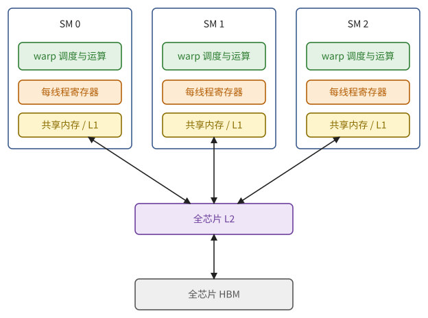
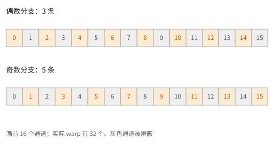
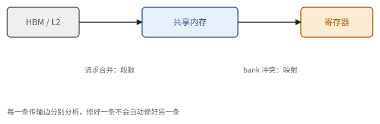
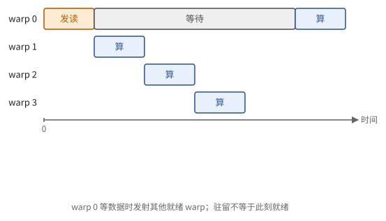
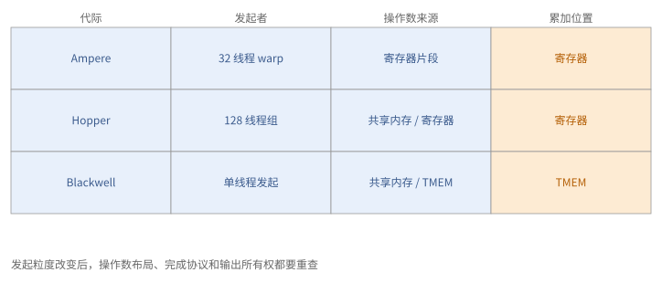

# 第 22 章　GPU 的结构

从这一章起是 GPU 路线。先想一个具体问题：从 HBM 读一个数要等七百纳秒左右，这段时间里一个 SM 能做好几万次乘加。机器怎样才能不白等？第 4 章给过两种回答。一种是事先把指令排好，让搬运和计算错开，这要求延迟可以预知；另一种是同时备着很多份互不相干的工作，谁的数据到了就做谁（命题 4.24）。GPU 选的是第二种，而且做到了极致：一个 SM 上同时驻留上千个线程，硬件每个周期挑一组数据已经到了的线程来执行。

这个选择决定了 GPU 编程的样子。程序员写的是"一个线程做什么"，硬件把 32 个线程捆成一组，用 SIMD 的方式执行；要让带宽跑满，就得让足够多的线程同时有读请求在路上。近几代 GPU 又在这个基础上加了几样东西：直接从片上存储取操作数的异步矩阵单元、按块搬运多维数组的搬运引擎、专门存放累加结果的存储。第 24 章的现代 kernel 就是围绕这些部件组织起来的。

## 22.1 总览

一颗数据中心 GPU 由一百多个相同的**流式多处理器**（streaming multiprocessor，SM）组成，SM 之间共享一个大的 L2 缓存和片外的 HBM。和第 6 章的抽象芯片（定义 6.1）对照：

| 抽象芯片 | GPU |
| --- | --- |
| 核心 | **SM**，每颗芯片一百多个 |
| 控制单元 | 每个 SM 4 个 **warp 调度器**，每个周期从驻留的线程组里挑一组可以执行的 |
| 向量单元 | 每个调度器下面的若干组运算单元，按 SIMT 方式执行（22.2 节） |
| 矩阵单元 | **Tensor Core**，每个 SM 4 个 |
| 片上存储 | **寄存器堆**（每 SM 256 KB）、**共享内存**与 L1 缓存（每 SM 两三百 KB）、全芯片共享的 **L2 缓存**（几十到一百多 MB） |
| 片外存储 | **HBM**（数据中心 GPU）或 GDDR（消费级 GPU） |
| 搬运机构 | 线程自己的读写指令、异步拷贝（cp.async）、张量搬运引擎（**TMA**） |
| 互联 | **NVLink** 与 **NVSwitch**；跨机器用网卡 |

和静态调度的芯片相比，GPU 有两点不同：SM 有缓存，指令的执行次序由硬件在运行时决定。读这张表时最要紧的是分清哪些东西属于一个 SM，哪些属于整颗芯片。

> **例 22.1（先画一个 SM，再复制很多份）** 线程的寄存器、共享内存里的数据、正在进行的矩阵运算，都属于某一个 SM；L2 和 HBM 属于整颗芯片。两个 SM 计算相邻的输出块、都要读同一块权重时，第二次读多半在 L2 命中，但一个 SM 不能把另一个 SM 的普通共享内存当成自己的缓冲。
>
> 所以算账要分两级：每个 SM 的寄存器和共享内存决定它一次能处理多大的块；所有 SM 的请求汇总之后，才受整颗芯片 HBM 带宽的限制。把 HBM 带宽乘以 SM 数，是把同一份带宽算了一百多遍。

**图 22.1**　GPU 的局部 SM 与全芯片存储。每个 SM 有自己的线程状态、寄存器与共享内存；所有 SM 共享 L2 和 HBM。

## 22.2 SIMT：线程、warp 与调度

GPU 的程序是按"一个线程"写的。比如把两个长度为 $n$ 的向量相加，程序只写"第 $i$ 个线程算 $z_i = x_i + y_i$"，然后启动 $n$ 个线程。每个线程看起来有自己的寄存器、自己的执行位置，像一台独立的小处理器。但硬件并不真的为每个线程配一套控制逻辑，那样太贵。

> **定义 22.2（SIMT）** 程序以**线程**（thread）为单位编写，每个线程在逻辑上有自己的寄存器和程序计数器。硬件把 32 个相邻的线程编成一个 **warp**，一个 warp 的 32 个线程同时执行同一条指令，各自使用自己的寄存器。这种执行方式叫 SIMT（single instruction, multiple threads）。

换句话说，一个 warp 就是一台宽度 $w = 32$ 的 SIMD 单元（定义 4.12），每个线程是它的一个通道；"线程"是写程序时的说法，"通道"是硬件的说法。既然是 SIMD，4.3 节的三条代价在 GPU 上一条不少：

1. **分支分歧**：同一个 warp 里的线程走了不同的分支，硬件只好用掩码把各个分支依次执行一遍（习题 4.7）。
2. **数据的摆放**：一个 warp 的 32 个线程同时访存，地址怎样分布决定了这次访存要花多少（22.3 节）。
3. **线程间交换数据**：同一个 warp 里可以用专门的洗牌指令直接交换寄存器里的值；不同 warp 之间要经过共享内存。

> **例 22.3（一个分支要付两份钱）** 一个 warp 的线程号为 0 到 31，偶数线程走一个分支（3 条指令），奇数线程走另一个分支（5 条指令）。硬件先在偶数通道上执行 3 条，再在奇数通道上执行 5 条，一共发射 8 条指令，每条只有 16 个通道在干活：有效工作 $16 \times 8$，只占满负荷 $32 \times 8$ 的一半。
>
> 如果是两个 warp 各走一个分支、每个 warp 内部一致，就没有这个损失。所以代价取决于条件在一个 warp 之内怎样分布，而不是源代码里有没有 `if`。另外，从 Volta 起每个线程有自己的程序计数器，分歧的两条路可能交错执行；这只是调度上的自由，线程之间需要同步时仍要显式地写出来。

**图 22.2**　同一个 warp 的两条分支分别开启偶数和奇数通道。掩码保证结果正确，但两条路径都占用发射时间。

**线程块与调度。** 线程再往上编成**线程块**（thread block，也叫 CTA），一个块至多 1024 个线程。一个块被整个交给一个 SM，它的所有 warp 从开始到结束都驻留在这个 SM 上，共用这个 SM 的共享内存，可以在块内同步。一个 SM 同时驻留好几个块，合计最多数十个 warp。

SM 内部分成 4 个子分区，每个子分区有一个 warp 调度器、四分之一的寄存器堆和一组运算单元。每个周期，每个调度器从分给它的 warp 里挑一个下一条指令的操作数已经就绪的，发射这条指令。这就是命题 4.24 说的多线程：一个 warp 在等存储，调度器就换另一个。

这种做法的代价在寄存器上。换 warp 不需要保存和恢复什么，因为所有驻留 warp 的寄存器一直都在寄存器堆里；寄存器堆因此要非常大。每个 SM 有 256 KB 的寄存器，比它的 L1 缓存还大，这在 CPU 上是不可想象的。

## 22.3 寄存器、共享内存与缓存

一个线程能用到的存储，从近到远有四级：自己的寄存器、本块共享的共享内存、缓存、全局内存（HBM）。

**寄存器。** 每个 SM 有 65536 个 32 位寄存器，每个线程最多用 255 个。寄存器是按线程分配的，所以一个 kernel 每个线程用得越多，一个 SM 能同时驻留的线程就越少（22.4 节）。编译器发现寄存器不够时，会把一部分变量**溢出**（spill）到片外存储（中间经过缓存），这很慢，审查 kernel 时要留意。

**共享内存**（shared memory）是每个 SM 上由程序自己管理的一块 SRAM，也就是第 3 章说的便签存储：数据要程序显式地写进去、读出来，硬件不会自动替你搬（定义 3.17）。它和 L1 缓存共用同一块 SRAM，两者的比例可以配置。共享内存分成 32 个存储体，每个 4 字节宽（定义 3.10）：一个 warp 的 32 个访问若落在 32 个不同的存储体上，一个周期就完成；若有几个落在同一个存储体上，就要排队（命题 3.11）。第 8 章的 XOR 交错（命题 8.11）就是为它准备的。

**缓存。** 每个 SM 有自己的 L1 缓存，整颗芯片共享一个大的 L2。L2 大到能放下一些中等大小的张量，所以被许多块重复读取的数据（例如矩阵乘法中被多个输出块共用的权重块）大多在 L2 命中，不必每次都到 HBM 去取。

**全局内存的访问粒度。** HBM 是按 32 字节的段来送数据的。一个 warp 的一次访存，代价取决于它的 32 个地址落在多少个不同的段里（定义 8.17）：32 个线程读连续的 32 个 f32，共 128 字节，只触及 4 个段；如果相邻线程的地址相隔 128 字节，就要触及 32 个段，每段只用 4 字节，效率只有八分之一（命题 8.18）。让一个 warp 的地址尽量挤在少数几个段里，在 GPU 上叫**访存合并**（coalescing）。

合并和存储体冲突常被混在一起，其实它们管的是两段不同的路。

> **例 22.4（合并与无冲突管的是不同的路）** 一个线程块从 HBM 按行连续读一块数据到共享内存，这一步是合并的。随后一个 warp 按列读取共享内存里的 $32 \times 32$ 数组，相邻线程的地址相隔 32 个字，全落在同一个存储体，32 路冲突。把共享数组改成 $32 \times 33$（每行多留一个空位）或做 XOR 交错，修好的是"共享内存 → 寄存器"这一段，与前面"HBM → 共享内存"那一段无关。
>
> 反过来，共享内存没有冲突，也补救不了从 HBM 跨步读来的 32 个段。所以审查一个 kernel 时，要为"HBM/L2 → 共享内存"和"共享内存 → 寄存器"分别写出下标映射，分别检查。

**图 22.3**　合并看的是全局请求触及几个段，冲突看的是共享内存的存储体分布；两者出现在不同的传输段上。

## 22.4 延迟隐藏与占用率

GPU 靠同时驻留许多 warp 来藏住延迟。那么一个 SM 最多能驻留多少，又至少要驻留多少？前一个数由资源决定，后一个数由 Little 定律决定。

> **定义 22.5（占用率）** 一个 SM 上实际驻留的 warp 数，与它最多允许驻留的 warp 数之比，称为**占用率**（occupancy）。

驻留的 warp 越多，每个都要占一份寄存器和共享内存，所以占用率受下面几样东西限制：

> **命题 22.6（占用率的上限）** 设 kernel 每个线程用 $r$ 个寄存器，每块 $T$ 个线程、$S$ 字节共享内存；SM 有 $R$ 个寄存器、$S_{\text{SM}}$ 字节共享内存，最多驻留 $W$ 个 warp。则每个 SM 驻留的块数至多为
>
> $$
> \min\!\left(\left\lfloor \frac{R}{rT} \right\rfloor,\ \left\lfloor \frac{S_{\text{SM}}}{S} \right\rfloor,\ \left\lfloor \frac{32W}{T} \right\rfloor,\ \text{每 SM 的最大块数}\right).
> $$

四项分别是寄存器、共享内存、warp 数和块数各自允许的块数，哪一样先用完，就卡在哪一样上。实际的寄存器和共享内存是按一定粒度分配的，结果可能比公式稍小。

> **例 22.7（两个资源上限取较小者）** 设每个 SM 有 65536 个寄存器、224 KiB 可用共享内存，最多 64 个 warp。一个 kernel 每块 256 个线程、每线程 64 个寄存器、每块 80 KiB 共享内存。寄存器允许 $65536 / (64 \times 256) = 4$ 块，共享内存只允许 $\lfloor 224 / 80 \rfloor = 2$ 块，所以最多驻留 2 块、16 个 warp，占用率至多 $16/64 = 25\%$。
>
> 25% 够不够，光看这个数说不清。如果这两个块每个都有好几份大的异步请求在路上，25% 也可能跑满带宽；如果每个线程只有一个小请求在路上，就可能不够。占用率说的是容量，真正和带宽挂钩的是在途的数据量，下面就来算它。

要几个 warp 才够，由 Little 定律回答：要维持带宽 $B$，路上必须同时有 $B \times L$ 的数据（推论 4.8）。

> **命题 22.8（跑满带宽所需的在途数据）** 设芯片有 $n_{\text{SM}}$ 个 SM，HBM 带宽为 $B$、延迟为 $L$。要跑满带宽，每个 SM 平均要有 $BL / n_{\text{SM}}$ 字节的读请求在途。

*证明* 由推论 4.8，整颗芯片要有 $BL$ 字节在途，平均分到每个 SM。∎

带入数字看看。带宽 3.35 TB/s、延迟约 700 ns、132 个 SM 的芯片，整颗芯片要有约 2.3 MB 在途，每个 SM 约 18 KB。如果每个线程同时只有一个 16 字节的读请求，一个 warp 在途 512 字节，每个 SM 就得驻留约 35 个 warp，占用率要五成以上。于是有两种策略：

- **靠占用率**：驻留很多 warp，每个 warp 只有少量请求在途；
- **靠每个 warp 的在途量**：只驻留少数 warp，但每个都有很多请求在途，比如一个线程连续发出好几个互不依赖的读，或者用异步拷贝，或者让搬运引擎一次搬一大块（22.6 节）。

早期的 GPU kernel 多用第一种。现代的矩阵乘法和注意力 kernel 每个 SM 只驻留少数几组 warp，每组用很大的寄存器和共享内存，靠深的异步流水线（第 9 章）保持足够的在途量，用的是第二种。

**图 22.4**　在驻留的 warp 中，调度器选择操作数已就绪的那个；一个 warp 等待时，由其他 warp 的独立工作填补。

## 22.5 Tensor Core 的演变

Tensor Core 是 GPU 的矩阵单元（第 5 章）。从数学上看它做的事一直没变：$D = AB + C$，每次一个固定形状的小块（定义 5.10）。变的是程序怎样把操作数交给它、结果放在哪里、谁来发起、怎样知道它做完了。三代的变化有一个一致的方向：矩阵单元越来越大，越来越不依赖线程，越来越直接从片上存储读取操作数。

**Ampere**（计算能力 8.0，消费级为 8.6）：warp 级的同步 MMA 指令。一个 warp 的 32 个线程合作完成一次例如 $m16n8k16$（bf16）的乘加。$A$、$B$、$C$ 都放在寄存器里，但不是某一个线程持有整块矩阵：每个线程的寄存器里只放其中几个元素，32 个线程合起来才是完整的矩阵，哪个元素放在哪个线程的哪个寄存器里由硬件规定。这种"每个线程持有的一小份"叫**片段**（fragment）。操作数要先从共享内存读进寄存器（有专门按矩阵布局读取的指令）。支持 tf32、bf16、fp16、int8 和 2:4 稀疏。

> **例 22.9（从一条真实 MMA 的名字读出数学对象）** 公开的 PTX 指令 `mma.sync.aligned.m16n8k16.row.col.f32.bf16.bf16.f32` 的名字可以逐段读：`m16n8k16` 是形状，$A$ 为 $16 \times 16$，$B$ 为 $16 \times 8$，$C$ 与 $D$ 为 $16 \times 8$；`f32.bf16.bf16.f32` 依次是 $D$、$A$、$B$、$C$ 的类型，即 bf16 输入、f32 累加和输出。一次做 $2 \times 16 \times 8 \times 16 = 4096$ 次浮点运算。
>
> 这 4096 次运算是 32 个线程合起来做的。在这个形态下，每个线程提供 $A$ 的 4 个 32 位寄存器（每个装两个 bf16）、$B$ 的 2 个，持有 $D$ 的 4 个 f32 元素；32 个线程正好凑出 $D$ 的 $16 \times 8 = 128$ 个元素。名字里的 `.sync` 只是说这是整个 warp 一起执行的指令，它不会同步整个线程块。

**Hopper**（9.0）：warpgroup 级的异步 MMA（wgmma）。4 个 warp（128 个线程）组成一个 **warpgroup**，一起发起一次 $m64nNk16$（$N$ 最多 256）的乘法。$B$（也可以包括 $A$）直接从共享内存读，不再经过寄存器，但要求按规定的交错布局存放；累加结果仍在这 128 个线程的寄存器里。指令是异步的：发起之后线程可以去做别的事，需要结果时再等它完成。支持 fp8。

**Blackwell**（10.0）：单个线程发起的异步 MMA（tcgen05）。一个线程就能发起整块的乘法；操作数来自共享内存（$A$ 也可以来自张量存储）；累加结果放在新增的**张量存储**（tensor memory，TMEM）里，不再占用线程的寄存器。TMEM 每个 SM 256 KB，组织成 128 行 × 512 列的 32 位单元。一个线程块的一次 MMA 最大可以是 $128 \times 256$；两个线程块组成一对（CTA 对）合作时可达 $256 \times 256$，各出一半的数据、各存一半的累加结果。乘法完成时，硬件去通知一个 mbarrier（22.6 节）。硬件直接支持 MX 格式和 NVFP4 的块缩放乘法（2.8 节）。

把三代放在一起，变化的就是三件事：谁发起（32 个线程、128 个线程、1 个线程），操作数从哪里来（寄存器、共享内存），累加放在哪里（寄存器、TMEM）。

**图 22.5**　Ampere、Hopper、Blackwell 的矩阵接口：发起者、操作数和累加结果各在哪里。数学语义相同，状态归属与同步方式不同。

> **注 22.10（对照）** 这个方向使 GPU 的矩阵单元越来越像 TPU 的 MXU：由少数指令驱动、从片上存储读操作数、异步完成的大矩阵单元。不读 TPU 路线的读者可以跳过这条注。

> **现状（2026-10）**：Rubin 把 Tensor Core 每周期沿 $K$ 方向处理的数据量加倍，主打格式是 NVFP4（每 GPU 约 50 PFLOP/s）。据公开资料，消费级 Blackwell（计算能力 12.0）没有 tcgen05 与张量存储，矩阵运算仍用 warp 级的 MMA 指令（支持 fp4）。例 22.9 的指令形态与片段数据据 NVIDIA 的 [PTX ISA](https://docs.nvidia.com/cuda/parallel-thread-execution/)，这个 bf16 形态要求计算能力 8.0 或更新。PTX 是公开的虚拟指令集，最终的机器指令由编译器针对具体目标生成；完整拼写见附录 B，不必背。

## 22.6 异步搬运：cp.async 与 TMA

22.4 节说，只驻留少数 warp 时，每个 warp 必须有很多数据在途。如果搬运要线程一个元素一个元素地读进寄存器、再写进共享内存，线程就被拴在搬运上，在途量也上不去。所以搬运必须是异步的：线程只负责发起，搬运由别的部件去做（定义 4.16 的 DMA 就是这个意思）。GPU 有两种异步搬运。

**cp.async**（从 Ampere 起）：每个线程发起一次从全局内存到共享内存的拷贝（每次 4、8 或 16 字节），数据不经过寄存器。同步的方式是"提交一组，等待其中若干组完成"。

**TMA**（tensor memory accelerator，Hopper 起）：一个专门的搬运引擎，可以把它看成懂多维数组的 DMA。程序事先建好一个**张量描述符**（tensor map），写明全局数组的基地址、各维长度和步长、每次要搬的块形状、在共享内存里怎样交错存放；之后只要**一个线程**发出一条指令，引擎就把整个多维块在全局内存和共享内存之间搬好，还可以把同一块同时送给簇里的几个线程块（多播，22.7 节）。地址计算和越界处理都由引擎完成，不占线程的寄存器和指令。

异步搬运带来一个问题：搬完了，等着用这块数据的线程怎么知道？GPU 用 **mbarrier** 解决，它是放在共享内存里的一个同步对象，相当于定义 9.7 的计数信号量加上一位"相位"。它记着本轮预期有几次到达、预期有多少字节；TMA 每搬完一部分，就把对应的字节数记上去，Tensor Core 做完乘法也可以去通知它。等待的线程等的是"本轮的计数满了"；计数一满，相位翻转，这个 mbarrier 就可以接着用于下一轮。多缓冲时每个缓冲配一个 mbarrier，反复使用，相位位用来区分"这一轮满了"和"上一轮满了"。

> **例 22.11（一条指令搬的不是一个元素）** 用 TMA 搬 $A[128, 64]$ 和 $B[64, 128]$ 两个 bf16 块，各 $128 \times 64 \times 2 = 16$ KiB。如果用同一个 mbarrier 等这两次搬运，就要声明本轮预期 32768 字节；只声明 16384 字节，计数在第一块到达时就满了，并不能说明两份操作数都已就绪。
>
> 另外，"一个线程负责发起"不等于"一个线程逐个元素地搬"，也不等于"参与计算的线程都已同步"。描述符管地址与布局，mbarrier 管这次异步搬运是否完成，warp 和线程块之间的协作仍然要按各自的同步规则来写。

## 22.7 线程块簇与分布式共享内存

线程块之间本来互不相识：它们可能被分到任意的 SM 上，开始的时间也不一定相同，所以一个块不能指望读到另一个块的共享内存。Hopper 引入了**线程块簇**（thread block cluster）：若干个线程块（可移植的上限是 8 个）保证被同时调度到相邻的一组 SM 上。簇里的线程块可以直接读写彼此的共享内存，这叫**分布式共享内存**（distributed shared memory）；可以在整个簇的范围内同步；TMA 可以把一块数据多播给簇里的多个线程块。用处是让相邻的线程块共享操作数，少从 L2 和 HBM 重复读取，Blackwell 的 CTA 对也建立在簇之上。

"保证同时调度"这一点比看上去重要。

> **例 22.12（同时驻留给协议增加了什么保证）** 两个普通线程块各自忙等对方写共享状态。如果硬件只把其中一个调度上去，另一个还在排队，正在运行的那个就会永远等下去。把这两个块组成一个簇，就得到了"同时调度"和"簇内同步"的保证。但仍要保证每个成员都会到达同步点，访问对方的共享内存时，对方还没有退出。
>
> 簇扩大了能够直接合作的范围，却没有把所有共享内存合成一个自动管理的大缓存：数据归谁、地址怎么算、退出之前怎样同步，都仍要写清楚。

## 22.8 互联

最后走出芯片。GPU 之间的连接分三层：

- **NVLink**：GPU 之间的点对点高速链路。
- **NVSwitch**：交换芯片，把一组 GPU 连成全带宽的交换网络（定义 7.3 中交换机的情形）。常见的一台服务器有 8 颗 GPU；NVL72 一类的机柜把 72 颗 GPU 放进同一个 NVLink 交换域。
- 跨越交换域时，经由每颗 GPU 配的网卡（InfiniBand 或以太网）通信，带宽比 NVLink 低一个数量级。

所以 GPU 系统是分层的交换网络：域内是全带宽的交换机，二分带宽高（7.2 节的表），all-to-all 很便宜；域间的带宽低得多。第 12 章的分工原则在这里变得具体：通信量大的张量并行和专家并行放在 NVLink 域内，数据并行和 FSDP 可以跨域。

厂商标的 NVLink 带宽通常是双向合计，代入公式之前要先换成单向。

> **例 22.13（双向带宽不能直接当单向用）** 某接口标称 900 GB/s，如果这是发送和接收的合计、各 450 GB/s，那么单向发送 90 MB 至少要 $90 \times 10^6 / (450 \times 10^9) = 0.2$ ms。把 900 当成单向带宽，就会算成 0.1 ms，差了一倍。
>
> all-reduce 的注入量、发送加接收的总量、厂商标的合计带宽，必须用同一个口径。实际能达到的带宽还受消息大小、拓扑和并发的影响，附录 A 的标称值只是上界。

## 22.9 各代的变化

> **现状（2026-10）**：

| | A100 | H100 | B200 | Rubin | RTX 3060 Ti |
| --- | --- | --- | --- | --- | --- |
| 架构（计算能力） | Ampere（8.0） | Hopper（9.0） | Blackwell（10.0） | Rubin | Ampere（8.6） |
| SM 数 | 108 | 132 | 148 | 224 | 38 |
| bf16 稠密峰值 | 312 TFLOP/s | 约 990 | 约 2300 | — | — |
| 更窄的格式 | int8 | fp8（约 2000） | fp8（约 4500）、fp4 | NVFP4（约 50 PFLOP/s） | int8 |
| 每 SM 共享内存上限 | 164 KB | 228 KB | 228 KB | — | 100 KB |
| L2 | 40 MB | 50 MB | 126 MB | — | 4 MB |
| 显存 | 80 GB，约 2 TB/s | 80 GB，3.35 TB/s | 192 GB，8 TB/s | 288 GB，22 TB/s | 8 GB GDDR6，448 GB/s |
| 每 GPU 的 NVLink（双向） | 600 GB/s | 900 GB/s | 1.8 TB/s | 3.6 TB/s | — |
| 新的编程接口 | cp.async、warp 级 MMA | TMA、wgmma、簇 | tcgen05、TMEM、CTA 对 | — | cp.async、warp 级 MMA |

表中"—"表示写作时没有找到可靠的公开数字。

GPU 的执行时间取决于运行时的动态行为：缓存是否命中，warp 怎样被调度，各个 SM 怎样争用带宽。所以光数指令不能确定时间，实际的性能要靠硬件计数器和剖析工具来看。但第 6 章的屋顶线估算在 GPU 上照样有效：它给出的上限和实测之间的差距，就是还能优化的余地。

> **注 22.14（型号名称不是指令能力表）** 部署 kernel 时，要核对的是目标的计算能力、所用指令要求的目标、累加结果放在哪里、同步协议和资源上限，而不是营销名称。都叫 Blackwell 的产品，矩阵接口可能完全不同（见上面的现状框）；即使 PTX 能编译通过，分块大小和带宽模型也要按具体目标重新算。

带宽提高之后，能快多少要看这个 kernel 原来卡在哪里。

> **例 22.15（Rubin 的带宽先换来哪一部分）** 一个只读数据的阶段要从 HBM 搬 1 GiB。按附录 A 的标称带宽，H100 SXM 的 3.35 TB/s 给出下界约 321 µs，Rubin 的 22 TB/s 给出约 48.8 µs，比值约 6.57。如果同一个 kernel 还有 100 µs 无法与搬运重叠的计算，两者的下界就变成约 421 µs 和 149 µs，比值只剩约 2.83。
>
> 带宽的提升只作用在搬运那一部分上；如果瓶颈原本是行归约或指数运算，带宽翻几倍也不会直接变成端到端的加速。峰值、实际能达到的带宽、执行时间，三者要分开看。

> **现状（2026-10-07）**：本例的标称参数据 [H100 产品表](https://www.nvidia.com/en-us/data-center/h100/) 和 [Rubin 架构介绍](https://developer.nvidia.com/blog/inside-nvidia-rubin-gpu-architecture-powering-the-era-of-agentic-ai/)，集中在附录 A；100 µs 是为说明串行工作而假设的。

## 本章小结

1. GPU 由一百多个 SM 组成；每个 SM 有 4 个动态调度的 warp 调度器、运算单元、4 个 Tensor Core、256 KB 寄存器堆、两三百 KB 的共享内存与 L1；全芯片共享 L2 与 HBM。算账时分清每 SM 的资源与全芯片的资源。（22.1 节、例 22.1）
2. SIMT：程序按线程写，硬件把 32 个线程编成 warp，以 SIMD 方式执行；warp 内的分支分歧用掩码依次执行；线程块整个驻留在一个 SM 上，块内共用共享内存、可以同步。（定义 22.2、例 22.3）
3. 共享内存有 32 个 4 字节的存储体；全局内存以 32 字节为段，一个 warp 一次访存的代价是它触及的段数。合并与存储体冲突分别管"HBM → 共享内存"和"共享内存 → 寄存器"两段路。（22.3 节、例 22.4）
4. 占用率受寄存器、共享内存、warp 数、块数限制（命题 22.6）；跑满带宽要求每个 SM 有 $BL/n_{\text{SM}}$ 字节在途，可以靠占用率，也可以靠每个 warp 的异步在途量。（命题 22.8、例 22.7）
5. Tensor Core：Ampere 是 32 个线程的同步 MMA（操作数与累加都在寄存器的片段里）；Hopper 是 128 个线程的异步 MMA（操作数可直接来自共享内存，累加在寄存器）；Blackwell 是单线程发起的异步 MMA（累加在 256 KB 的 TMEM，可用 CTA 对），支持块缩放格式。（22.5 节、例 22.9）
6. 异步搬运：cp.async 由每个线程发起；TMA 由一个线程按描述符搬整个多维块，可以多播。mbarrier 按到达次数与字节计数，带相位位，可以反复使用。（22.6 节、例 22.11）
7. 线程块簇保证一组块同时调度，可以互读共享内存；NVLink/NVSwitch 组成全带宽交换域，域间走网卡，带宽低一个数量级；厂商标的带宽常是双向合计。（22.7、22.8 节、例 22.12、例 22.13）
8. GPU 的时间由运行时决定，但屋顶线估算同样有效；部署时按计算能力而不是型号名核对接口。（22.9 节、注 22.14）

## 习题

**习题 22.1** ★ 一个 kernel 每线程用 128 个寄存器，每块 256 个线程、48 KB 共享内存。SM 有 65536 个寄存器、228 KB 共享内存、至多 64 个 warp、至多 32 个块。按命题 22.6，每个 SM 能驻留几个块？占用率是多少？若把寄存器降到 64 个呢？

提示 1

寄存器、共享内存、warp 数与块数各给一个上界，驻留块数取最小。

提示 2

逐项计算命题 22.6 中的四个量。

答案

寄存器：$65536 / (128 \times 256) = 2$；共享内存：$\lfloor 228/48 \rfloor = 4$；warp：$64 \times 32 / 256 = 8$；块数 32。至多 2 个块，16 个 warp，占用率 25%。寄存器降到 64 个时，寄存器的限制变为 4，与共享内存的限制相同，4 个块、32 个 warp，占用率 50%。

**习题 22.2** ★ 用命题 22.8，对 B200（8 TB/s、148 个 SM，设延迟 800 ns）求每个 SM 需要多少字节在途。若一个 SM 只驻留 3 个 warpgroup（12 个 warp），每个 warp 平均要有多少字节在途？用逐线程的 16 字节读能做到吗？

提示 1

先用整芯片带宽乘延迟，再均分 SM 和 warp；注意请求段流量与有用载荷的差别。

提示 2

每个 warp 一次 16 字节的读，在途 512 字节。

答案

$8 \times 10^{12} \times 8 \times 10^{-7} / 148 \approx 43$ KB。12 个 warp 时每个 warp 约 3.6 KB，相当于每个线程同时有约 7 个 16 字节的读在途，需要很深的软件流水线和大量寄存器。用 TMA 一次搬运一个几十 KB 的块，单条指令就能提供这样的在途量。这就是现代 kernel 依赖 TMA 的原因。

**习题 22.3** ★ 一个 warp 的 32 个线程各读一个 bf16，第 $i$ 个线程读地址 $a_0 + 2i$（字节），$a_0$ 是 32 的倍数。触及几个段？若第 $i$ 个线程改为从 $a_0+16i$ 开始读 8 个连续的 bf16（一次 16 字节的读）呢？若第 $i$ 个线程读第 $i$ 行的第一个元素，行长为 4096 个 bf16 呢？

提示 1

先列整个 warp 的字节区间，再按 32 字节边界数段；16 字节块假设相邻线程读互不重叠的连续块。

提示 2

定义 8.17，段长 32 字节。

答案

64 字节连续，2 个段，效率 100%。每线程 16 字节时 512 字节连续，16 个段，效率 100%，而且一次读到的数据是前者的 8 倍。读每行的第一个元素时相邻地址相隔 8192 字节，32 个段，每段只用 2 字节，效率 $1/16$。

**习题 22.4** ★ 在 Blackwell 上，一个线程块计算 $128 \times 256$ 的输出块，累加结果为 f32，放在 TMEM 中。它占 TMEM 的多少？能否在 TMEM 中放两份累加器？这有什么用？

提示 1

先按列和 32 位元素算容量，再核对是否还需其他 TMEM 对象。

提示 2

TMEM 是 128 行 × 512 列的 32 位单元。

答案

$128 \times 256$ 个 f32 占 256 列，恰为 TMEM 的一半，可以放两份。用途：当一份累加器正在被读出、做结尾融合并写回（第 24 章）时，Tensor Core 可以在另一份上开始下一个输出块的乘法，结尾与主循环重叠，即累加器的双缓冲。

**习题 22.5** ★ 共享内存中按行存放一个 $64 \times 64$ 的 bf16 块（每行 128 字节）。一个 warp 要读取一列的 32 个元素（第 $i$ 个线程读第 $i$ 行第 $j$ 列）。冲突度是多少？用 16 字节为单位的 XOR 交错（习题 8.4）后，读"一列 16 字节的块"（每个线程读第 $i$ 行的第 $c$ 个 16 字节块）的冲突度是多少？

提示 1

16 字节读取占四个 bank，单 warp 共 512 字节本就需要多次服务；把基本服务量和额外冲突分开。

提示 2

存储体宽 4 字节，32 个存储体覆盖 128 字节，恰为一行。

答案

每行 128 字节恰好覆盖 32 个存储体一次，第 $i$ 行第 $j$ 列总在同一个存储体，32 个访问冲突度为 32。按 16 字节交错后，第 $i$ 行的第 $c$ 个块存放在位置 $c \oplus (i \bmod 8)$：每 8 行在 8 个不同的 16 字节位置上，16 字节的访问以 4 个存储体为一组，8 个位置覆盖全部 32 个存储体。32 个线程的 16 字节访问共 512 字节，至少要 4 个周期（硬件每周期服务 128 字节），交错后恰好 4 个周期，没有额外的冲突。

**习题 22.6** ☆ 72 颗 GPU 在一个 NVLink 交换域中，每颗 GPU 的单向 NVLink 带宽为 900 GB/s。用命题 7.5 估计每颗 GPU 向其余每颗各发 1 MB 的全交换至少需要多少时间。若同样的 72 颗 GPU 只能经由每颗 50 GB/s 的网卡通信呢？

提示 1

每 GPU 自己的注入带宽也给出下界；二分带宽需与注入项同时取最大。

提示 2

无阻塞交换机的二分带宽为 $\frac{p}{2}\beta$。

答案

$(72/2)^2 \times 10^6 / (36 \times 9 \times 10^{11}) = 1.296 \times 10^9 / 3.24 \times 10^{13} \approx 40$ µs。经网卡时（假设网络本身无阻塞）为 $1.296 \times 10^9 / (36 \times 5 \times 10^{10}) \approx 0.72$ ms，慢 18 倍。这就是专家并行要尽量限制在 NVLink 域内的原因。

**习题 22.7** ★（综合审查题）例 22.9 的 warp MMA 逻辑形状为 $m16n8k16$，bf16 输入、f32 累加。一个 warp 共持有多少个输出元素、做多少 FLOP？把每线程的四个 f32 输出误当成整个 MMA 输出会漏掉多少？

提示 1

先按矩阵形状数整体，再用 32 线程和每线程片段交叉核对。

提示 2

整体输出 $16\cdot8=128$ 个元素；每线程 4，共 $32\cdot4$。

答案

共有 128 输出元素，做 $2\cdot16\cdot8\cdot16=4096$ FLOP。只计单线程片段会把输出计为 4，仅计整体的 1/32；warp 级指令是集体操作，不能再把 4096 按每线程重复计 32 次。

