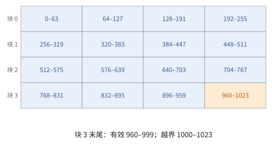
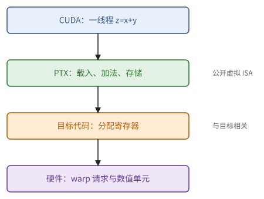
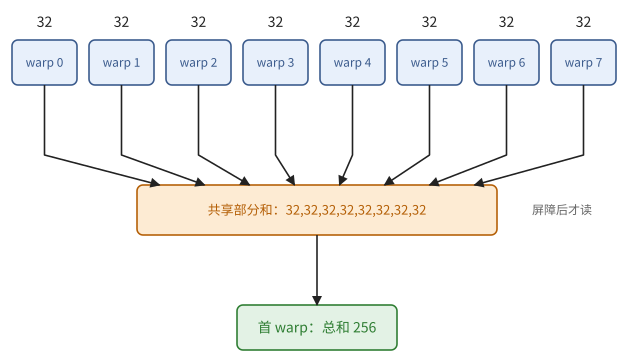
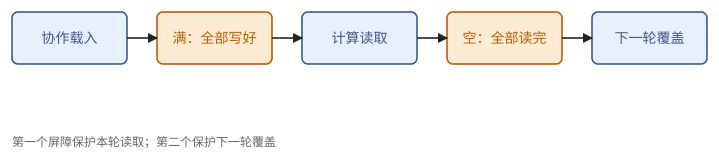
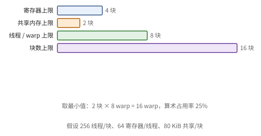

# 第 23 章　CUDA 编程：SIMT 模型

CUDA 是为 NVIDIA GPU 写程序的基本语言。它是在 C++ 上加了几样东西：用 `__global__` 标出一个在 GPU 上运行的函数（叫 kernel），在函数里描述**一个线程**做什么，然后一次启动成千上万个线程去执行它。第 22 章讲了硬件怎样执行这些线程；这一章讲程序员看到的模型。

代码只用来确定数学对象（下标怎样映射、谁和谁同步），越短越好；语法细节交给 AI 和文档即可。现代 GPU 上高性能 kernel 用到的异步搬运和 Tensor Core 放在第 24 章。

## 23.1 kernel 与线程层级

先看一个把两个向量相加的 kernel：

```cpp
__global__ void add(const float* x, const float* y, float* z, int n) {
    int i = blockIdx.x * blockDim.x + threadIdx.x;      // 本线程负责的元素
    if (i < n) z[i] = x[i] + y[i];                      // 越界的线程什么也不做
}
// 启动：add<<<(n + 255) / 256, 256>>>(x, y, z, n);   256 个线程一块，块数向上取整
```

启动语句里尖括号中的两个数，前一个是块的个数，后一个是每块的线程数。每个线程执行同一段代码，区别只在于它读到的几个内置变量不同：`blockIdx.x` 是它所在块的编号，`threadIdx.x` 是它在块内的编号，`blockDim.x` 是每块的线程数。第一行由这三个数算出"我该处理第几个元素"。

> **定义 23.1（线程层级与下标映射）** 一次启动由一个**网格**（grid）组成，网格由**块**组成，块由**线程**组成，网格和块都可以是一到三维的。每个线程知道自己的块坐标 `blockIdx`、块内坐标 `threadIdx`，以及块的形状 `blockDim`、网格的形状 `gridDim`。从（块坐标，线程坐标）到这个线程所处理的数据下标的函数，称为 kernel 的**下标映射**。

上面的例子里，下标映射是 $(b, t) \mapsto 256 b + t$。设计一个 CUDA kernel，第一件事就是设计这个映射，让它满足三个要求：

1. **覆盖**：每个数据元素恰好由一个线程处理；线程数多于元素时，多出来的线程要用边界检查挡住。
2. **合并**：同一个 warp 的 32 个线程（`threadIdx.x` 连续的 32 个）访问的地址应当连续（22.3 节）。
3. **负载**：工作在线程、warp、块之间大致均匀。

线程数少于数据量时，常用**网格步长循环**（grid-stride loop）：

```cpp
for (int i = blockIdx.x * blockDim.x + threadIdx.x; i < n; i += gridDim.x * blockDim.x)
```

每个线程处理一串相隔"整个网格的线程数"的元素。这样相邻线程在每一轮仍然访问相邻的地址，合并不受影响。

边界检查看起来平淡，却是许多错误的来源。

> **例 23.2（一千个元素怎样被覆盖）** 取 $n = 1000$、每块 256 个线程，启动 $\lceil 1000/256 \rceil = 4$ 块，线程编号 0 到 1023。前 1000 个线程各写一个元素，最后 24 个被边界条件挡住；块 3 的前三个 warp 全部有效，最后一个 warp 只有 8 个有效线程。
>
> 对互相独立的逐元素运算，这样挡住就够了。但如果后面还要做整个 warp 一起参加的归约（23.3 节），这 24 个线程就不能提前 `return`：它们应当贡献一个不影响结果的值（求和时是 0），和其他线程一起参加。



**图 23.1**　四个 256 线程的块覆盖 1024 个编号，最后 24 个超出数组。越界的线程能不能提前退出，取决于之后还有没有需要全体参加的同步。

## 23.2 存储空间

线程能读写的存储分成几个空间，各自对应第 22 章的一种硬件：

| 存储空间 | 声明 | 谁能访问 | 对应的硬件 |
| --- | --- | --- | --- |
| 寄存器 | 普通局部变量 | 一个线程 | 寄存器堆；放不下时溢出到"局部内存"（其实在全局内存里） |
| 共享内存 | `__shared__` | 一个块 | SM 上的共享内存 |
| 全局内存 | 指针参数、`cudaMalloc` 分配 | 所有线程 | HBM，经 L2、L1 缓存 |
| 常量内存 | `__constant__` | 所有线程，只读 | 带专门缓存的全局内存 |

主机与设备之间的分配、拷贝、释放是样板代码，可以交给 AI。只需记住一点：主机与设备之间的带宽比 HBM 低得多，数据应当尽量留在设备上。

写下的 CUDA 代码要经过两次翻译才变成 GPU 执行的指令。看 kernel 性能时常要看中间的那一层，所以把这几层的名字说清楚。

> **定义 23.3（程序、虚拟指令与机器指令）** **指令集体系结构**（instruction set architecture，ISA）规定一台机器上程序能看到的状态、能用的指令，以及指令执行的约束。CUDA C++ 是源语言；编译器先把它翻译成 **PTX**（Parallel Thread Execution），这是 NVIDIA 公开的虚拟 ISA，不对应具体某一代硬件；再由针对具体 GPU 的编译器翻译成目标机器指令，通常称为 **SASS**。源程序中的变量和 PTX 中的虚拟寄存器，要在寄存器分配之后才落到物理寄存器上，放不下的就溢出，多出额外的存储操作。

> **例 23.4（把加法 kernel 的一条数据路径拆开）** 假定地址和边界条件已经算好，一个线程计算 $z_i = x_i + y_i$ 的 PTX 大致是：
>
> ~~~text
> ld.global.f32 %x, [%px];
> ld.global.f32 %y, [%py];
> add.f32       %z, %x, %y;
> st.global.f32 [%pz], %z;
> ~~~
>
> 这里省去了地址计算、寄存器声明和函数入口。两条读指令在每个线程看来各读一个数，到了硬件上是一个 warp 的 32 个地址一起发出，按 22.3 节的规则合并成若干段；加法在运算单元上做；写回走存储通路。同样四条指令，线程的地址分布不同，产生的访存流量就可能差好几倍。最终的机器指令也不必和这四条一一对应。



**图 23.2**　源语言、PTX 与目标机器指令是三个层次。每个线程的虚拟操作在一个 warp 上合成一组并行请求，再落到硬件资源上。

下面的互动把定义 8.17 的段数模型用在一个 warp 上：每个线程读一个 f32，改变起点或步长，可以逐个地址核对传输效率。这里只计触及的 32 字节段，不考虑缓存。

<div class="widget" data-widget="coalescing"></div>

## 23.3 同步

线程之间要协作，就要同步。CUDA 提供四类手段。

**块内屏障** `__syncthreads()`：块内所有线程都到达这里之后，才一起往下走；它同时保证屏障之前对共享内存的写，对屏障之后的读可见。使用时有一条硬规矩：块内所有线程都必须执行到同一个 `__syncthreads()`。把它放在只有部分线程会进入的分支里，行为未定义，通常的结果是死锁，因为进了分支的线程永远等不齐人。

**warp 内交换数据**：同一个 warp 的线程可以直接读别人寄存器里的值，不经过共享内存，这类指令叫**洗牌**（shuffle）。`__shfl_sync(mask, v, src)` 让每个线程拿到第 `src` 号线程的 `v`；`__shfl_xor_sync(mask, v, k)` 拿到第 `lane ^ k` 号线程的 `v`；`__shfl_up_sync`、`__shfl_down_sync` 拿到编号相差 $k$ 的线程的值。这就是 4.4 节说的通道之间的数据置换。参数 `mask` 列出参加的线程，通常是全部 32 个（`0xffffffff`）。另有 `__ballot_sync`，把 32 个线程各自的真假收集成一个 32 位整数。

**原子操作** `atomicAdd` 等：对全局或共享内存中一个位置的"读—改—写"不可分割，不会被别的线程插进来。许多线程对同一位置做原子加法时，次序由运行时决定，所以浮点结果每次可能不同（命题 10.24）。

**栅栏** `__threadfence()`：保证本线程在它之前的写，先于它之后的写被整个设备看到（23.7 节）。

前两条的参与规则最容易出错，看一个尾部块的例子。

> **例 23.5（边界条件不能把屏障包进去）** 一个线程块读取数组末尾的一块，部分线程越界。正确的结构是：每个线程都写共享内存，有效的线程写数据，越界的线程写单位元（求和时是 0）；然后全块执行同一个屏障。如果把屏障也写进 `if (i < n)` 里面，尾部块就有一部分线程到不了屏障。
>
> 洗牌的 `mask` 也不是"只取这些线程的值"的过滤器：`mask` 里列出的、还没有退出的线程都必须执行这条指令，被读取的源线程也必须有效。最容易证明正确的写法，是让整个 warp 都参加，越界的线程贡献单位元。

## 23.4 归约与扫描

有了洗牌和屏障，就可以把第 10 章的归约写成 CUDA：先在一个 warp 内，再到一个块，再到整个网格。

**warp 内归约。** 用 XOR 的蝶形交换：第一步每个线程和编号差 16 的线程交换并相加，然后是差 8、4、2、1。5 步之后，每个线程都得到 32 个值的和：

```cpp
__device__ float warp_sum(float v) {
    for (int k = 16; k > 0; k /= 2)
        v += __shfl_xor_sync(0xffffffff, v, k);
    return v;                                   // 32 个线程都持有总和
}
```

> **命题 23.6（XOR 洗牌归约）** `warp_sum` 返回时，每个线程的 `v` 等于 32 个线程初始值之和。

*证明* 想法是看每一步之后，一个线程的值是哪些线程初始值的和。对步数归纳：用过 $k = 16, 8, \dots, 2^j$ 之后，线程 $l$ 的值等于编号的低 $j$ 位与 $l$ 相同（高位任意）的那 $2^{5-j}$ 个线程的初始值之和。下一步与线程 $l \oplus 2^{j-1}$ 交换相加，对方的集合恰好是第 $j-1$ 位取另一个值的那一半，两者合起来就是低 $j-1$ 位与 $l$ 相同的全部线程。到 $j = 0$ 时覆盖了全部 32 个线程。∎

这是命题 1.42 的二叉树，深度 $\log 32 = 5$；而且每个线程都得到结果，结构上和 all-reduce（定义 7.8）一样。

**块内归约。** 先在每个 warp 内归约，每个 warp 的第 0 号线程把结果写进共享内存；屏障之后，由第一个 warp 把这些部分和再归约一次：

```cpp
__device__ float block_sum(float v) {
    __shared__ float partial[32];               // 每个 warp 一个位置（块至多 1024 线程）
    int lane = threadIdx.x % 32, warp = threadIdx.x / 32;
    v = warp_sum(v);
    if (lane == 0) partial[warp] = v;
    __syncthreads();                            // 所有部分和写完之后才读
    int nwarps = (blockDim.x + 31) / 32;
    v = (threadIdx.x < nwarps) ? partial[lane] : 0.0f;
    if (warp == 0) v = warp_sum(v);
    return v;                                   // 结果在第 0 个 warp 的线程中
}
```

如果在同一个 kernel 里连续调用两次，第二次写 `partial` 之前要再加一个 `__syncthreads()`，否则可能覆盖第一次还没读完的部分和（命题 9.4）。

> **例 23.7（八个 warp 怎样合成一个总和）** 256 个线程每个贡献 1。每个 warp 经过五步归约得到 32，第 0 号线程把 32 写进 `partial[warp]`；屏障之后，第一个 warp 的前 8 个线程读这 8 个 32，其余 24 个线程取 0，再归约一次，得到 256。
>
> 这段代码要求一维的块、线程数是 32 的倍数。若最后一个 warp 不完整，`warp_sum` 假定的"32 个线程全部参加"就不成立；只把 `nwarps` 向上取整，不能说明任意块大小都能用。



**图 23.3**　先在八个 warp 内各自归约，再经共享内存汇集八个部分和，最后由第一个 warp 合并。屏障位于共享内存的写与读之间。

**整个网格的归约**要跨越块，有两种做法。一是每个块写出一个部分和，再由第二个 kernel（或者最后完成的那个块）归约这些部分和，结果是确定的。二是每个块用 `atomicAdd` 把部分和加到一个全局变量上，只要一个 kernel，但加的次序由运行时决定，结果不确定（命题 10.24）。

**扫描。** warp 内的前缀和用 `__shfl_up_sync` 走 5 步（Kogge–Stone，命题 1.44）：第 $k = 1, 2, 4, 8, 16$ 步，编号 $l \ge k$ 的线程加上第 $l - k$ 号线程的值。块内和整个网格的扫描用命题 10.19 的分块扫描：先在每个 warp 内扫描，再扫描各 warp 的总和，最后把偏移加回去。

## 23.5 共享内存分块矩阵乘法

第 6 章说过，矩阵乘法要快，关键是让读进来的数据被多次使用（命题 6.12）。最直接的 CUDA 写法是：每个块计算 $C$ 的一个 $T \times T$ 的块，每个线程算其中一个元素；沿 $K$ 方向，每次把 $A$、$B$ 各一个 $T \times T$ 的块读进共享内存，块内的线程一起用。

```cpp
template <int T>
__global__ void matmul_tiled(const float* A, const float* B, float* C, int M, int N, int K) {
    __shared__ float As[T][T];
    __shared__ float Bs[T][T];
    int tx = threadIdx.x, ty = threadIdx.y;
    int row = blockIdx.y * T + ty, col = blockIdx.x * T + tx;
    float acc = 0.0f;
    for (int k0 = 0; k0 < K; k0 += T) {
        As[ty][tx] = A[row * K + k0 + tx];      // 一个 warp 读一行中连续的 T 个：合并
        Bs[ty][tx] = B[(k0 + ty) * N + col];
        __syncthreads();                        // 命题 9.3：块装满之后才读
        for (int k = 0; k < T; ++k)
            acc += As[ty][k] * Bs[k][tx];
        __syncthreads();                        // 命题 9.4：全部读完之后才覆盖
    }
    C[row * N + col] = acc;
}
// 启动：dim3 block(T, T), grid(N / T, M / T)；这里假定 M、N、K 都是 T 的倍数
```

用前面几章的工具逐项检查：

- **合并**：$T = 32$ 时，一个 warp 是 `ty` 相同、`tx` 从 0 到 31 的 32 个线程，读 $A$ 和 $B$ 的地址都连续。
- **存储体**：`As[ty][k]` 对一个 warp 是同一个地址，硬件广播，没有冲突；`Bs[k][tx]` 是连续的 32 个字，也没有冲突。
- **同步**：两个屏障分别对应命题 9.3（装满之后才读）和命题 9.4（读完之后才覆盖）。
- **复用**：每个从全局内存读进来的元素，在共享内存里被 $T$ 个线程使用，全局内存的传输量按命题 6.12 降为原来的 $1/T$。

第二个屏障最容易被当成多余的删掉。

> **例 23.8（两个屏障守的是两条不同的边界）** $T = 32$ 时，一个块有 1024 个线程，计算 $32 \times 32$ 的输出。某一轮里，第一个屏障保证 $A$、$B$ 的共享块都已写好；第二个屏障保证本轮所有线程都已读完，下一轮才可以覆盖。
>
> 只留第一个屏障时，一个跑得快的 warp 可能已经开始写下一轮的块，另一个慢的 warp 还在读这一轮的块。两个屏障守护的是同一块存储在两个不同时刻的边界，不能因为"每轮已经同步过一次"而删掉一个。



**图 23.4**　共享块在每一轮的生命周期：合作载入 → 屏障（装满） → 计算时读取 → 屏障（读完） → 下一轮覆盖。

这个 kernel 是对的，但还很慢：每做一次乘加，要从共享内存读两个数，瓶颈从全局内存挪到了共享内存的带宽上（6.6 节：多级分块要每一级都检查）。办法是在寄存器这一级再分一次块。

**寄存器分块。** 让每个线程计算一个 $t_M \times t_N$ 的小块（例如 $8 \times 8$）：每一步 $k$，从共享内存把 $A$ 的 $t_M$ 个元素、$B$ 的 $t_N$ 个元素读进寄存器，然后做 $t_M t_N$ 次乘加。

> **命题 23.9（寄存器分块的复用）** 每个线程计算 $t_M \times t_N$ 的小块时，每次共享内存读取对应 $\frac{t_M t_N}{t_M + t_N}$ 次乘加；$t_M = t_N = t$ 时为 $t/2$。

*证明* 每一步 $k$ 从共享内存读 $t_M + t_N$ 个数，做 $t_M t_N$ 次乘加。这和命题 6.12 算块的强度是同一个计算，只是用在寄存器与共享内存这一级。∎

$t = 8$ 时，每次读取对应 4 次乘加，相比每线程一个输出时的 $1/2$，共享内存的压力降为八分之一。代价是每个线程要 $t_M t_N$ 个累加寄存器，再加上操作数，占用率随之下降（23.6 节）。全局内存 → 共享内存 → 寄存器，逐级分块，就是 CUDA 矩阵乘法的经典结构；在有 Tensor Core 的 GPU 上，最内一级换成 MMA 指令（第 24 章）。

## 23.6 占用率与资源

命题 22.6 给出了占用率的上限。写 kernel 时，基本的权衡是：

- 每个线程用更多寄存器、每个块用更多共享内存，就能做更大的分块，数据复用更多（命题 23.9）；
- 但能驻留的 warp 变少，靠"换 warp"藏住延迟的能力变弱（命题 22.8）。

> **例 23.10（寄存器分块的收益与价格）** 每个线程算 $8 \times 8$ 个输出，至少要 64 个 f32 累加器；每一步 $k$ 还要 $A$、$B$ 各 8 个值，不算地址就约 80 个寄存器。每块 256 个线程，共需 $80 \times 256 = 20480$ 个寄存器，65536 个寄存器的 SM 至多容纳 3 块。
>
> 实际分配按粒度取整，编译器也可能复用临时变量，所以这个估算不是最终的寄存器数。它的用处是提前发现不合理的规格，比如"把每个线程的输出块扩大一倍，但资源不变"。



**图 23.5**　例 22.7 的资源预算：四个上限取最小值。分配粒度会使真实的上限更低。

<div class="widget" data-widget="occupancy"></div>

占用率低了，延迟怎么藏？办法是让每个线程自己提供更多的在途操作：连续发出几个互不依赖的读，在一个线程里同时维护几个独立的累加。由 Little 定律，要紧的是在途的总量，它可以来自很多 warp，也可以来自每个 warp 里的多个独立操作。所以高性能的 kernel 常常故意在较低的占用率下运行。`__launch_bounds__` 可以告诉编译器每块最多多少线程，让它据此分配寄存器。

## 23.7 内存模型与作用域

两个线程读写同一份数据，谁先谁后，只有通过同步建立了先行发生关系才有保证（9.6 节）。CUDA 的同步还有**作用域**：线程、块、簇、设备、系统（包括主机和其他 GPU）。作用域越大，要通知的范围越大，代价越高。

9.6 节的消息传递（命题 9.17）在 CUDA 里用带内存次序的原子操作来写：

```cpp
#include <cuda/atomic>

__device__ void publish(float* data, int* flag, float v) {
    data[0] = v;
    cuda::atomic_ref<int, cuda::thread_scope_device> f(*flag);
    f.store(1, cuda::memory_order_release);          // 释放：之前的写对获取者可见
}

__device__ float consume(const float* data, int* flag) {
    cuda::atomic_ref<int, cuda::thread_scope_device> f(*flag);
    while (f.load(cuda::memory_order_acquire) == 0) { }   // 获取
    return data[0];
}
```

生产者先写数据，再以"释放"的方式把标志置 1；消费者以"获取"的方式读到标志为 1 之后，保证能看到生产者在释放之前写的数据。这里的作用域写的是 `thread_scope_device`，因为两边可能在不同的块里。

> **注 23.11（跨块忙等要求同时驻留）** 若生产者与消费者在不同的块中，消费者的忙等只有在生产者所在的块也在 GPU 上运行时才会结束。CUDA 并不保证一个网格的所有块同时驻留：如果消费者的块占满了所有 SM，生产者的块永远排不上，就会死锁。块之间的这类等待只能用在确实同时驻留的情形，例如协作启动，或者块数不超过 SM 能同时容纳的数量的持久化 kernel（第 24 章）。

> **例 23.12（次序对了，还要能跑起来）** 生产者用释放发布标志、消费者获取之后再读，这解决的是"能不能看到"；但如果消费者的块占满了 SM、生产者的块还没被调度，协议照样卡住。数据可见性的论证和"一定能往下走"的论证，要分别给出。
>
> 普通的跨块归约，可以拆成两个 kernel：同一个流里第二个 kernel 一定在第一个之后执行，省掉了显式的忙等。只有同时驻留的条件确实成立时，才把跨块等待放进同一个 kernel。

## 23.8 主机侧：流、事件与图

最后看主机一侧怎样组织 kernel 的执行。

- **流**（stream）：主机向 GPU 提交工作（kernel、拷贝）的有序队列。同一个流里的工作按次序执行；不同流里的工作可以并行，例如一个流在计算，另一个流在主机和设备之间拷贝数据。
- **事件**（event）：在一个流里做个记号，另一个流可以等这个记号，从而在两个流之间建立依赖。
- **CUDA Graph**：把一串 kernel 和拷贝录制成一张图，之后一次提交整张图。每次启动 kernel 都有几微秒的固定开销；模型小、kernel 多的时候（例如decode 的每一步），启动开销本身就可能成为瓶颈（6.2 节的开销受限），录成图可以把这部分开销降到最低。

> **例 23.13（两个流之间要写出真实的依赖）** 流 A 算完矩阵乘法后记录事件 E；流 B 先等 E，再去归约结果。这样就有了"计算完成先于读取"这条先行发生的边。如果只是把两件事放在两个流里，却没有记录和等待 E，B 可能读到还没算完的输出。
>
> CUDA Graph 能减少反复提交的开销，但图里同样要有这些数据依赖的边。它只是替你提交工作，不会自动补上数学上缺失的同步。

## 本章小结

1. kernel 描述一个线程的工作；线程按网格—块—线程组织；设计 kernel 首先是设计下标映射，使它覆盖全部数据、warp 内合并、负载均匀；网格步长循环让少量线程处理大量数据。（定义 23.1、例 23.2）
2. 存储空间：寄存器（每线程，可能溢出）、共享内存（每块）、全局内存（所有线程，经缓存）、常量内存。源程序经 PTX 再到机器指令。（23.2 节、定义 23.3）
3. 同步：`__syncthreads()` 必须被块内所有线程执行；warp 内用洗牌交换寄存器，`mask` 中的线程都要参加；原子操作的浮点结果不确定；栅栏保证可见的次序。（23.3 节、例 23.5）
4. warp 内归约用 5 步 XOR 洗牌，每个线程都得到结果；块内归约是 warp 归约加共享内存；跨块归约要么分两步确定地做，要么用原子操作；扫描用分块扫描。（命题 23.6、23.4 节）
5. 共享内存分块矩阵乘法：两个屏障分别守"读之前装满"和"覆盖之前读完"；全局内存传输降为 $1/T$；再做寄存器分块，每次共享内存读取对应 $t/2$ 次乘加。（23.5 节、例 23.8、命题 23.9）
6. 占用率与分块大小互相制约；在途的总量可以来自 warp 数，也可以来自每个线程的独立操作，高性能 kernel 常在低占用率下运行。（23.6 节、例 23.10）
7. 跨线程的消息传递用带释放/获取语义、指定作用域的原子操作；跨块的忙等要求双方同时驻留。（23.7 节、注 23.11）
8. 流、事件、CUDA Graph 组织主机一侧的工作；图降低启动开销，但不替代数据依赖。（23.8 节、例 23.13）

## 习题

**习题 23.1** ★ 一个 $M \times N$ 的行优先矩阵，用 $16 \times 16$ 的二维块逐元素处理。写出线程到元素的下标映射与边界检查。若改用 $32 \times 8$ 的块（`blockDim = (32, 8)`），哪种映射使得 warp 的访问合并？

<details><summary>提示 1</summary>

x 维是最快变化的线程坐标；一个 warp 应尽量沿数组连续列移动。

</details>
<details><summary>提示 2</summary>

`threadIdx.x` 连续的线程属于同一个 warp；它们应当访问同一行中相邻的列。

</details>
<details><summary>答案</summary>

`row = blockIdx.y * blockDim.y + threadIdx.y`，`col = blockIdx.x * blockDim.x + threadIdx.x`，`if (row < M && col < N)`。$16 \times 16$ 时一个 warp 是两行各 16 个线程，访问两段各 64 字节的连续地址；$32 \times 8$ 时一个 warp 恰是一行中连续的 32 列，访问 128 字节的连续地址，合并得更好。若错把 `threadIdx.x` 映射到行，一个 warp 的 32 个访问会相隔一整行，效率极低（习题 22.3）。

</details>

**习题 23.2** ★ 用 `__shfl_down_sync` 实现 warp 内归约，使得只有第 0 个线程得到总和。与命题 23.6 的 XOR 写法相比有什么区别？

<details><summary>提示 1</summary>

只要求 lane 0 正确时可构造向下归约树；其他 lane 的输出不用当作总和。

</details>
<details><summary>提示 2</summary>

`__shfl_down_sync(mask, v, k)` 让线程 $l$ 取得线程 $l + k$ 的值（$l + k \ge 32$ 时取自己的值）。

</details>
<details><summary>答案</summary>

`for (int k = 16; k > 0; k /= 2) v += __shfl_down_sync(0xffffffff, v, k);` 之后第 0 个线程持有总和，其余线程的值是部分和（编号较大的线程会把自己的值加了不止一次，但它们的结果不使用）。XOR 写法让所有线程都得到总和，适合之后每个线程都要用这个值的情形（例如 softmax 中用行最大值做减法）；down 写法只在需要一个结果时使用，二者的步数相同。

</details>

**习题 23.3** ★（审查题）下面的块内归约在某些块大小下会挂起。找出原因。

```cpp
if (threadIdx.x < 32) {
    v = warp_sum(v);
    if (threadIdx.x == 0) partial[blockIdx.x % 32] = v;
    __syncthreads();
}
```

<details><summary>提示 1</summary>

先找是否所有块内参与者都能到同一个屏障，再检查边界线程是否提前退出。

</details>
<details><summary>提示 2</summary>

23.3 节关于 `__syncthreads()` 的要求。

</details>
<details><summary>答案</summary>

`__syncthreads()` 放在只有前 32 个线程进入的分支中，块内其余线程永远不会到达这个屏障；块大于 32 个线程时行为未定义，通常是挂起。此外 `partial` 的下标用 `blockIdx.x` 也是错的：共享内存是每个块私有的，应当以块内的 warp 编号为下标。正确的写法见 23.4 节。

</details>

**习题 23.4** ★ 对 23.5 节的 kernel（$T = 32$，每线程一个输出），计算每次乘加对应的共享内存读取次数，以及每个块从全局内存读入的字节数与做的乘加次数之比。再按命题 23.9 计算每线程 $8 \times 8$ 的寄存器分块时的这两个量（块仍算 $128 \times 128$ 的输出）。

<details><summary>提示 1</summary>

分别数共享内存读与全局读；寄存器分块只直接减少前者。

</details>
<details><summary>提示 2</summary>

每线程每步 $k$：读 `As[ty][k]` 与 `Bs[k][tx]` 各一次，做一次乘加。

</details>
<details><summary>答案</summary>

每线程一个输出：每次乘加读两次共享内存。全局内存：每步 $k_0$ 读 $2 \times 32 \times 32 \times 4 = 8$ KiB，做 $32^3 = 32768$ 次乘加，每字节 4 次乘加（8 FLOP/字节）。$8 \times 8$ 寄存器分块、$128 \times 128$ 的块（256 个线程）：每次共享内存读取对应 4 次乘加；若 $b_K = 32$，每步读 $2 \times 128 \times 32 \times 4 = 32$ KiB，做 $128^2 \times 32 = 524288$ 次乘加，每字节 16 次乘加（32 FLOP/字节）。两级的复用都提高了。

</details>

**习题 23.5** ★ 一个 kernel 每线程 $8 \times 8$ 的寄存器分块，需要约 100 个寄存器。在 65536 个寄存器、最多 64 个 warp 的 SM 上，每块 256 个线程，能驻留几个块？若为了提高占用率强制每线程只用 64 个寄存器，会发生什么？

<details><summary>提示 1</summary>

减少可分配寄存器不等于减少数学状态，可能只是把状态放到更慢存储。

</details>
<details><summary>提示 2</summary>

命题 22.6；寄存器不够时，编译器把一部分变量溢出到局部内存。

</details>
<details><summary>答案</summary>

$65536 / (100 \times 256) \approx 2.56$，2 个块（按分配粒度可能是 2），16 个 warp，占用率 25%。强制 64 个寄存器后能驻留 4 个块，但 64 个累加值加上操作数放不进 64 个寄存器，编译器会把一部分溢出到局部内存，每次乘加都要多访问存储，通常更慢。更好的做法是保持寄存器分块、接受较低的占用率，用每个线程内的独立操作提供在途量（23.6 节）。

</details>

**习题 23.6** ★（审查题）一个求和 kernel 让每个线程对一个全局 f32 变量做 `atomicAdd`。指出它的两个问题，并给出改进。

<details><summary>提示 1</summary>

同时检查同址原子争用和浮点合并次序；先局部归约减少原子次数。

</details>
<details><summary>提示 2</summary>

性能：数百万次对同一个位置的原子操作。数值：命题 10.24。

</details>
<details><summary>答案</summary>

一，所有原子操作都落在同一个地址上，被硬件串行化，极慢。二，加法的次序由运行时决定，结果不确定，且是顺序求和，误差界随项数线性增长（命题 2.20）。改进：每个块先用 `block_sum` 求出部分和（树形求和，误差更小），每个块只做一次原子加法（快得多，但仍不确定）；若需要确定的结果，把部分和写到数组中，再用第二个 kernel 以固定的次序归约。

</details>

**习题 23.7** ☆ 若把 23.7 节的 `publish` 中的原子写改为普通写 `*flag = 1`，`consume` 中的循环改为普通读 `while (*flag == 0) {}`，可能出现哪些错误？

<details><summary>提示 1</summary>

普通变量没有跨线程同步语义；编译器可复用加载结果，硬件也可重排可见次序。

</details>
<details><summary>提示 2</summary>

9.6 节；编译器也可以对普通读做优化。

</details>
<details><summary>答案</summary>

一，编译器可能把普通读提到循环外，循环永远不结束。二，即使每次都真正读取，消费者也可能先看到 `flag = 1`、却读到旧的 `data`（没有释放/获取的次序保证）。用 `volatile` 只能解决第一个问题。正确的写法是带内存次序的原子操作，或者在写标志之前、读数据之前分别加上作用域足够的栅栏。

</details>

**习题 23.8** ★ 设计一个矩阵转置的 kernel：每个块把 $32 \times 32$ 的子块读入共享内存，再按转置后的次序写出。要求读和写都合并，且共享内存没有存储体冲突。

<details><summary>提示 1</summary>

读输出时连续和写输出时连续是两个要求，通常借共享内存改变数据归属。

</details>
<details><summary>提示 2</summary>

读：一个 warp 读一行的 32 个元素，写入共享内存的一行；写：一个 warp 读共享内存的一列，写到输出的一行。共享内存按列读时，用习题 8.7 的填充或交错。

</details>
<details><summary>答案</summary>

`__shared__ float tile[32][33];`（每行补一个元素）。读入：线程 $(ty, tx)$ 读输入的第 $r_0 + ty$ 行、第 $c_0 + tx$ 列，写入 `tile[ty][tx]`（warp 内连续，合并）。`__syncthreads()`。写出：线程 $(ty, tx)$ 把 `tile[tx][ty]` 写到输出的第 $c_0 + ty$ 行、第 $r_0 + tx$ 列（warp 内 `tx` 连续，写合并）；读 `tile[tx][ty]` 时 32 个线程的地址相隔 33 个字，存储体互不相同（命题 3.11，$\gcd(33, 32) = 1$）。不补元素时这一步的冲突度是 32。

</details>

**习题 23.9** ★（综合审查题）一维 CUDA 块有 64 线程，其中 50 个元素有效，全部线程将进入全块屏障和全 warp 掩码归约。无效线程提前 return 是否正确？给出易于证明的求和处理方式。

<details><summary>提示 1</summary>

无效数据不等于无效同步参与者；完整 warp 模板有参与前提。

</details>
<details><summary>提示 2</summary>

让全部 64 线程进入协议，无效元素贡献 0。

</details>
<details><summary>答案</summary>

不能用提前退出后的执行套本题要求的全参与模板。令无效线程读取值为 0，全部线程执行相同块屏障，两个完整 warp 使用全掩码归约；各 warp 部分和经共享内存再合并。这样求和数值为 50 个有效元素的和，参与和源 lane 都易于核对。

</details>
