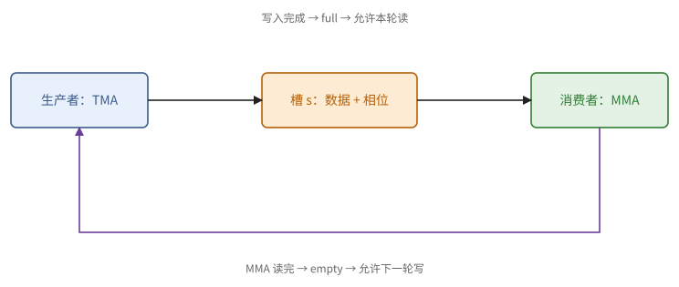
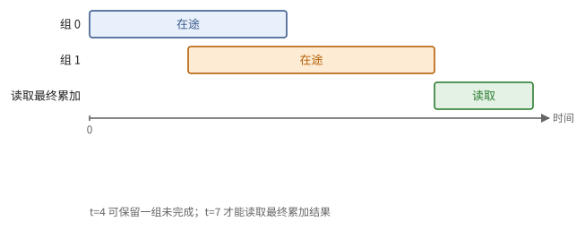
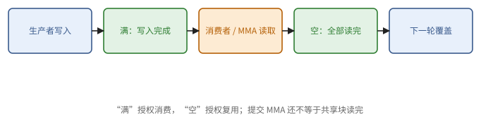
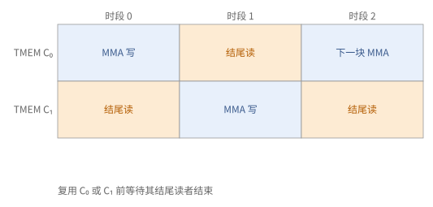

# 第 24 章　CUDA 编程：现代 GPU 的 kernel 结构

第 23 章的分块矩阵乘法里，每个线程既要搬数据，又要做乘加，还要一起等屏障。在 Hopper 和 Blackwell 上，这样写跑不快：Tensor Core 一次吞下的数据太多，线程一边搬一边算，根本喂不饱它。于是现代 kernel 换了一种组织方式，按工作的种类给 warp 分工，像一条装配线：

- 少数线程只负责用 TMA 把 $A$、$B$ 的块搬进共享内存。共享内存里开一个由 $S$ 格组成的环形缓冲，搬运的线程一格一格往里填。
- 另一些线程只负责在某一格的数据到齐之后发起异步的矩阵乘法，用完之后告诉搬运的线程"这一格可以重新填了"。
- 还有一些线程负责收尾：把算完的累加结果取出来，做激活、量化之类的融合运算，写回全局内存，同时下一个输出块的乘法已经开始了。
- 整个线程块不在算完一个输出块后退出，而是循环领取下一个输出块，每个 SM 只启动一个这样的线程块。

这就是第 9 章的多缓冲软件流水线，只不过流水线的各个阶段交给了不同的 warp，同步用的是 mbarrier（22.6 节）。下面先讲这条装配线的零件和它的同步协议，再讲输出块怎样分给 SM；最后把持久化的想法推到头：整个模型的一次前向只用一个 kernel。指令的具体名字和参数以附录 B 和 NVIDIA 的文档为准；本章的代码是省去细节的结构示意，重点在谁等谁。

## 24.1 异步拷贝与 mbarrier

**Ampere 的做法。** 在 Ampere 上，每个线程用 cp.async 发起拷贝，每发完一格就"提交一组"；要用第 $t$ 格之前，"等到未完成的组只剩 $S - 1$ 个"，这时第 $t$ 格一定已经到了。这就是定理 9.10 的 $S$ 级缓冲，只是同步以"组"为单位，而且只管发起拷贝的那个线程自己的拷贝。别的线程想知道数据到没到，还要再经过一次块内屏障。

**mbarrier。** 从 Hopper 起，搬运由 TMA 引擎完成，发起的只有一个线程，等数据的却是另一批线程，所以需要一个大家都能看见的同步对象。这就是放在共享内存里的 mbarrier。TMA 搬完数据时去更新它；Blackwell 的 tcgen05 矩阵乘法做完时，也可以通过 commit 去更新它。（Hopper 的 wgmma 则用自己的"提交一组、等待一组"，24.3 节。）把 mbarrier 写成第 9 章那样的模型：

> **定义 24.1（mbarrier）** 一个 mbarrier 有一个**相位**位，以及本相位的两个计数：尚待到达的次数 $a$ 和尚待到达的字节数 $x$。初始化时设定每个相位预期的到达次数 $a_0$。
>
> - **到达**（`arrive`）：$a \leftarrow a - 1$；
> - **预期字节**（`expect-tx`）：$x \leftarrow x + n$，通常由生产者在发起 TMA 之前声明；
> - TMA 每写入 $m$ 字节：$x \leftarrow x - m$；
> - 当 $a = 0$ 且 $x = 0$ 时，本相位完成：相位位翻转，$a \leftarrow a_0$；
> - **等待**（`wait`）给定一个相位，直到该相位完成。

用白话说：mbarrier 是一个"人到齐、货也到齐才放行"的计数器，放行之后自动重置，并把相位位翻一下，以便区分这是第几次放行。所以一个 mbarrier 可以反复使用，第 $j$ 次使用对应相位 $j \bmod 2$。

环形缓冲的每一格配两个 mbarrier：**满**（`full`）表示数据已经到了，可以读；**空**（`empty`）表示数据已经用完，可以覆盖。它们分别对应命题 9.3（读之前等写完）和命题 9.4（覆盖之前等读完）。

相位只有一位，这带来一个容易忽视的限制。

> **例 24.2（同一个对象怎样区分两轮）** 一格的 full mbarrier 跟踪 32768 字节；这一轮到齐之后相位翻转，下次绕回这一格时，等的是下一个相位。格号 $s = k \bmod S$ 只说明数据放在哪里，轮号 $\lfloor k/S \rfloor$ 才说明这是哪一份数据。
>
> 相位只有一位，只能区分"这一轮"和"上一轮"。所以协议必须保证生产者不能在没有确认的情况下领先消费者好几轮，否则新旧两轮会混在一起。empty 的确认既保护了存储，也限制了生产者能领先多远。



**图 24.1**　环形缓冲的每一格有 full 与 empty 两个完成条件。格号决定地址，相位决定是哪一轮；生产者和消费者通过它们交接这一格的所有权。

## 24.2 TMA

生产者用 TMA 搬运数据（22.6 节），使用分两步：

1. **在主机上建立张量描述符**：全局数组的基地址、各维长度与步长、每次搬运的块形状（box），以及块在共享内存里怎样交错存放（32、64 或 128 字节的 XOR 交错，第 8 章）。
2. **在 kernel 里由一个线程发出搬运**：给出描述符、块坐标、共享内存里的目的地址和一个 mbarrier。搬完之后，按字节数记到这个 mbarrier 上。TMA 还可以把同一块多播给簇里的几个线程块，或者把共享内存里的块写回全局内存（还可以顺便做原子加法）。

交错方式要和之后读这块共享内存的单元的要求一致。Hopper 的 wgmma 和 Blackwell 的 tcgen05 从共享内存读操作数时，都要求特定的交错布局；TMA 写入时就按这个布局摆好，读的时候就没有存储体冲突（命题 8.11）。这是 8.8 节"让生产者直接按消费者要的布局写"的典型例子。

描述符里有两套"步长"，一套描述全局数组，一套描述共享内存，不能混。

> **例 24.3（一个二维块的地址账）** $A[1024, 512]$ 是行优先的 bf16 数组，每行 1024 字节。从起点 $(128, 64)$ 搬一个 $[128, 64]$ 的块，有效数据共 16384 字节，但在全局内存里它是 128 段、每段 128 字节，段与段相隔 1024 字节。描述符把全局的行步长和块的形状交给引擎，引擎负责一段一段地取。
>
> 如果把全局行步长错写成块宽的 128 字节，搬出来的就是另一批元素。描述符里的全局布局和共享内存交错，描述的是搬运的两端，不能当成同一组步长。

## 24.3 Hopper：warpgroup MMA

消费者在 Hopper 上发起的矩阵乘法是 wgmma。它由一个 warpgroup（4 个 warp，128 个线程）共同发起，计算 $64 \times N \times 16$（bf16，$N \le 256$）的乘加：$B$ 从共享内存读，$A$ 从共享内存或寄存器读，累加结果放在这 128 个线程的寄存器里，按固定的规则分布。

它是异步的，用法是：

```text
wgmma 栅栏                       // 保证此前对累加寄存器与操作数的写已经完成
发起若干条 wgmma（沿 K 的若干步）
提交为一组
……可以做别的事……
等待到只剩 N 组未完成            // 之后才能读累加结果，或复用相应的共享内存
```

**寄存器的压力。** 一个 $64 \times 256$ 的 f32 累加块有 16384 个数，分给 128 个线程，每个线程 128 个寄存器，这还没算地址和别的变量。所以通常一个 warpgroup 负责 $64 \times 256$，两个消费者 warpgroup 合起来算一个 $128 \times 256$ 的输出块。

"等待到只剩 $N$ 组未完成"这个接口，要小心它到底保证了什么。

> **例 24.4（发起了的乘法，结果还不能用）** 一个 warpgroup 提交了两组 wgmma，然后"等待到只剩 1 组未完成"。这只保证较早的那组做完了，最新的一组可能还在算。要读累加结果，或者释放某组读过的操作数，必须等到真正覆盖那组工作的完成。
>
> 如果同一个累加器还会被后一组继续更新，就不能因为前一组完成了就去读它的最终值。共享内存里输入的生命周期，和累加器里输出的生命周期，要分别标出来。另外，wgmma 的组等待和 TMA 的 mbarrier 等待是两套不同的机制。



**图 24.2**　提交两组之后，"等待到最多一组未完成"只放行较早那组的依赖。读最终的累加器，需要所有相关的写都已完成。

## 24.4 warp 专门化

现在把生产者（24.2 节）和消费者（24.3 节）放进同一个线程块，写出主循环。把一个线程块的 warp 分成两类，这种组织方式叫 **warp 专门化**（warp specialization）：

- **生产者**（通常一个 warp，其中只有一个线程干活）：只发出 TMA，几乎不用寄存器。
- **消费者**（一两个 warpgroup）：发起 MMA，持有累加寄存器，最后做结尾。

两类 warp 对寄存器的需要相差悬殊。Hopper 允许在运行时调整各个 warpgroup 的寄存器数：生产者减少，消费者增加，总量不变，消费者就放得下大的累加块。

**主循环的协议。** 设环形缓冲有 $S \ge 2$ 格，每格有 `full[s]` 和 `empty[s]`，`phase` 每绕一圈翻转一次：

```text
生产者：
  for k in K 方向的各步:
      s = k mod S
      等待 empty[s] 的相应相位            // 命题 9.4：这一格已被消费者用完（第一圈不必等）
      在 full[s] 上声明预期字节数并满足本轮的到达计数
      TMA: A 的第 k 块 → smemA[s]，完成时计入 full[s]
      TMA: B 的第 k 块 → smemB[s]，完成时计入 full[s]

消费者：
  for k in K 方向的各步:
      s = k mod S
      等待 full[s] 的相应相位             // 命题 9.3：数据已到
      发起 wgmma(smemA[s], smemB[s], acc)，提交为一组
      等待到只剩 1 组未完成               // 第 k-1 步的 MMA 已经读完它的操作数
      若 k > 0：到达 empty[(k-1) mod S]   // 首步没有前一组，不释放负编号
  等待全部剩余 MMA 完成                   // 尾声：最后一组没有下一步替它等待
  若 K 方向至少有一步：到达最后使用的 empty 槽
```

消费者的关键在第三、四行：它不是一发起第 $k$ 步就释放第 $k$ 格，而是等第 $k-1$ 步的乘法做完了，才释放第 $k-1$ 格。这样第 $k$ 步的乘法和第 $k-1$ 步的收尾可以重叠，同时又保证释放的那一格确实没人在读了。

> **命题 24.5（协议没有数据竞争）** 上述协议中，TMA 写第 $s$ 格之前，读这一格的 MMA 已经完成；MMA 读第 $s$ 格之前，TMA 已经写完。

*证明* 先看"写之前读完"：生产者在第 $k$ 步写第 $s$ 格之前，等待 `empty[s]`；而消费者到达 `empty[s]`，是在第 $k - S$ 步的 MMA **完成**（不只是发起）之后，因为它先等到了"只剩 1 组未完成"，此时第 $k-S$ 步那组已经做完。再看"读之前写完"：MMA 在 `full[s]` 的相位完成之后才发起，而相位完成要求预期的字节全部到达。∎

这里最常见的错误，是在**发起** MMA 之后立刻到达 `empty`（习题 24.2）。MMA 是异步的，发起时它可能还没读操作数，生产者却已经可以覆盖这一格了。这是 9.5 节错误 2 的又一个例子。协议的头和尾也容易写错：

> **例 24.6（第一步和最后一步）** 两格缓冲处理三个 $K$ 块。稳态时，每一步释放的是前一块用过的那一格。但第 $k = 0$ 步没有第 $-1$ 块，不能去释放 `empty[-1 mod 2]`；循环结束时，最后一组乘法没有"下一步的等待"替它把关，必须先等所有剩下的 MMA 做完，再释放最后一格。
>
> 只有一个 $K$ 块时，程序也要正确：等 full、发起 MMA、提交、等完成、用结果、释放。把 $K$ 块数分别取 1、2、3，一步步列出协议，能同时查出开头和结尾的遗漏。



**图 24.3**　一格共享内存的满、空协议分别授权读取与覆盖；异步的矩阵单元也是读者之一。

<div class="widget" data-widget="gpupipeline"></div>

**乒乓**（ping-pong）。结尾（取出累加结果、做融合、写回）不用 Tensor Core，如果只有一组消费者，结尾期间 Tensor Core 就闲着。让两个消费者 warpgroup 各算一个输出块，错开半拍：一个在做结尾时，另一个正好在做主循环的 MMA，两者轮流，Tensor Core 就一直有活干。注意力 kernel 里一个 warpgroup 做 softmax（指数运算）、另一个做矩阵乘法，也是同样的思路（第 27 章）。

## 24.5 Blackwell：tcgen05 与 TMEM

Blackwell 的 MMA 由**一个线程**发起，累加结果在 TMEM 里（22.5 节）。线程块里的角色于是变成三种：

- **TMA warp**：和 Hopper 的生产者一样；
- **MMA warp**：其中一个线程发起 tcgen05 MMA，操作数来自共享内存；一组 MMA 做完时，用 commit 去更新一个 mbarrier，用来表示"这一格可以复用了"或"这个累加块算完了"；
- **结尾 warp**（若干个 warpgroup）：等"累加块算完了"，把结果从 TMEM 读进寄存器，做融合运算，经共享内存用 TMA 写回。

TMEM 要显式地**分配**和**释放**（以列为单位）。累加结果不再占寄存器，消费者的寄存器压力大大减轻。按习题 22.4，TMEM 可以同时放两个 $128 \times 256$ 的 f32 累加块：MMA warp 在其中一个上计算下一个输出块，结尾 warp 同时读出另一个，主循环和结尾自然重叠，不再需要乒乓。

> **例 24.7（累加器双缓冲也有所有权）** TMEM 里有两个累加块 $C_0$、$C_1$。MMA 在 $C_1$ 上算下一个输出块时，结尾 warp 读取 $C_0$、量化、写回；只有这些读者都结束之后，$C_0$ 才能重新清零，用于下一次 MMA。
>
> 结尾从 TMEM 读结果之前，要等相应的 `tcgen05.commit` 所跟踪的完成；TMEM 的读写本身又有自己的完成规则。累加器从寄存器搬到 TMEM，减轻了寄存器压力，但"谁在什么时候拥有这块存储"的问题一点没少。



**图 24.4**　两个 TMEM 累加块轮流用于主循环与结尾；复用一块之前，必须等结尾读完，不能只等 MMA 写完。

**CTA 对**（CTA pair）。一个簇里的两个线程块可以合作发起一次 $256 \times N$ 的 MMA：两块各出一半的 $A$（按 $M$ 切开），各存一半的累加结果，$B$ 的读取由两块共享。每个线程块读进来的 $B$ 少了一半，效果相当于把分块从 $128 \times N$ 扩大到 $256 \times N$，块的强度 $\frac{2 b_M b_N}{s(b_M + b_N)}$（命题 6.12 之后）随之提高，而每个线程块的共享内存和 TMEM 用量不变。

**块缩放 MMA。** MX 格式与 NVFP4 的缩放因子也放在 TMEM 里，MMA 在硬件中按 2.8 节的公式把它们乘上去。

## 24.6 持久化 kernel 与 tile 调度

前面讲的都是一个输出块的主循环。一个 GEMM 有许多输出块，它们怎样分给各个 SM，同样影响性能。

**持久化 kernel**（persistent kernel）只启动和 SM 数差不多的线程块（或簇），每个线程块循环处理多个输出块。这样做有三个好处：

- mbarrier 的初始化、TMEM 的分配、描述符的预取这些一次性的开销只付一次；
- 一个输出块的结尾可以和下一个输出块的主循环重叠（24.5 节）；
- 输出块怎样分配，可以自由设计。

分配的方式有两种：静态地让第 $i$ 个线程块依次处理第 $i, i + G, i + 2G, \dots$ 个输出块（$G$ 为线程块数），或者用一个全局的原子计数器动态领取。

> **现状（2026-10）**：Blackwell 提供"簇启动控制"，让持久化的线程块可以领取尚未启动的簇的工作，在硬件层面支持动态调度。

**波次量化与 Stream-K。** 输出块数不是 SM 数的整数倍时，最后一轮有很多 SM 闲着（命题 6.22）。Stream-K 不按输出块分配工作，而按"$K$ 方向的迭代"分配：把所有输出块的全部 $K$ 迭代排成一列，平均切给 $G$ 个线程块。于是一个输出块的 $K$ 迭代可能被两个线程块分担，它们各算一部分，最后把部分和加起来（split-K，6.8 节）。

> **命题 24.8（Stream-K 的跨度）** 设共有 $t$ 个输出块，每块 $k$ 次迭代。按输出块分配时，用时为 $\lceil t / G \rceil k$ 次迭代；Stream-K 用时约为 $\lceil tk / G \rceil$ 次迭代，外加部分和的合并。

*证明* 前者是命题 6.22；后者是把总工作量平均分配。∎

> **例 24.9（尾波和 Stream-K 的账）** 150 个输出块，每块 100 次 $K$ 迭代，100 个线程块。按输出块分配要两轮，共 200 次迭代的时间，第二轮只有一半的线程块在干活；把总工作平均分，只要 $150 \times 100 / 100 = 150$ 次，理论上省 25%。
>
> 但 Stream-K 要把跨线程块的部分和写出去、读回来，还要同步。如果 $K$ 很短，或者部分和很大，合并的代价可能吃掉省下的 50 次迭代。调度上的优化，要拿省掉的尾波和新增的流量来比。


**图 24.5**　150 个等长的输出块在 100 个线程块上，第二轮只有一半在工作。按 $K$ 方向的工作量重新分配可以缩小尾波，代价是部分输出块要合并部分和。

**光栅化与 L2 复用。** 同时运行的线程块如果计算的是输出中相邻的块，它们读的 $A$ 的行条和 $B$ 的列条有重叠，可以在 L2 里命中。同时运行的输出块如果排成 $g \times h$ 的矩形，一共只需要 $g$ 个 $A$ 的行条和 $h$ 个 $B$ 的列条。安排输出块的遍历次序，叫**光栅化**（rasterization）。

> **命题 24.10（正方形的区域最省）** 在 $gh = G$ 固定时，$g + h$ 在 $g = h = \sqrt{G}$ 时最小。所以输出块的遍历次序应当让同时运行的块组成接近正方形的区域（例如按 $\sqrt{G}$ 宽的条带逐条遍历），而不是逐行遍历整个输出。

*证明* 均值不等式：$g + h \ge 2\sqrt{gh} = 2\sqrt{G}$，等号在 $g = h$ 时成立。∎

例如 132 个线程块同时运行，逐行遍历一个 $64 \times 64$ 的输出块网格，同时需要 3 个行条和 64 个列条；改成 $12 \times 11$ 的区域，只需要 23 个条带（习题 24.5）。

## 24.7 CUTLASS 与 CuTe

手写上面的结构，要处理大量和硬件相关的细节：每种 MMA 的操作数在寄存器或 TMEM 里怎样分布，每种交错方式下共享内存的地址怎样算，TMA 描述符怎样构造。NVIDIA 的 **CUTLASS** 库把这些封装成可以组合的部件，它的基础是 **CuTe** 的布局代数。

> **定义 24.11（CuTe 布局）** 一个**布局**是一对 $(S, D)$：形状 $S$ 是正整数的（可以嵌套的）元组，步长 $D$ 是同样结构的整数元组。它定义一个从坐标到偏移的函数：对坐标 $c \in [S]$，
>
> $$
> L(c) = \sum_i c_i d_i .
> $$

这是定义 8.2 的推广，写法是"形状 : 步长"。新的地方只有一点：形状可以嵌套，一个"维"本身可以由几个子维组成，这样分块布局（定义 8.4）也能写成一个布局。例如 $8 \times 8$ 的行优先矩阵是 $(8, 8) : (8, 1)$。

> **例 24.12（换一种看法，还是换一种存法）** 把原来的 $8 \times 8$ 行优先数组看成 $2 \times 2$ 个 $4 \times 4$ 的块。把 $i = i_0 + 4 i_1$、$j = j_0 + 4 j_1$ 代入地址 $8i + j$，得 $8 i_0 + 32 i_1 + j_0 + 4 j_1$，对应布局 $((4, 2), (4, 2)) : ((8, 32), (1, 4))$。这只是换了一种看法，存储没动，块内的行与行之间仍有空隙。
>
> 如果按定义 8.4 真的把每个 $4 \times 4$ 块连续存放，地址是 $4 i_0 + 32 i_1 + j_0 + 16 j_1$，布局应为 $((4, 2), (4, 2)) : ((4, 32), (1, 16))$。分清"坐标分成块"和"块在物理上连续"，才能正确估计搬运量和复用。

CuTe 在布局上定义了几种运算：**复合**（一个布局作用在另一个布局的输出上）、**补**（一个布局没有覆盖到的那些偏移组成的布局）、**整除**（把一个布局切成"块内"和"块间"两部分）。线程到数据的分配、数据在存储里的摆放、MMA 操作数的布局，都写成布局；分块就是整除，换一种划分就是复合。它和第 8 章在 $\mathbb{F}_2$ 上的线性布局，是对同一类对象的两种代数描述。

> **现状（2026-10）**：CUTLASS 4 提供 CuTe 的 Python 接口（CuTe DSL），可以用 Python 写出与 C++ 同样结构的 kernel；FlashAttention 的 Blackwell 版本就是用它写的。NVIDIA 还在 CUDA 13 中推出了更高层的 tile 编程模型（第 25 章）。

## 24.8 一个模型一个 kernel：megakernel

24.6 节的持久化 kernel 让一个 GEMM 只启动一次。把这个想法推到头，就是让整个模型的一次前向传播只启动一个 kernel，称为 **megakernel**。它针对的是批量为 1 的 decode：一个用户、一个词元接一个词元地生成，每一步的时间就是用户感到的延迟。

先看普通的做法慢在哪里。批量为 1 时，每一步要把全部权重读一遍（命题 11.8）。Llama-3.2-1B 的 bf16 权重约 2.48 GB，H100 的带宽 3.35 TB/s，所以每秒最多约 1350 步。Stanford 的 Hazy Research 在 2025 年测得，主流推理框架只用到了带宽的一半左右。原因在于一次前向被拆成了约一百个 kernel，而每两个 kernel 之间都有三笔损失：

- **启动**：一次 kernel 启动约 2 µs，用 CUDA Graph（23.8 节）约 1.3 µs；
- **尾波**：下一个 kernel 要等上一个的所有线程块都结束才能开始。例如下投影有 512 个线程块，在 148 个 SM 的 B200 上分成四轮，最后一轮只有 68 个，另外 80 个 SM 空等（命题 6.22）；
- **重新起步**：新的 kernel 一开始流水线是空的，要先把权重读进来才能计算，几千个周期里显存带宽闲着。上一个 kernel 的尾巴和下一个 kernel 的开头本来可以重叠，kernel 边界把它们隔开了。

> **例 24.13（边界的账）** 设每层 7 个 kernel，16 层，每个边界的三笔损失合计约 5 µs，共 $112 \times 5 = 560$ µs。只读权重至少要 $2.48 / 3350 \approx 0.74$ ms。两者相加约 1.3 ms，每秒约 770 步，只有上限 1350 的 57%。模型越小，读权重的时间越短，边界的固定损失占比越大。

megakernel 的做法分三部分，每一部分都能在前面找到原型。

**片上解释器。** 每个 SM 运行一个循环，依次执行事先排好的一串"指令"；指令是一段融合好的工作，例如"RMSNorm、QKV 投影和 RoPE，负责第几到第几列"，或者"某几个头的注意力"。对 Llama，一共只要 7 种指令。每个 SM 的指令表在主机上用 Python 排好，之后几百次前向都重复使用。

**分页的共享内存。** 为了让下一条指令在上一条写回结果的同时就开始读权重，共享内存被切成若干页（H100 上把 213 KB 切成 13 页，每页 16 KiB），指令显式地申请和归还页；归还的页立刻交给下一条指令去装数据。这和 24.4 节的环形缓冲是同一个想法，只是格子在不同种类的指令之间流转。

**用计数器代替 kernel 边界。** kernel 边界原本隐含了一次全局同步："上一个 kernel 写完的数据，下一个 kernel 都能看到"。去掉边界之后，依赖要显式地表达：显存里放一组整数计数器，开始前清零；一条指令完成后，以释放语义（23.7 节）给相应的计数器加一；依赖它的指令以获取语义反复读这个计数器，等到达目标值再开始。这就是第 9 章的计数信号量。好处是依赖可以比 kernel 边界细得多：例如 MLP 的中间结果分成 4 段，每段一个计数器，下投影的某条指令只等它要用的那一段，而不是等整层算完。

结果：H100 上一次前向不到 1 ms，用到了带宽的 78%，比 vLLM 快约 2.5 倍、比 SGLang 快 1.5 倍以上；B200 上不到 680 µs，比 vLLM 快 3.5 倍以上。

> **例 24.14（边界去掉之后，时间花在哪里）** 作者对 B200 上约 600 µs 的一次前向做了分解：约 250 µs 花在激活的"写出、标记就绪、等待、再读入"上，约 200 µs 是真正的 RMSNorm 和矩阵—向量乘法，约 30 µs 在等权重，约 40 µs 是 warp 之间的同步，约 80 µs 是初始化等其他开销。按每条指令要经过约 4 次显存延迟（检查就绪、读入、写出、标记就绪），每次约 500 ns 估算，前一项约 200 µs，与测量相近。
>
> 所以 megakernel 把问题变了形：kernel 边界的损失没有了，代价是 SM 之间每一次交接都要走一趟显存的延迟。指令切得越细，依赖越多，这笔延迟越大；切得越粗，并行越少、重叠越差。这和第 9 章里"块大小"的取舍是同一类问题。

手工排指令表很费事，后续的工作试图把它自动化。MPK（CMU 等，2025）把模型编译成以 SM 为单位的任务图：每个算子按输出切成和 SM 数相当的若干个任务，一个任务的输出区域与另一个任务的输入区域有重叠时，才在两者之间连一条依赖；运行时由一个持久化 kernel 执行，部分 SM 当调度者、其余当工人，报告比 vLLM、SGLang 低至多 1.7 倍的延迟。

> **现状（2026-10）**：新的 GPU 由多颗芯粒（die）拼成，L2 也分成几份：B200 有两颗芯粒，AMD 的 MI350 有 8 颗，每颗芯粒有自己不与别的芯粒保持一致的 4 MB L2。线程块分到哪颗芯粒，CUDA/HIP 的编程模型表达不了，于是读同一块权重的两个线程块可能在两颗芯粒上各从显存读一遍。AMD 的 Fleet（2026）在任务图里加了"芯粒级任务"，把共用权重的工作放到同一颗芯粒上、经它的 L2 共享，在 MI350 上批量为 64 时，显存读取量比不区分芯粒的 megakernel 少 37%。另一个方向是只把相邻的算子融合，而不追求整个模型一个 kernel：DeepSeek-V4.1 每层在 prefill 时只用 15 个 kernel、decode 时 11 个，其中 MoE 的分发、两次专家矩阵乘法和回收融合在同一个 kernel 里。

## 本章小结

1. 现代 GPU kernel 的结构：持久化线程块；生产者用 TMA 填充 $S$ 格环形缓冲；消费者发起异步 MMA；结尾与下一块的主循环重叠。这是第 9 章多缓冲的 warp 专门化实现。（本章开头、24.4 节）
2. mbarrier：相位位加"到达次数"与"字节数"两个计数，计满时相位翻转，可以反复使用；每格配"满""空"两个；一位相位要求生产者不能无确认地领先多轮。（定义 24.1、例 24.2）
3. TMA：主机上建立描述符（形状、步长、块、交错），一个线程发起整块搬运，按字节计入 mbarrier；交错要与 MMA 的要求一致；全局步长与共享内存交错是两套参数。（24.2 节、例 24.3）
4. Hopper wgmma：warpgroup 发起 $64 \times N \times 16$ 的异步 MMA，累加在寄存器中，寄存器压力大；"只剩 $N$ 组未完成"只放行较早的组。（24.3 节、例 24.4）
5. warp 专门化的协议：消费者要等 MMA 完成后才释放它读过的那一格，否则生产者会覆盖正在读的数据；开头和结尾要单独处理；乒乓让结尾与 MMA 交替。（命题 24.5、例 24.6）
6. Blackwell：单线程发起 tcgen05，累加在 TMEM（显式分配），commit 通知 mbarrier；TMEM 双缓冲使结尾与主循环重叠；CTA 对共享 $B$ 的读取，提高块强度。（24.5 节、例 24.7）
7. 持久化 kernel；Stream-K 按 $K$ 迭代分配，消除尾波但要合并部分和；同时运行的块排成接近正方形的区域，L2 复用最好。（命题 24.8、24.10）
8. CuTe 布局 $(S, D)$ 是步长布局的嵌套推广，复合、补、整除描述分块与映射。（定义 24.11、例 24.12）
9. megakernel：批量为 1 的 decode 中，每个 kernel 边界有启动、尾波、流水线重新起步三笔损失，小模型时可占总时间的四成以上。整个前向写成一个持久化 kernel：每个 SM 执行事先排好的指令表，共享内存分页在指令之间流转，依赖用显存中的计数器（释放/获取）表达，可以比 kernel 边界更细。剩下的主要代价是 SM 之间每次交接的显存延迟。（24.8 节、例 24.13、24.14）

## 习题

**习题 24.1** ★ Hopper 上一个 GEMM 的输出块为 $128 \times 256$，$b_K = 64$，bf16。(a) 每一级缓冲（$A$ 与 $B$ 各一块）占多少共享内存？(b) 设一次 TMA 从发起到完成约 1 µs，每个 $K$ 步的 MMA 约 0.25 µs，按定理 9.10 需要几级？(c) 每 SM 至多 228 KB 共享内存，放得下吗？若放不下怎么办？

<details><summary>提示 1</summary>

输入两块的面积不同但都按 bf16 计；流水线槽数由完成延迟与消费节奏比较。

</details>
<details><summary>提示 2</summary>

(a) $A$ 块 $128 \times 64$，$B$ 块 $64 \times 256$。

</details>
<details><summary>答案</summary>

(a) $(128 \times 64 + 64 \times 256) \times 2 = 48$ KiB。(b) $\lceil 1/0.25 \rceil + 1 = 5$ 级。(c) $5 \times 48 = 240$ KiB，再加上结尾所需的共享内存，放不下。办法：用 4 级（接受偶尔的等待）；或减小 $b_K$ 到 32（每级 24 KiB，但每级的 MMA 时间也减半，所需级数翻倍，总共享内存不变，所以这不解决问题）；或用 CTA 对共享 $B$ 的读取（Blackwell）；或减小输出块。这说明为什么共享内存的容量是现代 GPU kernel 设计的核心约束之一。

</details>

**习题 24.2** ★（审查题）下面的消费者循环由 AI 写出。找出错误，说明它在什么情况下会给出错误的结果。

```text
for k:
    s = k mod S
    等待 full[s]
    发起 wgmma(smemA[s], smemB[s], acc)，提交为一组
    到达 empty[s]
等待所有 wgmma 完成
```

<details><summary>提示 1</summary>

MMA 发起后共享输入仍可能被读取；full 等待与 empty 通知必须保护两条不同的边。

</details>
<details><summary>提示 2</summary>

命题 24.5 的证明中，"完成"与"发起"的区别。

</details>
<details><summary>答案</summary>

消费者在**发起** MMA 后立即到达 `empty[s]`，而此时 MMA 可能还没有读取 `smemA[s]`、`smemB[s]`。生产者看到 `empty[s]` 完成后，会用 TMA 覆盖第 $s$ 级，MMA 读到的就是下一轮的数据。缓冲级数多、生产者比较慢时很少出错，所以测试难以发现。修改：到达 `empty` 之前先等待相应的 MMA 组完成，如 24.4 节的协议所示。

</details>

**习题 24.3** ★ 一个 Hopper 线程块有 1 个生产者 warpgroup 和 2 个消费者 warpgroup（共 384 个线程）。每个消费者的累加块为 $64 \times 256$ 的 f32。SM 有 65536 个寄存器。若每个线程的寄存器数相同，每个线程最多能用多少个？若生产者每线程只用 40 个，消费者每线程最多能用多少个？

<details><summary>提示 1</summary>

先给每个消费者分足其累加器，再把地址与生产者的资源算进去。

</details>
<details><summary>提示 2</summary>

$65536 / 384$；再从总量中减去生产者的部分。

</details>
<details><summary>答案</summary>

平均分配约 170 个，而消费者的累加结果就要 128 个，加上地址和中间值很可能不够。生产者用 $128 \times 40 = 5120$ 个后，剩下 60416 个分给 256 个消费者线程，每个约 236 个。这就是运行时调整寄存器分配的意义。

</details>

**习题 24.4** ★ 132 个 SM，140 个输出块，每块 64 次 $K$ 迭代。按输出块分配和按 Stream-K 分配，各需要多少次迭代的时间？利用率各是多少？

<details><summary>提示 1</summary>

按 tile 分配出现整波，按 K 工作分配出现部分和合并；先比较理想跨度。

</details>
<details><summary>提示 2</summary>

命题 24.8。

</details>
<details><summary>答案</summary>

按输出块：$\lceil 140/132 \rceil \times 64 = 128$ 次迭代，利用率 $140 \times 64 / (132 \times 128) \approx 53\%$。Stream-K：$\lceil 8960 / 132 \rceil = 68$ 次迭代，利用率约 99.8%，外加少数跨越两个线程块的输出块的部分和合并。

</details>

**习题 24.5** ★ 132 个线程块同时运行，输出为 $64 \times 64$ 个块。(a) 若按行遍历（同时运行的是前两行的全部 128 个块，加上第三行的 4 个），同时需要多少个 $A$ 行条和 $B$ 列条？(b) 若按 $12 \times 11$ 的区域遍历呢？

<details><summary>提示 1</summary>

同时工作的块共享同一行条或列条，只计不同条带个数。

</details>
<details><summary>提示 2</summary>

命题 24.10。

</details>
<details><summary>答案</summary>

(a) 3 个行条、64 个列条，共 67 个；$B$ 的 64 个列条覆盖了整个 $B$。(b) 12 个行条、11 个列条，共 23 个。若每个条带都是 L2 中的一份数据，(b) 让 L2 中同时需要的数据少得多，命中率更高。实际的选择还要考虑 L2 的容量和条带的大小。

</details>

**习题 24.6** ★ 写出 CuTe 布局 $(4, 8) : (8, 1)$ 与 $(4, 8) : (1, 4)$ 在坐标 $(2, 5)$ 处的值，并说明它们分别是什么布局。再写出 $8 \times 8$ 行优先矩阵被看作 $2 \times 2$ 个 $4 \times 4$ 块、块按行优先排列、块内行优先时的布局（与 24.7 节的例子不同：那里块内的元素仍按原矩阵的行优先存放）。

<details><summary>提示 1</summary>

分别代入步长；再区分"重新解释坐标"和"改变物理存储"。

</details>
<details><summary>提示 2</summary>

$L(c) = \sum c_i d_i$。第二问中，块内 16 个元素连续存放，块按行优先排列，每块占 16 个位置。

</details>
<details><summary>答案</summary>

$(4, 8) : (8, 1)$ 在 $(2, 5)$ 处为 $16 + 5 = 21$，是 $4 \times 8$ 的行优先布局；$(4, 8) : (1, 4)$ 为 $2 + 20 = 22$，是列优先布局。分块布局（定义 8.4）：行坐标拆成（块内行 $i_0 \in [4]$，块行 $i_1 \in [2]$），列坐标拆成（块内列 $j_0 \in [4]$，块列 $j_1 \in [2]$），偏移为 $16(2 i_1 + j_1) + 4 i_0 + j_0$，即 $((4, 2), (4, 2)) : ((4, 32), (1, 16))$。

</details>

**习题 24.7** ☆ Blackwell 上，一个持久化 GEMM 在 TMEM 中放两个 $128 \times 256$ 的 f32 累加块做双缓冲。若改为 $128 \times 256$ 的输出块再加上块缩放 MMA 所需的缩放因子也放在 TMEM 中，还能双缓冲吗？需要考虑什么？

<details><summary>提示 1</summary>

把缩放因子的物理列数加到两份累加块之外，不能只计 C。

</details>
<details><summary>提示 2</summary>

TMEM 共 512 列；两个累加块已经占满。

</details>
<details><summary>答案</summary>

两个累加块已经用满 512 列，缩放因子没有位置。要么减小输出块的 $N$（例如 $128 \times 192$ 的两份累加块占 384 列，余下的给缩放因子），要么放弃累加器的双缓冲、改用别的方式让结尾与主循环重叠。TMEM 的容量与共享内存一样，是 Blackwell kernel 设计的硬约束。

</details>

**习题 24.8** ★（综合审查题）两级共享输入流水线只处理一个 K 块。写出消费者从等 full 到退出的所有必要阶段。为什么"等待到只剩一组未完成"不能直接授权读最终累加器？

<details><summary>提示 1</summary>

没有下一次循环替最后一组等待，也没有第 -1 组可释放。

</details>
<details><summary>提示 2</summary>

一次提交后，wait_group 1 可以立即返回，因为至多一组未完成。

</details>
<details><summary>答案</summary>

等待 full；发起该块 MMA并提交；等待全部相关组完成；再读累加器、通知对应 empty，最后确认所有其他异步读者结束后退出。wait_group 1 允许唯一的一组仍未完成，不足以保护输出读取。单块情形必须走完整尾声。

</details>

**习题 24.9** ★ 用例 24.13 的模型估算两种情形中 kernel 边界的损失占总时间的比例（每个边界 5 µs，每层 7 个 kernel，H100 带宽 3.35 TB/s，批量 1，bf16）：(a) 1B 模型，16 层，权重 2.48 GB；(b) 8B 模型，32 层，权重 16 GB。(c) 由此说明 megakernel 对哪类场景最有用。

<details><summary>提示 1</summary>

读权重的时间是权重字节数除以带宽；边界的损失是边界数乘以 5 µs。

</details>
<details><summary>提示 2</summary>

比例 = 边界损失 /（读权重时间 + 边界损失）。

</details>
<details><summary>答案</summary>

(a) 读权重约 0.74 ms，边界 $112 \times 5 = 0.56$ ms，占约 43%。(b) 读权重约 4.78 ms，边界 $224 \times 5 = 1.12$ ms，占约 19%。(c) 边界损失与层数成正比，读权重的时间与参数量成正比；模型越小、批量越小（每步的有用工作越少），边界占比越大。megakernel 最适合小模型、批量为 1、看重延迟的场合；批量大时每个 kernel 本身更长，边界被摊薄，收益随之变小。

</details>

**习题 24.10** ★（审查题）一个 megakernel 里，指令 A 计算 MLP 的中间结果，写入全局内存后执行 `atomicAdd(&flag, 1)`；指令 B 在另一个 SM 上循环读 `flag`，等到它等于 1 后读取中间结果。代码用的是普通的（relaxed）原子加法和普通读取。指出问题并给出修正。

<details><summary>提示</summary>

计数器的值到了，不等于中间结果对另一个 SM 可见了。回顾 23.7 节的释放与获取。

</details>
<details><summary>答案</summary>

relaxed 的原子操作只保证计数器本身的更新是原子的，不保证在它之前写的中间结果先于它被别的 SM 看到；B 可能读到计数器为 1、却读到旧的中间结果。修正：A 在写完中间结果之后，用 GPU 作用域的释放语义更新计数器（或先执行 GPU 作用域的栅栏再做原子加法）；B 用 GPU 作用域的获取语义读计数器（或读到之后执行栅栏），再读中间结果。此外，计数器要在每次前向开始前重置，或者改用单调递增的目标值（第 $t$ 次前向等到 $t$），否则上一步残留的值会让 B 提前通过。

</details>
