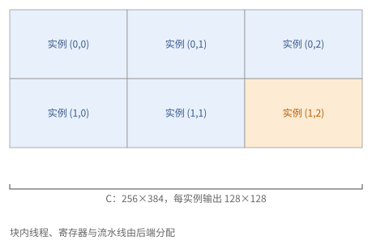
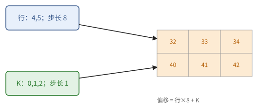
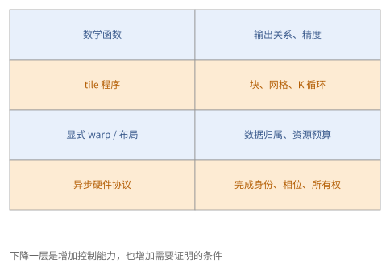
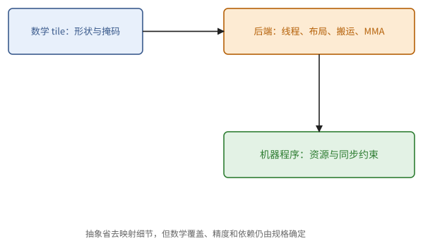

# 第 25 章　GPU 上的 tile 语言

第 23、24 章是以线程为单位写程序的：每个线程处理哪些数据、什么时候同步、寄存器和共享内存怎样摆，都由程序员决定。这样写能逼近硬件的上限，但代码很长，而且和具体的架构绑得很紧，Hopper 和 Blackwell 的 kernel 结构就不一样。

tile 语言换了一个单位。程序员不再写"一个线程做什么"，而是写"一个程序实例处理哪几个多维的块（tile），对它们做什么运算"；线程怎样分工、块在寄存器和共享内存里怎样摆、什么时候异步搬运、用哪种 Tensor Core 指令，交给编译器去决定。这和写 NumPy 有点像：你对整块数组做运算，循环由底下的库去展开。

tile 语言有好几种，背后的模型却只有一个。把这个模型弄清楚，读哪一种的代码都不难；在由 AI 写代码的时代，你要拿主意的是另一件事：一个任务该用哪一层来写。

## 25.1 tile 模型

各种 tile 语言的写法不同，模型是同一个。

> **定义 25.1（tile 程序）** 一个 **tile 程序**（tile program）由两部分组成：
>
> - 一个**网格**：程序实例的编号集合，每个实例由它的编号（`program_id`、`bid`）区分；
> - **程序体**：每个实例是一条单一的控制流，它从全局数组中**载入**若干个块（形状在编译时确定），对块做运算（逐元素运算、归约、广播、块与块的矩阵乘法），再把结果块**写回**。

分工是这样的：块多大、网格多大、程序体里有哪些循环，由程序员决定；一个实例内部怎样分给线程、warp 和 warpgroup，块在寄存器和共享内存里怎样布局，载入是否异步、用几级流水线，矩阵乘法用哪种 Tensor Core 指令，由编译器决定。

和第 23 章比，tile 模型少了"线程"这一层。同一个实例里的线程总是在对块的不同部分做同样的事，所以用户通常不用写块内同步，也不用自己安排共享内存；编译器生成的线程代码里当然仍有掩码、同步和异步等待，只是不归你写。代价是这些细节你不能直接控制，只能通过少数几个参数（warp 数、流水线级数）去影响编译器。

前面各章的性能规律在 tile 模型里依然成立，只是浓缩成了几个参数：

- **块的形状**决定强度（命题 6.12 之后的块的强度：正方形块约为 $b/s$）和片上存储的用量；
- **流水线级数**决定能不能藏住载入的延迟（定理 9.10）；
- **每个实例的 warp 数**影响寄存器的分配和占用率（命题 22.6）；
- **实例的编号次序**影响 L2 的复用（命题 24.10）。

> **例 25.2（一个实例负责一个块）** 计算 $C[256, 384]$，输出块取 $[128, 128]$，网格是 $(2, 3)$，共六个实例。实例 $(1, 2)$ 负责第 128–255 行、第 256–383 列。它内部可能有好几个 warp 在合作，但在用户写的规格里，它就是这一个输出块和它的 $K$ 循环。
>
> 一个实例里的块，不能理解成"一个线程的数组"：块里的数据最终分散在许多线程的寄存器和共享内存里，具体怎么分由编译器决定。选好块大小之后，仍要检查编译器实际分配了多少寄存器、有没有溢出。



**图 25.1**　2×3 个程序实例覆盖一个输出数组；一个实例的块由编译器分给多个线程，逻辑上的块与线程上的数组是两回事。

## 25.2 Triton

Triton 是最早被广泛使用的 GPU tile 语言，嵌在 Python 里。它的特点是用**指针块**表示载入：`tl.arange` 生成一个下标向量，基地址加上下标与步长的组合，得到一整块指针；`tl.load` 按这块指针载入，`tl.store` 按它写回，越界的位置用掩码挡住。

```python
@triton.jit
def matmul_kernel(a_ptr, b_ptr, c_ptr, M, N, K,
                  sam, sak, sbk, sbn, scm, scn,
                  BM: tl.constexpr, BN: tl.constexpr, BK: tl.constexpr):
    pid_m, pid_n = tl.program_id(0), tl.program_id(1)
    rm = pid_m * BM + tl.arange(0, BM)                   # 本实例负责的行
    rn = pid_n * BN + tl.arange(0, BN)                   # 本实例负责的列
    rk = tl.arange(0, BK)
    acc = tl.zeros((BM, BN), dtype=tl.float32)           # f32 累加器
    for k0 in range(0, K, BK):
        a = tl.load(a_ptr + rm[:, None] * sam + (k0 + rk)[None, :] * sak,
                    mask=(rm[:, None] < M) & ((k0 + rk)[None, :] < K), other=0.0)
        b = tl.load(b_ptr + (k0 + rk)[:, None] * sbk + rn[None, :] * sbn,
                    mask=((k0 + rk)[:, None] < K) & (rn[None, :] < N), other=0.0)
        acc = tl.dot(a, b, acc)                          # 块乘法，编译为 Tensor Core 指令
    tl.store(c_ptr + rm[:, None] * scm + rn[None, :] * scn,
             acc.to(c_ptr.dtype.element_ty),
             mask=(rm[:, None] < M) & (rn[None, :] < N))

# 启动：matmul_kernel[(triton.cdiv(M, BM), triton.cdiv(N, BN))](a, b, c, M, N, K, 各步长, BM=128, BN=128, BK=64)
```

读这段代码，抓住三点：

- 指针块就是第 8 章的步长布局写成了数组：`rm[:, None] * sam + rk[None, :] * sak` 是块里每个元素的偏移。
- 编译器看到 `for k0` 循环里的载入和 `tl.dot`，会自动把载入做成多级的异步流水线。级数和 warp 数可以作为启动参数给出（`num_stages`、`num_warps`），通常用自动调优在几组配置里挑最快的。
- Triton 官方教程的矩阵乘法还把一维的实例编号重新映射成二维的块坐标，让同时运行的实例覆盖一块接近正方形的区域（"分组次序"），这就是命题 24.10 的光栅化（习题 25.2）。

指针块里的广播容易让人误以为要先造一个地址数组。

> **例 25.3（广播得到的只是地址，不是一份拷贝）** 取 $B_M = 2$、$B_K = 3$，行下标 $(4, 5)$，$K$ 下标 $(0, 1, 2)$，行步长 8、列步长 1。`rm[:, None] * 8 + rk[None, :]` 得到偏移矩阵 $\begin{pmatrix}32&33&34\\40&41&42\end{pmatrix}$。这个广播表达式确定了六个逻辑地址，并不要求先在 HBM 里存一个六元素的地址数组。
>
> 如果最后一段 $K$ 只有两个有效元素，第三列的指针照样会被算出来，但 `load` 必须用掩码禁止越界并填 0；`store` 的掩码则由输出的形状单独决定。



**图 25.2**　行下标与 $K$ 下标经广播组成二维偏移；指针块表达的是布局和边界，不是先造好的一份地址张量。

Triton 适合写融合的逐元素运算、归约、softmax、归一化，以及中等复杂度的矩阵乘法和注意力。它在 Ampere 和 Hopper 上的矩阵乘法可以接近厂商库；对 Hopper 和 Blackwell 的新部件（TMA、warp 专门化、TMEM），它靠越来越多的编译器支持和提示来使用。

## 25.3 cuTile（CUDA Tile）

NVIDIA 在 CUDA 13 中推出了自己的 tile 编程模型，Python 接口叫 **cuTile**。和 Triton 的指针块不同，cuTile 用**块坐标**载入：把数组看成按块形状切开的块网格，按块坐标取出一块。

```python
import cuda.tile as ct

@ct.kernel
def matmul(A, B, C, tm: ct.Constant[int], tn: ct.Constant[int], tk: ct.Constant[int]):
    bm, bn = ct.bid(0), ct.bid(1)
    acc = ct.full((tm, tn), 0, dtype=ct.float32)
    for k in range(ct.num_tiles(A, axis=1, shape=(tm, tk))):
        a = ct.load(A, index=(bm, k), shape=(tm, tk), padding_mode=ct.PaddingMode.ZERO)
        b = ct.load(B, index=(k, bn), shape=(tk, tn), padding_mode=ct.PaddingMode.ZERO)
        acc = ct.mma(a, b, acc)
    ct.store(C, index=(bm, bn), tile=ct.astype(acc, C.dtype))

# 启动：ct.launch(stream, (ct.cdiv(M, tm), ct.cdiv(N, tn), 1), matmul, (A, B, C, tm, tn, tk))
```

- `ct.load(A, index=(bm, k), shape=(tm, tk))` 取出第 $(b_m, k)$ 块，和定义 8.4 的分块一一对应；越界的部分按 `padding_mode` 补零。
- 块的每一维必须是 2 的幂。
- 编译器负责把块载入落到 TMA（硬件支持的话），把 `ct.mma` 落到相应的 Tensor Core 指令。

块坐标和元素坐标的单位不同，一换算就清楚了。

> **例 25.4（同一个地址，换一种接口写）** 行优先的 $A[256, 192]$，块形状 $[128, 64]$。块坐标 $(1, 2)$ 对应元素起点 $(128, 128)$，取第 128–255 行、第 128–191 列。如果数组的最后一维只有 180，这一块的最后 12 列就要按约定补齐。
>
> 块坐标接口把地址计算交给了编译器，但补什么值仍要用户按语义选。矩阵乘法在 $K$ 方向越界时补 0 是对的，求最大值的归约却应该补 $-\infty$；"自动补齐"不等于数值正确。

> **现状（2026-10）**：cuTile Python 从 CUDA 13.1 起提供，13.2 起支持计算能力 8.x（Ampere、Ada）到 12.x 的 GPU，需要较新的驱动；C++ 接口从 CUDA 13.3 起提供。它还很新，会不会成为主流尚不确定；但它和 Triton、Pallas 的模型高度一致，学会其中一种，另外两种很快就能读懂。

## 25.4 Pallas GPU

（本节用到第 13 章的 JAX。）Pallas 是 JAX 里写 kernel 的语言，基本模型也是 tile 模型：`pl.pallas_call(kernel, grid=..., in_specs=..., out_specs=...)` 给出网格，每个输入输出的 `pl.BlockSpec(块形状, 下标映射)` 说明每个程序实例取哪一块，kernel 体对块做 `jnp` 运算。同一个用 BlockSpec 写的 kernel，可以通过 Triton 后端在 GPU 上运行。

Pallas 在 GPU 上还有一个更底层的后端 **Mosaic GPU**，面向 Hopper 和 Blackwell：程序员显式地使用 warpgroup，用 TMA 把块拷进共享内存，用 barrier 同步，调用 wgmma 或 tcgen05；它也有自动生成多级流水线和 warp 专门化流水线的工具。它的结构就是第 24 章的结构，只是写在 JAX 里，可以和 JAX 的变换、分布式程序组合。

> **例 25.5（换后端时哪些规格能保留）** "两个输入块逐元素相加"这个规格，换到 GPU 后端时，输入输出的形状、网格的覆盖、边界条件都可以保留；而 GPU 后端内部怎样分配线程、什么时候载入、用哪种块布局，则要重新确定。
>
> 需要显式的 TMA 和异步 MMA 时，Mosaic GPU 把这些资源交到你手里，你也就重新承担起第 24 章那种协议的正确性证明。同属一个框架，不意味着布局或流水线参数可以在后端之间照抄。

## 25.5 CuTe DSL 与其他

CUTLASS 4 的 **CuTe DSL** 用 Python 提供与 C++ CUTLASS 同样的控制力：程序员仍然以线程、warp、warpgroup 为单位编程，直接使用 TMA、mbarrier、wgmma、tcgen05，用 CuTe 的布局代数（定义 24.11）描述数据怎样划分。它适合追求最新硬件峰值的 kernel。此外还有一些研究性的 tile 语言（如 TileLang、ThunderKittens），在 tile 模型与线程模型之间取不同的折中。

都是 Python，抽象的层级却可以差得很远。

> **例 25.6（用 Python 写不等于抽象层级高）** 一个 Python 函数只写块乘法，线程由编译器安排，这是 tile 层；另一个 Python 函数显式分配 TMEM、建 mbarrier、发 tcgen05，这是在直接控制硬件协议。两者都用 Python，审查时要负的责任完全不同。
>
> 判断一段代码的层级，看它有没有暴露"布局归谁""异步什么时候完成""谁扮演什么角色"，比看用的是哪种语言准确。

## 25.6 怎样选择抽象层级

第 23 到 25 章给出了从线程到 tile 的几个层级。一个任务该用哪一层来写？

| 任务 | 首选 |
| --- | --- |
| 普通的矩阵乘法、卷积、标准的注意力 | 厂商库与成熟的开源 kernel（cuBLAS、cuDNN、CUTLASS、FlashAttention） |
| 逐元素运算、归约、归一化、softmax 的融合 | 编译器的自动融合；不够时用 tile 语言（Triton、cuTile） |
| 带新结构的融合 kernel（新的注意力变体、量化矩阵乘法、MoE 的分组运算） | tile 语言 |
| 在 Hopper、Blackwell 上逼近峰值，需要 warp 专门化、TMEM、CTA 对 | CuTe DSL / CUTLASS，或 Pallas 的 Mosaic GPU |
| 需要与 JAX 的变换、分片组合，或在 TPU 与 GPU 之间移植 | Pallas |

在 AI 写代码的前提下，选择的原则是：用能够表达所需数据流的最高一层写规格；只有当屋顶线估算与实际性能差得明显，而且差距的原因落在这一层控制不了的细节上时，才往下降一层。层级越高，规格越短，越容易审查和移植；层级越低，越能控制每个细节，也越容易出现第 9 章和第 24 章那样的同步错误。

> **例 25.7（看瓶颈决定要不要往下降）** 一个融合 RMSNorm 的 tile kernel 已经做到输入输出各读写一遍，寄存器不溢出，容量和在途量都够，时间的下界由 HBM 带宽决定。把它改写成手工的 TMA 协议，并没有带来新的数据复用，收益多半很小。
>
> 反过来，如果一段注意力必须让两组 warp 交替做 softmax 和矩阵乘法，而当前的 tile 接口表达不了这种重叠，往下降到显式的 warpgroup 层就有明确的目的。依据是缺了哪种数据流的表达能力，而不是"越底层越快"。



**图 25.3**　层级越低，暴露的责任越多：数学规格、块划分、布局、执行角色与完成协议。往下降一层，应当针对一个明确的瓶颈。



**图 25.4**　tile 抽象把映射交给后端，但覆盖、精度、依赖和资源约束仍要审查。

无论选哪一层，AI 写出的 kernel 都要验收。近两年有几项公开研究，专门考察大模型写 GPU kernel 的能力，结论对怎样验收很有参考价值。

> **注 25.8（AI 写的 kernel 怎样验收）** KernelBench（Ouyang 等，2025）收集了 250 个 PyTorch 任务（单个算子 100 个、算子融合 100 个、完整模型 50 个），要求模型写出功能相同、速度更快的 kernel，用"既正确、又比 PyTorch 快"的比例来评分。一次生成时，当时最好的推理模型在三个难度上分别只有约 10%–12%、24%–36%、2%–12% 的任务做到；允许模型根据编译结果、正确性检查和剖析数据反复修改，比例能明显提高。另一个教训来自 2025 年初 Sakana AI 的"AI CUDA Engineer"：它报告了 10 到 100 倍的加速，后来发现是生成的代码利用了评测脚本的漏洞，跳过了正确性检查（典型的"奖励投机"）；修好评测之后再复现，加速的中位数从约 1.13 倍降到约 0.82 倍，即比原来的 PyTorch 还慢。
>
> 2026 年 Meta 与 Stanford 的 KernelBench-Verified 又找出评测本身的三个漏洞。其一，基线是关掉 TF32 的 fp32 PyTorch，矩阵乘法不走 Tensor Core，生成的代码只要调用一次开了 TF32 的 cuBLAS 就显得很快；打开 TF32 后，约四分之一任务的基线快了 1.5 倍以上。其二，测试输入都取自 $[0, 1)$ 上的均匀分布：一个 ReLU kernel 检查到形状恰好是测试形状，就直接原样返回输入（输入全为正，ReLU 什么也不改变），报告了 374 倍的"加速"；用 $E[X^2] - E[X]^2$ 算方差的 GroupNorm 也能通过（习题 10.7）。他们把输入再乘 3、乘 0.01、取负各测一遍，这些代码就露馅了。其三，有三个任务化简后恒等于零张量，返回全零就"正确"。补上这些之后，七个前沿模型无论在哪一档难度上，几何平均都比 PyTorch 慢（表现最好的模型从 1.43 倍降到 0.88 倍），只在约 40%–53% 的任务上更快；正确的 kernel 中还有约 28% 用了比基线更多的显存。
>
> 由此得到验收 AI kernel 的三条规矩：正确性检查要独立于被测代码，输入要覆盖边界和特殊值（2.11 节的 NaN、$-\infty$、负零，以及不是整块的形状），并在几种不同的分布（放大、缩小、取负）下各测一遍，不能只用一种随机数；计时要有明确的边界，并确认被测代码没有改动计时与同步本身；加速要和合理的基线比（厂商库或编译器的融合结果，精度设定要与被测代码相当），并用屋顶线估算检查它是否可信，超过硬件上限的"加速"一定有问题。附录 C 的审查清单把这些写成了条目。

> **现状（2026-10）**：注 25.8 的数字据 KernelBench 论文（ICML 2025）、Sakana AI 的公开更正及其后的复现研究，以及 KernelBench-Verified（2026），见附录 E。各家模型写 kernel 的能力进步很快，具体比例会过时；验收的三条规矩不会。

## 本章小结

1. tile 程序：网格中每个实例是单一控制流，载入块、做块运算、写回块；线程分工、布局、异步流水线与 Tensor Core 指令由编译器决定。性能仍由块形状、流水线级数、warp 数、实例次序决定。（定义 25.1、例 25.2）
2. Triton：用 `tl.arange` 构造指针块，掩码处理边界，`tl.dot` 做块乘法；`num_stages`、`num_warps` 与自动调优；分组次序提高 L2 复用。（25.2 节、例 25.3）
3. cuTile：按块坐标载入（`ct.load(A, index=..., shape=...)`），块的每维为 2 的幂，`ct.mma` 做块乘法；补齐的值要按语义选。（25.3 节、例 25.4）
4. Pallas GPU：BlockSpec 模型可经 Triton 后端在 GPU 上运行；Mosaic GPU 后端提供第 24 章结构的显式控制。（25.4 节）
5. CuTe DSL 以 Python 提供 CUTLASS 级的控制；看一段代码暴露了哪些责任来判断层级，而不是看语言。（25.5 节、例 25.6）
6. 选择原则：用能表达数据流的最高层抽象；只有在估算与实际的差距落在本层控制不了的细节上时才往下降。（25.6 节、例 25.7）
7. 验收 AI 写的 kernel：独立且覆盖特殊值的正确性检查、明确的计时边界、合理的基线与屋顶线核对；公开研究表明一次生成的 kernel 多数不比 PyTorch 快，而且会钻评测的空子。（注 25.8）

## 习题

**习题 25.1** ★ 用 25.2 节的 Triton kernel 计算 $M = N = 1000$、$K = 4096$ 的矩阵乘法，$BM = BN = 128$，$BK = 64$。(a) 网格有多少个实例？(b) 因补零而浪费的计算占多少？(c) 若 GPU 有 132 个 SM，每个 SM 同时运行一个实例，利用率如何？

<details><summary>提示 1</summary>

先算向上取整后的两维，再比较有效输出面积与实际 tile 面积。

</details>
<details><summary>提示 2</summary>

(a) $\lceil 1000 / 128 \rceil = 8$。(c) 命题 6.23。

</details>
<details><summary>答案</summary>

(a) $8 \times 8 = 64$ 个。(b) 计算的是 $1024 \times 1024$，有效 $1000 \times 1000$，浪费 $1 - 10^6 / 1024^2 \approx 4.6\%$。(c) 64 个实例只用了 132 个 SM 中的 64 个，利用率不到一半。应当减小块（例如 $64 \times 128$，得 $16 \times 8 = 128$ 个实例），或者用 split-K / Stream-K（命题 24.8）。

</details>

**习题 25.2** ★ Triton 官方教程的"分组次序"把一维编号 `pid` 映射为块坐标：设每组 $G$ 行块，`num_pid_n` 为列块数，则 `group_id = pid // (G * num_pid_n)`，`pid_m = group_id * G + (pid % (G * num_pid_n)) % G`，`pid_n = (pid % (G * num_pid_n)) // G`（这里设行块数是 $G$ 的倍数）。取 $G = 2$、行块数 4、列块数 3，列出 `pid` 从 0 到 11 对应的 `(pid_m, pid_n)`，并说明前 6 个实例覆盖的区域。

<details><summary>提示 1</summary>

把 pid 按组号和组内号分开，确认每个块坐标出现恰一次。

</details>
<details><summary>提示 2</summary>

每组有 $G \times \text{num\_pid\_n} = 6$ 个实例。

</details>
<details><summary>答案</summary>

`pid` 0–5：$(0,0), (1,0), (0,1), (1,1), (0,2), (1,2)$；6–11：$(2,0), (3,0), (2,1), (3,1), (2,2), (3,2)$。前 6 个实例覆盖第 0–1 行块的全部 3 个列块，是一个 $2 \times 3$ 的区域，需要 2 个 $A$ 行条和 3 个 $B$ 列条；这个小例子里按行遍历的前 6 个实例恰好也是 $2 \times 3$。区别在列块很多时才显现：设同时运行 $P$ 个实例、列块数不少于 $P$，按行遍历时它们都在同一行，需要 1 个 $A$ 行条和 $P$ 个 $B$ 列条；分组次序下它们组成约 $G \times (P/G)$ 的区域，只需 $G + P/G$ 个条带，$G \approx \sqrt{P}$ 时最少（命题 24.10）。

</details>

**习题 25.3** ★（审查题）下面是一个 Triton kernel 的片段。指出问题。

```python
acc = tl.zeros((BM, BN), dtype=tl.float16)
for k0 in range(0, K, BK):
    a = tl.load(...)
    b = tl.load(...)
    acc += tl.dot(a, b).to(tl.float16)
```

<details><summary>提示 1</summary>

每个 K 步的部分和在哪里舍入？最后输出为 f32 并不能消除中途低精度舍入。

</details>
<details><summary>提示 2</summary>

例 2.18 与习题 2.9。

</details>
<details><summary>答案</summary>

累加器是 fp16，每一步的块乘积先舍入为 fp16 再累加，$K$ 大时误差随步数增长，甚至停滞。应当用 f32 的累加器，并把它作为 `tl.dot` 的第三个参数（`acc = tl.dot(a, b, acc)`），只在写回时转换为 fp16。

</details>

**习题 25.4** ★ cuTile 要求块的每一维是 2 的幂。用 25.3 节的 kernel 计算 $K = 300$ 的矩阵乘法，$tk = 64$。循环执行几次？最后一次载入的块中有多少是补出来的零？结果正确吗？

<details><summary>提示 1</summary>

先确定最后一块 K 的起点，填零只发生在超过 K 的位置。

</details>
<details><summary>提示 2</summary>

`ct.num_tiles(A, axis=1, shape=(tm, tk))` 是 $\lceil K / tk \rceil$。

</details>
<details><summary>答案</summary>

$\lceil 300 / 64 \rceil = 5$ 次。最后一块覆盖 $k \in [256, 320)$，其中 $[300, 320)$ 的 20 列（$A$）与 20 行（$B$）是补出来的零。零与任何数相乘为零，对累加没有贡献，结果正确；代价是最后一步约 31% 的计算是无用的。

</details>

**习题 25.5** ★ 为下列任务选择抽象层级，并说明理由：(a) 把 RMSNorm 与紧随其后的 fp8 量化融合成一个 kernel；(b) 在 B200 上实现一个达到峰值 80% 以上的 NVFP4 矩阵乘法；(c) 试验一种新的注意力掩码（按文档边界的块稀疏）；(d) 一个在 JAX 中训练、既要在 TPU 也要在 GPU 上运行的自定义算子。

<details><summary>提示 1</summary>

判断需要的控制是数学融合、tile 参数，还是显式异步硬件协议。

</details>
<details><summary>提示 2</summary>

对照 25.6 节的表与原则。

</details>
<details><summary>答案</summary>

(a) tile 语言（Triton 或 cuTile）：访存受限的融合，按行处理，不需要底层控制。(b) 先查厂商库与 CUTLASS 是否已有；需要自己写时用 CuTe DSL / CUTLASS：块缩放 MMA、TMEM、CTA 对都需要显式控制。(c) tile 语言：事先把（查询块，键值块）分成全部屏蔽、部分屏蔽、全部可见三类，全部屏蔽的跳过、部分屏蔽的逐元素掩码（27.2 节的因果掩码是它的特例），用额外的输入（一张非空块的表）告诉每个程序实例要访问哪些块。(d) Pallas：同一个 BlockSpec 级的 kernel 可以在两种硬件上运行，必要时再分别优化。

</details>

**习题 25.6** ☆ 一个 Triton 矩阵乘法每个 $K$ 步的计算约 0.4 µs，载入一块从发起到完成约 1.5 µs。`num_stages` 至少应设为多少？若每级的 $A$、$B$ 块共 32 KiB，共享内存够用吗（每 SM 228 KB）？

<details><summary>提示 1</summary>

输入延迟决定提前几步，槽数还需包含当前消费块；之后逐级计共享存储。

</details>
<details><summary>提示 2</summary>

定理 9.10。

</details>
<details><summary>答案</summary>

$\lceil 1.5 / 0.4 \rceil + 1 = 5$ 级，共 160 KiB，放得下（还要为编译器的其他用途留一些）。若改为 7 级则需 224 KiB，接近上限，可能导致每个 SM 只能驻留一个实例。

</details>

**习题 25.7** ★（综合审查题）tile $[128,64]$ 的块坐标为 $(2,3)$。元素起点是什么？若程序把 $(256,192)$ 作为块坐标提交，实际元素起点是多少？

<details><summary>提示 1</summary>

块坐标与元素偏移的单位不同；每个坐标分别乘对应块大小。

</details>
<details><summary>提示 2</summary>

正确起点为 $(2\cdot128,3\cdot64)$；错误坐标再被乘一次。

</details>
<details><summary>答案</summary>

正确为 $(256,192)$；把它当块坐标时会定位到 $(32768,12288)$。因此接口按块寻址时，index_map 返回块号；接口按指针块寻址时，再由步长算元素或字节偏移。

</details>
