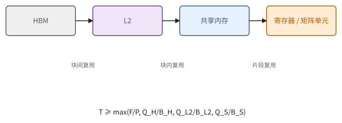
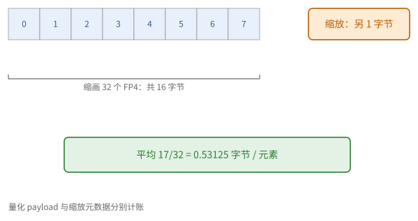
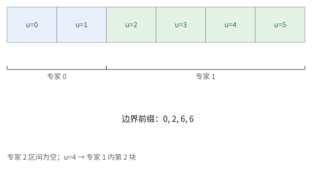
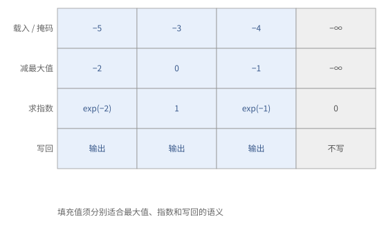

# 第 26 章　GPU kernel：矩阵乘法与访存受限算子

前几章准备好了零件：SM 与 Tensor Core（第 22 章），线程、共享内存与归约（第 23 章），异步流水线与 warp 专门化（第 24 章），tile 语言（第 25 章）。这一章把它们组装成 GPU 上最常用的几类 kernel。

矩阵乘法要沿着一条"逐级优化"的阶梯走：每上一级去掉一个瓶颈，同时露出下一个，而每个瓶颈都能用第 6 章的屋顶线在相应的存储级上算出来。

## 26.1 GEMM 的逐级优化

矩阵乘法的优化是一级一级进行的。下表从最朴素的写法出发，每一级说明它去掉了哪个瓶颈、又暴露了什么。设 f32 的 CUDA 核心峰值为 $P_{\text{fp32}}$，Tensor Core 的峰值 $P_{\text{tc}}$ 是它的十倍以上。

| 级 | 做法 | 去掉的瓶颈 | 新的瓶颈 |
| --- | --- | --- | --- |
| 1 | 每个线程算一个输出，直接从全局内存读操作数 | — | 每次乘加读 8 字节，强度 $\approx 0.25$ FLOP/字节，严重访存受限 |
| 2 | 调整下标映射，使 warp 的访问合并（23.1 节） | 访存效率低 | 仍然没有复用 |
| 3 | 共享内存分块（23.5 节） | 全局内存的流量降为 $1/T$ | 每次乘加读两次共享内存 |
| 4 | 寄存器分块，每线程 $t \times t$（命题 23.9） | 共享内存带宽 | 寄存器压力、占用率 |
| 5 | 16 字节的向量化读写、无冲突的共享内存布局（第 8 章） | 指令数与存储体冲突 | 接近 CUDA 核心的峰值 |
| 6 | 改用 Tensor Core（warp 级 MMA）与 cp.async 多级流水线 | 计算峰值提高十倍以上 | 喂数据：带宽与延迟重新成为瓶颈 |
| 7 | Hopper：TMA + wgmma + warp 专门化（第 24 章） | 线程的寄存器与指令开销、数据供给 | 共享内存的容量、结尾 |
| 8 | Blackwell：tcgen05 + TMEM + CTA 对 + 持久化与结尾重叠 | 结尾、单个线程块的强度 | — |

每一级都可以用"逐级的屋顶线"（命题 6.18）来验证：数据要经过 HBM → L2 → 共享内存 → 寄存器好几段路，每一段都有自己的带宽，也就各有一个时间下界，总时间不小于其中最大的那个。以第 1、3、4 级为例：

- 第 1 级每次乘加（2 FLOP）读 $A$、$B$ 各一个 f32，若缓存帮不上忙，强度为 $2/8 = 0.25$；
- 第 3 级 $T = 32$ 时，每读一个字节做 8 FLOP（习题 23.4）；
- 第 4 级 $128 \times 128$ 的块、$b_K = 32$ 时，每字节约 32 FLOP。

到了第 6 级，峰值提高了十倍以上，所需的强度也跟着提高十倍以上。由命题 6.12 之后的公式，块的强度约为 $\frac{2 b_M b_N}{s(b_M + b_N)}$（bf16 时为 $\frac{b_M b_N}{b_M + b_N}$），$128 \times 256$ 的块约为 85 FLOP/字节。要注意，这个强度是相对于**这个线程块从 L2 读进来的数据**而言的。不同线程块读的块有大量重叠，光栅化做得好（命题 24.10），它们就在 L2 里命中，真正从 HBM 读的远少于各线程块读入量之和。所以 GPU 上 GEMM 的块大小，是在 L2 带宽、共享内存容量（习题 24.1）和寄存器或 TMEM 容量之间权衡出来的。

> **例 26.1（不能把 L2 流量当成 HBM 流量）** bf16 的 $128 \times 256$ 输出块，每一步 $K$ 的强度为 $128 \times 256 / (128 + 256) \approx 85.3$ FLOP/字节。如果每份输入平均被四个线程块在 L2 里共用，那么相对于 HBM 的强度约为四倍，达到 341；而 L2 到各个线程块这一段，强度仍然只有 85.3。
>
> 前者可能已经超过 HBM 的拐点，后者却可能还没到 L2 的拐点。改进块的遍历次序，省的是 HBM 那本账；共享内存和寄存器分块，省的是后面两本账。几本账要分开算。



**图 26.1**　同一个 GEMM 在 HBM、L2、共享内存和计算上各有自己的下界。复用只减少它所在那一段之外的流量，不能把四级的账合成一个字节数。


**图 26.2**　共享内存里的输入与累加状态属于不同的存储；互动中的共享内存上限是显式给出的假设。

<div class="widget" data-widget="tilebudget" data-backend="gpu"></div>

> **现状（2026-10）**：GEMM 的块在 Hopper 上常见 $128 \times 128$ 到 $128 \times 256$（两个消费者 warpgroup），在 Blackwell 上常见 $256 \times 128$ 到 $256 \times 256$（CTA 对）。具体的选择由库在运行时按形状挑选。

## 26.2 低精度与块缩放的 GEMM

2.8 节讲过块缩放的数值含义：一组数共用一个缩放因子，真实值等于"低精度的码 × 缩放因子"。放到矩阵乘法里，首先要问的是：缩放因子随不随求和下标 $k$ 变？答案决定了它在哪里乘。

**按张量缩放的 FP8。** 若整个张量共用一个缩放因子，$C = s_A s_B (Q_A Q_B)$，缩放因子和 $k$ 无关，可以在结尾乘一次。按输出通道缩放（$B$ 的每一列一个因子）也是如此。

**按块缩放。** 若激活沿 $K$ 方向每 128 个元素一个因子、权重每个 $128 \times 128$ 块一个因子，因子就随 $k$ 所在的块变化，只能在块内提出来（2.8 节末的公式）：必须在每个 $K$ 块的部分积累加之前乘上。在 Hopper 上，这要由消费者在寄存器里做：每算完一个 $K$ 块，把这一块的部分积乘以对应的缩放因子，再加到 f32 的累加器上。Blackwell 在硬件里直接支持 MX 格式和 NVFP4 的块缩放 MMA，缩放因子放在 TMEM 里，不再需要软件处理。

**量化输出。** 若结尾要把输出量化成 FP8，得先知道输出块的最大绝对值才能定缩放因子：要么在结尾对每个块做一次归约（命题 10.2），要么用上一步的统计值（"延迟缩放"）。

> **例 26.2（缩放的元数据也占带宽，缩放的次序也不能乱）** 32 个 FP4 元素本身共 16 字节；若每组另带 1 字节的缩放因子，就是 17 字节，平均每个元素 0.53125 字节，而不是恰好 0.5。加上对齐和其他元数据，实际还要多。
>
> 再看次序：两个 $K$ 组的码的乘积分别是 3 和 5，两组的缩放因子之积分别是 2 和 10，那么正确的结果是 $3 \times 2 + 5 \times 10 = 56$。如果先把两组的乘积加起来再乘一个缩放因子，就错了。存储预算和数值次序，是两项独立的检查。



**图 26.3**　FP4 数据块之外还有缩放元数据；硬件或软件在组内应用缩放，再合并各组的部分积。

这些规则不是纸上谈兵。下面两份公开的报告，把低精度用在了大模型的整个预训练上，正好演示了本节和第 2 章的每一条。

> **注 26.3（两份低精度训练报告）** DeepSeek-V3 的技术报告（2024 年 12 月）用 FP8 训练了一个 6710 亿参数（每个词元激活 370 亿）的 MoE 模型。所有大矩阵乘法的输入都用 FP8 E4M3；激活按 $1 \times 128$ 的小块、权重按 $128 \times 128$ 的块各自缩放，正是上面"按块缩放"的粒度，选这么细是为了让离群值只影响自己那一小块（例 2.26）。报告还发现，所用 GPU 上 FP8 矩阵乘法在 Tensor Core 内部的累加只保留约 14 位有效数字，$K = 4096$ 时最大相对误差可达约 2%。他们的修补是"每累加 128 个元素（4 次 wgmma）就把部分和取出来，在 CUDA 核心上以 f32 累加"，这和按块乘缩放因子恰好可以放在同一步完成。整个训练相对 BF16 的损失误差保持在 0.25% 以内。
>
> NVIDIA 的 NVFP4 预训练报告（2025 年）走得更远：一个 120 亿参数的模型用 NVFP4 训练了 10 万亿词元，结果与 FP8 的基线相当。它用了四个办法。一，对计算权重梯度的那个矩阵乘法的输入，先乘一个 $16 \times 16$ 的随机 Hadamard 矩阵（每行每列随机变号的 $\pm 1$ 正交矩阵，再除以 4）。因为 $H H^\top = I$，$(XH)(H^\top Y) = XY$，数学结果不变；但乘过之后，一个块里的离群值被摊到了 16 个位置上，块内的最大值不再被一个数主导，量化误差变小。二，权重按 $16 \times 16$ 的二维块缩放，这样正向和反向用的是同一份量化权重。三，梯度用随机舍入（定义 2.32），避免小的更新被系统性地舍掉。四，大约 15% 的层（开头和末尾的几层）保留 BF16。同一报告在 80 亿参数、1 万亿词元的对比中发现，块长 32、缩放因子只能是 2 的幂的 MXFP4，要多用约 36% 的词元才能达到 NVFP4 的损失。
>
> 两份报告的共同点是：低精度的风险具体可算（累加位数、块内的动态范围、舍入的偏差），修补也都落在本节和第 2 章的工具上（定期提升累加精度、缩小缩放块、正交变换、随机舍入、保留少数敏感层）。审查一个低精度 kernel 时，应当逐条问这几件事。

> **现状（2026-10）**：注 26.3 的数字据 DeepSeek-V3 技术报告（arXiv 2412.19437）与 NVIDIA 的 NVFP4 预训练报告（arXiv 2509.25149），见附录 E。14 位的累加精度是对当时特定 GPU 的观察，换一代硬件要重新确认。

## 26.3 分组 GEMM 与 MoE

MoE 层要对每个专家 $e$ 计算 $Y_e = X_e W_e$，各组的行数 $n_e$ 由路由决定，彼此不同（11.5 节）。如果每个专家启动一次 GEMM，小的专家会让 GPU 大半空闲。分组 GEMM 把它们放进**一次**启动：

1. 计算每组的输出块数 $c_e = \lceil n_e / b_M \rceil \cdot \lceil N / b_N \rceil$ 及其前缀和 $C_e = \sum_{e' < e} c_{e'}$；
2. 持久化的线程块依次领取全局的块编号 $u$，用二分查找找到 $C_e \le u < C_{e+1}$，就知道这一块属于专家 $e$，以及它在组内的块坐标；
3. 用专家 $e$ 的数据（基地址、行数）构造这次的载入。用 TMA 时，每个组需要自己的描述符（或者在设备上修改描述符）。

> **例 26.4（从全局块号找到专家）** 三个专家的行数为 $(5, 130, 0)$，$b_M = 128$，输出的列方向有两个块。各专家的块数为 $(1 \times 2, 2 \times 2, 0) = (2, 4, 0)$，前缀边界为 $(0, 2, 6, 6)$。全局编号 $u = 4$ 落在 $[2, 6)$，属于专家 1，组内编号 $4 - 2 = 2$，按行块优先解成行块 1、列块 0。
>
> 这个行块只有两行有效（第 128、129 行）。空专家的前缀边界相同，区间长度为零，二分查找和"编号到坐标"的公式都要能跳过它。



**图 26.4**　六个全局工作块通过前缀区间映射到专家；专家 2 的区间为空，不领取任何块。

完整的 MoE 层是：路由 → 按专家**重排**词元（一次 gather）→ 分组 GEMM →（激活）→ 分组 GEMM → **还原**次序并按路由权重相加（scatter-add）。重排和还原受访存限制，常和相邻的 kernel 融合：例如第一个 GEMM 载入时直接按下标表去读，第二个 GEMM 的结尾直接写到还原后的位置。

> **现状（2026-10）**：Rubin 的 TMA 支持在 kernel 中直接更新描述符，便于 MoE 这类每组形状不同的情形。

路由本身也不能忽视。它的核心是对每个词元的 $E$ 个专家分数求 top-$k$，规模很小，却可能很慢。

> **例 26.5（把下标塞进尾数的 top-k）** SonicMoE（2026）报告，在他们的 MoE 实现里，PyTorch 通用的 `torch.topk` 约占路由计算时间的 40%。他们为 $E \le 4096$、$k \le 16$ 写了专门的 kernel：每个词元的一行分数用双调排序网络排序，排序之前先把列号写进 f32 尾数的最低 $\log_2 E$ 位。这样一行里不再有相等的键，排序结果总是稳定的，而且排好之后，从低位就能直接读出下标，不必另带一个下标数组。
>
> 代价是比较的不再是原来的值。按 2.11 节的整数键（命题 2.37）看，两个只在最低 $\log_2 E$ 位上不同的分数，现在按列号而不是按值排序；分数的最后几位被覆盖，返回的值也不再是原来的比特串。对路由来说这通常无所谓（分数只差最后几位的两个专家，选哪个都行），但它和"与参考实现逐位一致"是两种不同的规格。写规格时要说清楚要的是哪一种（注 2.39），审查时也要看出这一点（习题 26.9）。

## 26.4 结尾融合

一个输出块的累加结果离开片上存储之前的最后一步，叫**结尾**（epilogue）。此时结果已经在寄存器或 TMEM 里，顺手再做几件事几乎不花额外的搬运（命题 6.9 的融合）：

- 加偏置、激活函数、残差加法；
- 乘以缩放因子（26.2 节）、量化成低精度并算出新的缩放因子；
- 写成特殊的布局（例如下一层需要的转置或交错布局，8.8 节）。

在 Hopper 和 Blackwell 上，结尾通常是：累加结果从寄存器或 TMEM 读出 → 逐元素运算 → 写进共享内存 → 用 TMA 写回全局内存。结尾若不能和下一个块的主循环重叠，它的时间就直接加在每个块上；对 $K$ 较小的 GEMM，结尾可能占总时间的相当一部分。这就是持久化 kernel 和累加器双缓冲（24.5 节）的用处。

> **例 26.6（省掉一次往返有多少字节）** 输出 $C[4096, 4096]$ 是 bf16，占 32 MiB。单独做激活，至少要再读 32 MiB、写 32 MiB；在 GEMM 的结尾融合，就省下这 64 MiB 的中间往返。但如果结尾还要读残差，残差自己的 32 MiB 仍然要读，不能把结尾的流量都算成零。
>
> 结尾本身也要占用运算单元、寄存器或 TMEM 的读带宽以及写回的资源。HBM 的流量省下之后，结尾自己的吞吐可能成为新的下界。

## 26.5 访存受限的算子

softmax、RMSNorm、LayerNorm 这类算子，每个元素只做几次运算，时间几乎全花在读写上。写它们要解决两件事：一行数据交给谁处理，以及怎样让在途的数据足够多。

**一行交给谁。** 一行很短（几百到几千个元素）时，一个 warp 处理一行：每个线程用 16 字节的向量化读取拿到若干个元素，先在线程内归约，再用 warp 洗牌（命题 23.6）得到整行的结果。一行很长时，一个线程块处理一行，用块内归约（23.4 节）。一行放得进寄存器时，一遍读入，做两次归约（最大值与和），再写出；放不下时用在线 softmax（命题 10.4）或 Welford 合并（命题 10.9），边读边归约。

**在途量。** 由命题 22.8，要跑满带宽，每个 SM 要有足够的字节在途：用向量化读取，让每个线程处理多个元素，保持足够的占用率。

一个 Triton 写的按行 softmax（一行放进一个块）：

```python
@triton.jit
def softmax_kernel(x_ptr, y_ptr, n_cols, stride, BLOCK: tl.constexpr):
    row = tl.program_id(0)
    cols = tl.arange(0, BLOCK)                          # BLOCK 是不小于 n_cols 的 2 的幂
    mask = cols < n_cols
    x = tl.load(x_ptr + row * stride + cols, mask=mask, other=-float("inf")).to(tl.float32)
    x = x - tl.max(x, axis=0)
    e = tl.exp(x)
    y = e / tl.sum(e, axis=0)
    tl.store(y_ptr + row * stride + cols, y.to(y_ptr.dtype.element_ty), mask=mask)
```

越界的位置载入为 $-\infty$，指数为 0，既不影响最大值也不影响总和（习题 26.5）。归约在 f32 中进行。

> **例 26.7（负无穷和零各在该在的位置）** 真实的一行是 $(-5, -3, -4)$，块长为 4。第四个位置在求最大值之前应填 $-\infty$，减去最大值后指数为 0。若填 0，最大值就变成了 0，分母还多出一个 $e^0$，归一化全错。
>
> 一行没有任何有效元素时，四个位置都是 $-\infty$，直接相减会得到 NaN。这种空行的输出要在规格里另行约定；上面的 softmax 只适用于至少有一个有效元素的行。归约的单位元和空集合的结果，是两件要分别规定的事。



**图 26.5**　越界的位置在求最大值时填负无穷，取指数后贡献零；写回时只写有效的三列。单位元随归约的种类而不同。

**与相邻的运算融合。** 访存受限的算子单独成为一个 kernel，就要多读写一遍数据，所以能融合就融合：softmax 和注意力融合（第 27 章）；激活函数放进前一个 GEMM 的结尾；RMSNorm 的缩放可以折进后面的 GEMM。最后一个需要一点代数：设 $R = \operatorname{diag}(r_1, \dots, r_N)$ 为每行的归一化因子，$G = \operatorname{diag}(g)$ 为可学习的增益，则 $\operatorname{RMSNorm}(X) = RXG$，由结合律

$$
\operatorname{RMSNorm}(X)\, W = R\,\bigl(X\,(GW)\bigr),
$$

$GW$ 可以离线算好，每行的 $r_i$ 在 GEMM 的结尾乘上；只剩求 $r_i$ 的那次行归约要单独做或与前一个 kernel 融合。

## 26.6 审查要点

把本章的检查按顺序排成一张清单，审查 AI 写的 GEMM 或访存受限 kernel 时逐条过：

1. **上限**：用屋顶线估出时间下界（HBM、L2、计算），确定它应当受什么限制。
2. **合并与向量化**：全局内存的访问是否合并，是否用了 16 字节的读写（或 TMA）。
3. **共享内存**：布局是否无冲突（交错方式与 MMA 要求的布局一致）；级数和块大小是否放得进共享内存。
4. **同步**：多级流水线的"满""空"同步是否正确，尤其是"等 MMA 完成之后才释放一格"（命题 24.5）。
5. **精度**：累加器是否为 f32；FP8 的长累加是否定期提升到 f32；块缩放是否在正确的位置应用。
6. **占用与在途量**：在途的字节数是否足够（命题 22.8）；寄存器是否溢出。
7. **调度**：输出块数与 SM 数的关系（波次量化，命题 6.22、命题 24.8）；光栅化是否有利于 L2 复用。
8. **结尾**：融合了哪些运算；结尾是否与主循环重叠。

> **例 26.8（一份能交给 AI 的输出块规格）** 先写明 $C = AB$ 的形状、输入 bf16、f32 累加、边界不整除时怎么办；再写每个块唯一负责的输出区间、$K$ 块的缩放边界、输入缓冲的 full/empty 条件、预计的共享内存和累加器预算；最后分别给出 HBM、L2 和计算的下界。
>
> 如果 AI 只汇报"用了 Tensor Core、四级流水线"，还不能接受：这些名字证明不了每个元素都被覆盖、完成的是哪一次、容量是否合法。要让它把具体的下标和资源账填出来。

## 本章小结

1. GEMM 的八级优化，每一级去掉一个可以用逐级屋顶线算出的瓶颈；Tensor Core 使所需强度提高十倍以上，块大小在 L2 带宽、共享内存与寄存器/TMEM 容量之间权衡；L2 的账与 HBM 的账要分开算。（26.1 节、例 26.1）
2. 按张量缩放在结尾乘；按块缩放在每个 $K$ 块累加前乘；FP8 的长累加要定期提升到 f32；Blackwell 在硬件中支持块缩放。输出量化需要块内归约或延迟缩放。（26.2 节、例 26.2）
3. 大模型的低精度训练（DeepSeek-V3 的 FP8、NVIDIA 的 NVFP4）用的正是这些工具：细粒度的块缩放、定期提升累加精度、随机 Hadamard 变换摊开离群值、随机舍入、保留少数高精度层。（注 26.3）
4. 分组 GEMM：块数的前缀和加二分查找，把全局块编号映射为（专家，块坐标）；MoE 的重排与还原与相邻 kernel 融合；路由的 top-$k$ 可能占可观的时间，把下标塞进尾数的写法快而稳定，但不再与参考实现逐位一致。（26.3 节、例 26.4、例 26.5）
5. 结尾融合偏置、激活、缩放、量化与布局变换；结尾应与下一块的主循环重叠。（26.4 节、例 26.6）
6. 访存受限的 kernel：一行一个 warp 或一个块，向量化读取，warp 或块内归约，一遍完成；越界位置用归约的单位元填充；尽量与相邻运算融合，RMSNorm 的缩放可折进后面的 GEMM。（26.5 节、例 26.7）
7. 审查顺序：上限、合并、共享内存、同步、精度、在途量、调度、结尾。（26.6 节、例 26.8）

## 习题

**习题 26.1** ★ RTX 3060 Ti 的 f32 峰值约 16.2 TFLOP/s，显存带宽 448 GB/s。(a) 拐点是多少？(b) 估计 26.1 节第 1、3、4 级（强度分别为 0.25、8、32 FLOP/字节，设 L2 不提供额外的复用）各能达到峰值的多少？

<details><summary>提示 1</summary>

先算计算峰值与带宽之比，再把每级的强度乘带宽，截到计算峰值。

</details>
<details><summary>提示 2</summary>

$\min(P, I \cdot B)$。

</details>
<details><summary>答案</summary>

(a) $16.2 \times 10^{12} / 4.48 \times 10^{11} \approx 36$ FLOP/字节。(b) 第 1 级：$0.25 \times 448 = 112$ GFLOP/s，约 0.7%。第 3 级：$8 \times 448 \approx 3.6$ TFLOP/s，约 22%。第 4 级：$32 \times 448 \approx 14.3$ TFLOP/s，约 88%。实际上 L2 与 L1 会提供一些额外的复用，第 1、3 级会比这个估计好一些，但量级的差别不变。

</details>

**习题 26.2** ★ H100 的 bf16 Tensor Core 峰值约 990 TFLOP/s，HBM 3.35 TB/s，132 个 SM。(a) 一个 $128 \times 256$ 的块相对于它读入的数据，强度是多少？(b) 若所有 SM 读入的数据都来自 HBM（L2 没有复用），HBM 能支撑多少 TFLOP/s？(c) 要达到峰值，L2 平均要让每份数据被几个线程块共享？

<details><summary>提示 1</summary>

单块强度对应块读取，L2 共享减少的是 HBM 实际流量，不是单块的逻辑运算。

</details>
<details><summary>提示 2</summary>

(a) $\frac{b_M b_N}{b_M + b_N}$（bf16）。(c) 所需的复用倍数 = 峰值 / (b) 的结果。

</details>
<details><summary>答案</summary>

(a) $128 \times 256 / 384 \approx 85$ FLOP/字节。(b) $85 \times 3.35 \approx 285$ TFLOP/s，不到峰值的三分之一。(c) 约 $990 / 285 \approx 3.5$ 倍：平均每份从 HBM 读入的数据要被约 3.5 个线程块在 L2 中重复使用。这正是光栅化（命题 24.10）与簇的多播（22.7 节）要解决的问题，也说明 L2 的带宽必须是 HBM 的若干倍。

</details>

**习题 26.3** ★ 设某硬件的 FP8 MMA 在内部以约 14 位的有效精度累加（$u \approx 2^{-14}$）。$K = 8192$ 时，按命题 2.20 估计累加误差的界。若每 128 个元素就把部分和提升到 f32 中累加，误差界变为多少？代价是什么？

<details><summary>提示 1</summary>

若求严格界，应使用 gamma_K=Ku/(1−Ku)，并先检查 Ku 是否小于 1。

</details>
<details><summary>提示 2</summary>

命题 2.20 与习题 2.6 的分组求和。

</details>
<details><summary>答案</summary>

不提升时 $Ku=8192\times2^{-14}=0.5$，已不能把 $\gamma_K=Ku/(1-Ku)$ 近似为 $Ku$；按命题 2.20 的严格界，系数为 1（乘以 $\sum\lvert a_kb_k\rvert$），界非常宽松。每 128 项提升一次，组内系数 $\gamma_{128}=0.0078125/(1-0.0078125)\approx0.00787$；64 个组间用 f32 合并，再加约 $\gamma_{64}^{\mathrm{f32}}\approx3.8\times10^{-6}$ 的系数。典型的随机误差可能更小，但不能替代这个最坏情形界。代价是每组需要取出 MMA 的部分累加并在 CUDA 核心上相加，还要占用指令与寄存器。

</details>

**习题 26.4** ★ 一个 MoE 层有 4 个专家，各分到 300、50、0、700 个词元，$b_M = 128$，$N / b_N = 8$。(a) 每个专家的输出块数与前缀和是多少？(b) 全局块编号 $u = 30$ 属于哪个专家、组内的哪个块？(c) 补零浪费的行占多少？

<details><summary>提示 1</summary>

给每专家一个半开编号区间；空组产生零长区间，不领取块。

</details>
<details><summary>提示 2</summary>

$c_e = \lceil n_e / 128 \rceil \times 8$。

</details>
<details><summary>答案</summary>

(a) $c = (24, 8, 0, 48)$，前缀和 $C = (0, 24, 32, 32, 80)$。(b) $24 \le 30 < 32$，属于专家 1，组内第 6 个块（若按行块优先：行块 0，列块 6）。(c) 计算的行数 $384 + 128 + 0 + 768 = 1280$，有效 1050，浪费约 18%。

</details>

**习题 26.5** ★（审查题）把 26.5 节 Triton softmax 中的 `other=-float("inf")` 改成 `other=0.0`，对哪些输入会出错？错在哪里？

<details><summary>提示 1</summary>

尾部的零会参与分母，即使最大值没改变也可能错。

</details>
<details><summary>提示 2</summary>

越界位置的值会参与 `tl.max` 和 `tl.sum`。

</details>
<details><summary>答案</summary>

当 `BLOCK > n_cols` 时，越界位置被填成 0。若一行的所有真实元素都是负数，最大值会被错误地取为 0；即使最大值正确，每个越界位置也会给总和贡献 $e^{0 - m}$，使所有输出偏小。只有当 `n_cols` 恰好是 2 的幂（没有越界位置）时才正确。原则：越界位置要填归约的单位元（求最大值填 $-\infty$，求和填 0），而这里同一个值要先后参与两种归约，$-\infty$ 恰好对两者都正确（$e^{-\infty} = 0$）。

</details>

**习题 26.6** ★ 在 H100 上做一个逐行 RMSNorm，每行 8192 个 bf16，一个线程块（256 个线程）处理一行，每个线程用 16 字节的读取。(a) 每个线程读几次？(b) 用命题 22.8（每 SM 约需 18 KB 在途），每个 SM 需要同时驻留几个块？(c) 若块内先读完整行、再做归约、再写出，在途量是否足够？

<details><summary>提示 1</summary>

一次全块读取只产生 4 KiB 在途；每线程有几次请求同时活跃比总共要读几次更重要。

</details>
<details><summary>提示 2</summary>

一行 16 KiB；256 个线程每次共读 4 KiB。

</details>
<details><summary>答案</summary>

(a) $16384 / 16 / 256 = 4$ 次。(b) 若每个块在一行读完之前一直有 16 KiB 在途，约需 1–2 个块；考虑到读完之后的归约与写出阶段没有读在途，需要更多的块（例如 4 个以上）交错进行。(c) 每个线程连续发出 4 次独立的 16 字节读，再等待，在途量足够；若每个线程读一次、用一次、再读下一次，在途量只有四分之一，带宽利用率会明显下降。

</details>

**习题 26.7** ☆ 一个 GEMM 的结尾要把输出量化为 FP8，缩放因子由整个输出张量的最大绝对值决定。为什么不能在结尾中直接完成？给出两种办法。

<details><summary>提示 1</summary>

整张量的统计值依赖所有块，当前结尾还不能知道尚未产生的数据。

</details>
<details><summary>提示 2</summary>

结尾处理一个块时，其他块还没算完。

</details>
<details><summary>答案</summary>

整个张量的最大值依赖所有块，而每个块的结尾只知道自己的最大值。办法一：两遍，先写出 bf16 的结果并在结尾中用原子操作（或第二个 kernel）求全局最大值，再做一次量化（多一次读写）。办法二：延迟缩放，用上一步（或上几步）记录的最大值作为本步的缩放因子，同时在结尾中更新本步的最大值，供下一步使用；或者改用按块缩放，每个块的缩放因子只依赖于本块。

</details>

**习题 26.8** ★（综合审查题）一个 GEMM 结尾要量化输出，每个 128 列组使用该行该组的最大绝对值。若输出块按 64 列切分，能在各块独立确定正确的 128 列组缩放吗？给出两种修复。

<details><summary>提示 1</summary>

统计组跨越两个输出块，当前结尾看不到另一块的值。

</details>
<details><summary>提示 2</summary>

可改变 tile 使统计组局部完整，或增加一次跨块统计与重读量化。

</details>
<details><summary>答案</summary>

不能独立确定共同缩放。方案一让同一逻辑任务负责完整 128 列组，在结尾求组内最大值；方案二先写出未量化结果与局部最大值，合并两块统计后再量化，增加流量与启动。也可使用规格明确允许的延迟缩放，但那已是不同的数值协议。

</details>

**习题 26.9** ★（审查题）例 26.5 的路由 kernel 用于 $E = 128$ 个专家，分数都是正的 f32。(a) 尾数的最低几位被列号覆盖？这最多改变分数的多少（相对值）？(b) 两个分数 $a > b$，只在被覆盖的那几位上不同，排序后谁在前？与"按值排序"的结果是否一致？(c) 若规格要求与 `torch.topk` 的参考实现逐位一致（注 2.39），这个 kernel 违反了哪几条？(d) 给出一种仍然没有相等键、又不改动分数的写法。

<details><summary>提示 1</summary>

$\log_2 128 = 7$；f32 的尾数有 23 位，规格化数的有效数字在 $[1, 2)$ 中。

</details>
<details><summary>提示 2</summary>

(d) 命题 2.37 的整数键是 32 位整数，可以和列号拼成一个更长的整数再比较。

</details>
<details><summary>答案</summary>

(a) 最低 7 位。它们代表的量至多为 $(2^7 - 1) \cdot 2^{-23} < 2^{-16}$ 个有效数字单位，相对改变小于 $2^{-16} \approx 1.5 \times 10^{-5}$。

(b) 覆盖之后两者的低 7 位分别变成各自的列号，谁在前由列号的大小决定，与原来 $a > b$ 无关；如果 $a$ 的列号较小，排序会把 $b$ 放在前面，与按值排序不一致。

(c) 返回值的比特串不是输入的比特串（低 7 位被改了）；返回的序列也可能不是按原值排序的序列（只差低 7 位的两个分数次序可能颠倒）。下标本身互不相同、在范围之内，这两条仍然满足。

(d) 不改分数，另造一个 64 位的键：高 32 位放分数的整数键（命题 2.37），低 32 位放 $E - 1 - j$（$j$ 为列号，值相同时下标小的在前），按这个 64 位整数降序排序。键互不相同，排序稳定，返回的值从原数组按下标取回，比特串不变。代价是比较的位宽加倍、寄存器多用一倍。

</details>
