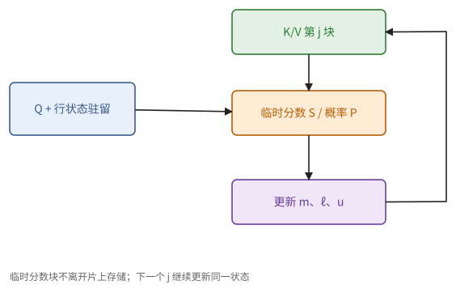
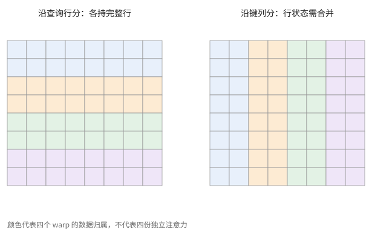
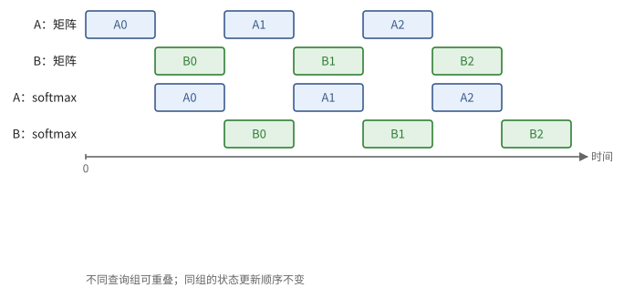
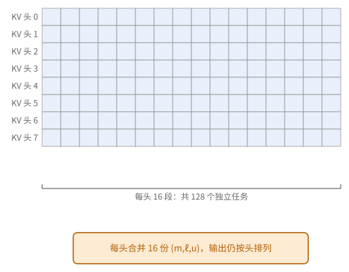
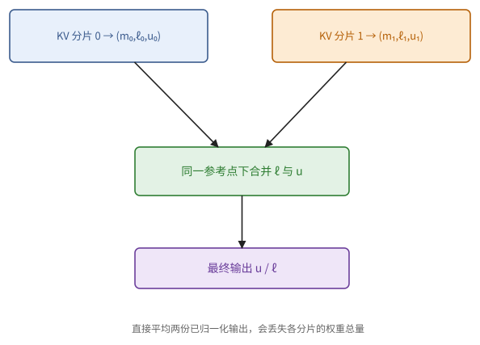

# 第 27 章　GPU kernel：注意力

注意力的中间矩阵是 $T \times T$ 的：序列长 32k 时，一个头的分数矩阵用 bf16 存就要 2 GiB，既放不下，也读写不起。第 10 章的在线 softmax（命题 10.6）给出了出路：一块一块地处理键和值，每个查询只保留一个小小的状态 $(m, \ell, u)$，分数矩阵从来不必完整地存在。这一章把它写成 GPU 上的 kernel，也就是 FlashAttention。

到了 Hopper 和 Blackwell，FlashAttention 要重新设计，因为瓶颈跑到了一个意想不到的地方：指数运算。最后一节看一个真实的服务系统怎样把这些拼在一起：长短不一的批、散落的页、共享的前缀，以及怎样把工作均匀地分给所有 SM。

## 27.1 注意力的屋顶线

考虑一个头：$Q, K, V \in \mathbb{R}^{T \times d}$，$O = \operatorname{softmax}(QK^{\mathsf T}/\sqrt{d})\, V$。$QK^{\mathsf T}$ 和乘 $V$ 各做 $T^2 d$ 次乘加，运算量约 $4T^2 d$（不计掩码）。设中间矩阵不离开片上存储，每个查询块（$b_q$ 行）要把全部的 $K$、$V$ 读一遍，共有 $T/b_q$ 个查询块，读入量约 $2sTd \cdot T/b_q$，强度约为

$$
\frac{4T^2 d}{2sTd \cdot T/b_q} = \frac{2 b_q}{s},
$$

和 $T$ 无关。由此：

- **prefill**（以及训练）：查询块够大时，强度 $2b_q/s$ 可以超过拐点 $P/B$，注意力有可能受计算限制；前提是指数、归约和片上资源也跟得上。
- **decode**：每个序列每步只有一个（或少数几个）查询，强度约为 $2 \times (\text{同时处理的查询数}) / s$，受访存限制，时间由读 KV cache 决定。

> **例 27.1（大查询块只是一个必要条件）** bf16 时 $b_q = 128$ 给出强度 $2b_q/s = 128$ FLOP/字节。若芯片的稠密矩阵峰值约 990 TFLOP/s、HBM 带宽 3.35 TB/s，拐点约 296。在这个"没有块间复用"的流量模型里，128 还不够让注意力受计算限制，$b_q$ 至少要接近 296 才有可能。
>
> 真实的 GPU 上，不同查询块读的是同一份 $K$、$V$，可以在 L2 里复用，HBM 的账会小得多；另一方面，指数和归约也可能先成为瓶颈。所以要按具体的存储级分别比较下界，不能把常见的块形状当成无条件的结论。

**图 27.1**　一个查询块流式地处理所有的 $K$、$V$，片上只保留 $Q$、当前的分数块和输出状态。重复读取的次数由查询块的个数与缓存复用决定。

> **注 27.2（FlashAttention 省的是什么）** 不用在线 softmax 的写法，要把 $S = QK^{\mathsf T}$ 写回 HBM，读回来做 softmax，再写出 $P$、读回来乘 $V$：HBM 流量含 $T^2$ 项，容量也要 $T^2$。FlashAttention（Dao 等，2022）把这些都留在片上，容量降为 $O(Td)$。至于流量，设片上存储为 $M$ 字节，查询块按片上能放下的取 $b_q \propto M/(ds)$，代入上面的读入量 $2sTd \cdot T/b_q$，得到约 $T^2 d^2 s^2 / M$ 量级的 HBM 流量。原论文证明了这个量级，并证明对一切 $M \in [d, Td]$（以元素计），没有哪种精确计算注意力的算法能在渐近意义上做得更好。两相比较，$d^2 s$ 远小于 $M$ 时（$d = 128$ 的 bf16 是 32 KiB，片上存储是它的若干倍），省下的流量才可观；更大的收益来自容量和融合：$T \times T$ 的矩阵不必存在，softmax 的逐元素运算也不再单独读写一遍。

## 27.2 FlashAttention 的结构

把命题 10.6 落实到线程块上。**网格**：每个线程块负责一个（批量，头，查询块）。线程块把自己的 $Q$ 块载入共享内存，然后依次处理各个键值块 $j$：

1. 载入 $K_j$、$V_j$（多级流水线，第 24 章）；
2. $S = Q K_j^{\mathsf T}$（Tensor Core）；
3. 按命题 10.6 更新每行的状态：$m' = \max(m, \operatorname{rowmax}(S))$，$P = e^{S - m'}$，$\ell' = \ell e^{m - m'} + \operatorname{rowsum}(P)$，$u' = u\, e^{m - m'} + P V_j$（最后一项又是一次 Tensor Core 乘法）；
4. 处理完所有键值块之后，输出 $u / \ell$。

**warp 的分工。** 一个线程块有若干个 warp（或 warpgroup），工作怎样分给它们？好的分法是把**查询的行**分给各个 warp：每个 warp 负责查询块中的若干行，和每个键值块的全部列相乘。这样每一行的 rowmax、rowsum 都在一个 warp 内完成（warp 洗牌，命题 23.6），处理一个键值块时 warp 之间不需要同步。反过来，若把**键值块的列**分给各个 warp，每一行的最大值和总和就散在几个 warp 里，每个键值块都要经过共享内存汇总一次。按行分工是 FlashAttention-2 相对于第一版的主要改进之一。

> **例 27.3（按查询分工为什么省掉汇总）** 一个查询块 64 行，四个 warp 各负责 16 行，每个 warp 都看完整的键值块。每一行的最大值、总和和输出状态由同一个 warp 维护，只在 warp 内交换。
>
> 若四个 warp 各看四分之一的键，每一行就有四份局部的 $(m, \ell, u)$，每处理一个键值块都要跨 warp 合并。这在数学上没错，但多了共享内存和同步；分工的方式决定了归约走哪条硬件通路。

**图 27.2**　按查询行切分时，各 warp 持有完整的行状态；按键列切分时，同一个查询要跨 warp 合并四份状态。

**因果掩码。** 完全在对角线以上的键值块直接跳过，约省一半的运算；跨过对角线的块逐元素屏蔽。如果某一行在已处理的块里全被屏蔽，$m = -\infty$，$e^{m - m'}$ 会算出 NaN（$-\infty - (-\infty)$），要特别处理：把参考点为 $-\infty$ 的情形换成 0（注 10.8 的空状态规则）。

**长序列、小批量。**（批量 × 头 × 查询块）的个数可能少于 SM 数。这时可以把查询块切得更细；解码时则沿键值方向切分（27.5 节）。

## 27.3 指数运算为什么成为瓶颈

27.2 节的结构在 Ampere 上已经够好。到了更新的 GPU，瓶颈出现在一个意想不到的地方：矩阵乘法之外的逐元素运算。

对分数矩阵 $S$ 的每一个元素，Tensor Core 要在 $QK^{\mathsf T}$ 和 $PV$ 中各做 $d$ 次乘加，共 $4d$ FLOP；专门的函数单元（SFU，负责指数这类超越函数）要做一次指数；CUDA 核心还要做几次减法、乘法和比较（求最大值、缩放）。把前两项的时间比一比：

> **命题 27.4（指数不成为瓶颈的条件）** 设每个 SM 每周期的 Tensor Core 算力为 $P$（FLOP），指数运算为 $E$ 次。注意力的指数运算不成为瓶颈的条件是 $4d \ge P / E$。

*证明* 每个分数元素在 Tensor Core 上要 $4d/P$ 个周期，在指数单元上要 $1/E$ 个周期；前者不小于后者即 $4d \ge P/E$。∎

代入数字。Hopper 每个 SM 的 bf16 Tensor Core 约为每周期 4096 FLOP，指数等超越函数每周期 16 次，$P / E = 256$。$d = 128$ 时 $4d = 512$，指数的时间是矩阵乘法的一半；再加上 CUDA 核心上的其他逐元素运算，非矩阵乘法的部分已经占了可观的比例。Blackwell 每个 SM 的 Tensor Core 算力翻倍，指数单元的吞吐却没变，$P / E$ 约为 512：$d = 128$ 时两者相当，$d = 64$ 时指数成了主要瓶颈。

所以在新的 GPU 上，注意力 kernel 的设计重点不再只是矩阵乘法，而是两件事：让 softmax 的逐元素运算和矩阵乘法同时进行；减少逐元素运算本身。

> **例 27.5（矩阵单元变快，收益为什么变小）** 设处理一个键值块，矩阵乘法用 4 个单位时间、softmax 用 2、搬运用 1。完全串行要 7；三种资源若能充分重叠，稳态的下界是 4。只把矩阵单元提速两倍，串行变成 5，重叠的下界变成 2，而 softmax 已经和矩阵乘法持平。
>
> 再继续提高矩阵峰值，若 softmax 不变，总时间就不会再按峰值的比例下降。命题 27.4 把这件事写成了"每个分数元素的 FLOP 数"与"指数次数"之比。

## 27.4 Hopper 与 Blackwell 上的设计

两代 GPU 上的公开设计，分别侧重 27.3 节的两个方向。

**Hopper（FlashAttention-3 的思路）**：让 softmax 与矩阵乘法重叠。

- warp 专门化：一个生产者 warp 用 TMA 载入 $K$、$V$；两个或更多的消费者 warpgroup 用 wgmma 做矩阵乘法（24.4 节）；
- 乒乓：两个消费者 warpgroup 交替进行，一个在做 softmax（用 SFU 和 CUDA 核心）时，另一个在做矩阵乘法（用 Tensor Core）；
- warpgroup 内部也做流水：在算第 $j$ 块的 softmax 时，已经发出第 $j + 1$ 块的 $QK^{\mathsf T}$；
- FP8：$QK^{\mathsf T}$ 和 $PV$ 都可以用 FP8，配合按块缩放（26.2 节）；为了降低量化误差，还先对 $Q$、$K$ 乘一个随机正交变换（和例 26.5 的随机 Hadamard 变换是同一个想法：$(QH)(KH)^{\mathsf T} = QK^{\mathsf T}$，结果不变，离群值却被摊开）。

> **例 27.6（交错的是不同的查询，同一个状态链不能乱）** 两个消费者 warpgroup 分别负责查询块 A、B。A 在做第 $j$ 块的 softmax 时，B 可以做矩阵乘法；同一个查询块也可以提前算下一个分数块，但更新第 $j+1$ 块的 $(m, \ell, u)$，必须等第 $j$ 块的状态更新完。
>
> 能并行的是用不同资源的独立工作，不能并行的是同一个状态上的依赖。两份分数缓冲、两份输出状态、各组的完成事件，都要算进资源预算。

**图 27.3**　两组独立的查询交替使用矩阵单元与 softmax 单元。同一组内，状态仍按键值块的次序更新。

**Blackwell（FlashAttention-4 的思路）**：在重叠之外，直接减少指数单元的负担。

- $S$ 和输出的累加 $u$ 都放在 TMEM 里，tcgen05 由单个线程发起，softmax 由专门的 warp 从 TMEM 读出 $S$、写回 $P$（24.5 节）；
- 把一部分指数改在 CUDA 核心上用多项式近似计算：先把 $2^x$ 拆成整数次幂和 $[0, 1)$ 内的小数次幂，整数次幂直接写进浮点数的指数位，小数次幂用一个低次多项式算。这样指数运算分摊到两种单元上；
- 减少重新缩放：由注 10.5，参考点 $m$ 不必是真正的最大值，只要 $e^{S - m}$ 不溢出就行。所以只在新的最大值超过旧参考点一定幅度时才重新缩放 $u$，大多数键值块可以跳过这一步。

> **现状（2026-10）**：FlashAttention-2（2023）在 A100 上达到理论峰值的约 50%–73%；FlashAttention-3（2024）在 H100 上用 FP16 达到约 740 TFLOP/s（约 75% 的峰值），FP8 接近 1.2 PFLOP/s。FlashAttention-2、3 的公开实现用 CUTLASS（C++）写成；FlashAttention-4 面向 Blackwell，用 CuTe DSL（Python）写成。指数近似与条件重新缩放的具体参数（多项式次数、阈值、分摊比例）以其论文与代码为准，见附录 E。

## 27.5 解码注意力与分页 KV cache

decode 时，目标是以接近显存带宽的速度把 KV cache 读完。几个常用的办法：

**利用 GQA。** 共用同一个键值头的 $H / H_{kv}$ 个查询头放进同一个线程块一起处理：键值只读一次，强度提高 $H / H_{kv}$ 倍。投机解码的多个草稿词元也一起处理。

**沿键值方向切分**（split-KV，也叫 flash-decoding）。批量小、上下文长时，（批量 × 键值头）的个数可能远少于 SM 数，每个线程块又要读很长的 KV，并发不够（命题 22.8）。办法是把每个序列的 KV 切成若干段，每段由一个线程块算出部分状态 $(m, \ell, u)$，再用一个小 kernel 按命题 10.6 合并。

> **例 27.7（按并发的缺口决定切几段）** 批量 1、键值头 8，每个头一个线程块只有 8 个任务，而 GPU 有 132 个 SM，大多数 SM 无事可做。把每个键值头沿长度切成 16 段，就有 128 个任务；之后每个头合并 16 份状态。
>
> 若 $d = 128$，每份状态有 $m$、$\ell$ 和 128 维的 $u$，共 130 个 f32，128 份约 65 KiB。和长达几十 MiB 的 KV 相比，这份中间状态很小，但额外的启动、归约和布局仍要算进去。

**图 27.4**　8 个键值头各拆成 16 段，并行任务增加到 128 个；随后按头合并状态，保持查询和头的身份。

**图 27.5**　split-KV 合并的是状态，不是对各段已归一化的输出取平均（习题 27.8）。互动展示同一个合并代数。

**分页 KV cache。** 服务系统里的 KV cache 按页存放（11.12 节）。kernel 读 KV 时按页表取页，用 cp.async 或 TMA 一页一页地载入：页内连续，页间不连续。TMA 只能搬"起点加步长"描述的规则区域（24.2 节），页足够大时可以每页发一次 TMA；页很小、甚至一页只有一个词元时，只能由线程按页表算出每一行的地址，用 cp.async 把散落的行收集到共享内存里连续存放，之后的矩阵乘法与连续存放时完全一样（27.7 节）。

**MLA 的解码。** 多头潜在注意力（11.8 节的现状框）把每个词元的键值压缩成一个共享的潜向量，所有查询头共用它。于是解码时，一个线程块可以让很多个查询头（例如 128 个）对同一段潜向量做注意力，强度比普通的 MHA 或 GQA 高得多（习题 27.6），这类 kernel 已经接近受计算限制。

## 27.6 反向传播

训练还需要注意力的反向传播。GPU 路线不依赖第 13 章，所以这里直接推出需要的公式。设损失对输出的梯度为 $\bar{O}$（与 $O$ 同形状）。只需要两条求导规则：

- 矩阵乘法 $Y = XW$：$\bar{X} = \bar{Y} W^{\mathsf T}$，$\bar{W} = X^{\mathsf T} \bar{Y}$（由 $\langle \bar{Y}, XW \rangle = \operatorname{tr}(\bar{Y}^{\mathsf T} X W)$ 分别对 $X$、$W$ 求梯度）；
- 逐行 softmax $y = \operatorname{softmax}(x)$：雅可比矩阵是对称的 $\operatorname{diag}(y) - y y^{\mathsf T}$，所以 $\bar{x} = y \odot (\bar{y} - \langle y, \bar{y} \rangle)$。

由此，一个头的反向为（省略缩放 $1/\sqrt{d}$）：

$$
\bar{V} = P^{\mathsf T} \bar{O}, \qquad \bar{P} = \bar{O} V^{\mathsf T}, \qquad \bar{S} = P \odot (\bar{P} - D\,\mathbf{1}^{\mathsf T}), \qquad \bar{Q} = \bar{S} K, \qquad \bar{K} = \bar{S}^{\mathsf T} Q,
$$

其中 $D_i = \sum_j P_{ij} \bar{P}_{ij}$。这个和不必真的去算：代入 $\bar{P} = \bar{O} V^{\mathsf T}$ 与 $O = PV$，得 $D_i = \langle O_{i,:}, \bar{O}_{i,:} \rangle$，只是两个 $d$ 维向量的内积。

从公式可以读出 GPU 上的结构：

- 前向为每行保存 $\operatorname{lse}_i = m_i + \log \ell_i$（只有 $T$ 个数）；反向时用 $P_{ij} = e^{S_{ij} - \operatorname{lse}_i}$ 重新算出 $P$ 的每一块，不必存 $T \times T$ 的 $P$。预先用一个小 kernel 算出 $D$。
- 每个线程块负责一个键值块，持有它的 $\bar{K}$、$\bar{V}$ 累加器，遍历所有查询块。
- $\bar{Q}$ 的每一块要对所有键值块累加，而这些键值块分在不同的线程块上。常见做法是用 f32 的原子加法累加到全局内存，代价是结果不确定（命题 10.24）；要确定的结果，就把各线程块的部分 $\bar{Q}$ 写出来再按固定次序归约，或者另写一个以查询块为单位的 kernel 计算 $\bar{Q}$。

反向的运算量约为前向的 2.5 倍：重算 $QK^{\mathsf T}$，再加四次矩阵乘法。

> **例 27.8（给梯度块选一个唯一的累加者）** 两个键值块都对同一个查询块的 $\bar Q$ 有贡献。若两个线程块直接用普通写入写同一块 $\bar Q$，后写的覆盖先写的；用原子加法能合并，但次序不确定。
>
> 一种确定的方案，是让查询块的所有者依次遍历全部键值块，在本地累加 $\bar Q$；另一种是写出各键值块的部分和，再按固定的树归约。两者都由反向公式推出，取舍在于重复读取、部分和流量与并行度。

## 27.7 推理服务的注意力引擎

前面几节的 kernel 默认一批序列的形状都一样。推理服务里不是这样：连续批处理（11.12 节）每一步拼出的批里，有的序列在 prefill、一次带来几千个查询，有的在 decode、只有一个查询；上下文从几十到几十万个词元不等；KV cache 按页散落在页池里；很多请求还共享同一段系统提示。FlashInfer（Ye 等，MLSys 2025 最佳论文）是被 vLLM、SGLang 等服务框架广泛采用的注意力库，它的设计正好回答了这几件事。这一节讲其中三个想法，每个都建立在前面已有的结论上。

**把状态合并当作标准的归约。** FlashInfer 让每次注意力计算都输出一个"注意力状态"：对键的下标集合 $I$，记
$$
\operatorname{lse}(I) = \log \sum_{i \in I} e^{s_i}, \qquad O(I) = \sum_{i \in I} e^{s_i - \operatorname{lse}(I)}\, v_i,
$$
即已经归一化的部分输出，加上它的对数分母。两个不相交集合的状态这样合并：
$$
O(I \cup J) = \frac{e^{\operatorname{lse}(I)} O(I) + e^{\operatorname{lse}(J)} O(J)}{e^{\operatorname{lse}(I)} + e^{\operatorname{lse}(J)}}, \qquad \operatorname{lse}(I \cup J) = \log\big(e^{\operatorname{lse}(I)} + e^{\operatorname{lse}(J)}\big).
$$
这和命题 10.6 是同一个幺半群，只是换了坐标：$\operatorname{lse} = m + \log \ell$，$O = u / \ell$。实现时同样先减去两个 lse 中较大的那个，再取指数。把合并当作像求和一样的标准操作，split-KV、共享前缀、长短混合的批，就都可以写成"各算一部分状态，再合并"。

> **例 27.9（用 lse 坐标再合并一次）** 沿用例 10.7 的数字：集合 $I$ 的两个分数是 $0$ 与 $\log 2$，值是 10 与 20；集合 $J$ 的分数是 $\log 4$，值是 30。$\operatorname{lse}(I) = \log(1 + 2) = \log 3$，$O(I) = (1 \cdot 10 + 2 \cdot 20)/3 = 50/3$；$\operatorname{lse}(J) = \log 4$，$O(J) = 30$。合并：
>
> $$
> O(I \cup J) = \frac{3 \cdot \tfrac{50}{3} + 4 \cdot 30}{3 + 4} = \frac{170}{7}, \qquad \operatorname{lse}(I \cup J) = \log 7,
> $$
>
> 与例 10.7 的结果相同。每一部分只交出两样东西：一个已经归一化的输出和一个数 lse，接收方不必知道这一部分里有多少个键。

**把页表看成稀疏矩阵。** 把一批的注意力看成一个大矩阵：行是这一批所有序列的查询（首尾相接排成一列），列是页池里的所有 KV 位置。查询 $q$ 要看键 $k$，就在 $(q, k)$ 处放一个非零元。按页存放时，同一序列连续的若干个查询（一个查询块，$B_r$ 行）要看的是同一组页，每页 $B_c$ 列，于是非零元成块出现：这是一个块大小为 $B_r \times B_c$ 的**块稀疏矩阵**（block-sparse row，BSR），行指针给出每个查询块的页列表从哪里开始，列下标就是页号。页表、按树组织的前缀缓存、投机解码的树形验证，都可以写成这个格式，于是一套 kernel 处理所有情形。

$B_c$ 就是页的大小，可以小到 1。这时一个键值块的各行散落在不同的地方，不能用 TMA 整块搬运；kernel 按列下标算出每行的地址，用 cp.async 把它们收集到共享内存里连续存放，之后的 MMA 与稠密时完全一样。每一行是一个词元的整段 $d$ 维向量（$d = 128$ 时 256 字节），访存仍然是合并的。论文实测：页大小为 1 时，decode 比连续存放只慢 1% 以内，prefill 慢约 10%（因为用不上 TMA）。

**共享前缀。** 一个请求要采样 $n$ 个不同的回答时，这 $n$ 个序列共享同一段提示。把矩阵拆成两部分：前缀那几列对这 $n$ 行都是非零的，作为一个 $n \times B_c$ 的稠密块处理，前缀的键值只从显存读一次，在共享内存里供 $n$ 个查询共用；各自的后缀单独处理。两部分各得一个状态，按上面的规则合并，结果与不拆分完全相同（命题 10.2）。论文中前缀 32768 个词元、批量 64 时，这样做的注意力用时约 0.25 ms，不拆分时约 4.1 ms。

**负载均衡。** 一批里上下文有长有短。若一个线程块负责一个（查询块，键值头），最长的序列决定整批的时间。FlashInfer 先把总工作量平均到线程块上，得到每段键值的长度上限 $L$；超过 $L$ 的键值被切成若干段，每段是一个任务；然后把任务按长度从长到短排好，依次交给当前累计负载最小的线程块。

> **命题 27.10（贪心分配的完成时间）** 设共有 $G$ 个线程块，任务的总代价为 $W$，每个任务的代价不超过 $L$。按任意次序把每个任务交给当前负载最小的线程块，则所有线程块完成的时间不超过 $W/G + L$。

*证明* 看最后完成的那个线程块，设它最后接到的任务代价为 $w \le L$。接这个任务时它的负载最小，不超过当时所有负载的平均值，而当时已分配的总代价小于 $W$，所以那时它的负载不超过 $W/G$。完成时间不超过 $W/G + w \le W/G + L$。∎

取 $L = W/G$ 时，完成时间不超过平均负载的 2 倍；按从长到短的次序分配还要好得多（经典的 LPT 调度，可以证明不超过最优解的 $4/3$ 倍）。论文的消融实验里，上下文长度在 4096 到 16384 之间均匀分布时，打开负载均衡把每个词元的间隔从 13.9 ms 降到 8.6 ms。

> **例 27.11（切开最长的那一段）** 两个线程块，四个序列的键值长度（以块计）为 12、3、3、2。不切分时，一个线程块拿到 12，另一个拿到 $3 + 3 + 2 = 8$，整批要等 12。总量 $W = 20$，$W/G = 10$，取 $L = 10$，把 12 切成 10 和 2，任务按从长到短排成 10、3、3、2、2：第一个线程块拿 10；其余依次交给负载较小的第二个线程块，$3, 6, 8, 10$。两个线程块都在 10 结束，恰好是平均值。代价是长序列的两段状态要多合并一次。

切开的段最后要合并。FlashInfer 不用 Stream-K 式的原子加法（命题 24.8），而是把各段的状态写进一块工作区，再由一个归约阶段按固定次序合并：给定同样的序列长度，合并次序每次都一样，结果是确定的。

**计划与执行分开。** 上面的分配要在 CPU 上算，每一步一次（plan）；这一步所有层、所有同类注意力都共用这份计划。真正的 kernel 调用（run）则被 CUDA Graph 录下来反复重放（23.8 节）。为了让重放合法，kernel 的网格大小固定（持久化 kernel，24.6 节），工作区的每一部分都按上限分配在固定的偏移上，于是每一步只有工作区里的内容变了，kernel 的参数一个都不变。

> **注 27.12（负载均衡与批不变）** 按"填满所有 SM"来定段长，意味着一个序列被切成几段取决于同批的其他序列，这不满足命题 11.31。Thinking Machines 指出 FlashInfer 的这种调度不是批不变的。DeepSeek-V4（2026）走了另一条路：decode 注意力完全不沿键值方向切分。序列数是 SM 数的整数倍的部分，每个序列由一个 SM 算完；最后不满一波的序列，由同一个块簇里的几个 SM 合作，借助分布式共享内存（22.7 节）合并，并精心安排使它的累加次序与单个 SM 时完全相同。这样既用满了 SM，每个序列的归约树又只由它自己决定。

## 本章小结

1. prefill 阶段注意力的强度约 $2b_q/s$，要与各存储级的屋顶线比较；普通的decode受访存限制，GQA、MLA 或多查询共享 KV 时要重新计算强度。FlashAttention 省掉 $T \times T$ 的存储与读写，HBM 流量约 $T^2 d^2 s^2 / M$，且这一量级不能再改进。（27.1 节、例 27.1、注 27.2）
2. FlashAttention：线程块负责一个查询块，遍历键值块，按在线 softmax 更新每行状态；按查询的行分给 warp，使行归约在 warp 内完成；因果掩码跳过对角线以上的块；注意全屏蔽行的 NaN。（27.2 节、例 27.3）
3. 每个分数元素要 $4d$ 次 Tensor Core FLOP 与一次指数；$4d < P/E$ 时指数成为瓶颈；Hopper 的 $P/E \approx 256$，Blackwell 约 512。（命题 27.4、例 27.5）
4. Hopper：warp 专门化、warpgroup 乒乓，使 softmax 与矩阵乘法重叠，FP8 配合正交变换；Blackwell：$S$ 与 $u$ 在 TMEM，部分指数用多项式近似，条件重新缩放。同一状态链上的依赖不能并行。（27.4 节、例 27.6）
5. 解码：GQA 的查询头一起处理；split-KV 之后合并状态；分页 KV 按页表取页，页大小在载入效率与浪费之间权衡；MLA 的解码强度很高。（27.5 节、例 27.7）
6. 反向：保存 lse 重算 $P$；$\bar{S} = P \odot (\bar{P} - D)$，$D_i = \langle O_i, \bar{O}_i \rangle$；按键值块分线程块，$\bar{Q}$ 用原子加法（不确定）或额外的归约；约为前向的 2.5 倍。（27.6 节、例 27.8）
7. 服务中的注意力（FlashInfer）：状态 $(O, \operatorname{lse})$ 的合并是标准归约；页表是块稀疏矩阵，页小时用 cp.async 收集到共享内存再做稠密 MMA；共享前缀作为稠密块只读一次，再与后缀的状态合并；长键值按上限切段、贪心交给负载最小的线程块，完成时间不超过 $W/G + L$，合并次序固定；计划在 CPU 上做，执行由 CUDA Graph 重放。按负载切段不是批不变的。（27.7 节、命题 27.10、注 27.12）

## 习题

**习题 27.1** ★ 用命题 27.4，分别对 Hopper（$P/E = 256$）与 Blackwell（$P/E = 512$）、$d = 64$ 与 $d = 128$，计算指数时间与矩阵乘法时间之比。

提示 1

每分数元素的指数与矩阵服务量固定，分别除各自吞吐再取比。

提示 2

比值为 $(P/E) / (4d)$。

答案

Hopper：$d = 64$ 时 $256/256 = 1$，$d = 128$ 时 $0.5$。Blackwell：$d = 64$ 时 2，$d = 128$ 时 1。Blackwell 上 $d = 64$ 的注意力若不减少指数运算，时间约为矩阵乘法的两倍；这还没有计入 CUDA 核心上的其他逐元素运算。

**习题 27.2** ★ 一个线程块有 4 个 warp，处理 $128$ 行的查询块与一个 $128$ 列的键值块。(a) 若按行分给 warp（每个 warp 32 行），每个键值块需要几次 warp 之间的同步来完成 rowmax 与 rowsum？(b) 若按键值块的列分给 warp（每个 warp 32 列）呢？

提示 1

问一个查询行的状态是否只属于一个 warp，还是被多个 warp 分段持有。

提示 2

行归约需要该行的所有列。

答案

(a) 0 次：每行的 128 列都在同一个 warp 内，用洗牌归约。(b) 每行的 128 列分布在 4 个 warp 中，rowmax 与 rowsum 各要经过共享内存汇总一次，且汇总之后才能算 $P$ 与更新 $u$，每个键值块至少两次块内同步。这就是 27.2 节"按行分工"的理由。

**习题 27.3** ★ decode：批量 4，$H_{kv} = 8$，上下文 128k 词元，GPU 有 132 个 SM。(a) 不切分时有几个线程块？SM 的利用率如何？(b) 沿键值方向每个序列切成 8 段呢？(c) 合并的代价是多少（$d = 128$，f32 状态）？

提示 1

先计任务数量与整波利用率，再计每个部分状态有多少 f32 元素。

提示 2

不切分时每个（序列，键值头）一个线程块。合并时每段写出 $(m, \ell, u)$。

答案

(a) $4\times8=32$ 个任务。按每 SM 一块的简单调度模型，最多使用 32 个 SM，约 24%；是否能跑满 HBM 还需检查每块的异步在途量，不能仅由块数推出。(b) 256 个线程块，按同一模型约两轮，每个读 16k 词元。(c) 每段每个查询头写出 $2+128$ 个 f32，共 $256\times(H/H_{kv})\times130\times4$ 字节，若 $H/H_{kv}=4$ 约 0.5 MB。与长 KV 的数 GB 相比状态流量很小，但额外启动与合并时间仍需计算。

**习题 27.4** ★ 分页 KV cache 的页大小取 16 或 256 个词元。设每个词元每层的 KV 是 4 KiB（$H_{kv}=8$、$d=128$、bf16，键和值各 2 KiB）。(a) 每页多大？(b) 1000 个序列的平均浪费（每个序列最后一页平均浪费半页）各是多少？(c) 页太小有什么代价？

提示 1

先按题设每词元字节量计算；平均末页余量只由页大小与序列数决定。

提示 2

(c) 每页一次载入，对比命题 4.19 与定义 8.17。

答案

(a) $16\cdot4=64$ KiB 与 $256\cdot4=1024$ KiB，即 1 MiB（每层）。(b) 平均每序列浪费 32 KiB 与 512 KiB，1000 个序列每层分别浪费 31.25 MiB 与 500 MiB。(c) 页太小时，每页载入的固定开销占比大，页表也更长；页太大时末页浪费大。选择要由搬运粒度、固定开销和长度分布共同决定。

**习题 27.5** ★（审查题）一个注意力反向 kernel 用 bf16 的 `atomicAdd` 把各线程块的部分 $\bar{Q}$ 累加到全局内存中。指出问题。

提示 1

并发更新同一位置需要原子，但 bf16 长累加与原子顺序的数值问题仍存在。

提示 2

例 2.18 与命题 10.24。

答案

一，bf16 累加会损失精度，长序列时甚至停滞；累加应当在 f32 中进行，最后再转换。二，原子累加的次序不确定，结果每次运行不同；若要可复现，应写出部分结果再按固定次序归约。三，bf16 的原子加法在一些硬件上要按对（两个 bf16）进行，性能也不好。

**习题 27.6** ★ MLA 的 decode：128 个查询头共享每个词元的一个 512 维潜向量（外加 64 维位置编码分量），bf16。对每个缓存的词元，计算注意力的运算量与读取的字节数，求强度。与 H100 的拐点（约 295 FLOP/字节）比较。

提示 1

同一缓存向量被 128 个查询共享，读取一次、运算按查询数增加。

提示 2

每个查询头：分数用 $512 + 64 = 576$ 维的点积，加权和用 512 维。

答案

每个词元读 $576 \times 2 = 1152$ 字节；运算量 $128 \times (2 \times 576 + 2 \times 512) = 278528$ FLOP；强度约 242 FLOP/字节，仍低于题设 H100 拐点 295，故在这一本 HBM 账上仍是访存受限。它比普通 MHA 的约 1 FLOP/字节高很多，矩阵时间与读取时间已接近，应同时安排有效矩阵分块与带宽供给；不能由"接近拐点"直接断言计算受限。

**习题 27.7** ☆ 在 Hopper 上用 FP8 计算注意力的 $QK^{\mathsf T}$ 与 $PV$。$P \in [0, 1]$ 转为 FP8 E4M3 时，最小规格化数是 $2^{-6}$。对很长的行（例如 32k 个键），这会带来什么问题？可以怎样缓解？

提示 1

区分最小规格化数与最小次正规数；低于前者不意味着所有值立即归零。

提示 2

长行中大部分 $P_{ij}$ 远小于 $2^{-6}$。命题 2.29。

答案

softmax 之后大部分概率很小，低于 $2^{-6}$ 的值落入次正规数区间甚至变为 0，它们的总和却可能不小，丢失会使输出偏差。缓解：在转为 FP8 之前把 $P$ 乘以一个缩放因子 $c$（例如 $c = 256$：$P$ 的最大值 1 变为 256，仍小于 E4M3 的最大值 448），与 $V$ 相乘之后再除以 $c$，这把能以规格化数表示的最小概率从 $2^{-6}$ 降到 $2^{-14}$；或者 $PV$ 保留 bf16，只对 $QK^{\mathsf T}$ 用 FP8。

**习题 27.8** ★（综合审查题）两键值段分别产生状态 $(0,2,6)$ 和 $(\log2,3,12)$。它们各自的局部输出为多少？直接平均局部输出是否正确？合并后的完整输出是多少？

提示 1

局部输出丢掉了归一化质量；保留 m、ℓ、u 再合并。

提示 2

将第一状态统一到参考点 log 2，其 ℓ、u 各乘一半。

答案

局部输出为 3、4，直接平均得 3.5；合并为 $(\log2,1+3,3+12)=(\log2,4,15)$，完整输出 3.75。即使两段元素数相同，softmax 分母贡献仍可不同，平均局部输出无依据。

**习题 27.9** ★ 把习题 27.8 的两个状态改写成 $(O, \operatorname{lse})$ 的形式，用 27.7 节的合并公式合并，验证得到同样的输出。

提示 1

$\operatorname{lse} = m + \log \ell$，$O = u / \ell$。

提示 2

合并时的权重是 $e^{\operatorname{lse}}$，可以先同时减去较大的那个 lse。

答案

第一段 $(O, \operatorname{lse}) = (3, \log 2)$，第二段 $(4, \log 2 + \log 3) = (4, \log 6)$。权重 $e^{\operatorname{lse}}$ 分别是 2 和 6，合并得 $O = (2 \cdot 3 + 6 \cdot 4)/(2 + 6) = 30/8 = 3.75$，$\operatorname{lse} = \log 8$。与习题 27.8 一致；对应的 $(m, \ell) = (\log 2, 4)$ 也给出 $\log 2 + \log 4 = \log 8$。

**习题 27.10** ★ 一批 decode 有 4 个序列，上下文分别为 64k、8k、4k、4k 个词元，有 8 个线程块，每个任务的代价与键值长度成正比。(a) 一个序列一个线程块时，完成时间由谁决定？(b) 按 27.7 节的办法，段长上限 $L$ 取多少？切出哪些任务？(c) 按从长到短交给负载最小的线程块，完成时间是多少？与命题 27.10 的上界比较。

提示 1

总工作量 $W = 80$k，平均每个线程块 $W/G$。

提示 2

64k 的序列切成若干段 10k（最后一段可能更短），其余序列不超过 $L$ 就不切。

答案

(a) 64k 的序列，用时 64k 个单位，其余 7 个线程块（其中 4 个空闲）早早结束。(b) $L = W/G = 10$k。64k 切成 6 段 10k 和 1 段 4k；8k、4k、4k 不切。共 10 个任务：$10, 10, 10, 10, 10, 10, 8, 4, 4, 4$（单位 k）。(c) 前 8 个任务各交给一个线程块：六块各 10，一块 8，一块 4。接下来的 4 交给负载最小的那块（4），变成 8；最后一个 4 交给负载为 8 的块之一，变成 12。完成时间 12k，比 (a) 快 5 倍多；上界 $W/G + L = 20$k，实际好得多。合并时 64k 序列的 7 段状态按固定次序合并。

**习题 27.11** ☆（审查题）一个 decode 注意力 kernel 按"把 SM 填满"选择 split-KV 的段数：$p = \lceil 132 / (\text{批量} \times H_{kv}) \rceil$，段长为 $\lceil T / p \rceil$。服务方希望温度为 0 时，同一个请求无论与谁同批，输出都逐位相同。这个 kernel 能做到吗？怎样修改？

提示

段长依赖批量。对照例 10.28 和命题 11.31。

答案

不能。批量变了，$p$ 就变了，段长 $\lceil T/p \rceil$ 跟着变，同一个查询的归约树随同批的请求数变化。修改：固定段长（例如 4096 个词元），分界点放在 4096 的倍数上，段数 $\lceil T / 4096 \rceil$ 只由序列长度决定，各段状态按位置次序合并。代价是批量大时多了不必要的切分与合并，批量小、序列短时可能填不满 SM。另一条路是像 DeepSeek-V4 那样不切分，让最后不满一波的序列由几个 SM 合作，并保证累加次序与单个 SM 时相同（注 27.12）。

