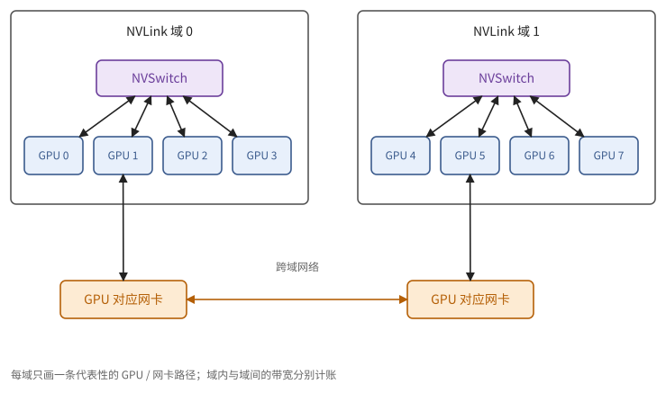
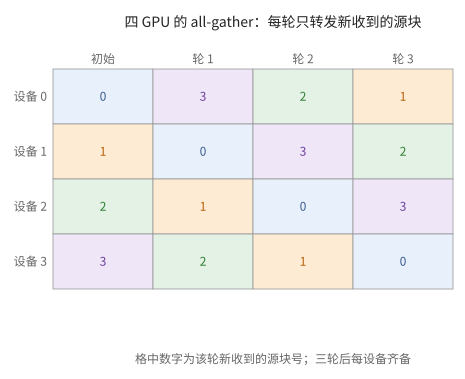
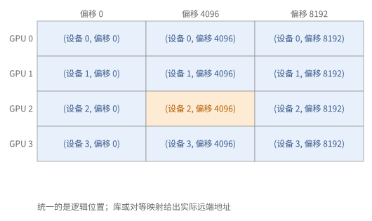
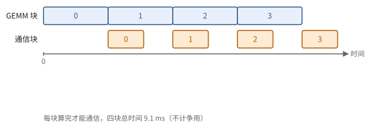
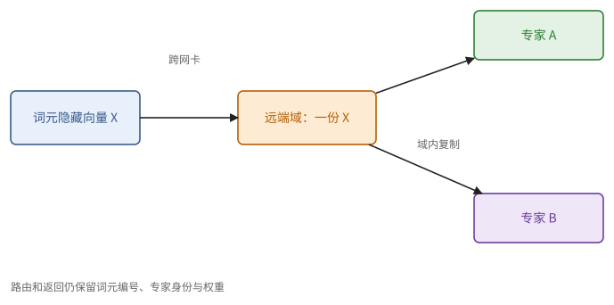

# 第 28 章　多 GPU 编程

第 7 章讲了集合通信的代数与代价，第 12 章讲了各种并行策略各需要哪些通信。这一章看这些通信在 GPU 系统上实际怎样做：大多数程序调用集合通信库，库按拓扑选算法；也可以让计算 kernel 直接读写别的 GPU 的显存，把通信揉进计算里。然后看两个最常见的场合，张量并行的通信怎样和矩阵乘法重叠，MoE 的全交换怎样少走网卡。最后是多 GPU 程序特有的几类错误。

## 28.1 NCCL 与拓扑

NVIDIA 的集合通信库 **NCCL** 实现了第 7 章的集合操作：all-reduce、all-gather、reduce-scatter、broadcast、reduce，以及点对点的发送与接收（用来组成 all-to-all）。它在初始化时探测拓扑，然后为每种集合操作和每种数据量选择算法：

- **环形**（命题 7.14）：带宽最优，适合大数据量；
- **树形**：步数为 $O(\log p)$，适合小数据量（命题 7.15 之后的讨论）；
- **交换机内归约**：较新的 NVSwitch 可以在交换芯片里直接做求和。每个 GPU 只要把数据发给交换机一次、从交换机收回结果一次，all-reduce 的带宽项约为 $n / \beta$，而环形算法约为 $2n / \beta$（习题 28.1）。

> **例 28.1（八 GPU 环的发送量）** 每个 GPU 有 64 MiB 数据要做环形 all-reduce，$p = 8$。每个 GPU 要发送约 $2(p-1)S/p = 2 \times 7 \times 64 / 8 = 112$ MiB。设有效的单向发送带宽为 100 GB/s，只算带宽项约 1.17 ms，再加上 $2(p-1)\alpha$ 的固定开销。
>
> 这里的 $\beta$ 是算法实际能用的单向发送带宽，不是厂商标的 NVLink 双向合计（例 22.13）。小消息不能忽略 $\alpha$；大消息还要看链路和 HBM 会不会互相争用。

**集合通信也要占用 SM。** NCCL 的集合操作是以 GPU kernel 的形式运行的：它要用若干个 SM 来搬数据、做归约，也要消耗显存带宽。所以"通信与计算重叠"在 GPU 上并不是免费的，通信 kernel 和计算 kernel 会争用 SM 和显存带宽（习题 28.6）。通常把通信放在单独的流里（23.8 节），并限制通信 kernel 使用的 SM 数。

**层次。** 一台服务器（或一个 NVLink 交换域）之内走 NVLink；跨服务器走网卡（通常每个 GPU 配一块），带宽低一个数量级。NCCL 把跨层次的集合操作拆成"域内—域间—域内"三步：例如 all-reduce 先在域内做 reduce-scatter，每个 GPU 手上只剩 $1/p_{\text{域内}}$ 的数据，再让各域之间对这一小份做 all-reduce，最后在域内做 all-gather。走慢速网卡的数据因此少了 $p_{\text{域内}}$ 倍，这正是命题 7.18 的思路用在分层的拓扑上。

**图 28.1**　域内的 GPU 经 NVLink/NVSwitch 相连，域间经网卡。一个集合操作可以分解到不同的层，每一层的带宽和固定开销各自计算。

**图 28.2**　按源块号追踪环形算法每一轮的数据；三轮之后每个设备收齐四块。

> **现状（2026-10）**：交换机内归约在 NVIDIA 的资料中称为 NVLink SHARP（NVLS）。NVL72 一类的系统把 72 颗 GPU 放进一个 NVLink 域，使张量并行与专家并行可以跨越更多的 GPU 而不经过网卡。

## 28.2 对称内存与设备端通信

集合通信库是一个独立的 kernel：计算 kernel 算完、写回显存，通信 kernel 再读出来发走。另一种做法是让计算 kernel 自己通信，这要靠 GPU 之间的直接访问。

在 NVLink 域内，一个 GPU 可以直接用普通的读写指令访问另一个 GPU 的显存，这叫对等访问。**对称内存**（symmetric memory）在此之上再约定一件事：每个 GPU 都在同样的偏移处分配同样大小的缓冲。于是"GPU $r$ 上的这个缓冲"可以统一地用（$r$，偏移）来指称，写程序时不必为每个 GPU 记一套地址。有了它：

- kernel 里的线程可以直接把数据**写进**对方的缓冲（推送），或从对方的缓冲**读出来**（拉取），也可以对对方的标志做原子操作；
- 跨越 NVLink 域时，NVSHMEM 一类的库提供单边的"放"（put）与"取"（get），经由网卡完成；
- 走直接对等访问的路径，可以用系统作用域的释放/获取标志来同步（命题 9.18 与 23.7 节）；走网络的单边操作，则要用库规定的次序、完成与信号接口，不能只靠普通的 CUDA 原子标志。

这样通信就可以**写进计算 kernel 里面**。例如 GEMM 的结尾直接把输出块写到负责它的那个 GPU 的缓冲里，等于把 reduce-scatter 融合进了 GEMM；或者 GEMM 载入操作数时直接从别的 GPU 拉取，等于把 all-gather 融合进了 GEMM。省掉了单独的通信 kernel 和中间缓冲，代价是正确性完全由程序员负责（28.5 节）。

> **例 28.2（逻辑偏移相同，不等于指针的数值相同）** 四个 GPU 各分配一个 1 MiB 的对称缓冲，逻辑上用（设备号，偏移）定位。设备 0 要写设备 2 的偏移 4096，应当通过受支持的远端地址解析或库接口得到目标地址，而不能以为"本地指针加上一个设备号"就是合法的远端指针。
>
> 直接对等访问的路径上，同步要求目标硬件支持系统作用域的原子操作；NVSHMEM 的放/取路径，则按库的 fence、quiet 与信号接口来规定完成和可见性。一个普通的 CUDA 原子标志，不能自动代替网络传输的完成语义。

**图 28.3**　对称内存统一的是设备号和逻辑偏移；真实的地址与跨域通信由受支持的映射或库接口提供。

## 28.3 张量并行中的通信重叠

张量并行中，MLP 的第二个矩阵乘法得到的是部分和，要做一次 all-reduce（在序列并行中是 reduce-scatter，12.4 节）。直接的做法是先把整个 GEMM 算完再通信，两者串行，通信的时间全部露在外面。

**分块重叠。** 把 GEMM 的输出沿行切成 $c$ 块：算完第 $i$ 块，就发起它的 reduce-scatter，同时去算第 $i + 1$ 块。由命题 7.19，若每块的计算时间不少于每块的通信时间，通信几乎全被藏住，只剩最后一块的通信露在外面。前面的 all-gather 同理：每收到一块激活就开始用它计算。

块该切多细？切得太粗，首尾露在外面的部分大；切得太细，每次通信很小，固定开销显著（命题 4.19）。把这两项写成一个式子：

> **命题 28.3（分块重叠的时间）** 设 GEMM 共需 $t_m$，通信共需 $t_c$，切成 $c$ 块，每块通信有固定开销 $\alpha$，重叠时计算与通信互不干扰。总时间约为
>
> $$
> \max\!\left(t_m + \frac{t_c}{c} + \alpha,\ \ t_c + c\alpha + \frac{t_m}{c}\right).
> $$

*证明* 这是两级流水线（命题 9.10），每块的计算为 $t_m / c$，每块的通信为 $t_c / c + \alpha$。若计算较慢，时间是全部计算加上最后一块的通信；若通信较慢，时间是全部通信加上第一块的计算。∎

> **例 28.4（分四块和分三十二块）** $t_m = 8$ ms，$t_c = 4$ ms，每块的固定开销 $\alpha = 0.1$ ms。$c = 4$ 时，命题 28.3 给出 $\max(8 + 1 + 0.1,\ 4 + 0.4 + 2) = 9.1$ ms；$c = 32$ 时为 $\max(8 + 0.125 + 0.1,\ 4 + 3.2 + 0.25) = 8.225$ ms；$c = 128$ 时约为 16.86 ms，反而比不重叠（$c = 1$，约 12.1 ms）还慢。
>
> 起初，切得越细，露在外面的尾巴越短；到后来，固定开销占了上风。若通信 kernel 还要和 GEMM 争 SM，$t_m$ 本身也会变大，最佳的 $c$ 要按实际的资源模型重新算。

**图 28.4**　计算产出一块，通信就可以消费这一块；首尾仍然露在外面，固定开销随块数累积。图中是带事件依赖的两级流水线。

实际中还有一个代价：通信与计算同时进行时，会争用 SM 和显存带宽（28.1 节），所以重叠后的总时间往往大于两者中较大的那个。用对称内存把通信融合进 GEMM 的结尾，可以免去单独的通信 kernel 对 SM 的占用。

## 28.4 MoE 的全交换

专家并行中，每个 MoE 层要做两次全交换（12.7 节）：**分发**，把每个词元送到持有它所选专家的 GPU；**合并**，把专家的输出送回来。每次全交换分两步：

1. **先交换计数**：每个 GPU 告诉其他每个 GPU 它要发来多少个词元，接收方据此在接收缓冲里划好位置；
2. **再交换数据**：按计数发送词元的隐藏向量（以及路由权重）。

在 NVLink 域内，可以用对称内存直接写进对方的接收缓冲。跨越域时，直接的做法是每个词元经网卡发往每一个目标 GPU；**分层**的做法是先经网卡发到目标服务器上与自己编号相同的那颗 GPU，再由它在服务器内经 NVLink 转发给真正的目标。如果一个词元选中的几个专家在同一台服务器上，分层的做法只需跨网卡发一次（习题 28.3）。

> **例 28.5（两个专家在同一台远端服务器上）** 一个词元选择的两个专家都在同一台远端服务器上。直接逐个专家跨网卡发送，隐藏向量要发两份；分层转发则先跨网卡发一份，再在远端的 NVLink 域内复制给两个专家。
>
> 省下的是跨域的隐藏向量，不是专家的计算，也不是全部的返回数据。返回时要按原来的词元编号、专家编号和路由权重合并，所以这些身份信息要一路带着。

**图 28.5**　同一个词元的两个目标专家位于同一远端域时，跨域只发一份隐藏向量，再用域内链路复制；返回合并时仍保留各专家的贡献。

decode 时，每一步的词元很少，全交换的数据量小，时间主要花在固定开销和同步上（与 12.8 节张量并行的情形相同）。

> **现状（2026-10）**：开源的专家并行通信库（例如 DeepSeek 的 DeepEP）提供两类 kernel：高吞吐的版本用于训练与 prefill，采用上述分层转发；低延迟的版本用于 decode，直接用 RDMA 写入，尽量减少同步与 SM 的占用，并能与计算重叠。DeepSeek-V4（2026）更进一步，把一个 MoE 层的分发、两次专家矩阵乘法和回收融合进一个 kernel（开源为 DeepGEMM 中的 MegaMoE）：专家被分成若干"波"，一波的词元一到齐就开始计算，于是稳态中同时进行着三件事：本波的计算、下一波词元的接收、已算完的专家结果的发送。他们报告这比不融合的实现快 1.5–1.73 倍，在强化学习采样这类批量小、尾巴长的场合最多快 1.96 倍。分发用的是"拉"的方式：每个 GPU 从远端读自己需要的词元，因为细粒度的"推"要频繁通知对方，延迟太高。命题 12.16 给出了这种融合能把通信完全藏住的条件。

## 28.5 正确性

多 GPU 程序除了单 GPU 上的那些错误，还有几类自己特有的：

- **集合操作的次序**：所有参与者必须以**同样的次序**调用同样的集合操作。如果某个 GPU 因为依赖数据的分支跳过了一次 all-reduce，或者两个 GPU 以不同的次序调用两个集合操作，就会死锁，或者把不相干的数据加在一起。
- **作用域**：GPU 之间的标志和数据要用系统作用域的释放与获取（23.7 节）；块作用域或设备作用域的同步，不保证对其他 GPU 可见。
- **同时驻留**：一个线程块在等另一个 GPU 上的信号时，那个 GPU 上相应的 kernel 必须已经启动并在运行（注 23.11 的跨 GPU 版本）。
- **缓冲的复用**：推送式的通信中，发送方往对方的缓冲里写之前，必须确认对方已经用完了上一轮的数据（命题 9.5），这要靠对方回送的信号（7.9 节的"信用"）。

第一条最容易被忽视，因为它在单 GPU 上根本不存在。

> **例 28.6（形状相同，次序也不能换）** 设备 0 先对 A 做 all-reduce、再对 B 做；设备 1 先 B 后 A。即使 A、B 的形状和类型完全相同，库也可能把不相干的贡献配在一起，或者因为依赖不同而卡住。一次集合操作的身份，至少包括参与的子组、序号、操作、形状和类型。
>
> 多流的程序尤其要把调用次序和事件依赖写清楚。某个设备没有有效数据时，应当贡献规定的单位元，而不是跳过这次调用。复用接收缓冲还需要上一轮的消费确认：网络传完了，不等于消费者用完了。

## 本章小结

1. NCCL 按拓扑与数据量选择环形、树形或交换机内归约；交换机内归约使 all-reduce 的带宽项减半。集合通信以 kernel 的形式运行，占用 SM 与显存带宽。跨层次的集合操作分解为域内与域间的组合，慢速网卡上的数据量随之减少。（28.1 节、例 28.1）
2. 对称内存让 kernel 直接读写其他 GPU 的缓冲；跨域时用单边的放与取；直接访问用系统作用域的释放/获取标志同步，网络路径用库规定的完成接口；通信可以融合进计算 kernel。（28.2 节、例 28.2）
3. 张量并行的通信分块与 GEMM 重叠，总时间见命题 28.3；块数在露出的通信与累积的固定开销之间权衡；还要计入 SM 的争用。（命题 28.3、例 28.4）
4. MoE 的全交换先交换计数再交换数据；跨域时分层转发减少网卡流量；decode 时受固定开销限制。（28.4 节、例 28.5）
5. 正确性：集合操作的次序一致、系统作用域的同步、同时驻留、缓冲复用前的信用。（28.5 节、例 28.6）

## 习题

**习题 28.1** ★ 8 颗 GPU 在一个 NVLink 交换域中，每颗 GPU 的单向带宽 450 GB/s。对每颗 GPU 上的 1 GB 做 all-reduce。(a) 用环形算法（只计带宽项）需要多少时间？(b) 用交换机内归约呢？

提示 1

环的每 GPU 发送量和双向同时收发分开；交换机归约还要求硬件与算法支持。

提示 2

环形：$2 \frac{p-1}{p} \frac{n}{\beta}$；交换机内归约：每个 GPU 发出 $n$、收回 $n$，可以同时进行。

答案

(a) $2 \times \frac{7}{8} \times 10^9 / 4.5 \times 10^{11} \approx 3.9$ ms。(b) 约 $10^9 / 4.5 \times 10^{11} \approx 2.2$ ms（发送与接收同时进行）。

**习题 28.2** ★ 张量并行中，一个 GEMM 需要 2 ms，它的 reduce-scatter 需要 1.5 ms，每次通信的固定开销 $\alpha = 20$ µs。按命题 28.3，切成 $c = 1, 4, 16, 64$ 块时总时间各是多少？哪个最好？

提示 1

每块通信含载荷项加固定项，块数越多尾部越小而固定项越大。

提示 2

两个表达式取最大值。

答案

$c = 1$：$\max(2 + 1.5 + 0.02, 1.5 + 0.02 + 2) = 3.52$ ms（不重叠）。$c = 4$：$\max(2 + 0.375 + 0.02, 1.5 + 0.08 + 0.5) = 2.40$ ms。$c = 16$：$\max(2 + 0.094 + 0.02, 1.5 + 0.32 + 0.125) = 2.11$ ms。$c = 64$：$\max(2 + 0.023 + 0.02, 1.5 + 1.28 + 0.031) = 2.81$ ms。$c = 16$ 附近最好，比不重叠快约 40%。（实际中还要计入 SM 的争用。）

**习题 28.3** ★ 16 台服务器、每台 8 颗 GPU，共 128 个专家，每颗 GPU 一个专家。每个词元选 8 个专家，设选择是均匀随机的。(a) 一个词元平均有几个选中的专家在本服务器之外？(b) 直接发送时每个词元平均跨网卡发送几次？(c) 分层发送（每个目标服务器只发一次）时呢？

提示 1

专家选择若不放回，应使用不放回的空服务器概率；独立抽样只是近似。

提示 2

(c) 8 个专家落在 15 台外部服务器上，求被选中的不同外部服务器个数的期望。

答案

(a) 每个专家在外部的概率为 $120/128$，期望 $8 \times 120/128 = 7.5$ 个。(b) 约 7.5 次。(c) 某台外部服务器至少被选中一次的概率约为 $1 - (1 - 8/128)^8 \approx 1 - 0.597 = 0.403$（近似为有放回），15 台的期望约 6.0 次。节省约 20%；若路由时限制每个词元只选少数几台服务器上的专家，节省会大得多。

**习题 28.4** ★（审查题）一个训练程序中，只有在梯度出现非有限值的 GPU 上才执行一次额外的 all-reduce 来"同步错误标志"，其余 GPU 跳过。会发生什么？怎样修改？

提示 1

collective 的调用身份必须对所有参与者一致，局部错误标志只是贡献值。

提示 2

28.5 节第一条。

答案

出现非有限值的 GPU 调用了一次额外的 all-reduce，其余 GPU 没有调用，它会一直等待（死锁），或者与其他 GPU 的下一次集合操作错配，把不相干的数据加在一起。修改：所有 GPU 每一步都无条件地对错误标志做一次 all-reduce（例如对一个 0/1 的标量求最大值），再统一决定是否跳过这一步。

**习题 28.5** ★（审查题）一个融合了通信的 kernel 中，GPU 0 的线程把数据写入 GPU 1 的对称缓冲，然后执行 `flag[1] = 1`（普通写入 GPU 1 的标志）。GPU 1 的线程循环读取自己的标志，见到 1 后读取缓冲。指出问题。

提示 1

先区分直接对等写入还是库传输，再按相应接口证明完成、可见性与信用。

提示 2

命题 9.18 与 23.7 节；作用域。

答案

标志用普通写入，没有释放语义；GPU 1 也是普通读取，没有获取语义。GPU 1 可能看到标志已为 1，却读到缓冲中的旧数据（GPU 0 的写还没有对 GPU 1 可见）；编译器还可能把循环中的读取提到循环外。修改：GPU 0 以系统作用域的释放语义写标志（或先执行系统作用域的栅栏），GPU 1 以系统作用域的获取语义读标志。还要确认 GPU 1 的缓冲在 GPU 0 写入之前已经空出来（28.5 节最后一条）。

**习题 28.6** ☆ 一个 GEMM 在 132 个 SM 上需要 2 ms。让它与一个使用 16 个 SM 的 NCCL 通信 kernel 同时运行。若 GEMM 计算受限、时间与可用的 SM 数成反比，它变成多少？若通信本身需要 1.5 ms，重叠后的总时间与不重叠相比如何？

提示 1

重叠会减少计算可用 SM；先把计算时间按新资源量放大。

提示 2

GEMM 只能用 116 个 SM。

答案

GEMM 约 $2 \times 132 / 116 \approx 2.28$ ms。重叠时总时间约为 $\max(2.28, 1.5) = 2.28$ ms（若通信的显存带宽占用不再拖慢 GEMM），不重叠时为 3.5 ms。重叠仍然划算，但收益比"通信完全免费"的估计少约 0.28 ms。

**习题 28.7** ★（综合审查题）设备 0、1 用对等推送重复发送到同一槽。生产者已经确认本次发送完成，但消费者仍在计算这份数据。能立即发送下一份吗？写出最小的双向握手，并说明换 NVSHMEM 路径还应核对什么。

提示 1

发送完成授权源复用，不授权覆盖目的消费者仍在读的数据。

提示 2

正向满信号保护读入，反向空信号保护下一次覆盖；每轮有身份。

答案

不能立即覆盖。生产者等本轮信用，写数据并以该路径规定的释放/完成机制发布满；消费者以获取/库等待确认本轮满，处理数据，所有读者结束后回送空信用；生产者观察空才开始下一轮。NVSHMEM 路径还需按库规定建立 put 的次序与交付完成，以及信号可见性，不能用普通对等原子推断网络完成。

