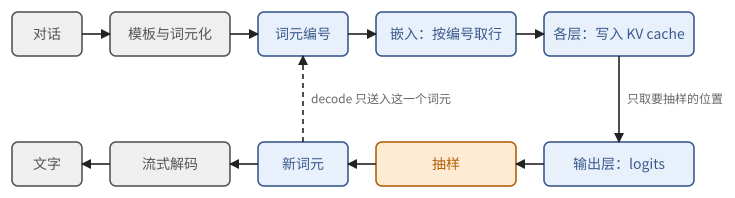

# 第 29 章　模型是什么：权重、词元与采样

第 11 章把 Transformer 写成了一串矩阵乘法，数出了每个词元的运算量和每层的 KV 字节数。可是有几件事那里一笔带过了：从网上下载一个模型，拿到的究竟是什么？一段中文是怎样变成矩阵 $X$ 的一行的？最后一层算出的向量，又是怎样变成屏幕上的下一个字的？

这一章把这条路从头到尾走一遍。我们打开一个真实的模型，DeepSeek 在 2026 年 10 月公开的 DeepSeek-V4.1-Flash，看它的文件里装着什么；然后讲文本怎样切成词元，位置怎样告诉模型，输出怎样变成一个随机抽出的词元，以及怎样让这个"随机"可以重放。推理服务每天处理的就是这些东西，后面四章讲推理系统时会反复用到。

从这一章起是第六部分。它是 TPU 与 GPU 两条路线的汇合处：正文只用到第一、二部分的结论，偶尔提到某条路线上的具体 kernel，都写成可以跳过的注。本章用到第 2 章的数值格式与块缩放（2.6、2.8 节），第 8 章的行优先布局（定义 8.2），第 10 章的扫描与批不变（10.5、10.6 节），以及第 11 章的记号。

## 29.1 一个模型由哪些文件组成

先看实物。在 Hugging Face 上打开 DeepSeek-V4.1-Flash 的仓库，能看到这样几类文件：

- `config.json`：几十个超参数，比如 `hidden_size: 5120`、`num_hidden_layers: 40`、`vocab_size: 129280`、`n_routed_experts: 384`、`num_experts_per_tok: 6`。第 11 章公式里的 $D$、$n_L$、$V$、$E$、$k$，都从这里读出。
- `model-00001-of-00048.safetensors` 到 `model-00048-of-00048.safetensors`：48 个权重文件，合计 510,286,023,000 字节，约 510 GB，装着 96,085 个张量。另有一个索引文件，记录每个张量在哪个文件里。
- `tokenizer.json` 等：词表和切词规则（29.2 节）。
- 一份把对话编码成提示的参考代码，以及一份几百行的参考推理代码。

所以一个"模型"由三样东西组成：一组带名字的数组（权重），一段规定怎样用这些数组计算的程序（结构，由 `config.json` 和代码共同确定），以及文本与整数之间的转换规则（词表）。权重是其中最大的部分，我们先看它怎样存放。

**safetensors 文件的格式。** 这种格式非常简单：文件开头 8 个字节是一个小端序的无符号整数 $h$；接下来 $h$ 个字节是一段 JSON 文本，称为文件头；再往后全是张量的原始字节，一个接一个。文件头为每个张量记下三件事：数据类型、形状，以及它的字节在数据区里的起止偏移。第 2 个权重文件的文件头只有 344 字节，其中一项是

```text
"embed.weight": {"dtype": "BF16", "shape": [129280, 5120], "data_offsets": [0, 1323827200]}
```

核对一下：$129280 \times 5120 \times 2 = 1{,}323{,}827{,}200$ 字节，正好是一个 bf16 的 $V \times D$ 矩阵。数组按行优先（定义 8.2）存放，所以第 $i$ 行（第 $i$ 个词元的嵌入向量）从数据区的偏移 $i \cdot 5120 \cdot 2$ 处开始，连续 10240 字节。


**图 29.1**　safetensors 文件：8 字节的文件头长度，JSON 文件头，然后是各张量按行优先排列的字节。偏移相对于数据区的起点。

> **定义 29.1（检查点）** 一个**检查点**（checkpoint）是从名字到张量的映射。每个张量由数据类型、形状和一段字节组成，字节按行优先排列。推理程序按名字把张量放到计算中的固定位置，名字与位置的对应关系由模型的代码规定。

**量化的张量。** 再看第 3 个文件里第 0 层的几个张量：

| 名字 | 数据类型 | 形状 |
| --- | --- | --- |
| `layers.0.attn.wkv.weight` | F8_E4M3 | $[512, 5120]$ |
| `layers.0.attn.wkv.scale` | F8_E8M0 | $[16, 160]$ |
| `layers.0.ffn.experts.0.w1.weight` | I8 | $[2304, 2560]$ |
| `layers.0.ffn.experts.0.w1.scale` | F8_E8M0 | $[2304, 160]$ |

第一对是一个 fp8 矩阵和它的缩放因子。$512 / 16 = 32$，$5120 / 160 = 32$：每个 $32 \times 32$ 的块共用一个 E8M0 因子，这是第 2 章块缩放（定义 2.28）的二维版本。第二对更有意思：`config.json` 说专家的中间维是 2304、隐藏维是 5120，可文件里的形状是 $[2304, 2560]$，类型还是 8 位整数。原因是这些专家权重用的是 fp4 E2M1，每个字节打包两个 4 位数（8.4 节的打包），文件格式没有 4 位类型，只好记成 I8；缩放因子 $[2304, 160]$ 说明每行每 32 个元素一个 E8M0 因子，正是 MXFP4（2.8 节的表）。文件里的数据类型只说明怎样存，说明不了怎样解释；解释要看 `config.json` 里的 `expert_dtype: fp4` 和代码。

> **命题 29.2（量化权重的字节数）** 一个有 $n$ 个元素的张量，元素占 $b$ 位，每 $g$ 个元素共用一个 $c$ 字节的缩放因子，则它占
>
> $$
> n\left(\frac{b}{8} + \frac{c}{g}\right) \ \text{字节}.
> $$

*证明* 元素部分 $nb/8$ 字节，因子共 $n/g$ 个。∎

MXFP4 每个元素 $0.5 + 1/32 = 0.53125$ 字节；$32 \times 32$ 块的 fp8 每个元素 $1 + 1/1024$ 字节，因子几乎可以忽略。

> **例 29.3（510 GB 从哪里来）** 从 `config.json` 估算这个检查点的大小。路由专家：40 层，每层 384 个，每个是三个 $2304 \times 5120$ 的矩阵（门控 MLP），共
>
> $$
> 40 \times 384 \times 3 \times 2304 \times 5120 \approx 5.44 \times 10^{11}
> $$
>
> 个参数，按 MXFP4 约 289 GB。技术报告说模型另有 1960 亿个 Engram 参数（一种按哈希查表的记忆模块，存成 fp8），约 196 GB。两项之和约 485 GB，剩下约 25 GB 是注意力的投影、共享专家、词嵌入与输出层、视觉编码器和草稿模块，它们大多是 fp8 或 bf16。
>
> 每个词元在 decode 时实际用到的参数要少得多。一层的注意力投影约 $1.27 \times 10^8$ 个参数，共享专家与 6 个路由专家共 $7 \times 3.54 \times 10^7 \approx 2.48 \times 10^8$ 个，每层约 $3.75 \times 10^8$，40 层约 150 亿，加上输出层，与报告的"decode 时每词元激活 160 亿参数"一致。存储按 5100 亿字节算，运算按 160 亿参数算，这是第 11 章混合专家模型的情形（11.9 节）推到了极端。

**载入。** 推理开始前，权重要从磁盘搬进加速器的 HBM。510 GB 放不进一块加速器，所以每块设备只读自己负责的那部分（第 12 章的分片）：例如 64 块设备做专家并行时，每块只读 6 个左右路由专家的权重。文件头给出了每个张量的字节区间，读一个张量只需读那一段，不必读整个文件。

> **命题 29.4（按行切和按列切）** 一个按行优先存放的 $m \times n$ 矩阵，若每块设备取连续的 $m/p$ 行，则每块设备读一段连续的字节；若每块设备取连续的 $n/p$ 列，则要读 $m$ 段互不相连的字节，每段 $ns/p$ 字节。

*证明* 由定义 8.2，第 $i$ 行占偏移 $[ins, (i+1)ns)$，连续的若干行占一段连续区间；一列中相邻两个元素相隔 $ns$ 字节。∎

PyTorch 习惯把线性层的权重存成 [输出维, 输入维]。所以沿输出维切分（张量并行的列切分，12.4 节）恰好是按存储的行切，一次连续读；沿输入维切分（行切分）是按存储的列切，变成许多小段。小段多了，命题 4.19 的固定开销就会显出来。

## 29.2 词元

模型只认整数。文本到整数的第一步是 UTF-8 编码：每个字符变成 1 到 4 个字节，英文字母 1 个，常用汉字 3 个。例如"世"是 `E4 B8 96`，"界"是 `E7 95 8C`。

如果直接把字节当成词元，序列太长：一段 1000 字的中文就是 3000 个词元，第 11 章的每一项代价都随之翻三倍。如果反过来把每个词当成词元，词表又会无穷大。今天几乎所有的模型都用介于二者之间的**字节对编码**（byte-pair encoding，BPE）：从单个字节出发，把训练语料里经常相邻出现的一对词元合并成一个新词元，反复合并，直到词表达到预定的大小。

> **定义 29.5（字节级 BPE）** 一个字节级 BPE 编码器由一张有序的**合并表** $m_1, m_2, \dots, m_R$ 给出，每一项 $m_r = (a_r, b_r)$ 是两个已有词元。词表由 256 个单字节词元和每次合并产生的新词元 $a_r b_r$（两段字节串首尾相接）组成，再加上若干特殊词元。编码一段字节串时，从单个字节的序列出发，反复做：在当前序列的所有相邻对中，找出在合并表里排名最靠前的那一对，把它在序列中的每次出现（从左到右，不重叠）合并成一个词元；直到没有相邻对出现在合并表里为止。**解码**把各个词元的字节串依次拼起来。

实际的编码器在合并之前还有一步**预切分**：先用一个正则表达式把文本切成单词、数字、空白、标点这样的小段，合并只在每段内部进行，所以一个词元不会跨越两个单词。

> **例 29.6（手算一次编码）** 设合并表依次是：(1) l + o → lo；(2) e + s → es；(3) lo + w → low；(4) es + t → est；(5) low + est → lowest；(6) e + r → er。
>
> 编码 `lowest`：初始 `l o w e s t`。相邻对里排名最前的是 (1)，得 `lo w e s t`；再是 (2)，得 `lo w es t`；(3) 得 `low es t`；(4) 得 `low est`；(5) 得 `lowest`。一个词元。
>
> 编码 `lower`：`l o w e r` → (1) `lo w e r` → (3) `low e r` → (6) `low er`。此时相邻对只有 (low, er)，不在表里，停止。两个词元。
>
> 编码 `slow`：`s l o w` → (1) `s lo w` → (3) `s low`。(s, low) 不在表里，两个词元：一个单字节词元 `s` 和 `low`。合并表里没有的字节组合，总能退回到单个字节，所以任何字节串都能编码。

真实的词表有十几万项。DeepSeek-V4.1-Flash 的 $V = 129280$，嵌入矩阵和输出层（各 $V \times D$）因此各有约 6.6 亿个参数。

> **命题 29.7（解码是编码的左逆，反过来不成立）** 对任意字节串 $x$，$\operatorname{decode}(\operatorname{encode}(x)) = x$。但不同的词元序列可以解码成同一个字节串，而编码器对每个字节串只给出其中一种。

*证明* 每次合并把相邻两段字节串换成它们的拼接，序列中所有词元依次拼起来的结果不变；初始序列拼起来就是 $x$。第二句：例 29.6 中 `low er` 与 `l o w e r` 都解码成 `lower`，编码器只给出前者。∎

第二句话在服务里有实际后果。模型生成时一个一个地吐出词元，吐出的序列不一定是编码器会给的那一种：它可能先生成 `low`，再生成 `er`。若下一轮对话把上一轮回答的**文本**重新编码，而编码器把 `lower` 编成了别的切法，那么新提示的词元序列就和上一轮实际算过的不一样了：模型看到的是一种它在训练中几乎没见过的切法，上一轮已经算好的中间结果也对不上了。稳妥的做法是保留上一轮实际生成的词元编号，而不是保留文本再重新编码。

**字符被切开。** 字节级 BPE 只看字节，不管字符的边界，所以一个汉字的 3 个字节可能分在两个词元里。流式输出时，服务每收到一个词元就想把新的文字发给用户，这时要小心。

UTF-8 的规则是：一个字符的首字节以 `0`、`110`、`1110` 或 `11110` 开头，分别表示这个字符共 1、2、3、4 个字节；其余字节以 `10` 开头。

> **命题 29.8（流式解码要扣下的字节）** 设已经收到的字节串是 $y$。从 $y$ 的末尾往前看至多 3 个字节，找到最后一个首字节；若它声明的长度超过它到末尾的字节数，就扣下从它开始的这几个字节，其余部分一定是完整的字符，可以立即输出。这样做，每个字符在它的最后一个字节到达时就输出，并且从不输出半个字符。

*证明* UTF-8 的字符边界只由首字节决定，一个字符至多 4 个字节，所以不完整的字符只可能是末尾的那一个，且它的首字节在末尾 3 个字节之内（若首字节更靠前，它声明的字节已经全部到达）。扣下的正好是这个不完整的字符。∎

> **例 29.9** 生成"世界"时，设第一个词元解码出 `E4 B8`，第二个解码出 `96 E7 95 8C`。收到第一个词元后，末尾的首字节 `E4` 声明 3 个字节，只到了 2 个，全部扣下，什么也不输出；收到第二个词元后，字节串是 `E4 B8 96 E7 95 8C`，两个字符都完整，输出"世界"。

**特殊词元与对话模板。** 一次对话不是一段文本，而是有结构的：系统提示、用户的话、模型的回答、工具调用和工具的结果。服务按模型规定的**对话模板**（chat template）把它们排成一个词元序列，在各段之间插入专门的**特殊词元**（special token），例如 DeepSeek 的 `<｜User｜>`、`<｜Assistant｜>` 和表示思考结束的 `</think>`。特殊词元在词表里有自己的编号，模型在训练中学会了它们表示结构。

这带来一个安全问题。用户可以在输入里直接打出 `<｜User｜>` 这几个字符。如果编码器把这段文字当成特殊词元的名字，换成那个特殊编号，用户就能伪造对话结构，例如冒充系统提示。正确的做法是：只有模板插入的位置才使用特殊编号，用户文本、工具结果里的同样字符一律按普通字节编码。输出一侧同理：服务按**编号**识别 `</think>` 和工具调用的标记，模型用普通词元拼出的同样文字只是文字。

> **注 29.10（分段并行编码）** 模板插入特殊词元的位置事先已知，而预切分不会跨过特殊词元，所以两个特殊词元之间的每段普通文本可以独立编码，再按原来的次序拼接：
>
> $$
> \operatorname{encode}(s_1 \cdot \langle\text{sp}\rangle \cdot s_2) = \operatorname{encode}(s_1) \cdot [\text{id}(\text{sp})] \cdot \operatorname{encode}(s_2).
> $$
>
> 几十万词元的长提示就可以分段并行地编码。DeepSeek 随 DeepInfer 开源的 deepseek-recipe 就是这样做的，它同时保证了上面说的防注入：特殊编号只来自模板，不来自文本。

## 29.3 嵌入与位置

词元编号进入模型的第一步是查表：编号 $i$ 取出嵌入矩阵 $W_E \in \mathbb{R}^{V \times D}$ 的第 $i$ 行。一次 prefill 处理 $N$ 个词元，就是从一个大矩阵里按编号取 $N$ 行，没有算术，只读 $NDs$ 字节。DeepSeek-V4.1-Flash 的一行是 10 KB，整张表 1.3 GB。

**图像。** 多模态模型把图像也变成"词元"。图像先切成 $14 \times 14$ 像素的小块（patch），视觉编码器（一个较小的 Transformer）为每个小块算出一个向量，再按 $3 \times 3$ 把相邻的小块并成一个，投影到 $D$ 维。提示里每张图占一串占位词元，模型的第一层之前，把这些位置的嵌入换成视觉编码器的输出。

> **例 29.11（一张图占多少个位置）** 一张 $1344 \times 1344$ 的图：$1344 / 14 = 96$，切成 $96 \times 96 = 9216$ 个小块；$3 \times 3$ 合并后剩 $32 \times 32 = 1024$ 个向量。与 `config.json` 里的 `max_image_tokens: 1024` 相符。这 1024 个位置在之后的计算中和文本词元没有区别：每个都占一份 KV cache，都要经过每一层。

**位置。** 第 11 章的注意力有一个看起来奇怪的性质：它不知道词元的先后次序。

> **命题 29.12（没有位置信息的注意力只看集合）** 设注意力的查询为 $q$，键值对为 $(k_j, v_j)_{j \in S}$，输出 $o = \sum_j \operatorname{softmax}_j(q \cdot k_j)\, v_j$。把这些键值对按任意置换重新排列，$o$ 不变。

*证明* softmax 的分母和加权和都是对 $j$ 的求和，求和与次序无关。∎

所以"狗咬人"和"人咬狗"若只靠词元本身，在注意力看来是同一组东西。必须把位置告诉模型。今天最常用的办法是**旋转位置编码**（rotary position embedding，RoPE）：按位置把查询和键旋转一个角度。

用复数写旋转最方便，先回忆几件事。复数 $z = a + \mathrm{i} b$ 可以看成平面上的点 $(a, b)$。$e^{\mathrm{i}\varphi} = \cos\varphi + \mathrm{i}\sin\varphi$ 是单位圆上角度为 $\varphi$ 的点（欧拉公式）。乘以 $e^{\mathrm{i}\varphi}$ 就是绕原点转过角度 $\varphi$：

$$
(a + \mathrm{i} b)(\cos\varphi + \mathrm{i}\sin\varphi) = (a\cos\varphi - b\sin\varphi) + \mathrm{i}\,(a\sin\varphi + b\cos\varphi),
$$

正是旋转矩阵 $\begin{pmatrix}\cos\varphi & -\sin\varphi \\ \sin\varphi & \cos\varphi\end{pmatrix}$ 乘以 $(a, b)$。例如 $1 \cdot e^{\mathrm{i}\pi/2} = \mathrm{i}$：点 $(1, 0)$ 转了 90° 到 $(0, 1)$。**共轭** $\bar z = a - \mathrm{i} b$ 把点关于横轴翻过去；两个复数 $z = a + \mathrm{i} b$、$w = c + \mathrm{i} d$ 当作平面向量时的内积 $ac + bd$ 等于 $\operatorname{Re}(z \bar w)$，因为 $z \bar w = (ac + bd) + \mathrm{i}(bc - ad)$。

> **定义 29.13（RoPE）** 设 $d$ 为偶数，频率 $\theta_i = b^{-2i/d}$（$i \in [d/2]$，底数 $b$ 通常取 10000）。把向量 $x \in \mathbb{R}^d$ 的分量两两配对，看成 $d/2$ 个复数 $z_i = x_{2i} + \mathrm{i}\, x_{2i+1}$。位置 $t$ 的旋转 $R_t x$ 把每个 $z_i$ 换成 $z_i e^{\mathrm{i} t \theta_i}$。位置 $t$ 的查询用 $R_t q_t$，位置 $t'$ 的键用 $R_{t'} k_{t'}$。

每一对分量在平面上转过角度 $t\theta_i$。$\theta_0 = 1$ 转得最快，每个位置转 1 弧度；$\theta_{d/2-1} \approx 1/b$ 转得最慢，转一圈要约 $2\pi b \approx 6.3$ 万个位置。快的分量分辨相邻的位置，慢的分量分辨远近。

> **定理 29.14（RoPE 只留下相对位置）** 对任意 $q, k \in \mathbb{R}^d$ 和位置 $m, n$，
>
> $$
> \langle R_m q, R_n k \rangle = \operatorname{Re} \sum_{i} z_i \overline{w_i}\, e^{\mathrm{i}(m - n)\theta_i},
> $$
>
> 其中 $z_i, w_i$ 分别是 $q, k$ 配对后的复数。它只依赖于 $m - n$。

*证明* 对两个复数 $a, c$，把它们看成平面向量时的内积是 $\operatorname{Re}(a \bar c)$。所以 $\langle R_m q, R_n k \rangle = \sum_i \operatorname{Re}\big(z_i e^{\mathrm{i} m\theta_i}\, \overline{w_i e^{\mathrm{i} n\theta_i}}\big) = \operatorname{Re} \sum_i z_i \overline{w_i} e^{\mathrm{i}(m-n)\theta_i}$。∎

例如 $d = 2$、$\theta_0 = 1$、$q = k = (1, 0)$：位置 3 的查询对位置 1 的键，分数是 $\cos 2$；位置 10 的查询对位置 8 的键，分数还是 $\cos 2$。分数只关心两个词元相隔多远。

RoPE 对推理系统有三个直接的后果：

1. **位置是每个词元的一项输入。** 每次前向都要随词元编号一起送进位置编号：一次 decode 送的是序列当前的长度，分段 prefill 的第二段送的是从第一段末尾接着数的位置。位置送错，模型不会报错，只会悄悄地算出错的结果（习题 29.7）。
2. **缓存的是旋转之后的键。** KV cache 里位置 $t$ 的键是 $R_t k_t$。由于因果掩码，位置 $t$ 的键值只依赖于位置 $0$ 到 $t$ 的词元，所以两个序列只要开头的词元完全相同，这一段的缓存就完全相同，可以直接复用；同一段文字出现在别的位置，旋转角不同，前面的内容也不同，缓存不能复用。
3. **它是逐元素的运算。** 每个分量乘一个复数，运算量和数据量都是 $O(d)$，应当与相邻的投影或注意力 kernel 融合（命题 6.9）。

> **现状（2026-10）**：用 $b = 10000$ 在较短的序列上训练的模型，直接用在更长的序列上效果会变差，因为最慢的那几个分量在训练中从没转到过那么大的角度。常用的补救是按频率分段重新缩放 $\theta_i$（YaRN 等方法）。DeepSeek-V4.1-Flash 的 `config.json` 写明原始长度 65536、YaRN 因子 16、最大位置 1,048,576；技术报告说预训练先在 64K 的长度上进行，到第 34 万亿个词元时扩展到 1M。

## 29.4 从最后的隐藏状态到下一个词元

经过最后一层之后，每个位置有一个 $D$ 维向量 $h$。再做一次 RMSNorm，乘以输出矩阵 $W_U \in \mathbb{R}^{D \times V}$，得到 $V$ 个实数 $\ell = h W_U$，称为 **logits**（未归一化的对数概率）。下一个词元的分布是 $\operatorname{softmax}(\ell)$。

只有要抽样的位置才需要 logits。prefill 处理 $T$ 个词元的提示，只需要最后一个位置的 logits；中间各位置的输出只是为了写入 KV cache。

> **例 29.15（别给每个位置都算 logits）** $T = 10000$、$D = 5120$、$V = 129280$。给所有位置算 logits 要 $2TDV \approx 1.3 \times 10^{13}$ FLOP，还要写出 $T \times V$ 个 f32，约 5.2 GB；只算最后一个位置要 $2DV \approx 1.3 \times 10^9$ FLOP，写出 517 KB。所以推理程序在输出层之前，先按一张下标表取出要抽样的那几行。训练时则相反，每个位置都要算损失。

**温度与截断。** 直接按 $\operatorname{softmax}(\ell)$ 抽样，偶尔会抽到概率很小的怪词。常用的调节有：

> **定义 29.16（温度、top-k、top-p）** 设 $\tau > 0$。按**温度** $\tau$ 的分布是 $p_i \propto e^{\ell_i/\tau}$；$\tau \to 0$ 时它集中到最大的 logit 上（**贪心解码**），$\tau = 1$ 是模型本来的分布，$\tau > 1$ 更平。**top-k** 只保留概率最大的 $k$ 个词元；**top-p**（也称 nucleus sampling）把词元按概率从大到小排序，只保留累计概率首次达到 $p$ 时的那些词元。截断之后把保留下来的概率重新归一化。

top-k 只看名次，而名次不受温度的影响，所以先做温度还是先做 top-k，保留下来的集合相同。top-p 看的是累计概率，温度一变，累计概率就变了。

> **例 29.17（先做温度还是先做 top-p）** 三个词元的 logits 为 $(2, 1, 0)$，$\tau = 0.5$，top-p 取 $p = 0.8$。
>
> 先做温度：$\ell / \tau = (4, 2, 0)$，概率约 $(0.867, 0.117, 0.016)$。第一个词元的累计概率 0.867 已经达到 0.8，只保留它，输出总是第一个词元。
>
> 先做 top-p：按 $\tau = 1$ 的概率 $(0.665, 0.245, 0.090)$，前两个的累计概率 0.910 才达到 0.8，保留前两个；再按 $\tau = 0.5$ 在这两个之间重新归一化，得到 $(0.881, 0.119)$。
>
> 两种次序给出不同的分布。规格里必须写明次序；常见的实现是先除以温度，再做 top-k、top-p。

**怎样抽。** 给定概率 $p_0, \dots, p_{V-1}$，最直接的抽法是**逆分布函数法**：算出前缀和 $F_i = p_0 + \dots + p_i$，取一个 $[0, 1)$ 上的均匀随机数 $u$，输出使 $F_i > u$ 的最小的 $i$。这要一次长为 $V$ 的扫描（10.5 节）。另一种抽法完全不需要归一化和前缀和：

> **定理 29.18（Gumbel-max）** 设 $G_0, \dots, G_{V-1}$ 独立，都服从标准 Gumbel 分布（分布函数 $e^{-e^{-g}}$，可以由均匀的 $u$ 取 $-\log(-\log u)$ 得到）。则
>
> $$
> P\Big(\arg\max_i\, (\log p_i + G_i) = i^*\Big) = p_{i^*}.
> $$

证明的想法是直接写出"第 $i^*$ 个最大"的概率，所有项合起来恰好是一个可以积出来的形状。

*证明* 记 $X_j = \log p_j + G_j$，则 $P(X_j \le x) = \exp(-p_j e^{-x})$，$X_{i^*}$ 的密度是 $p_{i^*} e^{-x} \exp(-p_{i^*} e^{-x})$。于是
$$
P(\arg\max = i^*) = \int_{-\infty}^{\infty} p_{i^*} e^{-x} \exp(-p_{i^*} e^{-x}) \prod_{j \ne i^*} \exp(-p_j e^{-x})\, dx = p_{i^*} \int_{-\infty}^{\infty} e^{-x} \exp(-e^{-x})\, dx,
$$
这里用了 $\sum_j p_j = 1$。令 $w = e^{-x}$，最后的积分等于 $\int_0^\infty e^{-w} dw = 1$。∎

$\log p_i$ 与 $\ell_i/\tau$ 只差一个与 $i$ 无关的常数，所以带温度的抽样就是 $\arg\max_i (\ell_i/\tau + G_i)$。这是一个 arg max 归约：可以分块、可以合并（定义 10.1），不必先求 softmax 的分母。

**可以重放的随机数。** 第 10 章说过，批里有哪些别的请求，不应当影响你的结果（定义 10.26）。抽样也要满足这一点：如果随机数取自"本批第几行"，同一个请求换一个批位置就会抽出不同的词元。做法是让每个随机数只由（请求的种子，词元的位置，用途）决定：把这三者送进一个哈希函数，输出一个均匀数。DeepInfer 的确定性抽样就是这样做的。它还多做了一步：

> **命题 29.19（定点数的前缀和与次序无关）** 把每个概率换成整数 $P_i = \lfloor p_i \cdot 2^{q} \rfloor$，用整数算前缀和。只要总和不溢出，无论按什么分块、什么次序相加，得到的每个前缀和都相同；按 $F_i > \lfloor u \cdot \sum_j P_j \rfloor$ 选出的 $i$ 因而也相同。

*证明* 整数加法满足结合律和交换律，且没有舍入误差（2.6 节的整数格式）。∎

浮点数的前缀和做不到这一点：分块方式一变，末位就可能变（例 10.25），落在两个词元分界处的 $u$ 就会选到不同的词元。定点化让每个 $p_i$ 的绝对误差小于 $2^{-q}$；DeepInfer 的实现用 32 位无符号整数，取 $q = 31$，误差小于 $5 \times 10^{-10}$。代价是：概率小于 $2^{-q}$ 的词元永远抽不到，好在这样的词元本来也几乎抽不到。

> **注 29.20（对照）** 这种"由密钥和位置直接算出随机数"的接口，在 JAX 中就是显式的随机 key（13.7 节），在 Pallas 中是计数器式生成器（定义 16.19）。GPU 上常用的 Philox 也属于这一类。不读这两部分的读者可以跳过这条注。

**约束输出。** 有时要求输出必须符合某种格式，例如一段合法的 JSON，或者匹配一个正则表达式。做法是在每一步把不允许的词元的 logit 设为 $-\infty$，再按上面的方法抽样。哪些词元允许，由一个自动机决定：格式先编译成一个识别它的自动机，每生成一个词元，自动机前进一步；在当前状态 $s$，词元 $w$ 允许，当且仅当自动机从 $s$ 读完 $w$ 的全部字节之后，还没有走到"不可能再匹配"的死状态。

这个做法保证了格式，却不是在"已知格式正确"的条件下按模型抽样。

> **命题 29.21（屏蔽不等于取条件）** 设模型给出完整输出 $y$ 的概率 $p(y) = \prod_t p(y_t \mid y_{<t})$，合法输出的集合为 $L$。逐步屏蔽后抽样，得到 $y \in L$ 的概率是
>
> $$
> q(y) = \prod_t \frac{p(y_t \mid y_{<t})}{p(A_t \mid y_{<t})},
> $$
>
> 其中 $A_t$ 是第 $t$ 步允许的词元集合。一般地 $q(y) \ne p(y)/p(L)$。

*证明* 第 $t$ 步在 $A_t$ 内按 $p(\cdot \mid y_{<t})$ 重新归一化，乘起来即得 $q$。不等的例子见下例。∎

> **例 29.22** 词表 $\{a, b, z\}$，$z$ 表示结束。模型第一步给 $a$ 概率 0.9、$b$ 概率 0.1；在 $a$ 之后几乎总想继续写别的，$p(z \mid a) = 0.01$；在 $b$ 之后 $p(z \mid b) = 0.99$。格式要求输出只能是 $az$ 或 $bz$。
>
> 真正的条件分布：$p(az) = 0.009$，$p(bz) = 0.099$，归一化后 $az$ 占 0.083，$bz$ 占 0.917。逐步屏蔽：第一步 $a, b$ 都允许，以 0.9 选 $a$；第二步只允许 $z$，被迫结束。于是 $q(az) = 0.9$。
>
> 模型在 $a$ 之后本想写别的东西，屏蔽不让它写，但第一步做选择时并不知道这一点。屏蔽只能向前看一步。实际中格式约束通常很宽，模型也很少想写出格式以外的东西，偏差不大；但在格式很紧、而模型很想说别的的时候，这个偏差会变得明显。

## 29.5 生成循环

现在可以把一次生成完整地写出来：

```python
ids = encode(render(messages))            # 对话模板 + 词元化（29.2 节）
logits = prefill(ids)                     # 一次前向：写入每层的 KV cache，只返回最后一个位置的 logits
out = []
while True:
    t = sample(logits, params, seed, pos=len(ids))   # 温度、截断、约束、可重放的随机数（29.4 节）
    ids.append(t); out.append(t)
    emit(stream_decode(out))              # 扣下不完整的字符（命题 29.8）和可能的停止串
    if t == EOS or len(out) == params.max_tokens or hit_stop(out):
        break
    logits = decode(t, pos=len(ids) - 1)  # 一个词元的前向：读全部 KV cache，追加一项
```



**图 29.2**　一次生成的数据流。prefill 走一遍提示的全部词元，之后每次 decode 只送入上一步抽出的一个词元；KV cache 随序列一起增长。

> **定义 29.23（一个请求的状态）** 推理服务为每个正在生成的请求保存：已有的词元编号（提示加已生成的部分）、它在每一层的缓存、下一个位置的编号、抽样参数与随机种子、停止条件，以及（若有约束）自动机的当前状态。一次 decode 读这个状态，产出一个词元，并把状态推进一步。

前面各节的细节在这个循环里各有位置。还有一个小问题值得单独说：**停止串**。用户可以要求输出遇到某个字符串（例如 `###`）就停，并且不把它发出去。停止串可能被切在两个词元里，流式输出时就不能把可能是停止串开头的文字先发出去。

> **命题 29.24（停止串需要扣下的文字）** 设停止串的集合为 $S$，已生成的文字为 $y$。扣下 $y$ 的最长的、同时是某个 $s \in S$ 的真前缀的后缀，其余部分立即输出。这样做，不会输出任何停止串的一部分，并且每个字符一旦确定不属于停止串就立即输出。

*证明* 若 $y$ 的某个后缀是某个停止串的真前缀，后续字符可能把它补成停止串，所以必须扣下；比它更靠前的字符，不可能再成为任何停止串的一部分（否则那个停止串的开头会落在一个更长的、也是真前缀的后缀上，与"最长"矛盾）。∎

> **例 29.25** 停止串 `###`。已生成 `ok ##`：最长的、是 `###` 真前缀的后缀是 `##`，所以输出 `ok `，扣下 `##`。下一个词元是 `#`，凑成停止串，生成结束，`##` 永不输出；若下一个词元是 `x`，就输出 `##x`。命题 29.8 扣下的不完整字符与这里扣下的文字要同时满足，取两者中较早的位置。

逐个词元地增量匹配，用的是字符串匹配的 KMP 自动机：记住已匹配的长度，新文字到来时继续往下走，不必回头重扫。DeepSeek-recipe 解析流式输出里的思考结束标记和工具调用标记，用的也是这个办法。

## 本章小结

1. 一个模型由权重、结构和词表组成。权重以检查点的形式存放：名字 → 数据类型、形状、行优先的字节；safetensors 文件是"8 字节长度 + JSON 文件头 + 原始字节"。量化权重在文件里的类型和形状反映存储方式（打包、块缩放），解释要看配置和代码。（29.1 节、定义 29.1）
2. 带块缩放的张量占 $n(b/8 + c/g)$ 字节；DeepSeek-V4.1-Flash 共约 510 GB，decode 时每词元只用约 160 亿参数。按存储的行切分是连续读，按列切分是 $m$ 段小读。（命题 29.2、29.4，例 29.3）
3. 字节级 BPE 按合并表的名次反复合并相邻对；解码是编码的左逆，但同一段文字有多种词元序列，服务应保留实际生成的词元编号。流式解码要扣下末尾不完整的 UTF-8 字符。（定义 29.5，命题 29.7、29.8）
4. 特殊词元只能由模板插入，用户文本里的同样字符按普通字节编码；以特殊词元为界的各段可以并行编码。（29.2 节、注 29.10）
5. 嵌入是按编号取行；图像经视觉编码器变成一串占位位置，$1344^2$ 像素约 1024 个。没有位置信息的注意力只看集合；RoPE 按位置旋转查询和键，分数只依赖相对位置；位置编号是每个词元的输入，缓存里存的是旋转后的键。（命题 29.12，定义 29.13，定理 29.14）
6. 只给要抽样的位置算 logits。温度与 top-k 可交换，与 top-p 不可交换。Gumbel-max 把抽样变成一次 arg max 归约。随机数应只由（种子，位置，用途）决定；定点数的前缀和与相加次序无关。（例 29.15、29.17，定理 29.18，命题 29.19）
7. 约束输出用自动机逐步屏蔽不允许的词元；它保证格式，但抽样的分布不是模型在格式条件下的条件分布。（命题 29.21、例 29.22）
8. 生成循环：编码、prefill、反复"抽样—输出—decode"；每个请求的状态包括词元、缓存、位置、抽样参数、停止条件和自动机状态。停止串要扣下最长的、是某个停止串真前缀的后缀。（定义 29.23、命题 29.24）

## 习题

**习题 29.1** ★ 一个 safetensors 文件开头 8 个字节解出 $h = 344$，文件头里有 `"embed.weight": {"dtype": "BF16", "shape": [129280, 5120], "data_offsets": [0, 1323827200]}`。词元 1000 的嵌入向量在文件中从第几个字节开始，到第几个字节结束（左闭右开）？

<details><summary>提示 1</summary>

数据区从文件的第 $8 + h$ 个字节开始，偏移相对于数据区。

</details>
<details><summary>提示 2</summary>

行优先：第 $i$ 行从数据区偏移 $i \cdot D \cdot s$ 开始。

</details>
<details><summary>答案</summary>

数据区起点 $8 + 344 = 352$。第 1000 行在数据区内的偏移是 $1000 \times 5120 \times 2 = 10{,}240{,}000$，长 10240 字节。所以在文件中是 $[10{,}240{,}352,\ 10{,}250{,}592)$。

</details>

**习题 29.2** ★ 用命题 29.2 验证文件中 `experts.0.w1` 的两个张量：逻辑形状 $[2304, 5120]$ 的 MXFP4 矩阵，应当有多少字节的元素、多少个缩放因子？与表中的 $[2304, 2560]$（I8）和 $[2304, 160]$（E8M0）对得上吗？这个专家的三个矩阵共占多少字节？

<details><summary>提示 1</summary>

E2M1 每个元素 4 位，两个一字节；MXFP4 每 32 个元素一个 1 字节的 E8M0 因子。

</details>
<details><summary>答案</summary>

元素 $2304 \times 5120 / 2 = 5{,}898{,}240$ 字节 $= 2304 \times 2560$，对上；因子 $2304 \times 5120 / 32 = 368{,}640$ 个 $= 2304 \times 160$，对上。一个矩阵 $5{,}898{,}240 + 368{,}640 = 6{,}266{,}880$ 字节，三个约 18.8 MB。384 个专家、40 层约 289 GB，与例 29.3 一致。

</details>

**习题 29.3** ★ 按例 29.3 的数字，DeepSeek-V4.1-Flash 在 decode 时每个词元的矩阵乘法约多少 FLOP（不计注意力的分数与加权和）？若 64 块设备做专家并行、每块每步处理 60 个词元，每块设备每步大约要读多少字节的路由专家权重（设每块放 6 个专家、每个专家都被用到）？

<details><summary>提示 1</summary>

命题 11.7：每词元约 $2\Phi$，这里 $\Phi$ 取实际用到的参数。

</details>
<details><summary>提示 2</summary>

每个专家三个矩阵约 18.8 MB（习题 29.2），每层 6 个，共 40 层。

</details>
<details><summary>答案</summary>

约 $2 \times 1.6 \times 10^{10} = 3.2 \times 10^{10}$ FLOP。每块设备每层 6 个专家约 113 MB，40 层约 4.5 GB。这一步处理 60 个词元，摊到每个词元约 75 MB。专家分散到越多的设备上，每块设备要读的就越少。

</details>

**习题 29.4** ★ `wq_b` 的存储形状是 $[32768, 1280]$（[输出维, 输入维]，fp8）。8 块设备做张量并行。(a) 若按输出维切分，每块设备读几段连续字节，每段多大？(b) 若按输入维切分呢？(c) 设每次读取的固定开销是 20 µs、带宽 5 GB/s，两种方式各要多久？

<details><summary>提示 1</summary>

命题 29.4；按输出维切就是按存储的行切。

</details>
<details><summary>答案</summary>

(a) 1 段，$4096 \times 1280 = 5{,}242{,}880$ 字节。(b) 32768 段，每段 160 字节。(c) (a) 约 $20\,\mu\text{s} + 1.05\ \text{ms} \approx 1.07$ ms；(b) 若每段单独读，$32768 \times 20\,\mu\text{s} \approx 0.66$ s，比 (a) 慢六百多倍。实际的载入程序会把整个张量读进主机内存再切，或者先把检查点转换成按设备切好的格式（参考推理代码的 `convert.py` 就是这样做的）。

</details>

**习题 29.5** ★ 用例 29.6 的合并表编码 `lowers`、`slowest` 和 `owe`。

<details><summary>提示 1</summary>

每一步只看当前序列里出现的相邻对，选合并表中排名最前的一个。

</details>
<details><summary>答案</summary>

`lowers`：`l o w e r s` → (1) `lo w e r s` → (3) `low e r s` → (6) `low er s`，三个词元。注意 (2) e+s 不会发生，因为 e 后面是 r。`slowest`：`s l o w e s t` → (1) `s lo w e s t` → (2) `s lo w es t` → (3) `s low es t` → (4) `s low est` → (5) `s lowest`，两个词元。`owe`：(o, w)、(w, e) 都不在表里，三个单字节词元 `o w e`。

</details>

**习题 29.6** ★ 三个词元依次解码出字节 `61 E4`、`B8 96 E7`、`95 8C 21`（`61` 是 a，`21` 是感叹号）。按命题 29.8，每收到一个词元后输出什么？

<details><summary>提示 1</summary>

每次都从累计字节串的末尾往前找最后一个首字节，看它声明的长度是否已经到齐。

</details>
<details><summary>答案</summary>

第一个：`61 E4`，`E4` 声明 3 字节只到 1 个，扣下，输出"a"。第二个：未输出部分是 `E4 B8 96 E7`，最后一个首字节 `E7` 只到 1 个，扣下；输出"世"。第三个：`E7 95 8C 21` 完整，输出"界!"。

</details>

**习题 29.7** ★（审查题）一段分段 prefill 的代码把长 1000 的提示分成两段，各 500 个词元。第二段的位置编号写成了 `positions = arange(500)`。会发生什么？程序会报错吗？怎样改？

<details><summary>提示 1</summary>

RoPE 的旋转角由位置编号决定（定义 29.13）。

</details>
<details><summary>提示 2</summary>

第二段的查询与第一段写入缓存的键之间，相对位置应当是多少？现在是多少？

</details>
<details><summary>答案</summary>

不会报错，形状全都对。但第二段的词元被当成了位置 0–499：它们的键按错误的角度旋转后写进缓存，它们的查询与第一段的键之间的相对位置也错了（例如位置 500 的词元与位置 400 的键之间本应相隔 100，现在算成了 $-400$；若因果掩码也按位置编号计算，第二段的前面一些查询还会看不到第一段的大部分键）。模型会输出质量变差但看似正常的文字。应写成 `positions = arange(500, 1000)`，即从缓存中已有的长度接着数。审查时，凡是分段、缓存命中、投机解码这些"从中间开始"的路径，都要检查位置编号的起点。

</details>

**习题 29.8** ★ 取 $d = 2$、$\theta_0 = 1$。(a) 设 $q = (1, 0)$、$k = (0, 1)$，算位置 5 的查询对位置 2 的键的分数，再算位置 9 的查询对位置 6 的键的分数。(b) 一段 100 个词元的文本，第一次出现在提示的位置 0–99，第二次出现在位置 300–399。能不能把第一次算出的 KV cache 复制过去给第二次用？

<details><summary>提示 1</summary>

(a) 用定理 29.14：$z = 1$，$w = \mathrm{i}$。

</details>
<details><summary>提示 2</summary>

(b) 除了旋转角，还要想第二次出现时每个位置的键依赖于哪些词元。

</details>
<details><summary>答案</summary>

(a) $\operatorname{Re}(1 \cdot \bar{\mathrm{i}} \cdot e^{3\mathrm{i}}) = \operatorname{Re}(-\mathrm{i}(\cos 3 + \mathrm{i}\sin 3)) = \sin 3 \approx 0.141$。两次相同，因为相对位置都是 3。(b) 不能。第一，缓存的键是按位置 0–99 旋转的，放到 300–399 角度不对。第二，更根本的：第二次出现时，第 1 层之后每个位置的隐藏状态都看过了前面 300 个词元，与第一次出现时（前面什么也没有）不同，所以从第 2 层起的键值本来就不一样。只有完全相同的前缀才能复用缓存。

</details>

**习题 29.9** ★ logits 为 $(3, 2, 2, 0)$，$\tau = 2$，$k = 2$。(a) 先做温度再做 top-k，与先做 top-k 再做温度，结果相同吗？(b) 取 top-p $p = 0.7$ 时呢？

<details><summary>提示 1</summary>

top-k 只看名次；注意有两个 logit 相等，要规定并列时怎样取。

</details>
<details><summary>提示 2</summary>

(b) 分别算 $\tau = 1$ 和 $\tau = 2$ 下的概率和累计概率。

</details>
<details><summary>答案</summary>

(a) 名次不受温度影响，两种次序保留同样的两个词元：logit 3 的那个，以及两个 logit 2 中的一个。并列时取哪一个，要在规格里写明（例如取编号小的），否则不同的实现会给出不同的结果，这又是一个批不变问题。保留第 0、1 个时，按 $\tau = 2$ 归一化得 $(e^{1.5}, e^{1})/(e^{1.5} + e) \approx (0.622, 0.378)$。(b) 先做温度：$\ell/\tau = (1.5, 1, 1, 0)$，$e^{1.5} \approx 4.48$、$e \approx 2.72$，概率约 $(0.410, 0.249, 0.249, 0.092)$，累计 0.410、0.659、0.908，要保留前三个。先做 top-p：按 $\tau = 1$，概率约 $(0.560, 0.206, 0.206, 0.028)$，累计 0.560、0.766，只保留前两个（并列取编号小的），再按 $\tau = 2$ 归一化为 $(0.622, 0.378)$。两种次序保留的集合不同，结果不同。

</details>

**习题 29.10** ☆ 只有两个词元，$p = (p_0, p_1)$。直接证明 $P(\log p_0 + G_0 > \log p_1 + G_1) = p_0$。（提示：两个独立的标准 Gumbel 之差服从 logistic 分布。）

<details><summary>提示 1</summary>

$G_1 - G_0$ 的分布函数是 $1/(1 + e^{-x})$。

</details>
<details><summary>答案</summary>

所求为 $P(G_1 - G_0 < \log(p_0/p_1)) = 1/(1 + p_1/p_0) = p_0/(p_0 + p_1) = p_0$。

</details>

**习题 29.11** ★（审查题）某个抽样 kernel 用 `rng = philox(seed=global_seed, offset=row_in_batch)` 为批里的每一行生成随机数。用户发现：同一个请求、同一个种子，单独发送和与别人一起发送，生成的文字不同。指出原因并给出修改的规格。

<details><summary>提示 1</summary>

一个请求在批里是第几行，由什么决定？

</details>
<details><summary>答案</summary>

随机数取决于"本批第几行"，而行号由调度器当时的负载决定，所以同一请求在不同的批组成下用到不同的随机数（定义 10.26 意义下不批不变）。规格：每个随机数只由（请求的种子，词元在序列中的位置，用途：主模型抽样、投机解码的接受判定等）决定，例如 $u = H(\text{seed}, 3t + \text{用途})$；还要保证概率的前缀和与分块方式无关（命题 29.19），并固定并列时的取法。前向计算本身也要批不变（11.12 节），否则 logits 的末位就已经不同了。

</details>

**习题 29.12** ★ 在例 29.22 中，把模型改成 $p(a) = 0.5$、$p(b) = 0.5$、$p(z \mid a) = 0.2$、$p(z \mid b) = 0.8$。求真正的条件分布和逐步屏蔽得到的分布。有没有办法在第一步就"知道"后面的约束？

<details><summary>提示 1</summary>

条件分布正比于 $p(az)$ 与 $p(bz)$。

</details>
<details><summary>答案</summary>

$p(az) = 0.1$，$p(bz) = 0.4$，条件分布 $(0.2, 0.8)$；逐步屏蔽给出 $(0.5, 0.5)$。要在第一步就考虑后面的约束，需要知道每个前缀之后"还能合法结束"的概率，即 $p(L \mid y_{<t})$，这一般要向前展开很多步才能估计（例如用多次抽样或束搜索），代价远高于一次屏蔽。实际系统接受这个偏差。

</details>

**习题 29.13** ☆ 用例 29.6 的合并表。模型在上一轮依次生成了词元 `low`、`est`（合起来是 `lowest`）。服务把上一轮的回答存成文本，下一轮重新编码。新提示的词元序列与上一轮实际算过的序列在这里是否一致？这对复用上一轮的 KV cache 有什么影响？

<details><summary>提示 1</summary>

编码 `lowest` 会得到什么？

</details>
<details><summary>答案</summary>

重新编码得到一个词元 `lowest`（合并 (5)），而上一轮缓存里存的是 `low`、`est` 两个位置的键值。词元序列从这里开始不同，29.3 节说的缓存复用在这个位置断开，后面的所有词元都要重新 prefill；而且模型看到的输入也和上一轮略有不同。所以应当保存上一轮实际的词元编号，或者用模型方给出的、保证与生成一致的编码规则（命题 29.7）。

</details>
