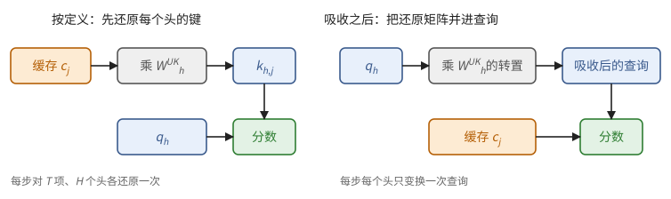
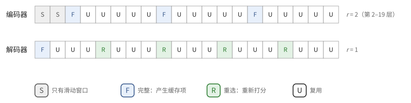

# 第 30 章　注意力的变体：缓存与计算的账

命题 11.22 给出了标准注意力的 KV cache：每层每词元 $2H_{kv}d_h$ 个数。照这个公式算，一个 80 层、8 个键值头、头维数 128 的 bf16 模型，每个词元要存 320 KiB，128K 词元的上下文是 40 GiB，一个用户就占去半块加速器的 HBM。长上下文和智能体应用让提示越来越长，近两年模型结构的改动，很大一部分都是冲着这个数来的。

这一章把这些改动放进同一本账。先把缓存拆成几个可以分别压缩的乘数，然后依次讲：多头潜在注意力怎样缩小每一项，滑动窗口、压缩和稀疏选择怎样处理序列的方向，跨层共享怎样处理层的方向，线性注意力怎样把缓存换成固定大小的状态。最后用 DeepSeek 几代模型的数字把账从头算一遍。每一种改动都要问三个问题：存多少，每一步读多少，每一步算多少。三者常常不是一回事。

用到第 10 章的 top-k 与仿射扫描（10.4、10.5 节），第 11 章的注意力与 KV cache（11.2、11.8 节），以及第 29 章的 RoPE（定义 29.13）。

## 30.1 缓存的账

先看一个具体的数。上面那个模型每个词元每层存 $2 \times 8 \times 128 = 2048$ 个数，乘以 2 字节、80 层，是 327,680 字节。要让它变小，可以从三个方向下手：让每一层每个词元存的东西少一点，让每一层不必为每个词元都存一项，或者让几层合用一份。

> **定义 30.1（缓存的账）** 对模型的第 $\ell$ 层，记 $c_\ell(T)$ 为一个序列处理了 $T$ 个词元之后这一层保留的缓存项数，$e_\ell$ 为每一项的字节数。一个序列的缓存为
>
> $$
> M(T) = \sum_{\ell} c_\ell(T)\, e_\ell .
> $$
>
> 另记 $r_\ell(T)$ 为 decode 一步时这一层的一个查询要读的项数。标准注意力 $c_\ell(T) = r_\ell(T) = T$，$e_\ell = 2H_{kv}d_h s$。

这一章的各种做法，按它们改变的量分类如下：

| 方向 | 做法 | 改变的量 |
| --- | --- | --- |
| 每项的大小 $e_\ell$ | GQA/MQA、MLA、低精度缓存 | 存储与读取同比缩小 |
| 序列的方向 $c_\ell(T)$ | 滑动窗口、压缩、线性注意力 | 存储与读取 |
| 只读一部分 $r_\ell(T)$ | 稀疏选择 | 读取与计算，存储不变 |
| 层的方向 | 跨层共享 | 存储；每层仍要各读各的 |

> **例 30.2（同一个模型，四种省法）** 沿用开头的模型：每词元每层 2048 个数，bf16 下 4096 字节，80 层，上下文 $T = 131072$。标准注意力一个序列的缓存是 $131072 \times 80 \times 4096$ 字节 $= 40$ GiB，decode 每一步也要把这 40 GiB 读一遍。
>
> | 做法 | 改的乘数 | 缓存 | 每步读取 |
> | --- | --- | ---: | ---: |
> | 标准 | — | 40 GiB | 40 GiB |
> | 缓存改 fp8 | $e_\ell$ 减半 | 20 GiB | 20 GiB |
> | 键值头 8 → 1（MQA） | $e_\ell$ 变为 1/8 | 5 GiB | 5 GiB |
> | 只保留最近 4096 个词元（滑动窗口） | $c_\ell = r_\ell = 4096$ | 1.25 GiB | 1.25 GiB |
> | 每步只读 2048 项（稀疏选择） | $r_\ell = 2048$ | 40 GiB | 0.625 GiB |
> | 每两层共用一份缓存 | 层数减半 | 20 GiB | 40 GiB |
>
> 前三种做法改的是"每一项"或"有几项"，存储和读取同比缩小；稀疏选择只少读，不少存；跨层共享只少存，两层仍要各读一遍（除非两层恰好在同一步、同一处读它）。几种做法可以叠加，叠加时各自乘进不同的乘数，读论文时先问它改的是哪一个。

最后一列是这一章反复要用的：稀疏选择不省存储，跨层共享不省读取。把这几个乘数分开看，是 DeepSeek-V4.1 技术报告的说法，也是读任何一篇"省 KV cache"的论文时最先该问的问题。

## 30.2 多头潜在注意力

11.8 节的现状框提到过多头潜在注意力（MLA）：每个词元只存一个共享的低维潜向量。先看它省了多少。DeepSeek-V3 有 128 个查询头，若每个头都有自己的 128 维键和值，每词元每层要存 $2 \times 128 \times 128 = 32768$ 个数；MLA 只存 $512 + 64 = 576$ 个，少了五十多倍。下面看它为什么还能算出同样的注意力。

> **定义 30.3（MLA 的计算）** 对每个词元的隐藏向量 $x \in \mathbb{R}^{1 \times D}$，计算潜向量 $c = x W^{DKV} \in \mathbb{R}^{1 \times d_c}$，缓存中只存 $c$。第 $h$ 个头的键和值由潜向量还原：
>
> $$
> k_h = c\, W^{UK}_h, \qquad v_h = c\, W^{UV}_h, \qquad W^{UK}_h, W^{UV}_h \in \mathbb{R}^{d_c \times d_h},
> $$
>
> 查询 $q_h \in \mathbb{R}^{1 \times d_h}$ 由当前词元另行算出。各头按通常的注意力计算，输出拼接后乘以 $W^O$。

直接照定义算，decode 时要把缓存里的每个 $c_j$ 还原成 $H$ 个头的键和值，相当于每一步都重新生成一份大的 KV cache，省下的存储又要用计算还回去。好在矩阵乘法有结合律。

> **命题 30.4（吸收）** 记 $\tilde q_h = q_h (W^{UK}_h)^{\mathsf T} \in \mathbb{R}^{1 \times d_c}$。则对缓存中的每个 $c_j$，
>
> $$
> q_h\, k_{h,j}^{\mathsf T} = \tilde q_h\, c_j^{\mathsf T}, \qquad \sum_j p_{hj}\, v_{h,j} = \Big(\sum_j p_{hj}\, c_j\Big) W^{UV}_h .
> $$
>
> 所以 decode 时可以直接拿 $\tilde q_h$ 与潜向量算分数，对潜向量做加权和，最后再乘 $W^{UV}_h$；$W^{UV}_h$ 还可以事先并进 $W^O$。

*证明* $q_h (c_j W^{UK}_h)^{\mathsf T} = q_h (W^{UK}_h)^{\mathsf T} c_j^{\mathsf T}$；加权和对 $j$ 是线性的，$W^{UV}_h$ 可以提到求和号外。∎

吸收之后，MLA 在 decode 时就是一种 MQA：所有查询头共用一个"键值头"，它的维数是 $d_c$，而且键和值是同一个向量 $c_j$。

**图 30.1**　同一个分数的两种算法。左边每步要把缓存中的每一项为每个头还原一次；右边只把每个头的查询变换一次，再直接与缓存的潜向量做点积。

**RoPE 带来的麻烦。** 若对还原出的键施加 RoPE，位置 $t$ 的查询与位置 $j$ 的键之间夹着 $R_t^{\mathsf T} R_j$（定义 29.13），它随 $(t, j)$ 变化，不能并进一个固定的矩阵，吸收就做不成了。MLA 的办法是把位置信息分出去：另算一个很短的、所有头共用的键 $k^R_j = R_j(x_j W^{KR}) \in \mathbb{R}^{1 \times d_r}$ 一起缓存，每个头的查询也多出一段 $q^R_h$。分数是两部分之和：

$$
\tilde q_h\, c_j^{\mathsf T} + q^R_h\, (k^R_j)^{\mathsf T}.
$$

于是每层每词元缓存 $d_c + d_r$ 个数。DeepSeek-V3 取 $d_c = 512$、$d_r = 64$，bf16 下每层 1152 字节，61 层共 70,272 字节，就是 11.8 节现状框里的"约 70 KB"。

**吸收改变了 decode 注意力的强度。** 11.8 节算过，GQA 在 decode 时注意力的强度约为 $2H/(H_{kv}s)$：每读一个键值头，只有共享它的 $H/H_{kv}$ 个查询头在用。MLA 只有一个"键值头"，所有 $H$ 个头都用它。

> **命题 30.5（MLA decode 注意力的强度）** 一个序列 decode 一步，对缓存中的每个词元，MLA 的注意力约做 $2H(d_c + d_r) + 2Hd_c$ 次浮点运算，读 $(d_c + d_r)s$ 字节，强度约为
>
> $$
> \frac{2H(2d_c + d_r)}{(d_c + d_r)\, s} \approx \frac{4H}{s}.
> $$

*证明* 分数每头 $2(d_c + d_r)$，加权和每头 $2d_c$；字节数为一项缓存的大小。∎

DeepSeek-V3 的 $H = 128$，bf16 缓存时强度约 $278528 / 1152 \approx 242$ FLOP/字节，与参考芯片 X 的拐点 260（例 6.2）相当；缓存换成 fp8，强度翻倍，越过拐点。也就是说，MLA 把 decode 的注意力从典型的访存受限变成了接近计算受限，这类 kernel 要像矩阵乘法那样用好矩阵单元，而不只是用满带宽。

吸收还有一个后果，涉及第 12 章的张量并行。

> **命题 30.6（按头切分切不开潜向量）** 把 $H$ 个头分到 $t$ 块设备上（12.4 节的张量并行按头切分注意力），每块设备都要用到每个缓存项的完整潜向量 $c_j$。所以一个序列的潜向量缓存在 $t$ 块设备上各存一份，总存储是按序列切分时的 $t$ 倍。

*证明* 每个头的分数 $\tilde q_h c_j^{\mathsf T}$ 用到 $c_j$ 的全部 $d_c$ 个分量。∎

对 GQA，按头切分时每块设备只存自己那几个键值头，缓存是被切开的；MLA 没有可切的键值头。所以 MLA 的模型在推理时，注意力部分通常不用张量并行，而是让每块设备各自服务一批完整的序列（数据并行）。

> **现状（2026-10）**：MLA 由 DeepSeek-V2（2024）提出，V3 沿用，Kimi K2 等沿用 V3 结构的模型也用它。DeepSeek-V4.1-Flash 的注意力仍是这种"所有头共用一个潜向量"的形式：64 个查询头，每项是一个 512 维的向量，其中 64 维带 RoPE。

## 30.3 滑动窗口

最简单的缩短序列方向的办法，是只看最近的若干个词元。

> **定义 30.7（滑动窗口注意力）** 窗口为 $W$ 的**滑动窗口注意力**（sliding window attention，SWA）中，位置 $t$ 的查询只看位置 $\max(0, t - W + 1)$ 到 $t$ 的键。每层每序列只需保留最近 $W$ 项：$c_\ell(T) = r_\ell(T) = \min(T, W)$。

缓存常用一个长 $W$ 的**环形缓冲**（ring buffer）存放：位置 $j$ 的键值放在第 $j \bmod W$ 个槽里，新的项覆盖最旧的项。槽号与位置不再相同，所以掩码和 RoPE 都必须用每个槽里记下的绝对位置，不能用槽号（习题 30.5）。

只看 $W$ 个词元，模型会不会看不远？一层确实只看 $W$ 个，但层叠起来，信息可以一层一层往后传。

> **命题 30.8（感受野）** 叠放 $n$ 层窗口为 $W$ 的滑动窗口注意力（层间只有逐位置的运算）。第 $n$ 层在位置 $t$ 的输出只依赖于输入在位置 $[t - n(W - 1), t]$ 上的值。

*证明* 对 $n$ 归纳。$n = 1$ 时由定义。设第 $n - 1$ 层在位置 $u$ 的输出只依赖于 $[u - (n-1)(W-1), u]$；第 $n$ 层在 $t$ 的输出依赖第 $n - 1$ 层在 $[t - W + 1, t]$ 上的输出，取并集得 $[t - (W - 1) - (n-1)(W-1), t]$。∎

这个命题在推理系统里有一个很实际的用处。假如一个序列在位置 $t$ 之前的计算结果丢了，只剩下词元，要重建各层在位置 $t$ 附近的滑动窗口缓存，需要往回重算多少个词元？第 $n$ 层的缓存覆盖 $[t - W + 1, t]$，由命题 30.8，它依赖于从 $t - W + 1 - (n-1)(W-1)$ 起的输入，大约 $nW$ 个词元。DeepSeek-V4.1-Flash 有 40 层、$W = 128$，精确重建要重算约 5000 个词元。

**与投机解码的配合。** 投机解码（11.11 节）一次写入 $\gamma + 1$ 个位置的缓存，其中被拒绝的位置之后要退回。对普通的 KV cache，退回只是把长度改小；对环形缓冲，新写的项已经覆盖了旧的项。

> **命题 30.9（环形缓冲要多留的槽）** 设一步写入 $\gamma + 1$ 个新位置（上一个词元和 $\gamma$ 个草稿），验证后可能只保留其中的前 $1 + a$ 个（$0 \le a \le \gamma$）。环形缓冲取 $W + \gamma - 1$ 个槽，就不会覆盖退回之后仍要用到的项；少于这个数，则 $a = 0$ 时会覆盖。

*证明* 设本步之前位置 $0..t$ 有效，本步写入 $t+1, \dots, t+\gamma+1$，保留到 $t + 1 + a$。之后的查询从位置 $p = t + 2 + a$ 起，窗口要用缓存中的 $[p - W + 1, p - 1] = [t + a + 3 - W, t + a + 1]$。用 $N$ 个槽时，写入位置 $j$ 覆盖位置 $j - N$。$N = W + \gamma - 1$ 时，$j - N \le t + \gamma + 1 - N = t + 2 - W < t + a + 3 - W$，被覆盖的都不再需要。$N = W + \gamma - 2$、$a = 0$ 时，写入 $j = t + \gamma + 1$ 覆盖 $t + 3 - W$，它恰好还要用。∎

DeepInfer 为 DeepSeek-V4.1-Flash 的滑动窗口每序列留 134 个槽，即窗口 128 再加 6 个；每步至多验证 5 个草稿（$\gamma = 5$），所以比这个下界多留了两个，余量另有他用。

**局部层与全局层交替。** 只用滑动窗口的模型，远处的信息要经过很多层才能传过来，传过来也变模糊了。常见的做法是大多数层用滑动窗口，少数层保留全局注意力：缓存的大头被压到常数，全局层负责远距离的检索。

> **现状（2026-10）**：Gemma 3（2025）每 5 个窗口 1024 的局部层配 1 个全局层；OpenAI 的 gpt-oss（2025）让窗口 128 的层与全局层交替，并给每个头加一个可学习的"注意力汇"（attention sink）：softmax 的分母里多一项 $e^{s_h}$，让一个头可以把权重放到"哪儿也不看"上。DeepSeek-V4 与 V4.1 则在每一层都用滑动窗口（V4.1 的窗口是 128），再叠加下一节的压缩与稀疏的全局分支；V4.1-Flash 的每层也有一个每头一个数的 `attn_sink` 参数。

## 30.4 压缩与稀疏选择

滑动窗口把远处的信息整个丢掉。另一种办法是把远处的信息压一压再留着。

> **定义 30.10（压缩）** 压缩比为 $r$ 时，把每 $r$ 个相邻词元的键值向量合成一项：
>
> $$
> \hat c_g = \sum_{i \in \text{第 } g \text{ 组}} w_i\, \kappa_i, \qquad (w_i)_{i \in \text{第 } g \text{ 组}} = \operatorname{softmax}(z_i),
> $$
>
> 其中 $\kappa_i$ 与打分 $z_i$ 都由词元 $i$ 的隐藏向量投影得到。$T$ 个词元之后有 $\lfloor T/r \rfloor$ 个完整的组；最后不满的一组先放在一个至多 $r - 1$ 行的小状态里，凑满了再合成一项写入缓存。

位置 $t$ 的查询只能看完整的组，否则会看到 $t$ 之后的词元。最近这几个还没凑成组的词元怎么办？它们恰好在滑动窗口里。所以压缩的全局分支和窗口的局部分支是互补的：查询同时对"已压缩的远处"和"未压缩的近处"做注意力，两部分合在一起做 softmax（用 10.2 节在线 softmax 的状态合并）。

压缩把 $c_\ell(T)$ 从 $T$ 降到 $T/r$。还可以更进一步：不读全部 $T/r$ 项，只读其中最相关的 $k$ 项。

> **定义 30.11（稀疏选择）** 一个**索引器**（indexer）为位置 $t$ 的查询给每个可见的缓存项 $j$ 打一个便宜的分数，例如
>
> $$
> I_{t,j} = \sum_{h=1}^{H_I} w_{t,h}\, \operatorname{ReLU}\big(q^I_{t,h} \cdot k^I_j\big),
> $$
>
> 其中 $q^I_{t,h}, k^I_j \in \mathbb{R}^{d_I}$ 维数很小、可以用 fp8 或 fp4 计算，$k^I_j$ 也要缓存。然后取分数最大的 $k$ 项（10.4 节的 top-k），主注意力只在这 $k$ 项和滑动窗口上计算。

稀疏选择不减少存储：将来的查询可能选中任何一项，所以每一项都得留着。它省的是主注意力的读取和计算。省下的东西也不是白来的：索引器仍要给全部 $T/r$ 项打分。

> **命题 30.12（稀疏选择的一步）** 一个 decode 查询在一层上：索引器约做 $2H_I d_I \cdot T/r$ 次运算、读 $T/r$ 个索引键；top-k 在 $T/r$ 个分数中选 $k$ 个；主注意力读 $k + W$ 项，运算量与 $T$ 无关。

> **例 30.13（一百万个词元时，账的大头在哪里）** 取 DeepSeek-V4.1-Flash 解码器中第一个做索引的层：$r = 1$，$H_I = 32$，$d_I = 128$，选 $k = 512$ 项，窗口 $W = 128$，主注意力 64 个头、每项 512 维。上下文 $T = 10^6$：
>
> - 索引器：$2 \times 32 \times 128 \times 10^6 \approx 8.2 \times 10^9$ 次运算，读 $10^6$ 个 fp4 索引键（每个 68 字节）约 68 MB；
> - 主注意力：$640$ 项，每项每头算分数和加权和共 $2 \times 512 + 2 \times 512 = 2048$ 次运算，64 个头共约 $8.4 \times 10^7$ 次，读约 0.2 MB。
>
> 索引器比主注意力多两个数量级。稀疏选择把问题从"注意力太贵"变成了"挑选太贵"，所以 V4.1 进一步让后面的层不再扫描全部位置：这一层把分数最高的 2048 个块（每块 8 个位置）作为候选池，后面的重选层只在这 16384 个候选中打分，每层约 $1.3 \times 10^8$ 次运算，与上下文长度无关。

## 30.5 跨层共享

前两节都在一层之内想办法。另一个方向是让几层合用一份缓存。最直接的是相邻两层共用同一份键值，缓存减半；DeepSeek-V4.1 的做法更细，下面先讲一个更有意思的结构上的后果。

设模型共 $n$ 层。前一半照常计算；后一半的每一层不再从自己的输入算全局的键值，而是统一由第 $n/2$ 层的输出投影得到（各层可以用各自的投影矩阵）。这是 YOCO（Sun 等，2024）的想法，DeepSeek-V4.1 称之为因果编码器—解码器（CED）。

> **命题 30.14（后半的全局缓存只依赖前半）** 在上述结构中，若后一半的层除了全局键值之外没有别的缓存，那么为一段 $T$ 个词元的提示建立全部缓存，只需让前 $n/2$ 层处理全部 $T$ 个词元，再对需要 logits 的位置（通常只有最后一个）走一遍后 $n/2$ 层。prefill 的层运算量约减半。

*证明* 后一半各层的全局缓存只由第 $n/2$ 层在各位置的输出决定。后一半各层在非最后位置的输出，既不进入任何缓存，也不用来算 logits，所以不必计算。∎

DeepSeek-V4.1-Flash 的后一半（20 层）还保留了各自的滑动窗口，它的键值来自每层自己的隐藏状态，不满足命题的条件。由命题 30.8，精确地建立这 20 层的窗口缓存，要让后一半在提示的最后约 $20 \times 128$ 个词元上运行。V4.1 只让后一半处理最后 128 个词元，并把这段重放中的窗口截断在重放段之内，得到近似的窗口缓存，报告称质量几乎不受影响。结果是：prefill 时每个词元只激活约 80 亿参数（前一半），decode 时激活约 160 亿（全部 40 层）。对输入很长、输出较短的智能体负载，prefill 的成本几乎减半。

**共享缓存与重新选择。** DeepSeek-V4.1 的全局分支（报告称 CSA2）给每个带全局分支的层指定三种模式之一：

- **完整**：自己算全局缓存项和索引键，自己做选择；
- **重选**：沿用前面最近一个完整层的缓存项和索引键，用自己的索引查询重新打分、重新选 top-k；
- **复用**：缓存项和选择结果都沿用前面的层，直接做稀疏注意力。

三种模式都各自计算查询和滑动窗口。只有完整层产生新的缓存项。

> **例 30.15（每词元 890 字节是怎样算出来的）** DeepSeek-V4.1-Flash 的 40 层：第 0、1 层只有滑动窗口；第 2–19 层分成三组、每组 6 层，组内第一层为完整、其余为复用，压缩比 $r = 2$；第 20–39 层分成五组、每组 4 层，第一组第一层为完整，其余四组第一层为重选，其余都是复用，$r = 1$。所以只有 4 层产生全局缓存项：三层每 2 个词元一项，一层每个词元一项，平均每词元 $3/2 + 1 = 2.5$ 项。
>
> 每一项包括：主缓存，512 维 fp4 E2M1，每 16 个一个 E4M3 因子，$256 + 32 = 288$ 字节；索引键，128 维 MXFP4，$64 + 4 = 68$ 字节。由命题 29.2，每词元
>
> $$
> 2.5 \times (288 + 68) = 890 \ \text{字节}.
> $$
>
> 这就是技术报告里"全局 KV 每词元 890 字节"的来历。另外，40 层的滑动窗口每层每序列存 134 个位置（命题 30.9），每个位置 512 维 MXFP8 共 528 字节，约 2.8 MB，与序列长短无关。

**图 30.2**　DeepSeek-V4.1-Flash 的 40 层。只有 4 个"完整"层产生全局缓存项，其余层沿用它们的缓存项，有的重新挑选、有的连挑选结果也沿用。

## 30.6 线性注意力与状态空间模型

上面的做法都还保留着 softmax 注意力。另一条路干脆换掉它。先看去掉 softmax 之后会发生什么。设查询、键为 $1 \times d_k$ 的行向量，值为 $1 \times d_v$ 的行向量，把分数 $\exp(q_t \cdot k_j)$ 换成简单的 $q_t \cdot k_j$，且不做归一化：

$$
o_t = \sum_{j \le t} (q_t k_j^{\mathsf T})\, v_j = q_t \sum_{j \le t} k_j^{\mathsf T} v_j = q_t S_t, \qquad S_t = S_{t-1} + k_t^{\mathsf T} v_t .
$$

求和号可以和 $q_t$ 交换次序，于是 $T$ 个键值对被压成了一个 $d_k \times d_v$ 的矩阵 $S_t$。这就是**线性注意力**（linear attention）：每层每个头只需保存一个固定大小的**状态**，decode 一步只更新状态、再乘一次，与已经看过多少词元无关。

纯粹的累加会让旧的信息永远留在状态里，实际的模型给它加上遗忘和修正：

- **带门控**：$S_t = a_t S_{t-1} + k_t^{\mathsf T} v_t$，$a_t \in (0, 1)$ 由当前词元算出，决定忘掉多少（Mamba-2、GLA 等属于这一类，状态空间模型的离散形式也可以写成这样）；
- **delta 规则**：$S_t = S_{t-1} + \beta_t k_t^{\mathsf T}(v_t - k_t S_{t-1})$，先用 $k_t$ 从状态里读出旧的值，再把新旧之差写进去，使 $k_t S_t$ 更接近 $v_t$；Gated DeltaNet 再乘上一个门控。

它们都是 $S$ 的仿射递推 $S_t = A_t S_{t-1} + B_t$：门控时 $A_t = a_t I$、$B_t = k_t^{\mathsf T} v_t$；delta 规则时 $A_t = I - \beta_t k_t^{\mathsf T} k_t$、$B_t = \beta_t k_t^{\mathsf T} v_t$。所以 10.5 节的扫描可以用来并行计算 prefill。delta 规则的 $A_t$ 是 $d_k \times d_k$ 的矩阵，10.5 节说过一般矩阵的复合太贵，但这里的 $A_t$ 是"单位阵减一个秩一矩阵"，若干个这样的矩阵之积有紧凑的表示，分块算法仍然可行。最简单的情形是不带门控：

> **命题 30.16（线性注意力的分块形式）** 不带门控时，把序列分成长 $c$ 的块。设块的查询、键、值为 $Q, K \in \mathbb{R}^{c \times d_k}$、$V \in \mathbb{R}^{c \times d_v}$，块开始时的状态为 $S_0$，$L$ 为 $c \times c$ 的下三角全一矩阵（含对角线）。则这一块的输出与块末的状态为
>
> $$
> O = Q S_0 + \big(Q K^{\mathsf T} \odot L\big) V, \qquad S_c = S_0 + K^{\mathsf T} V .
> $$

*证明* 块内第 $t$ 行：$o_t = q_t\big(S_0 + \sum_{j \le t} k_j^{\mathsf T} v_j\big) = q_t S_0 + \sum_{j \le t} (q_t k_j^{\mathsf T}) v_j$，后一项正是 $(QK^{\mathsf T} \odot L)V$ 的第 $t$ 行。$S_c$ 由定义。∎

每一项都是矩阵乘法，块内是一个小的"因果注意力"，块间只传递状态，也就是 10.5 节最后说的"块内用矩阵乘法、块间顺序传递"。带门控时，$L$ 换成 $L[t, j] = \prod_{r = j+1}^{t} a_r$，$QS_0$ 的第 $t$ 行乘以 $\prod_{r \le t} a_r$。每个词元的运算量约为 $4d_kd_v + 2c(d_k + d_v)$，与序列长度无关。

**状态有多大。** 固定大小不等于小。

> **例 30.17（什么时候状态比 KV cache 还大）** 一层线性注意力有 32 个头，$d_k = d_v = 128$，状态按 f32 保存：每序列 $32 \times 128 \times 128 \times 4 = 2$ MiB。同样宽度的 GQA 层（8 个键值头、头维数 128、bf16）每词元 4 KiB。序列短于 512 个词元时，线性层的状态比注意力层的 KV cache 还大；128K 词元时，前者只有后者的 $1/256$。

**为什么还要留几层全局注意力。** 固定大小的状态装不下任意长的上下文：$m$ 个比特的状态，至多区分 $2^m$ 种不同的历史，而 $T$ 个词元的历史有 $V^T$ 种。所以纯线性的模型在"从很长的上下文里原样找出某一句"这类任务上吃亏。实际的模型大多是混合的：多数层用线性注意力，少数层保留全局注意力。

> **现状（2026-10）**：Qwen3-Next（2025）每 3 层 Gated DeltaNet 配 1 层带门控的全局注意力；Kimi Linear（2025）每 3 层它们改进的 delta 规则层（KDA）配 1 层 MLA。DeepSeek 走的是另一条路：保留 softmax 注意力，用滑动窗口、压缩、稀疏选择和跨层共享把它的账压下去（30.4、30.5 节）。

**对推理系统的影响。** 线性层和滑动窗口层有一个共同点：每个序列有一块固定大小的状态，而不是随长度增长的、可以按页分配的缓存。这带来三件事：

1. 状态按序列整块分配，放在一个固定槽位的池子里，与分页的 KV cache 分开管理。
2. 投机解码被拒绝时，普通的 KV cache 改一下长度就退回了；状态已经被更新，退不回去，要么为每个待验证的位置各存一份状态快照（$\gamma + 1$ 份），要么从上一个保存的状态重算。
3. 想从某个中间位置接着算（例如复用上一轮对话的结果），必须恰好有那个位置的状态快照；它不能像 KV cache 那样从任意长度截断得到。所以系统只在固定的位置（例如每 128 个词元）存快照。

## 30.7 一本总账

最后用 DeepSeek 几代模型，把这一章的账从头算一遍。

| 模型 | 注意力 | 每词元每层存什么 | 每词元的全局缓存 |
| --- | --- | --- | ---: |
| DeepSeek LLM 67B（2023） | GQA，95 层 | K、V 各 $8 \times 128$ 个 bf16 | 389,120 字节 |
| DeepSeek-V3（2024） | MLA，61 层 | $512 + 64$ 个 bf16 | 70,272 字节 |
| DeepSeek-V4.1-Flash（2026） | 滑动窗口 + 压缩稀疏 + 跨层共享，40 层 | 只有 4 层存，fp4 | 890 字节 |

第一代到 V4.1 缩小了 437 倍，与技术报告给出的倍数一致；V4.1-Flash 约为 V4-Flash 的 1/4。按 128K 词元的上下文算，一个序列的全局缓存分别是 51 GB、9.2 GB 和 117 MB（V4.1 另加约 2.8 MB 的窗口缓存）。

各个乘数在这里都出现了：MLA 缩小了每一项（第一代到 V3），fp4 再缩小每一项，压缩比 2 缩短了一半的层的序列方向，跨层共享让 40 层里只有 4 层存东西。稀疏选择没有出现在这张表里，因为它不省存储；它出现在 decode 一步的计算里（例 30.13）。

这些数字还会改变整个推理系统的设计。当每词元的缓存是 300 多 KB 时，缓存只能放在 HBM 里，用完就丢；当它是 890 字节时，把几百万个对话的缓存存到 SSD 上几天，下次接着用，就成了划算的事。

## 本章小结

1. 缓存的账：$M(T) = \sum_\ell c_\ell(T) e_\ell$；可以分别缩小每项大小、序列方向的项数、层的方向，以及每步读取的项数。稀疏选择不省存储，跨层共享不省读取。（定义 30.1、30.1 节）
2. MLA 只缓存潜向量与一段共享的 RoPE 键，每层每词元 $d_c + d_r$ 个数；吸收后 decode 是所有头共用一个 $d_c$ 维键值头的 MQA，强度约 $4H/s$，接近计算受限；按头切分会把潜向量缓存复制 $t$ 份，所以注意力部分用数据并行。（命题 30.4、30.5、30.6）
3. 滑动窗口每层只存 $W$ 项，常用环形缓冲；$n$ 层的感受野为 $n(W-1)$，精确重建窗口缓存要重算约 $nW$ 个词元；配合投机解码时环形缓冲要 $W + \gamma - 1$ 个槽。（定义 30.7，命题 30.8、30.9）
4. 压缩把每 $r$ 个词元合成一项，与滑动窗口互补；稀疏选择用便宜的索引器打分、取 top-k，主注意力的代价与 $T$ 无关，但索引器仍是 $O(T/r)$，长上下文时它成了大头。（定义 30.10、30.11，命题 30.12，例 30.13）
5. 后半层的全局缓存只依赖前半层的输出时，prefill 只需前半层处理全部词元；DeepSeek-V4.1-Flash 由此 prefill 激活约 80 亿参数、decode 约 160 亿。完整/重选/复用三种模式让 40 层里只有 4 层产生缓存项，每词元 890 字节。（命题 30.14、例 30.15）
6. 线性注意力把键值压成 $d_k \times d_v$ 的状态，门控与 delta 规则都是仿射递推；prefill 用分块形式（块内矩阵乘法、块间传状态）。状态大小固定但不一定小；多数实际模型是混合的。（命题 30.16、例 30.17）
7. 固定大小的状态（窗口、线性层）要整块分配；投机解码的回退和从中间位置续算都需要快照。（30.6 节）
8. DeepSeek 三代：389,120 → 70,272 → 890 字节每词元。缓存的大小决定了它能放在哪一级存储、能保存多久。（30.7 节）

## 习题

**习题 30.1** ★ 一个模型 80 层，$H = 64$，$H_{kv} = 8$，$d_h = 128$，bf16。(a) 每词元的 KV cache 多大？(b) 若改用 MLA，$d_c = 512$、$d_r = 64$，同样 80 层，每词元多大？(c) 32K 词元的上下文，两者各占多少？

提示 1

(a) 命题 11.22；(b) 每层每词元 $d_c + d_r$ 个数。

答案

(a) $2 \times 80 \times 8 \times 128 \times 2 = 327{,}680$ 字节，320 KiB。(b) $80 \times 576 \times 2 = 92{,}160$ 字节，90 KiB，约为前者的 28%。(c) 32768 个词元：10 GiB 与 2.81 GiB。

**习题 30.2** ★ 用一个小例子验证命题 30.4：$d_c = 2$、$d_h = 1$，$W^{UK} = (1, 2)^{\mathsf T}$，$q = 3$，缓存的潜向量 $c_1 = (1, 0)$、$c_2 = (0, 1)$。分别按"先还原键再算分数"和"先吸收再算分数"计算两个分数。再数一数：缓存中有 $T$ 项、$H$ 个头时，两种做法每步各要多少次乘加（只算分数部分）？

提示 1

还原：$k_j = c_j W^{UK}$；吸收：$\tilde q = q (W^{UK})^{\mathsf T}$。

答案

还原：$k_1 = 1$，$k_2 = 2$，分数 3、6。吸收：$\tilde q = 3 \times (1, 2) = (3, 6)$，与 $c_1, c_2$ 点积得 3、6，相同。乘加次数：还原法每步要还原 $T$ 个键，$T \cdot H \cdot d_c d_h$，再算分数 $T H d_h$；吸收法先算 $\tilde q$，$H d_h d_c$，再算分数 $T H d_c$。$T$ 很大时，前者约 $THd_cd_h$，后者约 $THd_c$，少了 $d_h$ 倍。

**习题 30.3** ★ DeepSeek-V3 的缓存每词元 70,272 字节。8 块设备、每块 80 GB 可用于缓存，每个序列 32K 词元。(a) 注意力按头做 8 路张量并行时，整个系统最多同时容纳多少个序列？(b) 改为数据并行（每块设备各自服务完整的序列）呢？

提示 1

命题 30.6：张量并行时每块设备存每个序列的全部潜向量。

答案

每序列 $70272 \times 32768 \approx 2.30$ GB。(a) 每块设备都要存每个序列的完整缓存，每块 80 GB 只能放 34 个序列，整个系统就是这 34 个。(b) 每块设备放 34 个各不相同的序列，共 272 个，是 (a) 的 8 倍。

**习题 30.4** ★ 一个模型的 24 层都用窗口 $W = 512$ 的滑动窗口。(a) 最后一层在位置 $t$ 的输出最远能受到哪个位置的影响？(b) 一个序列在位置 10000 处丢失了全部窗口缓存，只剩词元，要精确重建，至少从哪个位置开始重算？

提示 1

命题 30.8；(b) 要重建的是第 24 层在 $[t - W + 1, t]$ 上的缓存。

答案

(a) $t - 24 \times 511 = t - 12264$。(b) 第 24 层的缓存覆盖位置 $9489..10000$，其中最早的位置 9489 的第 24 层键值是第 23 层输出的函数，依赖于 $9489 - 23 \times 511 = -2264$ 以后的输入，即从位置 0 起全部重算。一般地，只有当 $t$ 比 $nW$ 大很多时，"只重算最后约 $nW$ 个词元"才比从头算省。

**习题 30.5** ★（审查题）一个滑动窗口 kernel 用长 $W$ 的环形缓冲，掩码写成"槽号 $s$ 可见，当且仅当 $s \le t \bmod W$"。指出错误，给出正确的规格。

提示 1

$t \ge W$ 以后，槽号的大小和位置的先后还有关系吗？

答案

$t \ge W$ 时，槽号 $s > t \bmod W$ 的那些槽存的是更早的位置 $t - W + (s - t \bmod W)$，仍在窗口内，却被这个掩码挡掉了；窗口内只剩约 $(t \bmod W) + 1$ 项。正确的规格：每个槽同时记下它存的绝对位置 $j$（或由 $t$ 推出），槽可见当且仅当 $t - W < j \le t$ 且这个槽已经写过；RoPE 也按 $j$ 计算（第 29 章）。

**习题 30.6** ★ 窗口 $W = 4$，投机解码每步写 3 个位置（$\gamma = 2$）。位置 0–9 有效，本步写入位置 10、11、12，验证后只保留位置 10。(a) 若环形缓冲只有 4 个槽，写入后各槽存的是哪些位置？下一步位置 11 的查询要从缓存里读哪些位置？缺了哪个？(b) 5 个槽呢？

提示 1

槽号 $j \bmod (\text{槽数})$。位置 11 的查询看 $[8, 11]$，其中 11 是本步自己算的。

答案

(a) 写入前槽 0–3 存 8、9、6、7；写入后槽 2 ← 10（覆盖 6），槽 3 ← 11（覆盖 7），槽 0 ← 12（覆盖 8）。位置 11、12 作废。下一步位置 11 的查询要读 8、9、10，而 8 已被作废的 12 覆盖。(b) 5 个槽：写入前存 5–9；写入 10、11、12 分别覆盖 5、6、7，需要的 8、9、10 都在。与命题 30.9 的 $W + \gamma - 1 = 5$ 一致。

**习题 30.7** ★ 压缩比 $r = 4$。(a) 一个序列处理了 1003 个词元，缓存里有几个完整的压缩项？小状态里有几行？(b) 之后 decode，哪几步会产生新的压缩项？(c) 位置 1002 的查询能看到哪些压缩项？最近的 3 个词元由什么覆盖？

提示 1

第 $g$ 组是位置 $4g..4g+3$，凑满才写入。

答案

(a) $\lfloor 1003/4 \rfloor = 250$ 项，小状态 3 行（位置 1000–1002）。(b) 处理位置 1003、1007、1011……的那几步（每 4 步一次）。(c) 第 0–249 组，即位置 0–999；位置 1000–1002 不在任何完整组里，由滑动窗口覆盖。

**习题 30.8** ★ 在例 30.15 中，(a) 若索引键改用 fp8（128 维，每 32 个一个 E8M0 因子），每词元多少字节？(b) 若主缓存仍是 fp8（512 维，每 32 个一个因子），而索引键用 fp4，呢？(c) 若不做跨层共享，18 个 $r = 2$ 的层和 20 个 $r = 1$ 的层各存各的，主缓存与索引键都按例中的格式，又是多少？

提示 1

每词元的项数乘以每项的字节数；由命题 29.2 算每项。

答案

(a) 索引键 $128 + 4 = 132$ 字节，$2.5 \times (288 + 132) = 1050$ 字节。(b) 主缓存 $512 + 16 = 528$ 字节，$2.5 \times (528 + 68) = 1490$ 字节。(c) 每词元 $18/2 + 20 = 29$ 项，$29 \times 356 = 10{,}324$ 字节，是 890 的 11.6 倍。跨层共享贡献最大。

**习题 30.9** ★ 一个 40 层的模型按命题 30.14 组织（前 20 层、后 20 层），每层的稠密运算量相同，提示 $T = 32768$ 个词元。(a) 不利用这个结构，prefill 的层运算量是多少"词元·层"？利用之后呢？(b) 若后 20 层还各有窗口 $W = 128$ 的滑动窗口，按技术报告的估计，精确建立它们的窗口缓存要让后 20 层都处理最后 $20 \times 128 = 2560$ 个词元；近似的做法只处理最后 128 个。两种情况下 prefill 各节省多少？(c) 提示只有 $T = 4096$ 个词元时呢？

提示 1

把"词元·层"加起来：前 20 层处理全部 $T$ 个，后 20 层处理最后若干个。

答案

(a) $40 \times 32768 = 1{,}310{,}720$；利用后 $20 \times 32768 + 20 \times 1 = 655{,}380$，省了约一半。(b) 精确：$655{,}360 + 20 \times 2560 = 706{,}560$，省 46%；近似：$655{,}360 + 20 \times 128 = 657{,}920$，省约 50%。(c) 不利用结构时 $163{,}840$；精确 $81{,}920 + 51{,}200 = 133{,}120$，只省 19%；近似 $81{,}920 + 2{,}560 = 84{,}480$，仍省 48%。提示越短，精确重建的额外代价占比越大。多轮对话每轮新增的提示往往不长，这就是 V4.1 选择近似重放的原因。

**习题 30.10** ★ 验证命题 30.16：$d_k = d_v = 1$，$S_0 = 1$，块长 $c = 2$，$q = (1, 2)$，$k = (1, 1)$，$v = (3, 4)$。逐步递推算 $o_1, o_2$ 和块末状态，再用分块公式算一遍。

提示 1

逐步：$S_1 = S_0 + k_1 v_1$，$o_1 = q_1 S_1$。

答案

逐步：$S_1 = 1 + 3 = 4$，$o_1 = 4$；$S_2 = 4 + 4 = 8$，$o_2 = 16$。分块：$QS_0 = (1, 2)$；$QK^{\mathsf T} = \begin{pmatrix} 1 & 1 \\ 2 & 2 \end{pmatrix}$，乘 $L$ 后为 $\begin{pmatrix} 1 & 0 \\ 2 & 2 \end{pmatrix}$，再乘 $V = (3, 4)^{\mathsf T}$ 得 $(3, 14)$；$O = (4, 16)$。$S_2 = 1 + 1 \cdot 3 + 1 \cdot 4 = 8$。一致。

**习题 30.11** ★ 一个混合模型有 48 层，其中 36 层是线性注意力（每层 32 个头，$d_k = d_v = 128$，状态 f32），12 层是 GQA（8 个键值头，$d_h = 128$，bf16）。(a) 一个 4K 词元的序列与一个 256K 词元的序列各占多少缓存？(b) 若全部 48 层都是 GQA 呢？(c) 投机解码 $\gamma = 4$、为线性层存全部快照，每序列多占多少？

提示 1

线性层每序列 2 MiB 每层（例 30.17）；GQA 每词元每层 4 KiB。

答案

(a) 线性层共 $36 \times 2 = 72$ MiB，与长度无关；GQA 层每词元 $12 \times 4 = 48$ KiB。4K：$72 + 192 = 264$ MiB；256K：$72 + 12288$ MiB，约 12.1 GiB。(b) 每词元 192 KiB：4K 为 768 MiB，256K 为 48 GiB。(c) 线性层的状态再多 $4$ 份（共 $\gamma + 1 = 5$ 份），多 288 MiB；短序列时这比整个 GQA 部分还大。

**习题 30.12** ☆ 用例 30.13 的数字，问：上下文长度 $T$ 为多少时，第一个索引层的索引器运算量等于主注意力的运算量？长度 128K 时，索引器读的字节是主注意力的几倍？

提示 1

索引器 $2 \times 32 \times 128 \times T$；主注意力约 $8.4 \times 10^7$。

答案

$8192\,T = 8.4 \times 10^7$，$T \approx 10^4$。128K 时，索引器读 $131072 \times 68 \approx 8.9$ MB，主注意力读约 0.2 MB，约 40 倍。超过一万个词元后，挑选比注意力本身更贵。

