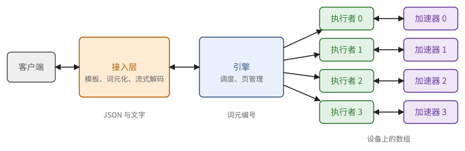
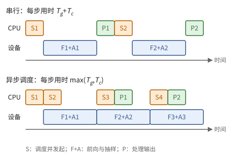

# 第 31 章　推理引擎：一个请求在服务器里走过的路

你在聊天窗口里按下回车，一两秒后第一个字出现，之后文字一段一段地冒出来。这一章讲这段时间里服务器做了什么。

前两章讲的是模型本身。可一台推理服务器同时为成百上千个用户服务：请求随时到来，长短不一，有的刚开始，有的快写完了。决定每一步做什么的，不是模型，而是一个叫**推理引擎**（inference engine）的程序：它把请求变成词元，把许多请求拼成一批，决定每一步谁算多少、缓存放在哪里，把输入搬上加速器，再把结果搬下来变回文字。这一章沿着一个请求走过的路，自底向上地把引擎拆开：主机与加速器之间怎样传数据，一步的输入是什么样子，调度器怎样做决定，CPU 的开销怎样藏起来，最后怎样衡量一个引擎的好坏。

例子取自 DeepSeek 在 2026 年 10 月开源的推理框架 DeepInfer，它支撑着 DeepSeek-V4.1-Flash 的线上服务。它最初建立在开源的 vLLM 之上，主要结构与 vLLM、SGLang 等引擎相同，所以这一章讲的也是这些引擎的共同结构。用到第 4 章的 Little 定律与 DMA（4.2、4.5 节），第 9 章的软件流水线（9.3、9.4 节），第 11 章的 prefill、decode 与连续批处理（11.8、11.12 节），以及第 29 章。

## 31.1 从请求到词元

客户端发来的是一段 JSON，大致是这样：

```json
{"model": "deepseek-v4.1-flash", "stream": true, "temperature": 1.0, "max_tokens": 1024,
 "messages": [{"role": "system", "content": "你是一个有帮助的助手。"},
              {"role": "user", "content": "世界上最高的山是哪座？"}]}
```

服务器上处理它的程序分成几层：

1. **接入层**（API 服务）：检查参数，按对话模板把 `messages` 排成一段带特殊词元的提示，编码成词元编号（29.2 节），连同抽样参数和到达时间组成一个请求，交给引擎。返回的方向，它把引擎吐出的词元编号流式解码成文字（命题 29.8、29.24），按协议包装好发回去。
2. **引擎**：一个循环，每一圈做一步（下面称为一个**步**）：决定这一步算哪些请求的哪些词元，准备输入，交给设备执行，取回抽样出的词元，更新每个请求的状态。
3. **执行者**：每块加速器一个进程，持有那块设备上的权重和缓存，按引擎的安排发起计算。

返回给客户端的是一个不断追加的事件流：每有新的文字，就发一行 `data: {...}`，其中带着这一小段文字，最后一行报告用了多少词元。屏幕上的字一段段地冒出来，就是这样来的。

接入层可以有很多份，跑在很多 CPU 核上；词元化、反词元化、解析工具调用这些按字符串处理的工作都在这里做，不占用引擎的循环。DeepSeek 把这一层的协议转换、提示编码和输出解析写成了 Rust 库（deepseek-recipe），同时支持三种主流的 API 协议，它们先被转换成同一种内部的对话格式，再共用一套编码逻辑。



**图 31.1**　一次请求经过的几层。接入层处理文本，引擎处理词元和调度，执行者处理设备上的数组；只有执行者接触加速器。

## 31.2 主机与设备

引擎是一个跑在 CPU 上的普通程序。它和加速器之间隔着一条链路，所有的数据都要从这条链路上过。

一台推理服务器通常有两颗 CPU、一两 TB 的主机内存（DRAM），以及 4 或 8 块加速器，每块带自己的 HBM。CPU 与加速器之间的链路是 PCIe 或厂商专用的连接。加速器上的 DMA 引擎（定义 4.16）负责在主机内存和 HBM 之间搬数据，一次搬 $S$ 字节约需 $\alpha + S/\beta$（命题 4.19）。

> **现状（2026-10）**：PCIe 5.0 x16 每个方向的理论带宽约 63 GB/s，PCIe 6.0 翻倍；NVIDIA 的 Grace–Blackwell 把 CPU 和 GPU 用 NVLink-C2C 相连，双向合计 900 GB/s。作为对比，一块 Blackwell 的 HBM 带宽约 8 TB/s：主机链路比 HBM 慢两个数量级。

DMA 引擎按物理地址读写。普通的主机内存由操作系统分页管理，随时可能被换出或移动，DMA 不能直接读它；驱动程序只好先把数据拷到一块固定的中转区，再从那里搬，多了一次拷贝，而且这次搬运不能和 CPU 的其他工作并行。所以引擎事先申请一块**锁页内存**（pinned memory）：操作系统保证它不被移动，DMA 可以直接、异步地读写它。DeepInfer 每一步的输入都先在锁页内存里准备好，再整块搬到设备上。

链路上走过的数据分成三类，量级相差很大：

- **启动时一次**：权重。DeepSeek-V4.1-Flash 共 510 GB（例 29.3）。64 块设备做专家并行时，每块约 8 GB；若主机内存里已有文件缓存、每块设备的链路实际跑到 25 GB/s，搬运只要零点几秒。启动慢主要慢在别处：编译、录制（31.5 节）、预热。
- **每一步**：这一步的词元编号、位置、页表等元数据（31.3 节），以及抽样出的词元编号。通常是几 KB 到几 MB，时间主要花在固定开销 $\alpha$ 上。
- **偶尔**：把暂时不用的 KV cache 搬到主机内存，或者把命中的缓存搬回来。这一类的量可以很大，要和计算重叠。

> **例 31.1（小块搬运为什么慢）** 把一个序列的 1 GB KV cache 从主机搬回 HBM，按 50 GB/s 要 20 ms，相当于大模型 decode 一两步的时间，所以要逐层搬、与前向计算重叠：第 $\ell$ 层计算时，第 $\ell + 1$ 层的缓存正在路上。
>
> 更麻烦的是，分页的缓存散落在许多小页里。设每页 64 KB，1 GB 是 16384 页；若每次 DMA 的固定开销 $\alpha = 5\,\mu\text{s}$，单是固定开销就要 82 ms，是带宽时间的 4 倍（命题 4.19）。DeepInfer 的技术说明里提到，GPU 自带的拷贝引擎搬这种细碎的缓存块效率很低，他们改用网卡的远程直接内存访问把数据推进 GPU 的显存：网卡能用满 PCIe 带宽，也不占用 GPU 的计算单元。

## 31.3 一步的输入：把参差的批摊平

连续批处理（11.12 节）每一步混着几种请求：有的在做 prefill，一次送进几百上千个词元；有的在 decode，每个只送一个。怎样把它们交给设备？最省事的办法是补齐成一个矩形，短的序列填空位，但长短悬殊时浪费极大。实际的引擎把所有请求的词元首尾相接，排成一行。

先看一个例子。块长（每页的词元数）$b = 4$，这一步有三个请求：

- A：新请求，提示 5 个词元，这一步全部 prefill，位置 0–4；
- B：在 decode，已有 9 个词元，前 8 个的键值已在缓存中，这一步处理位置 8；
- C：在 decode，这一步处理位置 20。

它们的页表（11.12 节）分别是 A：$[7, 2]$，B：$[3, 11, 5]$，C：$[1, 4, 9, 12, 6, 8]$。这一步送给设备的是：

| 张量 | 内容 |
| --- | --- |
| 词元编号 | A 的 5 个，B 的 1 个，C 的 1 个，共 $N = 7$ 个 |
| 位置 | $0, 1, 2, 3, 4,\ 8,\ 20$ |
| 各请求的起点 | $0, 5, 6, 7$（每个请求本步词元数 $5, 1, 1$ 的排他前缀和，最后一项是总数） |
| 本步之后的长度 | $5, 9, 21$ |
| 页表 | 按最长的补成 6 列，空位填 0 |
| 写入槽号 | $28, 29, 30, 31, 8,\ 20,\ 32$ |
| 抽样的行 | $4, 5, 6$ |

写入槽号说的是：每个新词元算出的键值，写进缓存池的哪个位置。缓存池可以看成一个大数组，第 $p$ 页占槽号 $[pb, (p+1)b)$。

> **定义 31.2（一步的输入）** 设本步处理 $n$ 个请求，第 $i$ 个请求本步送入 $q_i$ 个词元，位置为 $L_i - q_i, \dots, L_i - 1$（$L_i$ 为本步之后的长度），页表为 $\pi_i$。把这些词元依次排成长 $N = \sum_i q_i$ 的一行，送给设备的是：词元编号与位置（各长 $N$），起点 $s_i = \sum_{i' < i} q_{i'}$（$i = 0..n$），长度 $L_i$，页表，每个词元的**写入槽号**
>
> $$
> \text{slot}(i, t) = \pi_i[\lfloor t/b \rfloor] \cdot b + (t \bmod b),
> $$
>
> 以及需要抽样的行号（每个本步要产出词元的请求，取它的最后一行）。

这样摊平之所以可行，是因为模型里大部分运算根本不在乎一个词元属于哪个请求。

> **命题 31.3（只有注意力需要知道序列）** Transformer 一层中，除注意力的分数与加权和之外的运算（嵌入查表、归一化、各个投影、MLP 与专家、RoPE、残差加法、输出层）都是逐词元的：输出的第 $r$ 行只依赖于输入的第 $r$ 行和它的位置。所以它们可以直接作用于摊平后的 $N \times D$ 矩阵，不需要任何填充。

*证明* 逐一检查第 11 章的定义：矩阵乘法 $XW$ 的第 $r$ 行是 $x_r W$；RMSNorm 按行归一化；RoPE 只用本行的位置（定义 29.13）；MoE 按每个词元自己的路由选专家。只有注意力的加权和跨越了不同的行。∎

注意力 kernel 用起点和长度找到每个请求的查询，用页表找到它的键值（11.12 节）；新算出的键值先按写入槽号写进缓存，再统一计算，这也是例 11.31 要求的次序。

这几个数组之间有一组不变量，审查引擎的代码时值得逐条核对。

> **命题 31.4（一步输入的不变量）** 一组合法的输入满足：
>
> 1. 每个请求本步的位置是连续的 $L_i - q_i, \dots, L_i - 1$，起点数组单调，$s_n = N$；
> 2. 页表覆盖本步之后的全部长度：$\pi_i$ 至少有 $\lceil L_i / b \rceil$ 个有效项；
> 3. 本步写入的槽号两两不同，且不落在任何别的请求还要读的页里。
>
> 第 3 条保证并行写入没有竞争（定义 9.2）。几个请求可以共用只读的页（例如开头完全相同的请求共用开头的几页，29.3 节），但只有一个请求可以往一页里写。

**每一步搬多少。** 上表里的数组，除页表外都只有 $N$ 或 $n$ 个整数。页表最大：$n$ 个请求，每个最多 $\lceil L_{\max}/b \rceil$ 项。256 个请求、上下文 32K、每页 256 个词元，是 $256 \times 128 \times 4 = 128$ KB，经 50 GB/s 的链路要 2.6 µs，加上固定开销也就十几微秒。

## 31.4 调度器

现在可以看引擎的核心：每一步，调度器决定哪些请求、各送入多少个词元。

**请求的状态。** 每个请求处在几种状态之一：等待（在队列里，还没有分配缓存）、运行（有缓存，正在 prefill 或 decode）、结束（遇到结束词元、达到最大长度、被取消，或者因资源不足被终止）。DeepInfer 的调度器用 C++ 写成，状态和这里说的一一对应。

**每一步的约束。** 一步能做多少，受三样东西限制：

1. **词元预算**：本步送入的词元总数 $N \le N_{\max}$。$N$ 决定了这一步矩阵乘法的大小，也就决定了这一步的时间（命题 6.21）。
2. **请求数**：同时运行的请求不超过 $n_{\max}$，这由每个请求要占用的各种槽位决定。
3. **缓存**：每个本步要写入的请求，必须已经拥有覆盖其新长度的页（命题 31.4 第 2 条）。

**一种常见的策略**：先满足正在 decode 的请求，每个一个词元；剩下的预算按到达顺序给等待中的请求做 prefill，一个提示塞不下就切一段（11.12 节的分段 prefill），下一步接着做。这样已经开始出字的用户不会被新来的长提示卡住。

DeepInfer 的普通引擎做法略有不同：每一步要么全是 prefill，要么全是 decode。原因在于它的部署方式：许多块设备各自服务一批完整的请求（注意力部分用数据并行，命题 30.5），但混合专家层要所有设备一起做全交换（12.7 节），所以所有设备每一步必须做同一类事情。各设备用一次 all-reduce 投票决定这一步做 prefill 还是 decode；每隔若干个 decode 步，尝试插入一个 prefill 步。

**缓存池有多大。** 引擎启动时先确定能分出多少页。

> **例 31.5（启动时怎样定下页数）** 引擎先用一个最大规模的假批量跑一次前向，测出激活与临时缓冲的峰值，再计算
>
> $$
> \text{页数} = \left\lfloor \frac{\text{HBM} \times \text{利用率上限} - \text{权重} - \text{激活峰值}}{\text{每页字节数}} \right\rfloor .
> $$
>
> 例如 80 GB 的设备，利用率上限 0.9，权重 16 GB，激活峰值 6 GB，每词元 128 KiB 的 KV（习题 11.9 的模型），每页 16 个词元（2 MiB）：$(72 - 22) \times 10^9 / 2^{21} \approx 23842$ 页，约 38 万个词元。DeepInfer 还检查最大上下文不超过总容量的 80%，否则拒绝启动：一个序列都放不下的配置没有意义。

**缓存不够时。** 页按需分配：请求每跨过一页的边界，才拿一页新的。如果在 decode 中途页用完了，就要**抢占**（preemption）某个运行中的请求：释放它的全部页，把它放回等待队列的最前面，以后重新 prefill 它已有的全部词元（提示加已生成的部分）。也可以把它的缓存搬到主机内存，以后再搬回来，但那要占用链路（例 31.1）。

牺牲者怎样挑？DeepInfer 按已生成的词元数排序，优先抢占生成得最少的请求，相当于后来的先让出。它默认不重算被抢占的请求，而是直接结束它、返回"系统资源不足"，交给上层去重试；也可以配置成放回队列重算，但带格式约束的请求仍然只能结束，因为自动机的状态没有保存。

为什么不在接纳请求时就把它可能用到的页一次性留足，从而永远不必抢占？因为太浪费：

> **例 31.6（按最大长度预留的代价）** 请求的 `max_tokens` 设为 8192，但平均只生成 500 个词元就结束。若接纳时按最大长度预留，decode 部分预留的页约有 $1 - 500/8192 \approx 94\%$ 从未被写过；同样的缓存池能同时运行的请求少了十几倍，由命题 11.22，吞吐也随之大跌。所以引擎乐观地接纳，偶尔抢占；只要抢占很少发生，这笔账划算得多。

**分段的长度怎样定。** 词元预算 $N_{\max}$ 控制的是一步的规模，但同样是 $q$ 个新词元，接在 $c$ 个已缓存的词元之后，注意力的代价随 $c$ 增长。按第 11 章的账，prefill 一段的时间可以近似为

$$
t(q, c) \approx t_0 + a\, q + g\, q\Big(c + \frac{q}{2}\Big),
$$

前两项是固定开销和逐词元的矩阵乘法（每词元 $2\Phi$ FLOP），第三项是因果注意力（每对查询与键 $2D$ FLOP 量级，11.3 节）。DeepInfer 的 prefill 调度器为每一步给定一个时间预算，用拟合出的这种二次模型解出不超出预算、也不超过 32768 个词元的最大 $q$。同样的时间预算下，越靠后的分段越短。

## 31.5 CPU 的开销与异步调度

前面几节都是 CPU 上的工作：调度、准备输入、处理输出（检查停止条件、更新状态、把词元交给接入层）。设备在这期间做什么？如果引擎严格地一步一步来，设备就在等。

> **例 31.7（CPU 的开销有多大）** DeepSeek 公布的 DeepSeek-V4.1-Flash decode 数据中，每块设备同时服务约 60 个请求时，每块设备每秒产出约 1.4 万个词元；用了投机解码，每个请求每步平均产出约 3.3 个词元。由此一步约 $60 \times 3.3 / 14000 \approx 14$ ms。若 CPU 每步要花 4 ms 做调度和输出处理，串行执行时一步变成 18 ms，设备有 22% 的时间闲着。

另一笔开销是发起 kernel。decode 一步要跑完 40 层，DeepSeek-V4.1-Flash 的大多数层 decode 时各用 11 个 kernel，一步约五百次发起；每次发起有几微秒的固定开销，合起来一两毫秒。对付它的办法是**录制**：对每一种可能的批量，事先把一步要发起的全部 kernel 录成一个整体，以后每步只提交一次，只更新输入缓冲里的内容。录制要求每次的形状相同，所以只录有限几种批量，实际的批量向上补齐到最近的一种。

> **命题 31.8（按几何级数选批量档位的浪费）** 若录制的批量档位为 $1, \rho, \rho^2, \dots$（$\rho > 1$），每个实际批量 $B$ 补齐到不小于它的最小档位 $B'$，则补齐的浪费 $(B' - B)/B'$ 小于 $1 - 1/\rho$。

*证明* $B'$ 是不小于 $B$ 的最小档位，所以上一个档位 $B'/\rho < B$，$(B' - B)/B' < 1 - 1/\rho$。∎

$\rho = 2$ 时最坏浪费将近一半，所以实际的档位在小批量处取 2 的幂，大批量处改成等差（例如每 8 一档），用几十张录制好的图换取不到几个百分点的浪费。

> **注 31.9（对照）** GPU 上这种录制就是 CUDA Graph（23.8 节）。TPU 上本来就不逐个发起 kernel：一步的整个计算由 XLA 编译成一个程序（13.3 节），同样按有限几种形状编译、补齐（18.6 节的 ragged paged attention 按 decode、prefill、混合三种情形分别编译）。不读这两部分的读者可以跳过这条注。

剩下的 CPU 开销，用第 9 章的软件流水线藏起来。

**异步调度。** 第 $k$ 步可以分成四段：调度 $S_k$、前向 $F_k$、抽样 $A_k$（都在设备上）、输出处理 $P_k$。依赖关系是：$F_k$ 要等 $S_k$ 给出输入；$P_k$ 要等 $A_k$ 的结果从设备搬回来；而下一步的 $S_{k+1}$ 似乎要等 $P_k$，因为它得知道哪些请求结束了、新的词元是什么。

这最后一条依赖其实可以绕开。$S_{k+1}$ 真正需要的只有"哪些请求继续"；而新词元的编号，设备上本来就有，下一步直接从第 $k$ 步的输出缓冲里取，根本不必经过 CPU。至于哪些请求结束了，可以乐观地假设所有请求都继续。

> **定义 31.10（异步调度）** 设备执行第 $k$ 步的前向与抽样时，CPU 依次完成第 $k + 1$ 步的调度并发起它的前向，再处理第 $k - 1$ 步的输出。第 $k + 1$ 步的输入词元由设备从第 $k$ 步的抽样结果直接填入；调度时假定第 $k$ 步没有请求结束。

> **命题 31.11（异步调度的步长）** 设每步设备上的时间为 $T_g$、CPU 上的时间为 $T_c$。串行执行时每步用时 $T_g + T_c$；按定义 31.10 执行时，稳定后每步用时 $\max(T_g, T_c)$。代价是：在第 $k$ 步结束的请求，会多算第 $k + 1$ 步的一个词元，结果被丢弃；它的结束最晚在第 $k + 1$ 步之后才被发现，它的页晚一步释放。

*证明* 这是两段的软件流水线（9.4 节）：第 $k + 1$ 步的 CPU 工作与第 $k$ 步的设备工作使用不同的资源，彼此不依赖，由命题 9.9，稳定时每步的时间是两段中较长的一段。第 $k$ 步结束的请求在调度第 $k + 1$ 步时尚未被发现，所以仍被调度一次。∎

按例 31.7 的数字，每步从 18 ms 回到 14 ms，吞吐提高约 29%。DeepInfer 称之为"零开销调度"，默认开启，做法来自 SGLang 与 NanoFlow：设备执行 $F_k$、$A_k$ 时，CPU 依次做 $S_{k+1}$、发起 $F_{k+1}$、处理 $P_{k-1}$、发起 $A_{k+1}$。



**图 31.2**　上：串行执行，设备在 CPU 调度和处理输出时空闲。下：异步调度，CPU 提前一步调度，落后一步处理输出，设备不再空闲。

异步调度还要求页的分配也提前一步：调度第 $k + 1$ 步时，要为每个请求预留第 $k + 1$ 步要写的槽，哪怕它可能已在第 $k$ 步结束。投机解码时，每个请求本步验证几个草稿取决于上一步算出的置信度，而这时上一步的结果还没回到 CPU；DeepInfer 让 CPU 只定下本步验证的总数，各请求分别验证几个由设备上的一个小 kernel 当场算出。

## 31.6 抽样与约束放在哪里

第 29 章的抽样（温度、截断、随机数）都在设备上做，不把 logits 搬回主机。

> **例 31.12** 批量 256、词表 129280，f32 的 logits 共 $256 \times 129280 \times 4 \approx 132$ MB。搬回主机按 50 GB/s 要 2.6 ms，约是 decode 一步的五分之一；在设备上抽样后只搬回 256 个整数，1 KB。

**格式约束**（29.4 节）的自动机却在 CPU 上：它是按字节推进的状态机，不适合在加速器上并行。每一步，CPU 为每个带约束的请求算出一个长 $V$ 的允许位图（$V = 129280$ 时约 16 KB），搬到设备上，在抽样之前把不允许的 logits 置为 $-\infty$。

时间上，第 $k + 1$ 步的位图依赖第 $k$ 步抽出的词元，又必须在第 $k + 1$ 步抽样之前到达设备。这段时间窗口恰好是第 $k + 1$ 步的前向：CPU 拿到第 $k$ 步的词元后推进自动机、算出位图，与设备上的前向重叠。位图的计算必须比一次前向快，所以引擎把格式编译成自动机这一步提前做（DeepInfer 把编译放在专门的机器上，异步完成），并为常见的状态缓存允许的词元集合。

## 31.7 怎样衡量一个引擎

用户感受到的是两个时间。

> **定义 31.13（首词元时间与词元间隔）** 一个请求的**首词元时间**（time to first token，TTFT）是从它到达到第一个输出词元发出的时间；**词元间隔**（time per output token，TPOT，也称 inter-token latency）是之后相邻两个输出词元之间的平均时间。生成 $m$ 个词元的总时间约为 $\text{TTFT} + (m - 1)\,\text{TPOT}$。

TTFT 主要由排队和 prefill 决定，TPOT 主要由 decode 一步的时间决定。服务方关心的是吞吐：每块设备每秒产出多少词元。三者之间有一个简单的关系。

> **命题 31.14（并发、间隔与吞吐）** 一个 decode 实例稳定地同时运行 $C$ 个请求，每步每个请求产出一个词元、一步用时 $\tau$，则 $\text{TPOT} = \tau$，输出吞吐为 $C / \tau$ 词元每秒。若请求的平均生成长度为 $m$，则每秒完成约 $C/(m\tau)$ 个请求。

*证明* 每步产出 $C$ 个词元，用时 $\tau$。后一句是 Little 定律（定理 4.7）：系统中的请求数 $C$ 等于完成率乘以每个请求停留的时间 $m\tau$。∎

$\tau$ 本身随 $C$ 增长（命题 11.22）。把 $\tau(C)$ 代进去，就得到 decode 的基本权衡：

> **例 31.15（吞吐与单用户速度的曲线）** 沿用习题 11.10 的模型和芯片 X：bf16 权重 16 GB，每序列 4096 词元的 KV 0.5 GiB，HBM 带宽 1 TB/s。由命题 11.22，$\tau(C) \approx (16 + 0.537\,C)$ ms。
>
> | 并发 $C$ | 一步 $\tau$ | 单用户速度 $1/\tau$ | 吞吐 $C/\tau$ |
> | ---: | ---: | ---: | ---: |
> | 1 | 16.5 ms | 61 词元/秒 | 61 词元/秒 |
> | 8 | 20.3 ms | 49 | 394 |
> | 32 | 33.2 ms | 30 | 964 |
> | 64 | 50.4 ms | 20 | 1270 |
>
> 并发越高，总吞吐越大，每个用户越慢。若规定每个用户至少每秒 20 个词元，即 $\tau \le 50$ ms，这台设备最多只能同时服务 63 个请求、每秒约 1260 个词元。描述一个引擎的好坏，看的就是这样一条曲线：同样的单用户速度下，谁的吞吐更高。

DeepInfer 公布的基准正是这两种曲线：decode 一侧是"输出吞吐对单用户速度"，prefill 一侧是"未命中缓存的输入吞吐对延迟"。在服务里，还要再加一条约束：只有满足延迟要求（例如 TTFT 不超过 2 秒、TPOT 不超过 50 ms）的请求才算数，这样的吞吐常称为有效吞吐（goodput）。prefill 和 decode 放在一起会互相拖累对方的那个指标，这是 11.12 节把它们分到不同设备上的原因。

## 本章小结

1. 一个推理服务分三层：接入层处理文本（模板、词元化、流式解码、协议），引擎做调度，执行者在设备上计算。只有执行者接触加速器。（31.1 节）
2. 主机与设备之间的链路比 HBM 慢两个数量级。DMA 只能直接读锁页内存。权重启动时搬一次；每步只搬几 KB 到几 MB 的元数据和抽样结果；缓存的换入换出量大，要逐层与计算重叠，且碎小的页使固定开销占主导。（31.2 节、例 31.1）
3. 一步的输入把所有请求的词元摊平成一行：词元、位置、起点（排他前缀和）、长度、页表、写入槽号 $\pi[\lfloor t/b \rfloor] b + t \bmod b$、抽样的行。除注意力外的运算都逐词元，直接作用于摊平的矩阵。合法输入要满足位置连续、页表覆盖、写入槽号不冲突。（定义 31.2，命题 31.3、31.4）
4. 调度器每步受词元预算、请求数和缓存三重约束；先保证 decode，再按到达顺序分段 prefill；页按需分配，不够时抢占已生成最少的请求并重算。按最大长度预留会浪费大部分缓存。分段长度可由 $t(q, c) \approx t_0 + aq + gq(c + q/2)$ 按时间预算解出。（31.4 节、例 31.5、31.6）
5. 每步几百次 kernel 发起的开销用录制消除，批量补齐到档位，几何档位的浪费小于 $1 - 1/\rho$。异步调度让 CPU 提前一步调度、落后一步处理输出，每步用时从 $T_g + T_c$ 降到 $\max(T_g, T_c)$，代价是结束的请求多算一个词元。（命题 31.8、31.11）
6. 抽样在设备上做，只搬回词元编号；格式约束的位图在 CPU 上算，与下一步的前向重叠。（31.6 节）
7. TTFT 与 TPOT 是用户的两个指标；吞吐 $= C/\tau$，$\tau$ 随并发增长，于是吞吐与单用户速度此消彼长，引擎的好坏看这条曲线。（定义 31.13，命题 31.14，例 31.15）

## 习题

**习题 31.1** ★ 块长 $b = 4$。本步有两个请求：D 是新请求，提示 6 个词元，本步只做前 4 个（分段 prefill），页表 $[5, 9]$；E 在 decode，本步处理位置 13，页表 $[2, 7, 3, 10]$。写出词元数 $N$、位置、起点数组、本步之后的长度、写入槽号和抽样的行。

<details><summary>提示 1</summary>

D 本步不是最后一段，不产出词元。

</details>
<details><summary>提示 2</summary>

写入槽号用定义 31.2 的公式。

</details>
<details><summary>答案</summary>

$N = 5$。位置 $0, 1, 2, 3,\ 13$。起点 $0, 4, 5$。长度 $4, 14$。D 的位置 0–3 都在第 0 页（物理页 5），槽号 20–23；E 的位置 13 在第 3 页（物理页 10），$13 \bmod 4 = 1$，槽号 41。抽样只有 E 的那一行，行号 4；D 本步的最后一行不抽样，因为提示还没读完。

</details>

**习题 31.2** ★（审查题）一段准备输入的代码对 decode 的请求写成 `slot = table[seq_len // b] * b + seq_len % b`，其中 `seq_len` 是本步之后的长度。会出什么错？什么时候会越界？

<details><summary>提示 1</summary>

本步写入的是哪个位置？

</details>
<details><summary>答案</summary>

本步写入的位置是 $L - 1$，不是 $L$。这段代码把键值写到了下一个位置的槽里：本步位置的槽空着（以后读到的是旧数据或零），下一步又会写到再下一个槽，整条序列错开一位。当 $L$ 恰好是 $b$ 的倍数时，`table[L // b]` 指向一页尚未分配的页，可能越界或写进别人的页（违反命题 31.4 第 3 条）。正确的是用位置 $t = L - 1$。

</details>

**习题 31.3** ★ 一块 141 GB 的设备，利用率上限 0.9，权重 70 GB，激活峰值 8 GB。模型每词元 KV 为 320 KiB，每页 16 个词元。(a) 能分出多少页？能存多少个词元？(b) 若每个请求平均 6000 个词元，最多同时运行多少个请求？(c) 把 KV 量化成 fp8 呢？

<details><summary>提示 1</summary>

例 31.5 的公式；每页 $16 \times 320$ KiB。

</details>
<details><summary>答案</summary>

(a) 可用 $126.9 - 78 = 48.9$ GB；每页 5 MiB；约 9326 页，约 14.9 万个词元。(b) 约 24 个请求。(c) 每页 2.5 MiB，页数翻倍，约 29.8 万个词元，约 49 个请求。

</details>

**习题 31.4** ★ 设 prefill 的时间模型为 $t(q, c) = 2 + 0.05q + 2 \times 10^{-6} q(c + q/2)$ 毫秒，每步的时间预算是 400 ms，单段不超过 8192 个词元。(a) $c = 0$ 时最大的 $q$ 是多少？(b) $c = 100000$ 时呢？

<details><summary>提示 1</summary>

解二次方程 $10^{-6} q^2 + (0.05 + 2 \times 10^{-6} c)\, q + 2 = 400$。

</details>
<details><summary>答案</summary>

(a) $10^{-6}q^2 + 0.05q - 398 = 0$，$q \approx 6984$（不超过 8192）。(b) 系数变成 $0.25$：$10^{-6}q^2 + 0.25q - 398 = 0$，$q \approx 1582$。上下文越长，同样的时间预算下每段越短，因为每个新词元都要与更多的旧词元做注意力。

</details>

**习题 31.5** ★ 缓存池能放 200 万个词元。请求的提示平均 2000 个词元，`max_tokens` 为 16384，实际平均生成 1000 个。(a) 按最大长度预留，最多同时运行多少个请求？(b) 按实际用量，约多少个？(c) 由命题 11.22，在 decode 访存受限的情况下，两者的吞吐大约差多少？

<details><summary>提示 1</summary>

按实际用量时，一个请求在运行期间平均占用"提示 + 已生成的一部分"，可粗略取提示加一半的生成长度。

</details>
<details><summary>答案</summary>

(a) 每个预留 18384 个词元，约 108 个。(b) 平均占用约 2500 个，约 800 个。(c) 并发差约 7.4 倍。权重读取被摊到更多请求上，吞吐的差距没有并发那么大，但仍是数倍；同时 (b) 偶尔需要抢占。

</details>

**习题 31.6** ★ 某个引擎 decode 一步设备上用 10 ms，CPU 上用 6 ms。(a) 串行与异步调度时，每步各用多久？吞吐提高多少？(b) 若批量加倍后设备上用 16 ms、CPU 上用 12 ms 呢？(c) 若 CPU 上要 20 ms，异步调度还有用吗？该优化什么？

<details><summary>提示 1</summary>

命题 31.11。

</details>
<details><summary>答案</summary>

(a) 16 ms 对 10 ms，吞吐提高 60%。(b) 28 ms 对 16 ms，提高 75%。(c) 每步从 30 ms 降到 20 ms，仍有用，但这时 CPU 是瓶颈，设备一半时间在等。该减少 CPU 的工作：把调度器从 Python 换成 C++（DeepInfer 就是这样做的），减少逐请求的 Python 操作，把能放到设备上的工作（例如生成下一步的输入）移到设备上。

</details>

**习题 31.7** ★ 录制的批量档位是 1, 2, 4, 8, 16, 32, 64, 128, 256。(a) 实际批量 129 时浪费多少？(b) 改成 64 以下按 2 的幂、64 以上每 16 一档，最坏浪费是多少？一共要录几种？

<details><summary>提示 1</summary>

命题 31.8 只给了几何档位的上界，等差档位要另算。

</details>
<details><summary>答案</summary>

(a) 补到 256，浪费 $127/256 \approx 50\%$。(b) 64 以下最坏接近 50%（但批量小，绝对浪费也小）；64 以上，每档宽 16，最坏是 65 补到 80，浪费 $15/80 \approx 19\%$，越往后越小，256 附近约 6%。档位：1–64 共 7 种，80–256 共 12 种，合计 19 种。

</details>

**习题 31.8** ★ 一个 decode 实例要求 TPOT 不超过 40 ms，平均每个请求生成 800 个词元。(a) 要达到每秒 20000 个输出词元，至少要同时运行多少个请求？(b) 每秒完成多少个请求？(c) 若 TPOT 降到 30 ms 而并发不变，吞吐是多少？

<details><summary>提示 1</summary>

命题 31.14：吞吐 $= C/\tau$。

</details>
<details><summary>答案</summary>

(a) $C = 20000 \times 0.04 = 800$。(b) $800 / (800 \times 0.04) = 25$ 个每秒。(c) $800/0.03 \approx 26667$ 词元每秒。

</details>

**习题 31.9** ★ 在例 31.15 中，把权重量化成 int8（8 GB），KV 不变。重新算 $C = 1, 32, 64$ 三行。若要求单用户速度至少每秒 20 个词元，最大并发和吞吐各是多少？

<details><summary>提示 1</summary>

$\tau(C) \approx (8 + 0.537C)$ ms。

</details>
<details><summary>答案</summary>

$C = 1$：8.5 ms，118 词元/秒；$C = 32$：25.2 ms，40 与 1270；$C = 64$：42.4 ms，24 与 1509。要 $\tau \le 50$ ms：$C \le 78$，吞吐约 1560 词元/秒，比 bf16 时的约 1260 高约 24%。量化权重在低并发时收益大（单用户快近一倍），高并发时 KV 占主导，收益变小，与例 11.26 的结论一致。

</details>

**习题 31.10** ★（审查题）一个引擎为了支持一种复杂的重复惩罚，每步把整个 logits 拷到 CPU 上，用 NumPy 处理后再抽样。批量 512、词表 152064。估算这一步多出的时间，并给出改法。

<details><summary>提示 1</summary>

例 31.12 的算法；还要加上 CPU 上处理这些数据的时间。

</details>
<details><summary>答案</summary>

logits 约 $512 \times 152064 \times 4 \approx 311$ MB，搬运约 6.2 ms；NumPy 对 3 亿个数做一遍运算还要几十毫秒；而且这期间设备在等，异步调度也被打断。应把惩罚做成设备上的 kernel：每个请求维护一个"已出现词元的计数"数组（或稀疏的列表），在抽样 kernel 里按计数修改 logits，只把最终的词元编号搬回 CPU。

</details>

**习题 31.11** ☆ 每步要把 4 MB 的输入搬到设备。设锁页内存的 DMA 为 $5\,\mu\text{s} + S/(50\ \text{GB/s})$；普通内存要先由 CPU 以 10 GB/s 拷进中转区，再做同样的 DMA，且这两段不能与 CPU 的其他工作重叠。两种做法各用多少时间？异步调度时哪一种会拖慢每一步？

<details><summary>提示 1</summary>

锁页时 DMA 是异步的，CPU 可以去做别的事。

</details>
<details><summary>答案</summary>

锁页：$5\,\mu\text{s} + 80\,\mu\text{s} = 85\,\mu\text{s}$，而且与 CPU 并行。普通内存：CPU 拷贝 $400\,\mu\text{s}$，再加 $85\,\mu\text{s}$，共约 0.49 ms，全部算在 CPU 的时间 $T_c$ 里。若 CPU 本来就是瓶颈（习题 31.6 (c)），后者直接加长每一步。

</details>
