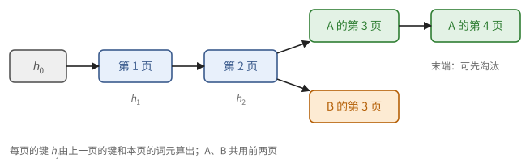
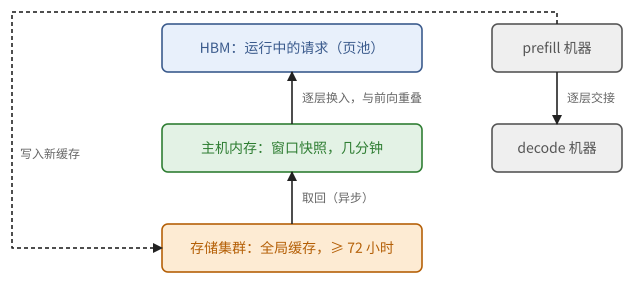

# 第 32 章　KV cache 的存储系统

到目前为止，KV cache 都被当作一块随序列增长、请求结束就丢掉的内存。可是同一个用户的下一轮对话，开头就是上一轮的全部内容；一个智能体反复调用工具，每次的提示都以同一段越来越长的历史开头。若每次都从头 prefill，大部分算力都花在重复的工作上。

这一章把 KV cache 当作一个存储系统来设计。先看设备上的页怎样管理和共享；再看怎样认出两个请求有相同的前缀，把上一次算好的缓存直接拿来用；然后看缓存放在哪一级存储、存多久，什么时候从存储里读回比重新计算划算；接着看 prefill 与 decode 分开部署时，缓存怎样从一台机器搬到另一台；最后看第 30 章那些固定大小的状态怎样保存。

用到第 3 章的存储层次（3.6 节），第 4 章的单次拷贝代价（命题 4.19），第 11 章的分页 KV cache（11.8 节），第 29 章关于缓存复用的观察（29.3 节），第 30 章的缓存账（30.7 节）和滑动窗口（30.3 节），以及第 31 章的页池与调度。例子主要取自 DeepInfer 和 DeepSeek-V4.1 的技术报告。

## 32.1 页的管理与共享

第 31 章的页池是一个大数组，分成 $P$ 页。管理它的数据结构很简单：一张空闲页的链表，加上每页一个**引用计数**（reference count），记录有几个请求正在用这一页。分配时从链表头取一页，计数置 1；一个请求不再用某页时，计数减 1，减到 0 就放回链表。两种操作都是常数时间。DeepInfer 的页管理器就是一条双向链表加一个计数数组，并且永远不用第 0 页，让 0 在页表里表示"空"。

引用计数让几个请求可以共用页。最常见的场合是**并行抽样**：同一个提示要 $n$ 个不同的回答（例如让用户挑一个，或者强化学习里对同一个问题采样多次）。提示部分的缓存对 $n$ 个回答完全相同，只需算一次、存一份。

> **例 32.1（$n$ 个回答共用提示）** 提示 $L = 4000$ 个词元，每页 $b = 16$，要 $n = 8$ 个回答，各生成 $m = 1000$ 个词元。不共享时每个回答各占 $\lceil 5000/16 \rceil = 313$ 页，共 2504 页。共享时，提示的前 $\lfloor 4000/16 \rfloor = 250$ 页只存一份，引用计数为 8；每个回答再各自占 $313 - 250 = 63$ 页，共 $250 + 8 \times 63 = 754$ 页，约为不共享时的 30%。

例中 $4000$ 恰好是 16 的倍数。若提示停在一页的中间，最后那一页的前半是提示、后半要写各自生成的内容，就不能共用了：分叉时给每个回答各复制一份这一页（**写时复制**，copy-on-write），之后各写各的。DeepInfer 在分叉时就是这样克隆最后一页的。这里的规则只有一条，就是命题 31.4 的第 3 条：计数大于 1 的页只读。

## 32.2 前缀缓存

29.3 节说过：由于因果掩码，位置 $t$ 的键值只依赖于位置 $0$ 到 $t$ 的词元。所以两个请求只要开头的词元完全相同，这一段的缓存就完全相同。

> **定义 32.2（前缀缓存）** 请求结束后，它的页不立即清空，而是连同"这些页存的是哪一段前缀"的记录一起留在池中。新请求到来时，找出池中与它的提示开头一致的最长一段，直接引用这些页（计数加 1），只对剩下的部分做 prefill。这样的机制称为**前缀缓存**（prefix caching）。

多轮对话是最直接的受益者：第 $k$ 轮的提示是"前 $k - 1$ 轮的全部内容加上新的一句"，前缀与上一轮完全一致。智能体的负载更极端：一次任务里几十上百次工具调用，每次的提示都是越来越长的同一段历史。

**怎样认出相同的前缀。** 不能逐个词元地比较所有缓存中的序列，要建索引。只对整页建索引：

> **定义 32.3（链式哈希）** 设 $H$ 是一个哈希函数。对词元序列 $x$ 的第 $j$ 个整页（$j = 1, 2, \dots$，第 $j$ 页是位置 $[(j-1)b, jb)$），定义
>
> $$
> h_0 = H(\text{附加信息}), \qquad h_j = H\big(h_{j-1},\ x[(j-1)b : jb]\big).
> $$
>
> 池中每个被缓存的整页以它的 $h_j$ 为键登记在一张哈希表里。附加信息包括模型版本，以及一切会影响缓存内容却不在词元里的东西（例如图像的内容摘要）。

> **命题 32.4（链式哈希识别前缀）** 若 $H$ 没有碰撞，则两个序列 $x, y$（附加信息相同）的第 $j$ 页哈希值相等，当且仅当它们的前 $jb$ 个词元完全相同。

*证明* 对 $j$ 归纳。$j = 0$ 时两边都只依赖附加信息。若 $h_j(x) = h_j(y)$，由无碰撞，$h_{j-1}(x) = h_{j-1}(y)$ 且第 $j$ 页的词元相同；由归纳假设前 $(j-1)b$ 个词元相同。反方向直接代入定义。∎

为什么要把前一页的哈希值串进来，而不是只对每页自己的词元求哈希？因为一页缓存的内容取决于它前面的全部词元：两个序列的第 5 页词元相同，但前 4 页不同，它们的第 5 页缓存就不同（习题 32.2）。

**图 32.1**　链式哈希把缓存的页连成一棵树。共同的前缀是共同的祖先；查找从根出发，走到第一个查不到的页为止。

查找时，从 $j = 1$ 起依次算 $h_j$，在表里查，第一次查不到就停。这样得到的命中长度总是页长的整数倍。还有一个小约束：命中的部分不能是提示的全部，至少要留一个词元做 prefill，因为下一个词元的分布要从最后一个位置的 logits 抽出来（例 29.15），而 logits 没有被缓存。

> **例 32.5（命中多少）** $b = 16$。上一轮的序列长 1000 个词元，都已缓存（前 62 个整页登记过，第 63 页只写了 8 个词元，不登记）。新一轮的提示是上一轮的全部 1000 个词元加上 37 个新词元。按页查找：前 62 页命中，第 63 页的 16 个词元中前 8 个与上一轮相同，但这一页没有登记，查不到。命中 $62 \times 16 = 992$ 个词元，只需 prefill 剩下的 45 个。

另一种常见的组织方式是**基数树**（radix tree）：把所有缓存的序列按词元排成一棵前缀树，共同的前缀是共同的祖先（SGLang 的 RadixAttention）。它和链式哈希表存的信息一样，好处是能直接看出页与页之间的父子关系，下面的淘汰会用到。

**淘汰。** 池满了，要腾出页。计数为 0 的缓存页都可以淘汰，挑哪些？

> **命题 32.6（先淘汰末端）** 若某个缓存页被淘汰，链上它后面的所有页都再也不会被命中（查找在它这里就停了）。所以在 LRU（最久未用的先淘汰）之外，应当只淘汰链的末端：一页只有在它后面的页都已淘汰（或从来没有）时才可以淘汰。

*证明* 查找从 $j = 1$ 起依次进行，在第一个查不到的页处停止（定义 32.3）。∎

> **注 32.7（缓存也会泄露信息）** 命中缓存的请求，首词元时间明显更短。若不同用户共用一个缓存，攻击者可以构造一段提示、测量它的响应时间，判断别人最近是否发过以这段文字开头的请求。多租户的服务因此把租户的身份放进附加信息 $h_0$，让不同租户的缓存互不相通。

## 32.3 存在哪里，存多久

HBM 只有几十到几百 GB，装不下多少用户的历史。第 3 章的存储层次（定义 3.17）在这里往外延伸了几级：

| 存储 | 每台服务器的容量 | 每块设备分到的带宽（量级） | 适合存放 |
| --- | --- | --- | --- |
| HBM | 每块几十到几百 GB | 数 TB/s | 正在运行的请求 |
| 主机内存 | 1–2 TB | 数十 GB/s | 刚结束的、几分钟内可能继续的会话 |
| 本地 SSD | 数十 TB | 数 GB/s | 几小时到几天 |
| 存储集群 | 每台存储服务器数百 TB，集群可达 PB 级 | 数 GB/s，经网络 | 几天，任何计算节点都能读 |

缓存存得越远，读回越慢。什么时候读回比重新计算划算？

> **命题 32.8（读回还是重算）** 设模型 prefill 每个词元的运算量为 $F$ FLOP，设备的有效算力为 $P u$（$u$ 为利用率）；缓存每个词元 $e$ 字节，从某一级存储读回的带宽为 $\beta$、固定开销为 $\alpha$。命中的前缀有 $n$ 个词元时，读回比重算快，当且仅当
>
> $$
> \alpha + \frac{ne}{\beta} < \frac{nF}{Pu}.
> $$
>
> $n$ 较大时，这等价于 $\beta > \beta^* = \dfrac{e\,Pu}{F}$；称 $\beta^*$ 为**持平带宽**。

*证明* 两边分别是读回 $ne$ 字节（命题 4.19）和重算 $n$ 个词元的时间。$n \to \infty$ 时 $\alpha$ 可以忽略，两边除以 $n$。∎

> **例 32.9（两种模型的持平带宽）** 设有效算力 $Pu = 10^{15}$ FLOP/s。
>
> 一个 700 亿参数的稠密 GQA 模型：$e = 327{,}680$ 字节（30 章开头的例子），$F \approx 2 \times 7 \times 10^{10}$。$\beta^* = 327680 \times 10^{15} / (1.4 \times 10^{11}) \approx 2.3$ GB/s。从主机内存读回轻松划算；从本地 SSD 读，要每块设备分到几 GB/s 才划算，勉强。
>
> DeepSeek-V4.1-Flash：$e = 890$ 字节（例 30.14），prefill 每词元只激活约 80 亿参数（30.5 节），$F \approx 1.6 \times 10^{10}$。$\beta^* \approx 56$ MB/s。即使经网络从存储集群读，带宽也高出持平点几十倍。
>
> 对后者，问题不再是"值不值得读回"，而是"存得下多少、存多久"。

**存多久。** 缓存的价值在于以后还会被命中，而命中的概率随时间衰减。

> **命题 32.10（容量与保存时间）** 若系统平均每秒产生 $\lambda$ 个新的（未命中的）词元，每个词元的缓存 $e$ 字节，要求每份缓存至少保存时间 $\tau$，则需要的存储至少是 $\lambda e \tau$。

*证明* 时间 $\tau$ 内新产生的缓存都必须同时存在，共 $\lambda \tau e$ 字节。∎

> **现状（2026-10）**：DeepSeek 为 DeepSeek-V4.1-Flash 的线上服务配了一个专门的存储集群，用自家的分布式文件系统 3FS 存放全局缓存，约 100 PiB 的 SSD；每台存储服务器 20 块 30.73 TB 的 SSD，读不低于 40 GB/s；按逻辑容量算，每块在线的 GPU 配约 14.4 TB。缓存保存不少于 72 小时：智能体的流量 3 天，聊天的流量 7 天（聊天的命中有更长的尾巴，一小部分缓存会被读很多次）。数据按 10 + 2 的纠删码存放，读取时同时向 11 个节点发请求，任意 10 个返回即可解码，以此压住尾部延迟。

用命题 32.10 检查一下这个配置：14.4 TB 除以每词元 890 字节，约 $1.6 \times 10^{10}$ 个词元。若一块设备以 $10^{15}$ FLOP/s 的有效算力不停地 prefill，每秒产生 $10^{15} / (1.6 \times 10^{10}) \approx 6 \times 10^4$ 个新词元，填满 14.4 TB 要约 3 天。存储的规模恰好对应几天的保存时间（习题 32.6）。若换成每词元 327,680 字节的稠密模型，同样的 14.4 TB 只够存不到 2 小时的产出，按天保存缓存根本无从谈起。第 30 章那些压缩缓存的结构，正是在这里兑现了价值。

**为什么用一个独立的存储集群。** 也可以让每台计算机器把缓存存在自己的主机内存和 SSD 里。那样，命中缓存的请求必须被送到存着它前缀的那台机器上，而负载均衡希望把请求送到最闲的机器上，两者常常冲突。缓存放在一个所有机器都能读的存储集群里，任何一台 prefill 机器都能命中任何前缀，路由就只管负载；计算机器的故障率比存储机器高一个数量级以上，缓存也不会随计算机器一起丢失；两类机器还可以各自扩容。代价是每次读回都要走网络，但如例 32.9 所示，对缓存很小的模型，这点带宽完全够用。

**一次命中的流程。** DeepInfer 的技术说明给出了三步：

1. **匹配**：接入层对提示算链式哈希，查存储的元数据，得出命中长度。路由要用到命中长度（还要 prefill 多少词元决定了这个请求有多重），所以这一步无法与别的工作重叠。
2. **取回**：由一个单独的进程异步地把命中的缓存从存储集群读进主机的共享内存。
3. **换入**：引擎进程里的一个线程把缓存从主机内存逐层搬进 HBM，与前向计算重叠（例 31.1 的做法），由网卡直接写入显存。

**图 32.2**　DeepSeek-V4.1-Flash 部署中缓存的三级存放。新缓存写入存储集群；命中时先取回到主机内存，再逐层换入 HBM。prefill 与 decode 分开部署时，缓存在两类机器之间逐层交接。

## 32.4 prefill 与 decode 分离时的搬运

11.8 节说过，大规模服务常把 prefill 和 decode 放在不同的机器上。prefill 机器算完一个请求的缓存，要把它交给 decode 机器。这条链路要多宽？

> **命题 32.11（交接所需的带宽）** 设 prefill 一侧每秒处理 $\lambda$ 个未命中的词元，每词元缓存 $e$ 字节；另有每个请求固定大小的状态 $\sigma$ 字节（例如滑动窗口的缓存），每秒交接 $\mu$ 个请求。则 prefill 到 decode 的链路至少要 $\lambda e + \mu \sigma$ 字节每秒。

*证明* 每秒新产生的缓存都要交给 decode 一侧。∎

（若 decode 一侧还要用到命中的前缀，那部分缓存可以由 decode 机器自己从存储集群读，也可以由 prefill 机器转交；后者会把命中的部分也算进这条链路。）

> **例 32.12（两种模型的交接带宽）** 8 块设备的 prefill 机器，每块有效算力 $10^{15}$ FLOP/s。
>
> 700 亿参数的稠密模型：每秒 $8 \times 10^{15} / (1.4 \times 10^{11}) \approx 5.7 \times 10^4$ 个词元，乘以 327,680 字节，约 18.7 GB/s，即约 150 Gb/s。
>
> DeepSeek-V4.1-Flash：每秒约 $5 \times 10^5$ 个词元，乘以 890 字节约 0.45 GB/s；若每个请求平均新增 1000 个词元，每秒 500 个请求，每个再带约 2.8 MB 的滑动窗口状态（例 30.14），又是 1.4 GB/s。合计约 1.9 GB/s，约 15 Gb/s。
>
> DeepInfer 的建议是：若把 prefill 和 decode 放在不同的机房，每 8 块 GPU 预留约 400 Gb/s 的带宽。按上面的估算，单是交接缓存只占其中一小部分，所以跨机房分离在技术上可行。他们实际把推理节点放在相邻的不同机房；技术说明还提醒，机房之间的光纤容易被施工挖断。

交接也要和计算重叠：prefill 每算完一层，就把这一层的缓存发出去，不必等整个请求算完。decode 一侧事先为这个请求分配好页，数据经网卡直接写进这些页。

## 32.5 固定大小的状态与快照

第 30 章的滑动窗口缓存和线性层的状态，每个序列一块、大小固定，不能按前缀分页。这给前缀缓存带来一个新问题：要从位置 $L_1$ 接着算，必须恰好有位置 $L_1$ 的状态。

> **定义 32.13（快照）** 一个序列在位置 $t$ 的**快照**（snapshot）是它在处理完前 $t$ 个词元之后的全部固定大小的状态（各层的滑动窗口缓存、线性层的状态等）。

系统不可能为每个位置都存快照，只在粒度 $g$ 的倍数处存。于是命中长度要同时满足两件事：全局缓存命中到 $L_1$（$b$ 的倍数），并且 $L_1$ 处有快照。

DeepInfer 的规则取 $g = b = 128$：先查全局缓存得到命中长度 $L_1$；再查快照，若 $[L_1 - 128, L_1]$ 内有快照，命中长度就是 $L_1$（从快照出发，重放到 $L_1$ 补出窗口）；否则退一页，取 $L_1 - 128$，并把命中部分的最后 128 个词元重放一遍，近似地补出窗口状态（下面的近似重建）。decode 期间，序列每跨过一个 128 的边界，就在设备上把当前的窗口复制一份；投机解码一步可能跨过边界好几个位置，复制的时刻因此可能比边界晚至多 5 个词元，环形缓冲多留的槽（命题 30.8 之后的说明）正好吸收这个偏差。

**快照丢了怎么办。** 要么精确重建：由命题 30.7，要重算约 $n_L W$ 个词元；要么近似重建：只重算最后 $W$ 个词元，并让这段重算里的窗口不越过重算的起点。

> **例 32.14（存、精确重算、近似重算）** DeepSeek-V4.1-Flash：40 层，$W = 128$。一个快照约 2.8 MB（例 30.14）。精确重建要重算约 $40 \times 128 = 5120$ 个词元；近似重建只重算 128 个，便宜 40 倍。
>
> 存快照要占存储：若和全局缓存一起存几天，在短轮次的多轮对话中，快照的总量与全局缓存相当（V4 的部署中，窗口缓存约占持久缓存的一半）。技术报告的观察是：快照只在一个会话还活着的几分钟里有用，会话结束或换了话题就再也用不上；全局缓存却有长尾的复用。两者的访问模式不同，就不该放在同一级存储、用同一个保存期限。V4.1 因此把快照放在每台机器主机内存的一个小池子里（约占主机内存的 10%），只保存几分钟，过期立即回收；全局缓存放在存储集群里，保存至少 72 小时；快照找不到时用近似重建兜底。持久缓存因此缩小到 V4 的约 1/8。

近似重建有一个代价，值得审查时记住：同一个请求，命中在不同的位置，重算的那一段窗口不同，后面算出的缓存和输出也会不同。这和第 10 章的批不变性（定义 10.26）一样，是"同样的输入，不同的执行情形，不同的比特"；区别在于，这里是设计者为了成本有意接受的。技术报告也明确把"缓存续接边界处的近似状态"列为需要继续压力测试的风险。

## 本章小结

1. 页池用空闲链表加引用计数管理，分配释放都是常数时间；并行抽样的 $n$ 个回答共用提示的整页，分叉时复制未写满的最后一页；计数大于 1 的页只读。（32.1 节、例 32.1）
2. 前缀缓存把结束请求的页留在池中，新请求引用最长的相同前缀。只对整页建索引，键是链式哈希 $h_j = H(h_{j-1}, \text{第 } j \text{ 页})$；无碰撞时哈希相等当且仅当前 $jb$ 个词元相同。命中长度是页长的倍数，且至少留一个词元做 prefill。（定义 32.2、32.3，命题 32.4，例 32.5）
3. 淘汰只淘汰链的末端，否则后面的页再也命中不了；多租户要把租户身份放进哈希，防止通过响应时间探测别人的提示。（命题 32.6、注 32.7）
4. 读回比重算划算，当且仅当带宽超过持平带宽 $\beta^* = ePu/F$；稠密 GQA 模型约几 GB/s，DeepSeek-V4.1-Flash 只有约 56 MB/s。保存时间 $\tau$ 需要存储 $\lambda e \tau$；每词元 890 字节时，每块设备 14.4 TB 约可保存 3 天的产出。（命题 32.8、32.10，例 32.9）
5. 独立的存储集群让任何机器都能命中任何前缀，路由只需考虑负载；命中的流程是匹配、取回、逐层换入。（32.3 节）
6. prefill 与 decode 分离时，链路至少要 $\lambda e + \mu\sigma$；缓存很小时，跨机房分离也可行。交接要逐层与计算重叠。（命题 32.11、例 32.12）
7. 固定大小的状态只能按快照续接；命中长度要同时对齐全局缓存与快照。快照丢失时精确重建要 $n_L W$ 个词元，近似重建只要 $W$ 个，但结果随命中位置而变。访问模式不同的数据放在不同的存储级、用不同的保存期限。（定义 32.13、例 32.14）

## 习题

**习题 32.1** ★ 提示 $L = 1000$ 个词元，$b = 16$，要 $n = 4$ 个回答，各生成 $m = 300$ 个。(a) 不共享时共多少页？(b) 共享时呢？分叉时要复制几页？(c) 若 $L = 1008$ 呢？

提示 1

$1000 = 62 \times 16 + 8$：提示的最后一页没写满。

答案

(a) 每个回答 $\lceil 1300/16 \rceil = 82$ 页，共 328 页。(b) 前 62 页共享；每个回答从第 63 页（提示的后 8 个词元加生成的内容）起各自占 $82 - 62 = 20$ 页，第 63 页要为每个回答复制一份（共复制 4 次，或者原页留给其中一个、复制 3 次）。共 $62 + 4 \times 20 = 142$ 页。(c) $1008 = 63 \times 16$，提示恰好占满 63 页，全部共享，不必复制；每个回答各占 $\lceil 1308/16 \rceil - 63 = 82 - 63 = 19$ 页，共 $63 + 76 = 139$ 页。

**习题 32.2** ★ 若哈希只对每页自己的词元求，即 $h_j = H(x[(j-1)b : jb])$，举一个例子说明前缀缓存会返回错误的缓存。

提示 1

29.3 节：一页缓存的内容依赖于它前面的全部词元。

答案

取 $b = 2$。缓存中有序列 $x = (\text{我}, \text{爱}, \text{北}, \text{京})$ 的两页。新请求 $z = (\text{北}, \text{京}, \dots)$ 的第 1 页词元是"北京"，与 $x$ 的第 2 页相同，按页单独哈希得到相同的键，于是查找命中，把 $x$ 的第 2 页当作 $z$ 的第 1 页。可那一页的键值是在"我爱"之后、在位置 2–3 上算出的：RoPE 的角度不对，第 2 层起的键值还看过"我爱"（29.3 节）。结果错了，且不会报错。链式哈希把前文编进键里，排除了这种情况。

**习题 32.3** ★ $b = 64$。上一轮序列长 2000 个词元，全部缓存。(a) 新提示是上一轮的前 1500 个词元（用户编辑了自己更早的一句话，从第 1500 个词元起不同）加上 600 个新词元，命中多少？(b) 新提示恰好就是上一轮的 2000 个词元（重新生成同一个回答），命中多少？要 prefill 多少？

提示 1

命中只到登记过的整页，且至少留一个词元。

答案

(a) 前 $\lfloor 1500/64 \rfloor = 23$ 页完全相同，第 24 页（位置 1472–1535）中有不同的词元，不命中。命中 1472，prefill $2100 - 1472 = 628$ 个。(b) 上一轮登记了 $\lfloor 2000/64 \rfloor = 31$ 页（1984 个词元）。提示 2000 个词元，31 页全部命中，剩 16 个；命中 1984，prefill 16 个。若提示恰好是 1984 个词元，31 页全中，但必须留一个，只能用前 30 页，prefill 64 个（或者实现上允许命中最后一页、只重算最后一个词元）。

**习题 32.4** ★ 按 DeepInfer 的规则（$b = g = 128$），一个提示长 5000 个词元，全局缓存命中到 $L_1 = 4864$。(a) 若快照池里有位置 4864 的快照，命中长度是多少？要 prefill 多少个新词元？(b) 若最近的快照在位置 4736 呢？(c) 若 $[4736, 4864]$ 内没有任何快照呢？

提示 1

32.5 节的规则：$[L_1 - 128, L_1]$ 内有快照就取 $L_1$，否则退一页，并把命中部分的最后 128 个词元重放一遍。

答案

(a) 命中 4864，从快照直接接着算，prefill 136 个新词元。(b) $4736 \in [4736, 4864]$，命中长度仍是 4864：从 4736 的快照出发，把 4736–4863 这一页重放一遍，只为补出窗口状态（这一页的全局缓存直接复用），再 prefill 136 个新词元；这次重建是精确的，因为起点有精确的快照。(c) 命中长度退到 4736，prefill 264 个新词元；4736 处的窗口状态由重放 4608–4735 这 128 个词元近似得到。

**习题 32.5** ★ 一个 80 亿参数的稠密模型，32 层、8 个键值头、头维数 128、bf16 缓存。设备的有效算力 $4 \times 10^{14}$ FLOP/s。(a) 持平带宽是多少？(b) 读回固定开销 $\alpha = 2$ ms、带宽 5 GB/s 时，命中多少个词元以上才值得读回？

提示 1

命题 32.8；$e = 2 \times 32 \times 8 \times 128 \times 2$。

答案

(a) $e = 131{,}072$ 字节，$F = 1.6 \times 10^{10}$，$\beta^* = 131072 \times 4 \times 10^{14} / (1.6 \times 10^{10}) \approx 3.3$ GB/s。(b) 读回每词元 $131072 / (5 \times 10^9) \approx 26\,\mu\text{s}$，重算每词元 $1.6 \times 10^{10} / (4 \times 10^{14}) = 40\,\mu\text{s}$，每词元省约 $13.8\,\mu\text{s}$；要抵消 2 ms 的固定开销，需 $n > 2000/13.8 \approx 145$ 个词元。短的命中不值得去远处读。

**习题 32.6** ★ 用 32.3 节现状框的数字：每块 GPU 配 14.4 TB 的逻辑容量，每词元 890 字节。设 prefill 每词元 $1.6 \times 10^{10}$ FLOP，一块 GPU 的有效算力为 $10^{15}$ FLOP/s，且所有在线 GPU 中有一半在做 prefill、一直满负荷。(a) 存储能保存多少天的新缓存？(b) 若改成 V4 的情形（每词元的持久缓存是 V4.1 的 8 倍），同样的存储能保存多久？(c) 纠删码 10 + 2 使物理容量比逻辑容量多多少？

提示 1

命题 32.10：时间 = 容量 /（每秒新词元数 × 每词元字节）。一半的 GPU 在做 prefill，摊到每块在线 GPU 上，每秒的新词元数减半。

答案

(a) 每块做 prefill 的 GPU 每秒 $6.25 \times 10^4$ 个词元；摊到每块在线 GPU 约 $3.1 \times 10^4$ 个，每秒 $2.8 \times 10^7$ 字节。$1.44 \times 10^{13} / 2.8 \times 10^7 \approx 5.1 \times 10^5$ 秒，约 6 天。考虑到命中缓存的请求不产生新缓存、算力利用率也不是一直满载，这与 3–7 天的保存期限在同一量级。(b) 约 0.75 天，不到 72 小时的目标。(c) 12/10，多 20%。

**习题 32.7** ★ 用命题 32.11 估算：一个 MLA 模型（DeepSeek-V3 的缓存，每词元 70,272 字节，prefill 每词元约 $7.4 \times 10^{10}$ FLOP），8 块设备、每块有效算力 $10^{15}$ FLOP/s 的 prefill 机器，交接需要多少带宽？与例 32.12 的两个模型比较。

提示 1

每秒词元数 $= 8 \times 10^{15} / F$。

答案

每秒约 $1.08 \times 10^5$ 个词元，乘以 70,272 字节约 7.6 GB/s，约 61 Gb/s。介于稠密 GQA 模型（150 Gb/s）与 V4.1-Flash（约 15 Gb/s）之间。注意 V3 每词元的计算量更大，每秒产生的词元更少，所以虽然每词元的缓存只有稠密模型的 1/4.7，带宽只低了约 2.5 倍。

**习题 32.8** ★（审查题）一个前缀缓存的实现按"最久未用"淘汰任意计数为 0 的页。它有什么问题？举例说明。

提示 1

命题 32.6。同一条链上各页的最近使用时间有什么关系？

答案

同一条链上的页通常是同一个请求在同一时刻用过的，最近使用时间相同或相近。按 LRU 在它们之间任意挑选，可能先淘汰了链中间的一页，它后面的页全部变成再也无法命中的死页（命题 32.6），却仍占着池子，直到它们自己也被淘汰；池子的有效容量因此变小。应当只淘汰链的末端（基数树的叶子），或者在淘汰一页时连同它的后代一起淘汰。

**习题 32.9** ★ 一次对话有 10 轮，每轮用户说 200 个词元，模型回答 300 个词元，系统提示 1000 个词元。(a) 没有前缀缓存时，10 轮共 prefill 多少词元？(b) 有前缀缓存且总能命中呢？(c) 若每轮之间相隔太久，缓存都被淘汰了呢？

提示 1

第 $k$ 轮的提示 $= 1000 + 500(k - 1) + 200$。

答案

(a) $\sum_{k=1}^{10} (1200 + 500(k-1)) = 12000 + 500 \times 45 = 34{,}500$。(b) 第 1 轮 1200，之后每轮只需新的 200 个加上上一轮回答的 300 个（回答在生成时已写入缓存，若回答结束时缓存被保留，则只需 200 个）。按回答已缓存计：$1200 + 9 \times 200 = 3000$，约为 (a) 的 9%。(c) 与 (a) 相同。保存期限决定了 (b) 和 (c) 哪个是现实。

**习题 32.10** ☆ 一个面向多个企业客户的服务共用一个前缀缓存，所有客户的哈希都从同一个 $h_0$ 开始。描述一个攻击，说明攻击者需要能测量什么，以及注 32.7 的修正为什么能挡住它。

提示 1

命中时首词元时间明显更短。

答案

攻击者猜测另一家公司的系统提示可能以某段文字开头（例如某个产品名），把这段文字作为自己请求的开头发送，测量首词元时间：若明显比随机文字短，说明这段前缀在缓存里，即最近有人发过以它开头的请求。逐页延长猜测，就能一点点拼出别人的提示。把租户身份放进 $h_0$ 后，不同租户的哈希链从一开始就不同，攻击者的请求不可能命中别人的页。

**习题 32.11** ☆ 一个 30 层、窗口 $W = 256$ 的模型，每层快照 1 MB。(a) 精确重建要重算多少个词元？近似重建呢？(b) 若每个会话平均 20 轮、每轮新增 500 个词元，每轮结束存一个快照并保存 3 天，与每词元 2000 字节的全局缓存相比，快照占多大比例？

提示 1

(b) 每轮新增全局缓存 $500 \times 2000$ 字节，快照 $30 \times 1$ MB。

答案

(a) 约 $30 \times 256 = 7680$ 个；近似 256 个。(b) 每轮全局缓存 1 MB，快照 30 MB，快照是全局缓存的 30 倍。轮次越短，快照越占大头。这就是 V4.1 不再持久保存快照、改为几分钟的内存池加近似重建的原因。

