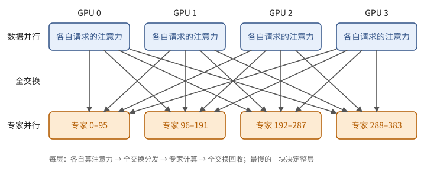

# 第 33 章　集群上的推理服务

前两章讲的是一个引擎和它的缓存。可 DeepSeek-V4.1-Flash 的权重就有 510 GB，一个 decode 实例要用 64 到 128 块 GPU；整个服务由许多这样的实例、专门做 prefill 的机器、专门跑视觉编码器的机器和一个存储集群组成。DeepSeek 说，这样的一个集群每天要处理上百万亿个词元。

这一章讲怎样把这些机器组织起来：三个阶段各用什么并行，为什么 decode 要把专家分得很散，专家的负载怎样均衡，请求怎样分给实例，大批量时投机解码怎样决定每个请求验证几个草稿，机器坏了怎么办，最后算一笔成本。每一节都会回到前面某个简单的模型：屋顶线、全交换、最忙的那块设备决定整步的时间。

用到第 6 章的小批量矩阵乘法（命题 6.21），第 11 章的混合专家与投机解码（11.9、11.11 节），第 12 章的专家并行（12.7、12.8 节），以及第 30–32 章。

## 33.1 三个阶段，三种部署

一个多模态请求要经过三个阶段：视觉编码器把图像变成向量（例 29.11），prefill 处理提示，decode 逐个生成。三者的瓶颈各不相同：视觉编码器的模型小、每张图的计算量固定；prefill 计算受限；decode 每步要读大量权重和缓存、计算很少（11.8 节）。所以 DeepSeek-V4.1-Flash 的部署把它们分到三类机器上，各自扩容。

> **现状（2026-10）**：DeepInfer 的技术说明给出的部署是：视觉编码器每个实例一块 GPU，建议用较便宜的型号；prefill 用普通的 8 卡机器，专家并行取显存允许的最小值（EP2 到 EP8）；decode 用 64 到 128 卡的超节点（同一个高带宽交换域），专家并行取可用 GPU 允许的最大值（EP64 到 EP128）。注意力一律用数据并行，数据并行的份数等于专家并行的份数；不用张量并行，也不用上下文并行。prefill 与 decode 的 GPU 数量之比约为 1:1，最小的高效部署是 64 块 prefill 加 64 块 decode。

注意力为什么用数据并行，命题 30.5 已经给出了理由：MLA 类的注意力只有一个共享的潜向量，按头切分只会把缓存复制许多份。于是一个 decode 实例的结构是：$p$ 块 GPU，每块各自持有一批完整的请求、做它们的注意力；到了混合专家层，所有 GPU 一起做两次全交换（12.7 节），每块 GPU 负责 $E/p$ 个专家。

**图 33.1**　一个 decode 实例（这里画 4 块 GPU、384 个专家）。注意力按请求分在各块 GPU 上，专家按编号分在各块 GPU 上，两者之间每层两次全交换。

这个结构有一个直接的后果：

> **命题 33.1（最慢的一块决定一步）** 在注意力数据并行、混合专家用专家并行的实例中，每个混合专家层的全交换要等所有 GPU 都算完注意力才能开始，专家计算完成后的回收又要等最忙的专家。所以一步的时间是
>
> $$
> \sum_{\ell} \Big(\max_g\, t^{\text{attn}}_{g,\ell} + \max_g\, t^{\text{moe}}_{g,\ell} + t^{\text{a2a}}_\ell\Big),
> $$
>
> 其中 $g$ 取遍实例中的 GPU。任何一块 GPU 的注意力或专家负载偏重，所有 GPU 都要等它。

*证明* 全交换是集合操作，每个参与者都要发出自己的数据（定义 7.8），所以它在最后一个参与者到达后才完成；每层依次进行。∎

后面两节分别处理这两个 $\max$：专家的负载靠专家负载均衡（33.3 节），注意力的负载靠请求的路由（33.4 节）。在这之前，先看 decode 为什么要用这么多 GPU。

## 33.2 为什么 decode 要把专家分散

把 decode 实例从 8 块 GPU 扩到 64 块，容量是够了，可是每块 GPU 的效率为什么会提高？关键在于每块 GPU 每步要读多少专家权重、这些权重被多少词元分摊。

> **命题 33.2（专家并行的强度）** decode 实例有 $p$ 块 GPU，每块每步处理 $n$ 个词元（含投机解码要验证的位置）；共 $E$ 个路由专家，每个词元选 $k$ 个，每个专家的三个矩阵共 $3DF_e$ 个参数、每个参数 $s$ 字节。设路由大致均匀，则
>
> 1. 每个专家每步平均分到 $pnk/E$ 个词元；
> 2. 每块 GPU 每步要读 $(E/p) \cdot 3DF_e s$ 字节的专家权重；
> 3. 专家部分在每块 GPU 上的算术强度约为 $\dfrac{2pnk}{Es}$。

*证明* 全实例每步有 $pn$ 个词元、$pnk$ 次"词元分给专家"，均分到 $E$ 个专家。每块 GPU 持有 $E/p$ 个专家，几乎每个都会被用到（习题 11.12），所以要读全部权重。每块 GPU 平均承担 $nk$ 次分派，每次 $6DF_e$ FLOP；除以读的字节数即得强度。∎

每块 GPU 能处理多少个词元，$n$ 受单用户速度的限制（命题 31.14）：一步不能太长。在 $n$ 固定时，专家部分的强度与 $p$ 成正比。这是命题 6.21 在混合专家上的样子：把 $N$ 换成每个专家分到的词元数 $pnk/E$。

> **例 33.3（EP8 与 EP64）** DeepSeek-V4.1-Flash：$E = 384$，$k = 6$，每个专家约 18.8 MB（习题 29.2），40 层。设每块 GPU 服务 60 个请求，每个请求每步验证约 4 个位置，$n = 240$。
>
> | | EP8 | EP64 |
> | --- | ---: | ---: |
> | 每块 GPU 每层的专家数 | 48 | 6 |
> | 每步要读的专家权重 | 36 GB | 4.5 GB |
> | 按 8 TB/s 读完需要 | 4.5 ms | 0.56 ms |
> | 每个专家分到的词元 | 30 | 240 |
> | 专家部分的强度（FLOP/字节） | 约 113 | 约 900 |
>
> EP8 时，单是读专家权重每步就要 4.5 ms，而且强度远低于 B200 按 fp8 计的拐点（约 560 FLOP/字节，附录 A），矩阵单元大部分时间闲着。EP64 时读权重只要 0.56 ms，强度越过了拐点。在同样的单用户速度下，EP64 每块 GPU 的吞吐高得多。DeepInfer 公布了 EP8 与 EP64 的对比曲线，结论相同。

代价在通信上。每块 GPU 每层要把 $nk$ 份隐藏向量发出去、收回来；例 12.15 算过，这两次全交换常常决定 decode 的速度，而且只有在高带宽的交换域里才划算。所以宽专家并行要求整个实例在一个超节点里：DeepInfer 的 decode 基准用的就是同一个交换域内的 64 块 GPU。

还有一点：64 块 GPU 时，每块 GPU 上的专家权重只有约 4.5 GB，其余的权重（注意力、共享专家等，每块 GPU 各存一份）和按行切分的 Engram 表也只有十几 GB；每块 GPU 60 个请求的缓存，按每词元 890 字节、128K 上下文算，也只有约 7 GB。decode 的瓶颈不是显存容量，而是每步的时间。DeepInfer 的说明里也写道：decode 不受缓存容量限制，所以 decode 期间不把缓存卸载到主机。

## 33.3 专家的负载均衡

命题 33.2 假定路由均匀。实际上，有的专家很热门，一步里分到的词元是平均的好几倍。由命题 33.1，全实例都要等持有热门专家的那块 GPU。衡量这件事的量是

$$
\lambda = \frac{\max_g (\text{GPU } g \text{ 的专家负载})}{\operatorname{mean}_g (\text{GPU } g \text{ 的专家负载})},
$$

专家部分的时间按 $\lambda$ 倍拉长。DeepInfer 称之为 `moe_lb`。

对付热门专家有两个办法。第一，**冗余专家**：每块 GPU 多留一两个槽，放热门专家的副本；一个专家有 $c$ 份副本时，它的词元平分给各副本，每份的负载变成 $1/c$。第二，**摆放**：把这些副本分到各块 GPU 上，使最忙的 GPU 尽量不忙。

第二件事是一个经典的调度问题：有若干个"任务"（专家的副本，各有负载 $w_i$），要分给 $m$ 台"机器"（GPU），使负载最大的机器尽量轻。它是 NP 难的，常用的是贪心法。

> **定义 33.4（列表调度与 LPT）** **列表调度**按某个次序依次处理任务，每个任务交给当前负载最小的机器。若次序是按负载从大到小，称为 **LPT**（longest processing time first）。

> **定理 33.5（列表调度的界）** 设最优的最大负载为 $\mathrm{OPT}$。任意次序的列表调度，得到的最大负载不超过 $(2 - 1/m)\,\mathrm{OPT}$。

证明的想法是盯住最后决定最大负载的那个任务：它被分配时，它去的那台机器是最闲的，所以不会比平均更忙。

*证明* 设最大负载出现在机器 $i$ 上，$j$ 是最后分给它的任务。分配 $j$ 时 $i$ 的负载最小，不超过其余任务总负载的平均：$L_i - w_j \le (W - w_j)/m$，其中 $W = \sum w$。所以
$$
L_i \le \frac{W}{m} + \Big(1 - \frac{1}{m}\Big) w_j \le \mathrm{OPT} + \Big(1 - \frac{1}{m}\Big)\mathrm{OPT},
$$
因为 $\mathrm{OPT} \ge W/m$（总负载要分完）且 $\mathrm{OPT} \ge w_j$（任何一个任务都要在某台机器上完成）。∎

Graham（1969）还证明了 LPT 的界是 $(4/3 - 1/(3m))\,\mathrm{OPT}$：先排大任务，最后剩下的小任务可以填平缝隙。

> **例 33.6（手算一次 LPT）** 3 块 GPU，7 个专家的负载为 $8, 7, 6, 5, 4, 3, 3$（总和 36，平均每块 12）。LPT：8 → GPU0，7 → GPU1，6 → GPU2，5 → GPU2（11），4 → GPU1（11），3 → GPU0（11），3 → GPU0、1、2 中最小的，三者都是 11，给 GPU0（14）。最大负载 14，$\lambda = 14/12 \approx 1.17$。最优是 12：$\{8, 4\}, \{7, 5\}, \{6, 3, 3\}$。若再加一个冗余槽，把负载 8 的专家复制一份（两份各 4），可以分成 $\{7, 5\}, \{6, 3, 3\}, \{4, 4, 4\}$，三块都是 12。

实际的摆放还有一个约束：每块 GPU 的槽位数相同（显存是按槽位预留的），所以是"每台机器恰好放 $c$ 个任务"的版本；DeepInfer 的贪心法在每次分配时跳过已经放满的 GPU。

**按每一步算，而不是按平均算。** 统计负载时，最自然的做法是把过去若干步的负载取平均，再对平均负载做均衡。这可能做错，因为每一步都是一次同步，代价是那一步的最大值。

> **例 33.7（平均负载看不出的不均衡）** 2 块 GPU，4 个专家，两步的负载：第一步 $(4, 0, 2, 2)$，第二步 $(0, 4, 2, 2)$。四个专家的平均负载都是 2，任何两两配对看上去都一样均衡。可是 $\{e_1, e_3\}, \{e_2, e_4\}$ 这种摆法，第一步是 6 对 2，第二步是 2 对 6，两步的最大值之和是 12；$\{e_1, e_2\}, \{e_3, e_4\}$ 两步都是 4 对 4，和为 8。热门专家在不同的步轮换时，应当把它们放在同一块 GPU 上互相错开。

DeepInfer 的目标函数因此是"历史上每一步的最大负载之和"：每摆一个副本，就试着把它放到每块 GPU 上，看这个和增加多少，选增加最少的。

> **现状（2026-10）**：DeepInfer 的设置：prefill 每块 GPU 起始 4 个冗余槽，统计最近 100 步的负载，每 1000 步重新摆放一次，实测 $\lambda = 1.074$（EP4）和 $1.045$（EP2）；decode 每块 GPU 1 个冗余槽，补齐到总数是 EP 份数的倍数（EP64 时每块 7 个专家：$384 + 64 = 448 = 7 \times 64$），统计 1000 步，每 10000 步重摆一次，实测 $\lambda = 1.090$。重摆时专家权重在交换域内通过 NVLink 直接搬运。训练一侧也在做同样的事：DeepSeek 的模型在训练时为每个专家维护一个偏置，只用于挑选专家、不改变权重，以此让负载均衡，而不在损失函数里加大的惩罚项（V4.1 只保留了一个权重很小的序列级惩罚）；V4.1 还为图像词元和文本词元各维护一套偏置。

## 33.4 请求的路由

命题 33.1 的另一个 $\max$ 是注意力。同一个 decode 实例里，若一块 GPU 分到的请求上下文特别长，它的注意力就慢，全实例都等它。所以把请求分给 GPU 时，要同时看两样东西。

> **命题 33.8（decode 一块 GPU 的一步）** 在命题 33.1 的实例中，GPU $g$ 一步的注意力时间近似为
>
> $$
> t_g \approx a\, n_g + b\, K_g ,
> $$
>
> 其中 $n_g$ 是它服务的请求数（决定逐词元运算的规模），$K_g$ 是这些请求的上下文长度之和（决定注意力要读的缓存与要打分的项）。路由的目标是让 $\max_g t_g$ 尽量小。

*证明* 逐词元的运算与请求数成正比；每个请求的注意力代价随它的上下文长度增长（命题 30.11），对请求求和。∎

只平衡请求数，长上下文的请求可能扎堆；只平衡总长度，短请求可能扎堆，使某块 GPU 的批量过大。DeepInfer 的 decode 路由在所有实例的所有 GPU 上同时平衡这两个量：短请求倾向于送到请求少、但总长度大的 GPU 上，长请求倾向于送到总长度小的 GPU 上。

prefill 一侧的路由更关心计算量。DeepInfer 把请求按总上下文长度分成四档（16K 以下、16K–64K、64K–256K、256K 以上），各档分配若干引擎，按上一轮各档的计算需求重新分配；每个引擎有一个计算配额，空出来时主动来取任务；同一个数据并行组内，请求交给当前负载最小的那块 GPU；每块 GPU 内再按第 31 章的二次时间模型定出每段的长度。这里不需要考虑"把请求送到存着它前缀的机器上"，因为缓存在独立的存储集群里，任何机器都能命中（32.3 节）。

视觉编码器的路由最简单：图像交给当前待处理的小块数最少的那块 GPU，一张图的小块数 $(w/14) \times (h/14)$ 可以直接从尺寸算出。

> **现状（2026-10）**：DeepInfer 报告，加上这些负载均衡之后，线上服务达到了理想均衡的离线基准的约 80%。

## 33.5 大批量下的投机解码：每个请求验证几个

11.11 节说过，投机解码的验证只在 decode 访存受限时近乎免费；批量大了，多验证一个草稿就要多花时间（习题 11.17）。每个请求的草稿质量又各不相同：有的请求在写代码的样板部分，草稿几乎全对；有的在写需要思考的内容，第二个草稿就很少被接受。固定每个请求都验证 5 个，在大批量时是浪费。

DeepSeek-V4.1-Flash 的草稿模块（DSpark）一次前向就给出 5 个位置的草稿，另有一个**置信头**为每个草稿估计"在前面的草稿都被接受的条件下，它被接受的概率" $c_{r,1}, \dots, c_{r,5}$。由此得到请求 $r$ 的前 $j$ 个草稿全部被接受的概率

$$
a_{r,j} = \prod_{i \le j} c_{r,i}, \qquad 1 \ge a_{r,1} \ge a_{r,2} \ge \dots
$$

> **引理 33.9（期望产出）** 请求 $r$ 验证前 $\ell$ 个草稿时，本步期望产出 $1 + \sum_{j \le \ell} a_{r,j}$ 个词元。

*证明* 设前 $A$ 个草稿被接受，则产出 $A + 1$ 个词元，$E[A] = \sum_{j \ge 1} P(A \ge j) = \sum_{j \le \ell} a_{r,j}$。这里不需要假设各草稿独立。∎

现在的问题是：这一步一共验证 $M$ 个草稿时，怎样把它们分给各个请求？

> **定理 33.10（验证哪些草稿）** 设本步有 $n$ 个请求，共验证 $M$ 个草稿，每个请求验证的必须是它自己的前若干个草稿。则全部 $a_{r,j}$ 中最大的 $M$ 个（并列时先取 $j$ 小的）构成一个最优选择，并且它对每个请求都恰好是前若干个。

*证明* 由引理 33.9，本步的期望产出是 $n$ 加上被选中的 $a_{r,j}$ 之和。若不要求"前若干个"，取最大的 $M$ 个显然最优。而对每个请求，$a_{r,j}$ 随 $j$ 单调不增，并列时先取 $j$ 小的，所以若 $a_{r,j}$ 被选中，$a_{r,j'}$（$j' < j$）也被选中：选出的集合满足约束，因而在有约束时也最优。∎

剩下的是选 $M$。设一步的时间是本步总词元数的函数 $t(n + M)$，可以事先测出来。要最大化的是每秒的期望产出

$$
\frac{n + S_M}{t(n + M)}, \qquad S_M = \text{最大的 } M \text{ 个 } a_{r,j} \text{ 之和}.
$$

$S_M$ 随 $M$ 增加而增加、增幅越来越小；$t$ 随 $M$ 增加。录制的批量档位（命题 31.8）使 $t$ 是一个阶梯函数：在同一档里多验证几个草稿不花时间，所以最优的 $M$ 总是取在某一档的上沿附近，或者在 $a_{r,j}$ 小到不值得的地方停下。

> **例 33.11（两个请求怎样分）** 两个请求，各有 5 个草稿：$a_1 = (0.9, 0.8, 0.5, 0.2, 0.1)$，$a_2 = (0.6, 0.3, 0.1, 0.05, 0)$。一步的时间：总词元数不超过 8 时 10 ms，不超过 12 时 12 ms。
>
> 按定理 33.10，从大到小依次是 0.9、0.8、0.6、0.5、0.3、0.2、0.1、0.1……。$M = 6$ 时，$S_6 = 3.3$，总词元 8，用 10 ms，每毫秒 $5.3/10 = 0.53$ 个；$M = 7$ 时总词元 9，进入下一档，$S_7 = 3.4$，$5.4/12 = 0.45$。最优是 $M = 6$：请求 1 验证 4 个，请求 2 验证 2 个。若固定每个都验证 5 个，总词元 12，期望产出 $2 + 2.5 + 1.05 = 5.55$，每毫秒 $0.46$ 个，少了约 13%。

> **现状（2026-10）**：DeepInfer 报告了线上工作点附近的对比（EP64、数据并行 64）。每块 GPU 同时 60 个请求时，固定验证 5 个与按上述方法动态选择相比：平均验证的草稿数从 5 降到 3.58，平均接受长度从 3.30 降到 3.21，每块 GPU 的吞吐从每秒 13730 个词元升到 14466 个，提高 5.4%；并发 96 时提高 11.0%；并发 16 时反而低 1.5%，因为那时验证本来就几乎免费。异步调度（定义 31.10）使这一步的置信度在调度下一步时还没回到 CPU，所以 CPU 只用更早的估计定下总数 $M$，各请求的长度由设备上的一个小 kernel 按最新的置信度当场算出：累乘、全局排序取前 $M$ 个、再按请求计数。

## 33.6 弹性、容错与成本

**扩容与缩容。** prefill 按未命中的词元数决定要几台机器，decode 按运行中的请求数；调整有速率限制和上下限。总要留些余量应对流量的波动：池子里留一些空闲的机器，并且利用率高于 80% 时不缩容。

**故障。** 宽专家并行有一个代价：一个 decode 实例的 64 到 128 块 GPU 是一个通信域，其中任何一块坏了，全实例都无法继续（命题 33.1）。

> **例 33.12（实例越大，越常出故障）** 12.8 节的现状框里，Llama 3 的训练在 54 天里遇到 419 次意外中断，用了 16384 块 GPU，平均每块 GPU 每小时约 $419/(54 \times 24 \times 16384) \approx 2 \times 10^{-5}$ 次。设推理集群中每块 GPU 的故障率与此相当、彼此独立，一个 64 块 GPU 的实例每小时出故障的概率约为 $64 \times 2 \times 10^{-5} \approx 1.3 \times 10^{-3}$，平均约 33 天一次；100 个这样的实例，平均每 8 小时就有一个出故障。

所以容错不靠"不出故障"，而靠冗余和重新路由。DeepInfer 的做法：重启一个实例要几分钟，故障期间由其他实例的余量接住请求；重启时按当前健康的 GPU 数重新决定专家并行的份数，不必等坏卡修好。一个 decode 引擎收到下线通知后有一分钟的宽限期，期间还没结束的请求连同它们的缓存一次性转给其他引擎继续生成。

**成本。** 推理服务的成本，最终是每块 GPU 每小时的价格除以它每小时产出的词元数。

> **例 33.13（每百万词元的成本）** 由上一节的现状框，一块 decode GPU 在工作点每秒约产出 $1.4 \times 10^4$ 个词元，每小时约 $5 \times 10^7$ 个。若一块 GPU 每小时的成本是 $c$ 美元，每百万个输出词元的 decode 成本约为 $c / 50$ 美元；$c = 3$ 时约 6 美分。这还没有算 prefill、视觉编码器、存储集群和冗余的机器，也没有算没跑满的时段。

> **现状（2026-10）**：DeepSeek 在开源 DeepInfer 时公布：DeepSeek-V4.1-Flash 的单个推理集群当前每天服务 155 万亿个词元，按低谷时段的价格计，整体收入约为每块 GPU 每小时 38 美元。这些数字来自厂商自己的说明，本书没有办法核实，引用时应注明出处。

回头看这一章，几乎每个设计都可以追溯到前面某个很简单的模型：宽专家并行来自"每个专家分到的词元数决定强度"（命题 6.21），负载均衡和路由来自"最慢的一块决定一步"，验证长度的选择来自期望的尾和公式，存储集群的规模来自"容量等于速率乘以保存时间"。读一份推理系统的技术报告，先把它的每个设计对应到这样的一个模型上，再看报告给出的数字是否和模型的估算一致。

## 本章小结

1. 视觉编码、prefill、decode 三个阶段瓶颈不同，分开部署、各自扩容：视觉编码单卡，prefill 用较小的专家并行，decode 用整个超节点的宽专家并行；注意力一律数据并行。（33.1 节）
2. 注意力数据并行、专家并行的实例中，每层的全交换使最慢的 GPU 决定整步：一步 $= \sum_\ell (\max_g t^{\text{attn}} + \max_g t^{\text{moe}} + t^{\text{a2a}})$。（命题 33.1）
3. 每块 GPU 每步 $n$ 个词元时，每个专家分到 $pnk/E$ 个，专家部分的强度约 $2pnk/(Es)$，与 $p$ 成正比；宽专家并行既减少每块 GPU 读的权重，又让专家越过拐点，代价是要求高带宽的交换域。decode 的瓶颈是每步的时间，不是显存容量。（命题 33.2、例 33.3）
4. 专家负载不均使专家部分拉长 $\lambda = \max/\text{mean}$ 倍。对策是冗余副本加摆放；摆放是最小化最大负载的调度问题，列表调度的界为 $2 - 1/m$，LPT 为 $4/3 - 1/(3m)$。目标要按每一步的最大值求和，而不是对平均负载做均衡。（定义 33.4、定理 33.5、例 33.6、33.7）
5. decode 路由要同时平衡请求数和上下文总长度：$t_g \approx an_g + bK_g$。prefill 路由按长度分档、按计算配额取任务；缓存在独立存储中，路由不必追随前缀。（命题 33.8、33.4 节）
6. 投机解码的期望产出是 $1 + \sum_{j \le \ell} a_{r,j}$（不需要独立性）；总验证数固定时，取全部 $a_{r,j}$ 中最大的 $M$ 个最优，且自动满足"前若干个"；再按实测的步时曲线选 $M$。批量越大，按置信度挑选比固定长度收益越大。（引理 33.9、定理 33.10、例 33.11）
7. 宽实例是一个故障域，实例越大越常出故障；容错靠余量、重新路由和按健康 GPU 数重启。成本是每 GPU 小时的价格除以每小时的词元数。（例 33.12、33.13）

## 习题

**习题 33.1** ★ 沿用例 33.3 的模型，每块 GPU 每步 $n = 240$ 个词元。分别对 EP16、EP32、EP128 算出每块 GPU 每层的专家数、每步读的专家权重、按 8 TB/s 读完的时间、每个专家分到的词元数和专家部分的强度。哪一档开始越过 560 FLOP/字节的拐点？

提示 1

命题 33.2；每个专家 18.8 MB，每参数约 0.53 字节。

答案

EP16：24 个，18 GB，2.25 ms，60 个，约 226。EP32：12 个，9 GB，1.13 ms，120 个，约 453。EP64：6 个，4.5 GB，0.56 ms，240 个，约 906。EP128：3 个，2.26 GB，0.28 ms，480 个，约 1811。从 EP64 起越过拐点；再往上，专家部分变成计算受限，读权重的时间不再是瓶颈，继续扩大的收益主要来自别处（每块 GPU 的专家少了，也省了显存），而全交换的代价不变或变大。

**习题 33.2** ★ 一个 decode 实例有 4 块 GPU，每步注意力的时间按 $t_g = 0.02\,n_g + 10^{-5} K_g$ 毫秒计。四块 GPU 的请求数都是 50，上下文总长度分别是 $2 \times 10^6$、$2 \times 10^6$、$2 \times 10^6$、$8 \times 10^6$。(a) 每步注意力的时间由哪块 GPU 决定？比四块的平均多花多少？(b) 若把第四块 GPU 上的长请求挪走一些，使总长度均为 $3.5 \times 10^6$，每步注意力的时间是多少？

提示 1

命题 33.1：每层取各 GPU 注意力时间的最大值。

答案

(a) 前三块 $0.02 \times 50 + 10^{-5} \times 2 \times 10^6 = 1 + 20 = 21$ ms，第四块 $1 + 80 = 81$ ms。全实例按第四块算，每步 81 ms，而四块的平均只有 36 ms，多花了 125%。(b) 每块 $1 + 35 = 36$ ms，比 (a) 快 2.25 倍。（系数是为了演示而取的，比例关系与实际相同。）

**习题 33.3** ★ 4 块 GPU，9 个专家的负载为 $9, 8, 7, 6, 5, 4, 3, 2, 2$。(a) 用 LPT 摆放，最大负载是多少？$\lambda$ 是多少？(b) 最优的最大负载是多少？(c) 若允许把负载 9 的专家复制一份，最大负载能降到多少？

提示 1

总和 46，平均 11.5；最优不小于 12（整数）且不小于最大的单个任务。

答案

(a) 9→G0，8→G1，7→G2，6→G3，5→G3（11），4→G2（11），3→G1（11），2→G0（11），最后的 2 来时四块都是 11，给 G0（13）。最大 13，$\lambda = 13/11.5 \approx 1.13$。(b) 总和 46 不能被 4 整除，至少有一块 $\ge 12$；$\{9, 3\}, \{8, 4\}, \{7, 5\}, \{6, 2, 2\}$ 达到 12，所以最优是 12。(c) 复制后多了两份 4.5。要降到 11.5，四块必须恰好各 11.5，两份 4.5 要分在两块上，另外两块只由整数负载组成，凑不出 11.5，所以最好仍是 12，例如 $\{8, 4\}, \{7, 4.5\}, \{5, 4.5, 2\}, \{6, 3, 2\}$。这一层复制热门专家没有帮助：它的负载本来就没有超过最优值。

**习题 33.4** ☆ 证明定理 33.5 的界不能改进：给出 $m$ 台机器的一组任务和一个次序，使列表调度的最大负载恰为 $(2 - 1/m)\,\mathrm{OPT}$。

提示 1

先放许多小任务把各台机器填平，最后来一个大任务。

答案

取 $m(m-1)$ 个负载为 1 的任务和 1 个负载为 $m$ 的任务，次序是小任务在前。列表调度把小任务平分，每台 $m - 1$，最后的大任务放到任一台上，最大负载 $2m - 1$。最优：大任务独占一台（负载 $m$），其余 $m - 1$ 台各放 $m$ 个小任务，最大负载 $m$。比值 $(2m - 1)/m = 2 - 1/m$。LPT 先放大任务，就避免了这种情况。

**习题 33.5** ★ 64 块 GPU，每块放 6 个专家，共 384 个。某一层有一个专家的负载是平均的 8 倍，其余均匀。(a) 不复制时，$\lambda$ 至少是多少？(b) 每块 GPU 多一个冗余槽（共 64 个冗余槽），把这个热门专家复制多少份最合适？（设副本平分负载、各放在不同的 GPU 上。）

提示 1

平均每块 GPU 的负载是 6 个"平均专家"。热门专家占 8 个"平均专家"的负载。

答案

总负载 $383 + 8 = 391$ 个单位，每块平均约 6.11。(a) 持有热门专家的 GPU 至少有 $8 + 5 = 13$（另外 5 个专家各 1），$\lambda \ge 13/6.11 \approx 2.1$。(b) 复制成 $c$ 份、放在 $c$ 块不同的 GPU 上，每份 $8/c$，这几块 GPU 的负载约 $6 + 8/c$。$c = 2, 4, 8, 16$ 时 $\lambda$ 约为 1.64、1.31、1.15、1.06。8 份左右已经接近均衡，再多的副本收益很小，剩下的冗余槽应留给别的层、别的热门专家。

**习题 33.6** ★ 三个请求的草稿生存概率为 $a_1 = (0.95, 0.9, 0.85, 0.8, 0.7)$，$a_2 = (0.5, 0.2, 0.05, 0, 0)$，$a_3 = (0.8, 0.6, 0.3, 0.1, 0.05)$。一步的时间：总词元数（请求数加验证的草稿数）不超过 8 为 10 ms，不超过 16 为 13 ms，不超过 24 为 16 ms。(a) 按定理 33.10 和步时曲线，最优的 $M$ 和各请求的验证长度是多少？(b) 与"每个请求都验证 5 个"相比，每毫秒的期望产出差多少？

提示 1

把 15 个 $a_{r,j}$ 从大到小排好，对每个 $M$ 算 $(3 + S_M)/t(3 + M)$。

答案

从大到小：0.95, 0.9, 0.85, 0.8, 0.8, 0.7, 0.6, 0.5, 0.3, 0.2, 0.1, 0.05, 0.05, 0, 0。$M = 5$：总词元 8，$S_5 = 4.3$，$7.3/10 = 0.73$。$M = 6$ 进入 13 ms 档，在这一档里一直加到 $M = 13$（总词元 16）：$S_{13} = 6.8$，$9.8/13 \approx 0.754$，略优于 $M = 5$。选出的是除两个 0 以外的全部：请求 1、2、3 分别验证 5、3、5 个。(b) 全部验证 5 个：总词元 18，用 16 ms，$S = 6.8$，$9.8/16 \approx 0.61$，比最优低约 19%。

**习题 33.7** ★ 引理 33.9 说期望产出不需要独立性。举一个各草稿的接受明显相关的例子（例如"要么全对，要么第一个就错"），验证引理仍然成立，并说明命题 11.28 的公式在这里给出什么。

提示 1

设以概率 0.6 全部 5 个草稿都被接受，以概率 0.4 第一个就被拒绝。

答案

此时 $a_{r,j} = 0.6$（$j = 1..5$），引理给出期望产出 $1 + 5 \times 0.6 = 4$；直接算：$0.6 \times 6 + 0.4 \times 1 = 4$，一致。命题 11.28 假定每个草稿以 $\alpha$ 独立被接受；若取 $\alpha = 0.6$，它给出 $1 + 0.6 + 0.36 + \dots \approx 2.38$，大大低估了。置信头估计的是条件概率 $c_{r,j}$，乘起来就是生存概率，不需要独立的假设。

**习题 33.8** ★ 按例 33.12 的故障率，(a) 一个 128 块 GPU 的 decode 实例平均多久出一次故障？(b) 若每次故障要 5 分钟才能恢复（重启或由其他实例接管），实例的可用时间占多少？(c) 若改成 8 个 16 块 GPU 的实例，单个实例的可用率是多少？整个系统的平均容量损失是多少？

提示 1

故障率与 GPU 数成正比；容量损失 = 故障频率 × 恢复时间 × 受影响的容量。

答案

(a) $128 \times 2 \times 10^{-5} \approx 2.6 \times 10^{-3}$ 次每小时，约 16 天一次。(b) 不可用的时间占 $2.6 \times 10^{-3} \times 5/60 \approx 2.1 \times 10^{-4}$，可用率约 99.98%。(c) 每个 16 块的实例故障率 $3.2 \times 10^{-4}$ 每小时，不可用的时间占约 $2.7 \times 10^{-5}$，可用率约 99.997%。整个系统：8 个实例的故障总次数与 (b) 相同（都正比于 GPU 总数），但每次只损失 1/8 的容量，平均容量损失约 $2.7 \times 10^{-5}$，是 (b) 的 1/8。实例越大，每次故障波及的容量越大，平均损失也随实例的大小成比例增加，所以宽专家并行需要更多的余量。

**习题 33.9** ★ 一块 GPU 每小时成本 3 美元。prefill 与 decode 的 GPU 数之比为 1:1。decode 每块每秒产出 $1.4 \times 10^4$ 个输出词元；平均每个请求有 20000 个输入词元（其中 90% 命中缓存）和 1000 个输出词元。(a) 每百万个输出词元的 decode 成本是多少？(b) 若 prefill 每块每秒处理 $6 \times 10^4$ 个未命中的词元，prefill 的产能够不够？(c) 每个请求的 GPU 成本是多少？

提示 1

(b) 每输出 1000 个词元，要 prefill 2000 个未命中的词元。

答案

(a) 每小时 $5.04 \times 10^7$ 个，$3 / 50.4 \approx 0.06$ 美元。(b) decode 每块每秒对应 $1.4 \times 10^4 / 1000 = 14$ 个请求，每个要 prefill 2000 个未命中的词元，共 $2.8 \times 10^4$ 个每秒；prefill 每块能处理 $6 \times 10^4$，1:1 时绰绰有余，可以减少 prefill 的机器。(c) 一个请求占用 decode GPU $1000 / (1.4 \times 10^4) \approx 0.071$ 秒、prefill GPU $2000 / (6 \times 10^4) \approx 0.033$ 秒，按每秒 $3/3600$ 美元，约 $0.00009$ 美元，即每万个请求约 0.9 美元（没有计入存储、余量和空闲时段）。命中率从 90% 降到 0，prefill 的工作量变成 10 倍，这就是缓存命中的价格要比未命中便宜得多的原因。

