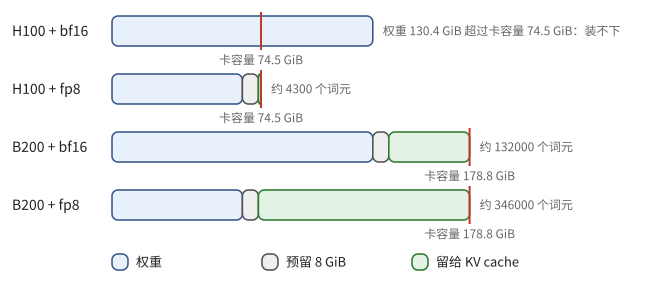

# 第 34 章　一次模型调用：输入、输出与账

有人给你一份模型配置和一块加速卡的规格，问：这个模型能在这块卡上服务吗？最多能容纳多长的上下文？这是第 11 章和第 30 章教过的估算，手算几分钟就够。可是现实里配置有几百份，卡有几十种，权重格式有好几种，新模型每周都有，配置文件的字段名还各写各的。这样的活适合交给程序，而其中"读懂一份五花八门的配置"这一步，正是语言模型擅长的。

这个估算任务会贯穿第七部分。本章先看最简单的用法：只调用模型一次，把材料交给它，等它写出结果。第 35 章让模型自己打开文件、调用计算器，第 36、37 章让许多个这样的调用一起工作并保证可靠，第 38 章读一个真实系统的源码。

第六部分结束时，我们有了一个推理服务，它有首词元时间、词元间隔和每百万词元的价格。对应用程序来说，从逻辑门到几百块 GPU 的整套机器，只是一条指令：交进去一串词元，拿回一串词元。这条指令慢（秒的量级）、贵（第 6、11、30 章的账）、结果带随机性，而且上一次调用的内容它一概不记得。写应用的人要回答三个问题：交进去什么，怎样接收拿回来的东西，每次调用要花多少。本章用到第 11 章的 prefill 与 decode，第 29 章的词元，第 30 章的 KV cache，第 31 章的首词元时间与词元间隔，第 32 章的前缀缓存。不需要 TPU 或 GPU 的编程接口。

## 34.1 先手算一遍

任务 E 是这样的：给定一个稠密模型的配置和一块卡的规格，回答两个问题。权重放得下吗？放下之后还剩多少显存给 KV cache，够容纳多少词元的上下文？

先手算一个具体的情形。模型 M 有 $70\times10^9$ 个参数、80 层、8 个键值头、头维度 128（分组查询注意力，11.2 节）。卡取附录 A.3 的 H100（80 GB HBM）和 B200（192 GB HBM）。权重存成 bf16（每个参数 2 字节）或 fp8（1 字节）。运行时还要给激活、通信缓冲和显存碎片留地方，这里一律留 8 GiB（假设值）。计算分四步。

1. 权重字节数是参数个数乘每个参数的字节数：bf16 是 $1.4\times10^{11}$ 字节，fp8 是 $7\times10^{10}$ 字节。
2. 统一单位。厂商写的 80 GB 是 $80\times10^9$ 字节，而这里按 GiB（$2^{30}$ 字节）算：$1\ \mathrm{GB}=0.931\ \mathrm{GiB}$。于是 H100 是 74.5 GiB，B200 是 178.8 GiB，权重是 130.4 GiB（bf16）或 65.2 GiB（fp8）。
3. 每个词元的 KV cache。由命题 11.22，每个词元每层存 $2H_{kv}d_h$ 个数，所以每词元是 $2\times80\times8\times128\times2=327680$ 字节，也就是 320 KiB。一个 128K 词元（$2^{17}$ 个）的上下文要 40 GiB。
4. 卡的容量减去权重再减去 8 GiB，剩下的除以 320 KiB，就是能存的词元数。

> **例 34.1（任务 E 的手算）** 四种组合的结果如下。
>
> | 卡 | 权重格式 | 权重（GiB） | 卡容量（GiB） | 留给 KV（GiB） | 可容纳词元数 |
> | --- | --- | ---: | ---: | ---: | ---: |
> | H100 | bf16 | 130.4 | 74.5 | 负数 | 装不下 |
> | H100 | fp8 | 65.2 | 74.5 | 1.3 | 约 4300 |
> | B200 | bf16 | 130.4 | 178.8 | 40.4 | 约 132000 |
> | B200 | fp8 | 65.2 | 178.8 | 105.6 | 约 346000 |
>
> 第二行说明"权重放得下"不是答案：H100 上放 fp8 权重以后，只够存 4300 个词元，大约是几页文字。回答必须说"能容纳多少词元"。第三行有一个巧合：B200 上用 bf16，恰好能放下一个 128K 词元的序列，剩 0.4 GiB，所以同时只能服务一个这样的请求。

图 34.1 把这四行画成了容量条。



**图 34.1**　四种组合下一块卡的显存分配（每 GiB 画两个像素）。红线是卡的容量；H100 + bf16 的权重已经越过红线。

这张表的每一格都能用一两个公式核对，错在哪里也看得出来：把 GB 当成 GiB，每格会差 7%；把 KV 头数写成 64，KV 的账会大八倍。这正适合拿来练习怎样使唤语言模型：任务清楚，答案可以由程序算出来，就能检查模型做得对不对。

## 34.2 一次调用是一个函数

在应用程序看来，一次调用就是一个函数。

> **定义 34.2（调用）** 应用把一个有序的词元序列（称为**上下文**，context）和几个参数（最多生成多少词元、温度等）交给推理服务，服务返回一段新生成的词元，外加一份用量统计：输入多少词元、输出多少词元、其中有多少命中了缓存。一次**调用**（call）结束以后，服务不保留这次调用的任何内容。

最后一句话容易被忽略，所以举一个例子。

> **例 34.3（"我刚才说了什么"）** 用户先发"你好"，模型回答"你好！"。用户接着问"我刚才说了什么？"。第二次调用要想答对，应用就必须把"你好""你好！""我刚才说了什么？"三段一起送进去。如果只送最后一句，模型没有任何办法知道"刚才"是什么。聊天界面里看起来连续的对话，实际是应用每一轮把全部历史重新交给一个不记事的函数。

由此得到三个事实，后面的章节会反复用到。

第一，模型这一次计算能看到的，恰好是交进去的那些词元。磁盘上的文件、昨天的对话、公司的数据库，只要没有被放进这次的上下文，对模型就不存在。反过来，一段材料被移出上下文，模型也不会"还记得"。

第二，改变提示，改变的只是这一次的输入；改变模型权重的是训练（11.7 节）。让模型"按二进制单位计算"，不会让它以后永远这样做，下次调用还要再说一遍。

第三，输出是从一个概率分布里抽出来的（11.1 节、29.4 节）。温度大于 0 时，同样的输入可以得到不同的输出；即使温度为 0，由于同一批里其他请求不同，算术顺序可能改变，结果也可能不同（11.12 节）。所以模型的输出和人手写的代码不同：不能因为"上次对了"就免去检查。

## 34.3 一次调用要花多少时间

第六部分已经给出所有零件，现在把它们拼成一个公式。一次调用分两段：先读入输入（prefill，计算受限），再逐个生成输出（decode，每个词元都要把权重读一遍，访存受限）。

> **命题 34.4（一次调用的时间）** 设稠密模型有 $\Phi$ 个参数，权重每个 $s$ 字节；设备的矩阵峰值为 $P$，prefill 时能达到的利用率为 $\eta$，HBM 带宽为 $B_{\text{HBM}}$。一次调用有 $n$ 个需要新做 prefill 的输入词元（没有命中缓存的那部分），生成 $m$ 个输出词元。若没有排队、实例上只有这一个请求，且读 KV cache 的时间相对读权重可以忽略，则
>
> $$
> T \approx \frac{2\Phi\, n}{\eta P} + m\cdot\frac{s\Phi}{B_{\text{HBM}}}.
> $$

*证明* 前向传播每个词元约做 $2\Phi$ 次浮点运算（命题 11.7）。prefill 计算受限，时间是总运算量除以实际算力 $\eta P$。decode 每个输出词元一步，单个请求时，一步至少把全部权重从 HBM 读一遍（命题 11.23，$B=1$），时间是 $s\Phi/B_{\text{HBM}}$；第一个输出词元其实由 prefill 的最后一个位置给出（例 29.15），严格地说 decode 只有 $m-1$ 步，$m$ 较大时可以略去这点差别。∎

> **例 34.5（B200 上的一次调用）** 为了有数可算，假设负责读配置的语言模型也是 $70\times10^9$ 个参数、bf16 权重（它和任务 E 里被估算的模型 M 是两回事，只是借用同一组数），放在一块 B200 上（$P\approx2.3\times10^{15}$ FLOP/s，$B_{\text{HBM}}=8$ TB/s，附录 A.3），取 $\eta=0.5$（假设值）。一次调用输入 6000 个新词元，输出 500 个词元。
>
> - prefill：$2\times70\times10^9\times6000/(0.5\times2.3\times10^{15})\approx0.73$ s；
> - decode：每步读 140 GB 权重，$140/8000=17.5$ ms，500 步共 8.75 s；
> - 合计约 9.5 s，其中 decode 占 92%。
>
> 平均每个输入词元花 0.12 ms，每个输出词元花 17.5 ms，相差约 140 倍。假设输入里有 5000 个词元命中了前缀缓存（32.2 节），prefill 只剩 0.12 s，总时间约 8.9 s，只省了 6%。

这个例子里有两条经验。其一，想让一次调用快，先减少输出词元数：让模型输出紧凑的 JSON，不要让它把推理过程和结论都写成长文。其二，前缀缓存省的是 prefill，对输出没有帮助，所以只有输入很长而输出很短时，它的作用才显著（35.2 节会看到这样的例子）。

这是一个空闲实例上的最快情形。真实的服务把许多请求拼成一批，一步的时间随并发增长（例 31.15）；应用实际等待的时间还要加上排队，价格则按每百万词元计（例 33.13），输出词元通常比输入词元贵得多，道理正是上面那个 140 倍。

> **注 34.6（内部推理词元）** 有的模型在给出回答之前，先生成一段内部推理。这些词元也要一个个 decode，所以也占输出预算、占时间。估算输出长度时，要把它们和可见的回答一起算。

## 34.4 上下文是一份预算

窗口有长度上限。输入和输出都要装在里面，所以交给模型的材料不是越多越好，要像做预算一样分配。

> **定义 34.7（上下文预算）** 设模型与接口共同允许的总长度为 $W$ 个词元。一次调用中，系统规则、当前请求、保留的历史、检索来的材料、工具说明分别占 $s,q,h,d,t$ 个词元，协议模板等开销为 $e$，为生成预留 $r$ 个词元。放得下的必要条件是
>
> $$
> s+q+h+d+t+e+r\le W.
> $$
>
> 若接口另外限制最大输入或最大输出，还要分别满足。$r$ 应包含接口计入输出预算的内部推理词元（注 34.6）；不同服务的计数规则不同，以实际返回的用量统计为准。

> **例 34.8（给答案留位置）** 总窗口 32768，预留输出 4096，模板与系统规则共 2048，当前请求 1024，历史 12288，工具说明 1024。留给检索材料的是
>
> $$
> 32768-4096-2048-1024-12288-1024=12288 .
> $$
>
> 如果一次检索返回 16000 个词元，就得先挑选、压缩历史，或者拆成几次查询。输出预留不是空闲的输入空间。

窗口放得下，只是应用这一侧的条件。服务器那一侧还有另一个条件：上下文里的每个词元，在这次调用期间都占着一份 KV cache。

> **例 34.9（窗口的另一个代价是显存）** 模型 M 每个词元 320 KiB（34.1 节）。例 34.8 里 12288 个检索词元占 $12288\times320\ \text{KiB}=3.75$ GiB。在例 34.1 的 H100 + fp8 一行里，留给 KV 的总共才 1.3 GiB，这 12288 个词元连一个请求都放不下。在 B200 + bf16 一行，它们占掉 40.4 GiB 中的 3.75 GiB。decode 每一步还要把这些 KV 读一遍。所以"把资料都塞进去"不是免费的：窗口放得下，只说明请求合法，服务器未必养得起很多个这样的请求。

安排上下文还有一条经验。32.2 节说，前缀缓存按开头逐页匹配，只要开头一页变了，后面全部落空。所以把不变的内容放在前面：系统规则、工具说明、固定的参考材料；把每次都变的内容放在后面：本轮的请求和最近的操作结果。常见的错误是在系统规则开头加一行"当前时间：……"，每次调用的开头都不一样，缓存永远命不中。

历史太长时可以压缩，但要保住三样东西：目标，已经确认的事实及其来源，还没解决的问题。"之前检查过，一切正常"没有说明检查了什么、按什么标准，下一轮无法据此作决定。压缩的办法和风险在 35.4 节讲。

## 34.5 提示是规格

模型在一次调用的中途不能反问你。凡是提示里没有说清楚的，它只能猜，而猜的结果读起来往往一样流畅。所以写提示，其实是在写一份规格。

> **定义 34.10（任务规格）** 交给模型、用来说明任务并提供材料的输入称为**提示**（prompt）。一份好的任务规格明确四件事：输入材料是什么，允许采取什么操作，必须交付什么，怎样判断交付物合格。

> **例 34.11（任务 E 的规格）** 给模型的说明可以只有这几行：
>
> ```text
> 输入：model.json（num_params, num_layers, num_kv_heads, head_dim）与
>       hardware.csv（card, hbm_gb）；二者都带版本号。预留显存 8 GiB 由调用方给定。
> 操作：只读这两份文件；乘除运算调用计算器，不心算。
> 输出：对每个（卡, 权重格式）一行：权重 GiB、卡容量 GiB、留给 KV 的 GiB、
>       可容纳的词元数、结论。
> 验收：每个数字写出公式和所用字段的出处；缺字段的行写 unknown，不得猜测；
>       GB 按 $10^9$ 字节、GiB 按 $2^{30}$ 字节换算。
> ```

这几行把一句含糊的"帮我估一下"变成了几个可以逐条检查的条件：各项之和对不对，GiB 是不是字节数除以 $2^{30}$，引用的字段是不是真的存在。模型仍然可能出错，但错误有了落脚的地方。"GB 按 $10^9$、GiB 按 $2^{30}$"这一句尤其值得写出来：34.1 节的 7% 就藏在这里，而且结果会被放大：H100 + fp8 一行，把 80 GB 读成 80 GiB，留给 KV 的显存就从 1.3 GiB 变成 6.8 GiB，可容纳的词元数从约 4300 变成约 22300，差了五倍。模型不会知道你想要哪一种。

给一个完整的例子，往往比加上"认真""专业""反复检查"更能消除歧义。例如写出一行字段齐全的结果，再写出一行缺了 `head_dim` 的结果，让模型看到"缺数据"是一个正常的输出：

```json
{"card":"X","format":"bf16","status":"unknown","missing":["head_dim"]}
```

在提示里放几个示范的做法叫少样本提示（few-shot prompting）。示范要包含容易出错的边界，只放最顺利的情形，模型学到的就是"总能给出一个数"。

对话接口通常把输入分成几种来源：系统规则、用户请求、模型自己之前的输出、工具返回的结果（具体名字以所用接口为准，见附录 B）。程序应当保留这个区分。尤其不要把网页或文件里读到的句子拼进系统规则：来源标记能帮助模型分辨材料，却不能替程序检查权限，这一点在 35.3 节和 37.5 节还要用到。

## 34.6 输出要分三步验收

假设程序要求模型对每个组合返回这样的一行：

```json
{"card":"H100","format":"fp8","status":"ok","weights_gib":65.19,
 "kv_budget_gib":1.31,"kv_tokens":4303,
 "evidence":["model.json#num_params","hardware.csv#H100"]}
```

收到它以后，要做三件不同的事。先确认它能解析成一个 JSON 对象，而且生成是完整结束的，没有被长度限制截断；再确认字段齐全、类型对、取值在允许的范围内；最后才是确认内容：数字算得对不对，引用的出处在不在。

> **定义 34.12（结构化输出）** 程序用一个**模式**（schema）规定输出的字段、类型和允许的取值，要求模型的输出符合它，这样的输出称为**结构化输出**（structured output）。常用的模式语言是 JSON Schema。例如，规定 `status` 只能取 `ok` 或 `unknown`，`evidence` 必须是字符串数组，`status` 为 `unknown` 时必须有 `missing` 字段。

有的服务和引擎可以在抽样时直接排除不符合模式的词元（29.4 节、31.6 节）。但即使有这种能力，程序仍要处理被截断、被拒绝回答、连接中断，以及某些模式特性不被支持的情形。更要紧的是，模式只管第二步。

> **例 34.13（格式对、内容错）** 下面三行都符合上面的模式，却都是错的。
>
> 1. H100 + fp8 的 `kv_tokens` 写成 132477：这是 B200 + bf16 那一行的数，抄串了行。重新计算一遍就能发现。
> 2. fp8 的 `weights_gib` 写成 70：把 $70\times10^9$ 字节当成了 70 GiB，忘了除以 $1.074\times10^9$。单位检查能发现。
> 3. `evidence` 里写着 `model.json#kv_heads`，而文件里的字段叫 `num_kv_heads`：引用是一个合法字符串，却指向不存在的东西。逐条核对出处能发现。

可见三种错误要用三种检查才能抓住。"解析成功"不等于"任务成功"；把二者混为一谈，就丢掉了后两道最有用的检查。

## 34.7 哪些交给模型，哪些交给程序

任务 E 里有两类性质不同的工作。把 `n_layer`、`num_hidden_layers`、`layers` 这些五花八门的字段名认成"层数"，把"8 个键值头"从一段 README 的文字里找出来，这需要理解语言，适合交给模型。而 $2\times80\times8\times128\times2$ 是多少、$130.4-74.5$ 是正是负，用一个五行的程序就能算对，让模型心算只会引入无谓的风险。

> **例 34.14（任务 E 的分工）** 让模型做一件事：读每份配置，抽出四个字段的值，并给出每个值在原文里的位置。其余全部由程序做：按固定公式算出表中各列，用字符串匹配检查"模型报告的值确实出现在它指出的位置"，缺字段就输出 `unknown`。这样，需要信任模型的只有"字段抽取"这一步，而这一步有出处可查；整张表的算术是确定性的。

这条分工的原则可以写成一句话：能由普通程序精确完成的读取、算术和检查，就写进程序；留给模型的，是必须理解语言才能做的部分，而且要让它的输出带着可以核对的出处。换模型、换提示时，用同一批输入和同一套验收条件就能比较新旧两个版本。

最后看一眼整个工具箱。想让应用做得更好，有五种办法，各自改变的东西不同，验收时要问的问题也不同。

| 想改变什么 | 办法 | 验收时要问什么 |
| --- | --- | --- |
| 任务的含义和答案的形状 | 写明确的提示，给包含边界的示例 | 有没有歧义；缺数据时怎么返回 |
| 本次能用的外部知识 | 检索与上下文选择（35.3 节） | 资料是否取到、版本是否相符 |
| 与外部世界交互的能力 | 受约束的工具（35.1 节） | 参数、权限、返回的证据是否成立 |
| 一类任务上稳定的行为倾向 | 训练或微调（11.7 节） | 是否在没参与训练的样本上检验过 |
| 单个问题能用的计算量 | 更多推理词元，或多生成几个候选再检查 | 增加的计算是否提高了可验证的成功率 |

生成更多推理词元或多取几个候选，都只是多花计算去尝试，不会把没核对过的叙述变成证据。要求模型交付假设、公式、出处和检查结果，通常比要求它打印全部思考过程更便于审查。

任务 E 要真正做起来，模型必须能打开文件、调用计算器，这是单次调用做不到的。下一章把调用接成循环。

## 本章小结

1. 一次调用是一个不记事的函数：模型这一次看到的恰好是交进去的词元；提示改变本次输入，训练才改变权重；输出是抽样的结果，需要检查（定义 34.2、34.2 节）。
2. 单个请求的调用时间约为 prefill 加 decode；每个输出词元的代价远大于输入词元，缩短输出比缩短输入更有效；前缀缓存只省 prefill（命题 34.4、例 34.5）。
3. 上下文是预算，输入输出共用窗口；窗口里的每个词元还要占服务器的 KV 显存；稳定内容放在前面，利于前缀缓存（定义 34.7、例 34.9、34.4 节）。
4. 提示是规格：输入、操作、交付物、验收四项都要写明，单位这类细节也要写；示例要包含边界（定义 34.10、例 34.11）。
5. 输出验收分三步：完整解析、符合模式、内容与出处成立；模式只保证第二步（定义 34.12、例 34.13）。
6. 能由程序精确完成的读取、算术和检查写进程序，让模型做必须理解语言的部分，并带着出处（例 34.14）。

## 习题

**习题 34.1** ★ 另一个模型 N：$8\times10^9$ 个参数、32 层、8 个键值头、头维度 128，bf16 权重，放在一块 H100（80 GB）上，同样预留 8 GiB。求每词元的 KV 字节数、留给 KV 的显存和可容纳的词元数。如果有人把"80 GB"当成 80 GiB，会得到多少词元？

<details><summary>提示 1</summary>

先用命题 11.22 求每词元的 KV：层数、键值头数、头维度相乘，再乘 2（K 和 V）和每个数的字节数。

</details>
<details><summary>提示 2</summary>

权重是 $16\times10^9$ 字节。H100 的容量按例 34.1 的办法换成 GiB，再减去权重和 8 GiB。

</details>
<details><summary>答案</summary>

每词元 $2\times32\times8\times128\times2=131072$ 字节 $=128$ KiB。权重 $16\times10^9$ 字节 $\approx14.9$ GiB；H100 容量 74.5 GiB；留给 KV 的是 $74.5-14.9-8\approx51.6$ GiB，除以 128 KiB 得约 42.3 万个词元。如果把 80 GB 当成 80 GiB，留给 KV 的变成 57.1 GiB，得到约 46.8 万个词元，多估了约 4.5 万个词元（11%）。单位错误不会让程序崩溃，只会悄悄让结论偏乐观。

</details>

**习题 34.2** ★ 模型 M 的 fp8 权重放在一块 B200 上（fp8 峰值取附录 A.3 的约 $4.5\times10^{15}$ FLOP/s，$\eta=0.5$，HBM 带宽 8 TB/s，单请求，忽略 KV 读取）。一次调用输入 3000 个新词元，输出 300 个词元。求总时间。输入减半和输出减半，哪一个省得更多？

<details><summary>提示 1</summary>

用命题 34.4。fp8 时 $s=1$。

</details>
<details><summary>提示 2</summary>

分别算 prefill 和 decode 两项，再分别把 $n$ 或 $m$ 减半。

</details>
<details><summary>答案</summary>

prefill：$2\times70\times10^9\times3000/(0.5\times4.5\times10^{15})\approx0.19$ s；decode：每步读 70 GB，$70/8000\approx8.75$ ms，300 步共 2.63 s；合计约 2.81 s。输入减半省约 0.09 s，总时间 2.72 s；输出减半省约 1.31 s，总时间 1.50 s。输出词元的代价大得多，所以要求紧凑的输出格式，收益比压缩输入大。

</details>

**习题 34.3** ★ 总窗口 16384，输出预留 2048，规则与模板 1536，当前请求 512，历史 8192，工具说明 1024。最多放多少检索词元？若检索结果有 4096 个词元，至少要移走多少其他输入？对模型 M，这 3072 个检索词元在服务器上占多少 KV？

<details><summary>提示 1</summary>

用定义 34.7 的不等式，其余项全部从 $W$ 里减掉。

</details>
<details><summary>提示 2</summary>

剩余容量与 4096 的差就是要移走的量。KV 用每词元 320 KiB 乘。

</details>
<details><summary>答案</summary>

可放 $16384-2048-1536-512-8192-1024=3072$ 个词元。若保留 4096 个检索词元，至少移走 $4096-3072=1024$ 个其他输入。3072 个词元占 $3072\times320$ KiB $=960$ MiB。不能靠减少输出预留来腾地方，却仍然承诺同样长的输出；前缀缓存命中也不会把历史从逻辑窗口里扣掉（34.4 节）。

</details>

**习题 34.4** ★ 审查题。程序收到 `{"card":"B200","format":"bf16","status":"ok","kv_tokens":132477,"evidence":["doc-8"]}`，它符合模式，于是直接把这一行写进报告。指出还缺哪些检查。

<details><summary>提示 1</summary>

对照 34.6 节的三步：是否完整、是否符合模式、内容是否成立。

</details>
<details><summary>提示 2</summary>

`doc-8` 是什么？它是否真的说明 B200 的容量？数字能不能重新算出来？

</details>
<details><summary>答案</summary>

先要确认响应是完整结束的，没有被截断。然后要确认 `doc-8` 存在、本任务有权访问，并且确实描述 B200 和这一版数据；缺少 `weights_gib`、`kv_budget_gib` 等中间量，没法复算，应要求补全。程序用同一组输入重新计算 `kv_tokens`，并核对单位（GB 与 GiB）。模式只管输出的形状，不管这些；内容无法核实时，这一行应当降级为 `unknown`，不能当作成功写进报告（例 34.13）。

</details>

**习题 34.5** ★ 有人这样给模型下任务："帮我估一下这个模型要多少显存，大概就行。"把它改写成含四项的规格，并指出原话里至少两处会让模型悄悄猜测的地方。

<details><summary>提示 1</summary>

问自己：模型从哪里得到参数？"显存"指权重还是包括 KV？用多长的上下文？单位？

</details>
<details><summary>提示 2</summary>

四项是输入、操作、输出、验收（定义 34.10）。

</details>
<details><summary>答案</summary>

原话没有说明：材料从哪里来（模型自己"回忆"参数，常常记错），"显存"包括什么（权重？KV？激活？），上下文长度和批量是多少，用 GB 还是 GiB，"大概"到多大的误差。改写为：输入——给定版本的 `model.json`，上下文长度 $T$ 与并发数 $B$ 由调用方给定；操作——只读该文件，用计算器；输出——权重、$B$ 个长度 $T$ 的 KV、预留三项分别列出，并给总和，单位 GiB；验收——每项给公式与字段出处，缺字段写 `unknown`，总和等于各项之和。

</details>

**习题 34.6** ☆ 把温度设为 0，为什么两次调用仍可能给出不同的回答？这对"上次对了所以这次不用检查"的想法意味着什么？

<details><summary>提示 1</summary>

回忆 11.12 节：同一个请求被放进不同的批里时，浮点加法的顺序会怎样？

</details>
<details><summary>提示 2</summary>

两个几乎相等的 logits 在舍入后可能换名次。

</details>
<details><summary>答案</summary>

温度为 0 时取概率最大的词元，但各词元的 logits 是浮点数。同一个请求与不同的其他请求拼成一批时，归约的次序可能不同，舍入误差不同；两个最大的 logits 很接近时，名次会换，之后的整段输出也就跟着变（11.12 节）。所以"上次对了"不能当作"这次也对"：验收要对每一次的输出做，而不是依赖输出可以逐字重现。需要重现时要用批不变的推理引擎，并固定随机数的来源（命题 29.19）。

</details>
