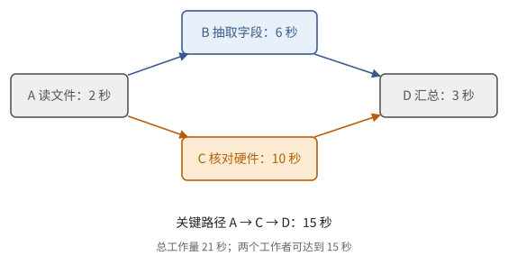

# 第 36 章　多个 agent：分工、依赖与容量

任务 E 现在要做大：一百份模型配置，六种卡，两种权重格式，共 1200 行。让一个 agent 一份一份地做，每份配置大约六轮（读两个文件、抽字段、算、检查、写出一行），每轮模型输出 200 个词元。在一个只服务这一个请求的实例上，一轮约 3.3 s，一份配置约 20 s，一百份就是半个多小时。自然的想法是多派几个工作者同时做。能快多少？快不快得起来取决于什么？分工本身又要付出什么？

这一章只讲性能：哪些子任务可以同时做，时间的上下界是多少，拆分要多付多少词元，共享的模型服务能撑住多少个工作者。出错怎么办留到下一章。用到第 1 章的工作量与深度（定理 1.59），第 4 章的 Little 定律，第 9 章的先行发生，第 31 章的吞吐与单用户速度，第 32 章的前缀缓存，第 35 章的循环。

## 36.1 什么时候需要不止一个 agent

先把几个词说清楚。第 35 章的工具循环里，每一轮由模型根据工具返回的结果选择下一步。

> **定义 36.1（agent 与编排）** 在一个由程序维护的循环里，模型根据任务状态和工具返回选择后续操作，这样的系统称为**智能体**（agent）。组织若干次模型调用、工具操作，以及它们之间的依赖、资源和完成条件，称为**编排**（orchestration）。负责提出子任务的角色称为**规划者**（planner），承担子任务的角色称为**工作者**（worker）。几个角色可以用同一个模型，也可以用不同的模型。

多派一个 agent，是多开一个上下文和一段控制流程，并没有给模型添一个有独立信息来源的"大脑"。两个角色读了同一份错误的资料，会犯同一个错误。所以先问一句：这件事真的需要吗？

有些工作的路径是事先知道的。对任务 E，每份配置都是"读文件、抽字段、算、检查"，程序可以把这个顺序直接写死，只在"抽字段"这一步调用模型。把路径预先规定好的程序叫**工作流**（workflow）。只有下一步取决于刚读到的内容时，才需要让模型选路径：比如一份配置里写着"继承自某个基础模型"，就得再去读另一个文件，读几个、读哪个，事先不知道。实际的系统常常两种混用：外层的流程、权限和验收是固定的，内层让模型决定下一步查什么。

常见的组织形状有这几种，适用的条件不同，每一种都留着一项检查：

| 形状 | 适用条件 | 要保留的检查 |
| --- | --- | --- |
| 顺序处理 | 后一步依赖前一步的结果 | 中间结果合格才继续 |
| 分类后路由 | 输入有可以区分的类别 | 拿不准时有回退的路 |
| 分开检查再汇总 | 子任务相互独立 | 统一单位、版本和汇总格式 |
| 规划者派发工作者 | 子任务要读了材料才能确定 | 子任务规格与可派发条件 |
| 生成后审查再改写 | 有清楚的质量标准 | 独立的证据，最大修改轮数 |

这些形状都可以用普通程序组合。要不要用一个框架，取决于它是否把状态、恢复和检查做得清楚，而不取决于它有多少个角色名。ReAct 把推理和外部行动交替进行；工作流、规划者与工作者这些组织方式的资料见附录 E。

## 36.2 子任务与依赖

派给工作者的任务，要像一份小规格（34.5 节）那样写清楚。

> **定义 36.2（子任务约定）** 一个可以派发的子任务写明：输入对象及版本、前置条件、允许读写的范围、预期产物、验收方法和预算。只有前置任务的产物已经取得并通过了所需检查，才把它列为可运行；"前置任务已经派出"不算满足条件。

读写范围的作用，和第 9 章是同一回事。两个任务只读同一份配置，可以同时做；一个任务正在改配置，另一个却要据旧版本生成最终的报告，就得等它（读之前等数据，命题 9.4），或者固定一个快照，或者在提交时发现版本已经变了就重算。

用箭头把"必须等谁"画出来，就得到任务的依赖图。

> **定义 36.3（任务依赖图）** 对一批已经确定的子任务，每个任务是一个节点，$u\to v$ 表示 $v$ 必须等 $u$ 的产物合格才能开始，每个任务有一个时长。若图中没有有向环，称为**有向无环图**（directed acyclic graph，DAG）。所有任务的时长之和是总工作量 $W$；沿着箭头的一条路径上时长之和的最大值，称为**关键路径长度** $L$。

这是定义 1.57 里的工作量和深度，只不过"运算"换成了"任务"，每个任务的时长不再都是一个单位。

> **例 36.4（一份配置的依赖图）** 检查一份配置分四个任务：A 读取两个文件并确认版本，2 s；B 抽取模型字段，6 s；C 抽取并核对硬件容量，10 s；D 等 B、C 都合格，算出表中各列并汇总，3 s。B 和 C 都只依赖 A，互相独立（图 36.1）。$W=2+6+10+3=21$ s，关键路径是 A→C→D，$L=2+10+3=15$ s。

**图 36.1**　A 完成以后 B、C 并行，D 等两者。经过 C 的这条路径决定了 15 s 的下界。时长是为了说明依赖而设的假设值。

> **命题 36.5（多个工作者的时间界）** 设有 $p$ 个同速的工作者，每个同时只能做一个任务，任务时长固定，派发不占时间。完成全部任务的时间 $T$ 满足
>
> $$
> T\ge\max\!\left(\frac{W}{p},\,L\right).
> $$
>
> 若调度满足"只要有工作者空闲而且有可运行的任务，就立刻派发"，则还有
>
> $$
> T\le\frac{W}{p}+\Big(1-\frac1p\Big)L .
> $$

*证明* 下界：$p$ 个工作者在时间 $T$ 里至多完成 $pT$ 的工作，所以 $pT\ge W$；关键路径上的任务不能重叠，所以 $T\ge L$。

上界的想法是：追出一条链，使得任何一个时刻，要么链上有一个任务在运行，要么 $p$ 个工作者全都在忙。取最后一个完成的任务作为链的末端 $j_1$；在 $j_i$ 的所有前驱里取完成得最晚的一个作为 $j_{i+1}$，一直追到没有前驱的任务为止。$j_i$ 在 $j_{i+1}$ 完成的那一刻变得可运行；从那一刻到它开始之间，它是"可运行而没开始"的，按派发规则，这段时间里没有空闲的工作者。所以任一时刻，要么链上某个任务正在运行，要么 $p$ 个工作者全忙。设链上任务的运行时间共 $C$，它不超过最长路径 $L$。在其余的 $T-C$ 里，$p$ 个工作者全忙，做了至少 $p(T-C)$ 的工作；在链上任务运行的 $C$ 里，至少有链上那个任务的 $C$ 的工作。两部分加起来不超过 $W$：$W\ge p(T-C)+C$，即 $T\le W/p+(1-1/p)C\le W/p+(1-1/p)L$。∎

当所有任务的时长都是一个单位时，这就是定理 1.59 的 Brent 界。

> **例 36.6（两个工作者为什么没有快一倍）** 例 36.4 里 $p=2$：$W/p=10.5$ s，$L=15$ s，所以 $15\le T\le10.5+0.5\times15=18$ s。实际的安排是 A 先做 2 s，然后 B、C 同时做，D 最后做，恰好 15 s，比串行的 21 s 只快 $21/15=1.4$ 倍。再加十个工作者也没用，因为 A→C→D 这条链不能缩短。

命题 36.5 把"加人手能不能提速"变成了两个数的比较：$W/p$ 大于 $L$ 时，人手少，加人有用；$W/p$ 降到 $L$ 以下后，再加人只是闲着。

两点提醒。实际的探索常常分轮长出新节点，也可能有"检查失败，回去修"这样的环，不必强说整个系统永远是一张 DAG；可以对一次固定的、没有重试的展开去分析并行度，把后面的重试算作新的一次尝试。另外命题假设派发不占时间，没有计共享服务的争用，这一点在 36.4 节补上。

## 36.3 拆分的代价

拆得越细，每个工作者要从头读的东西越多。每个工作者都需要自己的说明、必要的材料，还要把结果交回来。如果一个推理需要反复共享同一份细节，拆给许多人，总输入量和协调轮数都会增加。适合拆开的，是输入和交付的边界清楚、互相独立的工作。

> **例 36.7（共享材料的代价）** 八个工作者每人都要先读同一份 20000 词元的参考资料，再各自处理一份配置。如果每个请求都自己 prefill 这份资料，共要 $8\times20000=160000$ 个词元，按例 34.5 的 B200 约 19.5 s 的计算。如果把这份资料放在所有请求共同的开头，八个请求共用同一段前缀缓存（32.2 节），只需算一次：20000 个词元，约 2.4 s。后者省了 17 秒的服务算力，让服务能多接别的请求。

这个例子说明，要让并行的工作者共享缓存，就得把共同的东西放在每个请求的开头，并保证字节上完全一致（34.4 节）。

另一个代价在回程。工作者把结果交给规划者时，通常要摘要，而摘要会丢掉区别（命题 35.11）。规划者拿到的是"这份配置没问题"，而不是工作者当时看到的全部。要让规划者能追问，就得保留每个结论的出处（37.4 节）。

## 36.4 共享服务的容量

工作者越多，并不是想快多少就能快多少，因为它们共用同一个模型服务和同样的工具服务。

> **命题 36.8（按任务计的容量上界）** 稳定状态下，设每项任务平均要发 $r$ 次模型请求、$u$ 次某类工具操作，共享的模型服务和工具服务分别能持续处理 $\mu_m$ 次请求每秒和 $\mu_t$ 次操作每秒。若所有任务都要经过这两个服务，则任务吞吐 $\lambda$（项每秒）满足
>
> $$
> \lambda\le\min\!\Big(\frac{\mu_m}{r},\,\frac{\mu_t}{u}\Big).
> $$
>
> 要避免队列无限增长，实际的负载还要低于相应的容量，并为波动留余量。

*证明* 每秒完成 $\lambda$ 项任务，长期平均需要 $\lambda r$ 次模型请求和 $\lambda u$ 次工具操作，二者分别不能超过服务的处理能力。这是 Little 定律（定理 4.7）的稳态形式：流入等于流出。∎

$\mu_m$ 不是常数。第 31 章说过，并发越高，每个请求越慢，总吞吐越大（例 31.15）。所以在这里要把"服务能撑多少"拆成词元：服务在某个并发下每秒产出若干输出词元，除以一个请求平均输出的词元数，才是每秒完成的请求数。

> **例 36.9（一百份配置，三十二个工作者）** 假设 agent 用的语言模型 L 由例 31.15 的引擎服务（它和任务 E 里被估算的模型 M 是两回事）。并发 $C=32$ 时 $\tau=33.2$ ms，每秒产出 964 个词元。设每个工作者总有一个请求在服务中（工具耗时忽略），每份配置要 $r=6$ 次模型请求，每次输出 200 个词元，工具读取 $u=4$ 次，文件服务能撑 $\mu_t=8$ 次每秒。
>
> - 模型一侧：每项任务要 $6\times200=1200$ 个输出词元，$964/1200\approx0.80$ 项每秒；
> - 工具一侧：$8/4=2$ 项每秒；
> - 所以 $\lambda\le0.80$ 项每秒，瓶颈在模型。一百份配置约需 125 s，加上起头和收尾，在两分钟多一点。
>
> 作对比：只有一个工作者时，$C=1$、$\tau=16.5$ ms，一次请求 3.3 s，一份配置 19.8 s，一百份是 33 分钟。32 个工作者把时间缩到 2 分钟出头，快了约 16 倍，不到 32 倍：并发提高以后，每步用时从 16.5 ms 涨到 33.2 ms，每个工作者的速度只剩一半。再把工作者加到 64，$\tau$ 涨到 50.4 ms，吞吐升到 1270 词元每秒，只多了约三成，而每个工作者的等待又长了一半。

加工作者不能把工具服务的 8 次每秒变大，也不能让模型服务白白多出吞吐，多出来的只是排队。预算也是同一个道理：把成功的、失败的、重试的请求都算上；失败重试的请求同样占服务的容量。

预算至少要分开记录：模型请求次数、输入和输出词元数、工具操作次数、总的墙钟时间、并发上限，以及已经预留给在途操作的资源。只检查"已经花了多少"，会让几个并发的工作者同时透支同一笔余额；正确的做法是派发之前先原子地预留，结束后按实际用量结算。

失败后的重试要有上限，等待逐步变长，并遵守服务给出的恢复时间，否则服务越忙，客户端重试越多，局面越糟。换备用模型时，窗口容量、工具的语义和输出的格式都要重新检查；已经输出一半的答案，不能没有标记地接上另一个模型生成的后半段。

## 本章小结

1. agent 的上下文、任务状态和控制流程由应用组织；规划者与工作者可以用同一个模型，也不因此多出独立的证据；路径预先已知时，工作流就够了（定义 36.1）。
2. 子任务要规定输入版本、前置条件、读写范围、产物、验收和预算；只有前置任务合格才算可运行（定义 36.2、命题 9.4）。
3. 固定任务图的完成时间至少是 $\max(W/p,L)$；按"有空闲就派发"的调度，不超过 $W/p+(1-1/p)L$（定义 36.3、命题 36.5）。
4. 拆分要多付词元：共享的材料放在所有请求的开头，才能共用前缀缓存；摘要回传会丢信息（例 36.7）。
5. 任务吞吐受模型和工具两个共享服务的约束；并发提高，吞吐提高但每个工作者变慢，加工作者的收益是递减的（命题 36.8、例 36.9）。
6. 预算按请求、词元、工具次数、墙钟时间、并发分别记账，派发前预留，重试计入预算。

## 习题

**习题 36.1** ★ A 用 3 s，之后 B、C 各用 8 s 和 5 s，D 等 B、C 以后用 2 s。求总工作量、关键路径、两个工作者的时间上下界，以及任意多个工作者能达到的下界。能不能达到？

提示 1

分别加总全部节点，以及最长的一条路径。

提示 2

试试 A 完成后同时启动 B、C。

答案

$W=3+8+5+2=18$，$L=3+8+2=13$。$p=2$ 时，$\max(9,13)=13\le T\le9+0.5\times13=15.5$。安排：A 在 0–3 s，B 在 3–11 s，C 在 3–8 s，D 在 11–13 s，恰好 13 s，达到下界。任意多个工作者仍然至少要 13 s。这个结论假设任务时长固定，也不计服务的争用。

**习题 36.2** ★ 每项任务平均 10 次模型请求、2 次工具调用，模型服务和工具服务分别能处理 50 次每秒、20 次每秒。任务吞吐上界是多少？如果重试使每项任务平均的模型请求增为 15 次呢？

提示 1

把每个服务的容量换算成"项每秒"，取较小的那个。

提示 2

重试也是真实的请求，不能只算成功的路径。

答案

原来是 $\min(50/10,\,20/2)=5$ 项每秒。重试后是 $\min(50/15,\,10)=10/3\approx3.3$ 项每秒。长期的输入负载还要低于这些上界，并留出波动的余量。增加等待中的工作者不会提高共享服务的容量。

**习题 36.3** ★ 五个工作者共享一份 30000 词元的材料，各自再处理一份 2000 词元的配置。不用前缀缓存和理想共享时，prefill 的词元总数分别是多少？按每个词元 0.12 ms，各需多少服务时间？共享需要满足什么条件？

提示 1

不共享时，每个请求的输入是共享材料加自己那份；共享时，共享材料只算一次。

提示 2

前缀缓存按开头逐页匹配（32.2 节）。

答案

不共享：$5\times(30000+2000)=160000$ 个词元，约 19.2 s。共享：$30000+5\times2000=40000$ 个，约 4.8 s。条件：共享材料在每个请求的开头，并且字节和词元上完全一致（没有每个请求不同的前缀，如时间戳或任务编号）；前缀要按页对齐，零头那一页要重算；缓存没有被淘汰。命中多少以服务返回的用量为准。

**习题 36.4** ★ 审查题。编排器在 B、C 两个任务"已经派出"时，就把汇总任务 D 派了出去，理由是"它们很快会完成"。会出什么问题？按定义 36.2 应当怎么改？

提示 1

D 拿到什么输入？如果 C 失败了呢？

提示 2

可运行的条件是"产物已取得并通过检查"。

答案

D 在没有输入的情况下启动，只好猜测或空等；如果 B 或 C 后来失败或产物不合格，D 已经消耗了请求和时间，其结果也不能用。应当等 B、C 的产物都已取得并通过验收以后，才把 D 列为可运行；派发的条件是依赖满足，不是依赖已经启动（定义 36.2）。

**习题 36.5** ★ 一个任务需要读一份 30000 词元的文档，依次回答三个问题，后一个问题要用到前一个问题的答案。拆成三个工作者，并行度有多大？还多付了什么？

提示 1

画依赖图：三个问题是链还是并列？

提示 2

每个工作者要不要读那份文档？

答案

三个任务排成一条链，$W=L$，由命题 36.5，$T\ge L$，加工作者不能提速，并行度是 1。反而每个工作者都要读 30000 词元的文档（可以用前缀缓存共享），并且要把前一个的答案传给下一个，多了一次上下文构建和一次摘要的损失。这类任务不适合拆开，一个 agent 顺序做更省。

**习题 36.6** ☆ 在命题 36.5 里令 $p=1$ 和 $p\to\infty$，两个界各变成什么？它们与 $T$ 的实际含义是否相符？

提示 1

$p=1$ 时没有并行。

提示 2

$p\to\infty$ 时 $W/p\to0$。

答案

$p=1$：下界 $\max(W,L)=W$（因为 $L\le W$），上界 $W+0\cdot L=W$，所以 $T=W$：一个工作者就是把所有任务的时间加起来。$p\to\infty$：下界趋于 $L$，上界趋于 $L$（$W/p\to0$，$(1-1/p)\to1$），所以 $T\to L$：人手无限多时，时间由关键路径决定。两种极端都与直觉相符，命题在中间给出一个不超过两倍的范围，因为 $W/p+(1-1/p)L\le 2\max(W/p,L)$。

