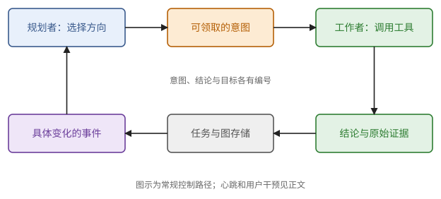

# 第 38 章　源码案例：ARTEX 怎样组织规划、工作与证据

前四章讲了一套词汇：上下文预算、工具循环、依赖图、原子领取、任务检查点、带出处的结论、授权绑定。这一章拿它们去读一个真实的系统，看这些东西在代码里长什么样。

ARTEX 是社区开源的一个面向授权安全测试的应用，后端是 Go。我们只把它当作"规划者与工作者"编排的标本来读：不部署它，也不对任何网络目标做测试，例子一律沿用任务 E，想象把"核对一百份配置的显存估算"交给这样一个系统。读法是跟着一件事走：谁提出下一步，谁允许它运行，结果写在哪里，什么条件让任务结束。用到第 34 至 37 章，以及第 32 章的前缀缓存。

> **现状（2026-10-25）**：本章依据社区仓库 `Hinln/ARTEX` 的固定提交 `f3e3f54b6c93916388a0a3dc6a439893a9abe37a`，并与同一提交的本地副本核对。仓库保留 AGPL-3.0 许可证，依赖 `norma v0.4.3`，主要的业务状态存在 PostgreSQL 里。附录 E 给出固定提交的源码链接。本章的结论来自静态阅读，没有编译、运行，后续版本应重新核对。

## 38.1 先找控制流程

设想用户提出：核对一百份离线的模型配置，列出每份缺失的字段，生成一份显存估算报告。系统里有几个角色：一个把要求整理成目标，一个决定先检查什么，几个工作者分别去读配置，最后有人汇总。每个角色仍然用第 34、35 章的方式调用模型和工具，区别只在各自的上下文和工具表。

| 角色与入口 | 在这个快照中的职责 |
| --- | --- |
| `agent/goals.go` 的 `DecomposeGoals` | 把任务要求整理成目标 |
| `agent/planner.go` 的 `Planner.Plan` | 读取当前态势，判断目标，提出后续意图 |
| `agent/worker.go` 的 `Worker.execute` | 执行一条意图，使用工具，写回结论 |
| `agent/mainagent.go` | 面向用户的会话入口：查询进度、补充目标、干预工作 |
| `server/engine.go` 的 `Engine` | 唤醒规划者，让工作者领取、执行、结束 |

一个角色能做什么，要看它拿到的工具表，不看它的名字。`PlannerTools` 和 `MainAgentTools` 里都有 `add_intent`，所以规划者文件里的一句注释，读不成"全系统只有这一条创建意图的路径"。

> **注 38.1（注释、代码与运行证据）** 注释写的是作者的意图，当前的代码写的是可见的实现，配置、依赖库和运行记录才决定一次部署走了哪条路径。三者不一致时，分别记下来。例如选项 `MaxTurns` 听上去是轮数上限，但 planner 和 worker 的代码都注明 `0 = unlimited`，真正的上界要结合时长和任务预算去查。

## 38.2 一次变化怎样推进下一轮规划

工作者结束以后，程序告诉规划者"哪一项工作结束了"，比只说一声"有变化"有用：规划者先看这个结果，再决定新动作，不必每次重新猜整个任务发生了什么。`TriggerEvent` 记下具体的原因，`plannerLoop` 把一小段时间里到达的通知合并成一次规划，`Planner.Plan` 把触发原因、图的概览和规划便签拼成本轮的输入。除了事件，循环还有心跳，间隔不低于 600 s，用来处理长时间没有新通知的情况。

> **例 38.2（用一次变化推进任务）** 工作者读完配置 A，写下结论"r4 的 A 缺少字段 `head_dim`"，并留下读取记录。下一轮规划的输入带上这条完成事件和结论。规划者发现配置 B、C 已有工作者在运行，就不再重复派发；等一百份配置的结果都到齐，才提出"汇总报告"的意图。这是按现有结构构造的离线例子，不是该项目实际运行过的记录。



**图 38.1**　控制的循环与共享的存储。规划者和工作者通过有编号的意图、结论和事件协作；箭头表示软件调用或数据流，不表示模型参数在角色之间传递。

通知可能重复到达，也可能在写入之后、发出之前中断，所以收到通知后要查询当前状态；重启之后怎样重新发现待办的工作，要看恢复的路径（37.2 节）。

## 38.3 两张图分别记录什么

在离线配置的例子里，"有哪一百份文件、各属于哪个模型"和"哪次检查发现了什么、哪条结论支持报告"是两类关系。放进同一张图里，对象和判断就混在一起了。

> **定义 38.3（对象关系与探索关系）** 在这个案例里，**资产图**（asset graph）记录被研究的对象及其关系，**探索图**（exploration graph）记录目标、意图、工作结论、发现和摘要之间的关系。前者回答"有哪些对象、彼此怎样相连"，后者回答"做过什么、根据什么继续做"。

ARTEX 的"资产"是主机、服务、站点这些测试对象；用到普通的软件任务上，可以换成仓库、文件、配置和版本。探索图的节点有六种：目标 `goal`，探索方向 `intent`，工作者登记的结论 `fact`（包括否定的结论），应用登记的发现 `finding`，线索 `hint`，以及一组旧节点的摘要 `digest`。边的种类各有用途：`derived_from` 从已有材料提出意图，`yields` 把意图连到它产出的结论，`proves` 把证据连到目标。

> **例 38.4（一条可追溯的链）** 读取配置 A 的记录产生结论 F："A 的 r4 缺字段 `head_dim`"；由 F 派出意图 I："在报告里列出这个缺项"；I 产出报告片段 R；R 被用来说明目标 G（"报告覆盖全部配置"）的一部分已经满足。追溯时，既要看得到这些关系，也要能从 F 回到实际读取的内容，从 R 回到已经保存的报告版本。

创建意图时，`addOneIntent` 检查显式给出的父节点存在、属于允许引用的范围、并且是 `fact` 或 `finding`。这建立的是来源的结构，不是第 36 章那张由程序机械检查全部前置条件的 DAG：某条事实够不够支持下一步，由规划者判断。

"完成"是在哪里变成一个状态的，是读这类系统最值得追的一处。

> **注 38.5（`prove_goal` 检查了什么）** `prove_goal` 先检查目标编号指向本任务的 `goal`、证据编号指向允许引用的 `fact` 或 `finding`；通过之后连一条 `proves` 边，把目标标为 `met`，再看是否所有目标都已 `met`，是的话自动判定整个任务完成。这些是类型和归属的检查：两条同种类、同归属的结论，一条能支持某个目标，另一条不能，检查区分不出来。
>
> 实现里还有两个细节。连边和更新状态两处都写成 `_ = ...`，数据库的错误没有返回给调用者，所以一句"目标已标记"的返回文字，还不足以说明两次写入都成功了。另一个工具 `goal_met` 直接把任务完成的标志置位，参数说明要求"确实全部达成"，实现里没有逐项重新核对证据。

这是一个通用的审查办法：先找"完成"在哪里变成状态，再分别问那个位置检查的是编号、写入是否成功，还是业务上的真实性。

## 38.4 记忆放在哪里

35.4 节区分了五样常被统称为记忆的东西。ARTEX 里的对应物，最值得看的是下面两个。

规划便签。`Planner` 的 `todos` 是一个以任务编号为键的 Go `map`，`todoFor` 在其中创建并复用 `TodoStore`，所以同一个 planner 对象的多次唤醒接着用同一份便签。worker 则在执行入口新建一个临时的 `TodoStore`，代码注释写着"退出即丢"。

> **例 38.6（便签能活过唤醒，活不过重启）** planner 的构造函数每次都重新创建这个 `map`，没有任何一条路径把便签从数据库装回来。所以进程重启之后，Todo 要按丢了处理，除非另外找到装载的路径。若它很重要，就得放进可靠的存储，让恢复程序能读到（37.2 节）。

摘要。图太大时，`coldgraph.go` 和 `compaction.go` 把近期仍活跃的材料留在可见范围，把较冷的节点折成 `digest`；原节点继续保存，可以经 `expand_digest`、`node_detail` 等工具一层一层取回。

> **例 38.7（原节点找得回，摘要未必无损）** 数据库保存了二十条原始结论和摘要的成员关系，说明原记录找得回来。模型这一轮看到的却只有一句摘要：如果摘要省掉了"只检查了 r4"这样的限定，模型得展开摘要、读原文才会知道（命题 35.11）。

其余几样的位置：原始会话按会话标识存在 transcript 里；图里的目标、意图、事实和发现既是任务状态，也是共享的证据（37.4 节）；前缀缓存靠 `Planner.Plan` 每次重建会话时的安排，稳定的规划规则放在系统提示里，本轮变化放在动态输入里，是否真的命中仍由服务器上的缓存状态决定（32.2 节）。分开看这些存储，就知道错误该在哪里修：Todo 丢了是便签的恢复问题，图里的结论错了是证据问题，KV cache 被淘汰一般只是重复计算的成本。

## 38.5 领取、结束、拦截

`Frontier` 查询状态为 `open` 的意图，`Engine.claimNext` 尝试领取，关键的动作在 `ClaimIntent`，缩写成条件更新是：

```sql
UPDATE exploration_nodes SET state='running', owner=:worker
WHERE id=:id AND exploration_id=:task
  AND kind='intent' AND state='open';
```

程序再检查受影响的行数是不是 1。这就是 37.1 节的原子领取，解决多个工作者同时抢同一条 `open` 意图的问题。注意这条更新没有像 37.1 节那样同时递增尝试编号，所以 37.2 节"拒绝过期提交"那一层保护要靠别处的检查，需要继续核对。两个不同的意图其实要求同一件业务工作，以及外部操作要不要恰好执行一次，这条更新管不到（命题 37.7）。

> **例 38.8（会话结束与目标完成）** `runIntent` 的常规结束路径里，出错记为 `blocked`，轮数或时长耗尽记为 `exhausted`，正常返回记为 `done`。这比统一写成"完成"保留了更多信息：规划者看到 `exhausted`，就知道这个方向试过但没做完，要换个角度。但会话正常结束仍然不是目标完成，要看实际的写回、证据和目标检查（37.6 节）。

工具拦截要沿实际的调用链追。`guard.Guard` 的 `preToolUse` 记录调用，再交给数据库里的规则和可选的判断器，规则可以放行、拒绝或进入人工审批。没有配置拦截器、工具不在启用列表里，或者没命中规则而备用的判断器没开启时，这个函数走的是继续放行的路径。

> **注 38.9（拦截器接在哪些入口上）** `Worker.execute` 把 hooks 接到 SDK 的选项里；`Planner.Plan` 构造选项时没有设置 `Hooks` 字段，而且 planner 和 worker 用的都是 `ModeBypass` 权限模式。所以从"worker 的路径上有 guard"，推不出 planner、主会话、MCP 工具和任意的子进程都受同一套检查。完整的保证要逐条核对公共封装、依赖的 SDK、实际的配置和进程的权限（37.5 节）。本章的静态观察不是安全验收。

模型服务失败时，`llmpool.Pool.Stream` 只在还没有向调用方发出任何事件时，才换用备用的配置。重试一份还没交付的回答是安全的；已经执行过的工具副作用，要按 37.3 节另行处理。

## 38.6 三张资源表

界面上显示八个工作者，不等于八项工作都在用模型：它们可能在等工具、等审批或等额度。`Engine` 另外统计实际在途的模型调用，比 agent 的个数更接近模型的真实负载。读性能相关的代码，分别记三张表：可运行和正在运行的子任务（第 36 章），模型请求和词元（第 31、32 章），工具操作和结果。

> **例 38.10（从编排负载接回推理服务）** 设每秒到达 1 项任务，每项平均 8 次模型请求，其中 4 次伴随工具读取。模型服务平均每秒接到 8 次请求，工具服务每秒接到 4 次读取。若每次上下文平均 10000 个词元，每秒提交的输入就是 80000 个词元；其中多少需要新做 prefill，还要扣掉实际能复用的前缀（命题 35.4）。若模型服务只能维持同类请求每秒 6 次，单是它就把任务的吞吐限制在 $6/8 = 0.75$ 项每秒，队列会不断增长（命题 36.8）。数字都是为了说明模型而设的假设。

要判断"多个 agent 比一个快"，得在同一批任务、同一套验收标准下比较完成的延迟、成功率和全部的成本（定义 37.11）。本章没有运行任何负载，给不出吞吐或加速倍数。

## 38.7 把源码阅读变成可以交给 AI 的规格

读这份快照的顺序，可以是：先看工具表（`agent/tools.go` 的 `PlannerTools`、`agent/tools_insert.go` 的 `WorkerTools` 和 `MainAgentTools`），弄清谁能提出方向、谁能写结论；再看 `server/engine.go` 的 `plannerLoop`、`workerLoop`、`runIntent`，一次变化怎样推进工作；然后是 `db/exploration.go` 的领取，`agent/tools.go` 里宣布成功的 `proveGoal`、`goalMet`，以及 `guard/guard.go` 的拦截。每一步只追一个问题，不必先弄懂全部的界面和领域工具。

> **例 38.11（一个可验收的离线编排器）** 沿用任务 E，给 AI 的规格可以是：输入固定为一百份配置的指定版本和一张硬件表；目标是逐份列出缺失的字段并生成估算报告；只提供受限的读取器、字段检查器、计算器和一个独立的产物目录。每条结论带着文件编号、版本、字段位置和读取记录。各份配置的检查可以并行，汇总必须等所有检查都已验收（命题 36.5）；领取与提交用原子的状态转换（命题 37.2），恢复时先核对未决的操作（例 37.5）；报告由独立的检查器确认范围和内容之后才发布；没检查过的文件明确列为未完成（例 37.9）。
>
> 用预先构造的离线材料就能检验这个规格：两个工作者争抢同一个任务，文件的版本中途改变，读取失败被误写成"不存在"，摘要漏掉了否定词，同一份结果重复到达，程序在操作和记账之间中断。读者不需要运行 ARTEX，就能推出每种情形的预期结果。

换到别的编排框架，也可以问同样的问题：状态放在哪里，怎样改变，谁能改变，代价怎样算，什么证据支持"完成"。

## 本章小结

1. 先区分目标整理、规划、执行、用户入口和调度；角色的能力由实际的工具表和配置决定，注释不能代替代码和运行证据。（38.1 节、注 38.1）
2. 具体的变化送进下一轮规划，同时保留心跳；合并通知减少调用，去重、恢复和终止要另外验证。（例 38.2）
3. 资产图记录对象，探索图记录目标、动作和证据的关系；`proves` 边只检查类型和归属，内容是否真的支持目标没有被检查。（定义 38.3、注 38.5）
4. 便签跨唤醒但不跨重启；摘要的原节点可取回，但摘要本身有损。（例 38.6、例 38.7）
5. 条件更新控制对同一条意图的领取；会话 `done`、业务目标完成、外部效果恰好一次，是三个不同的条件。（38.5 节、例 38.8）
6. 工具拦截要逐路径核对 hooks、规则、配置和进程权限。（注 38.9）
7. 把 agent 的工作量换算成请求和词元，才能接回推理服务的容量模型；读源码的最终产物是一份输入、依赖、状态转换和验收都明确的规格。（例 38.10、例 38.11）

## 习题

**习题 38.1** ★ 有人依据 planner 文件里的注释说"只有 planner 能创建意图"，又依据 `MainAgentTools` 里的 `add_intent` 说"主会话一定随时可以创建"。两句话各缺什么核对？

<details><summary>答案</summary>

第一句忽略了主会话等其他创建意图的路径，局部的注释推不出全系统唯一。第二句还要核对工具目录、是否启用、任务状态和相关限制；基础工具集里有某个工具，不等于每次运行都能成功调用它。正确的结论要注明固定的快照、入口和配置条件（注 38.1）。

</details>

**习题 38.2** ★ 某次 `prove_goal` 返回"目标已标记"，数据库里却没有新增的边。按本章读到的实现，首先查什么？即使边和状态都有了，是否足以证明目标真的完成？

<details><summary>答案</summary>

先查连边和更新状态的那两行：它们的错误被忽略，返回的文字不能代替落库的核验；再查目标的实际归属。即使写入完整，也只说明程序登记了关系和状态；证据是否真实、版本是否适用、是否足够满足目标，还要另外核实（注 38.5）。

</details>

**习题 38.3** ★ `ClaimIntent` 已经保证同一条 `open` 意图只有一个领取者。如果 planner 创建了两条内容相同、编号不同的意图，是否仍可能重复工作？某个工具超时重试，是否仍可能重复外部效果？

<details><summary>答案</summary>

都可能。条件更新只约束同一个意图所在的行；两个编号可以分别被领取，需要按对象、版本和业务操作去识别重复的意图。工具超时重试则需要稳定的去重标识、结果查询或对账（命题 37.7）；同一条意图只有一个工作者，不等于这个工作者的一次逻辑操作只发出一次请求。

</details>

**习题 38.4** ★ 一份 digest 保存了全部成员的编号，却把"只检查了 A，B 没检查"写成了"检查无异常"。为什么可以说它"在数据库里可恢复"，却不能说它"对模型的上下文无损"？怎样修正后续的决定？

<details><summary>答案</summary>

原节点还保留着，所以存储层面找得回来；摘要却丢掉了"B 没检查"这个关键区别，直接依据它结束任务可能出错（命题 35.11）。先展开摘要，读取成员的原文，恢复"A 已检查、B 未检查"的覆盖记录，再决定派发 B 的工作；同时修正摘要并保留来源。

</details>

**习题 38.5** ★ 一个项目里有 guard、审批页面和任务范围字段。能不能据此宣称任意 agent 的 shell 调用都被限制在这个范围内？列出需要追查的三类位置。

<details><summary>答案</summary>

不能。第一，逐个角色和公共封装检查：工具是否真的接到了相同的 hooks，有没有绕过的入口（注 38.9）。第二，检查规则是否启用、没匹配或判断失败时怎么处理、审批是否绑定了实际的参数和版本。第三，检查工具进程的文件和网络权限，以及子进程和远程工具是否受同样的限制（37.5 节）。

</details>
